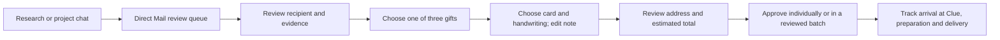

# Direct Mail customer experience

## Revision 2 — campaign context and customer feedback (2026-10-25)

Founder requested a recipient-level project table connecting gifts, notes,
microsites, LinkedIn ads and email; richer evidence and product links; reusable
notes; QR destination status; and chronological fulfillment. Preserve this
document's existing customer-only and frontend-only boundaries.

Confirmed budget correction: project gifting preferences guide recommendations,
can be locked and deliberately amended, and reserve no money. A preferred
$50–$100 gift range with a $120 hard ceiling is an example, not a universal
default. Search permission is separate from approval to send. Show gift cost,
tax, inbound delivery, preparation and outbound delivery together at approval.
Builder ruling: label the search ceiling explicitly as gift price; retain the
separate all-in mailer spending limit. Never increase it silently. Mock gifting
credits are separate from subscription credits; approval deducts the approved
estimate once. Actual-cost settlement and amounts above the approved total need
a later explicit approval contract; no real payments are introduced here.

Use one project campaign table, grouping recipient records under their existing
project/account/contact identity. Cells link to canonical assets and mailers;
missing channel references stay "Not linked". Email is only a reference, because
its implementation belongs to another branch. Do not infer account attribution
from unrelated Gallery items. Chat and Gallery open the same table.

The customer reviews agent-prepared details. Replace manual insight selection
with one feedback request; the eventual agent chooses whether existing research
is sufficient or a targeted refresh is needed. Preserve current drafts until a
replacement is accepted. Show source links and the note alongside the gift.
Note templates are reusable structures, with rendered recipient review required.
Changing a library template does not change an existing approved snapshot.

Keep preprinted card stock with unique durable QR URLs. During preparation Clue
binds a physical card to the mailer and approved microsite, then verifies the
redirect and recipient pairing before dispatch. Customer UI shows destination,
assignment and verification separately; no warehouse console or manual customer
scan step. A published page is not proof that its printed QR is connected.

Tracking shows Gift ordered → On its way to Clue → Received at Clue → Inspection
and preparation → Shipped to recipient → Delivered. Inspection, handwritten card
and repacking are explicit preparation activities. Future milestones are pending,
not completed. Package photos carry dates. No extra routine dispatch approval.

Pilot examples use exact final-sheet notes and purchased variants, with source
references. Earlier ideas may differ from final purchases. Private pilot data
stays outside tracked source and is loaded only through the local preview seam;
synthetic fixtures remain portable. Merchant images must match the linked variant;
missing or unverified images remain explicit rather than using unrelated photos.

Status: first customer UI implemented on 2026-10-25 with an isolated local adapter.
See [the implementation and backend handoff](../api-contracts/direct-mail.md) for
the exact working scope and remaining integration slices. The decisions
marked confirmed below were agreed with the founder on 2026-10-24.
Branch: `feat/direct-mail-infrastructure-ui`.

## Purpose and confirmed decisions

Turn the manual gifting pilot into a customer experience in the existing Clue
frontend. A customer can understand why a gift fits a recipient, choose one of
three agent recommendations, prepare the card, approve the mailer, and follow
its journey through Clue to the recipient. The same experience must support
one recipient and a reviewed batch.

Confirmed:

- Customer-facing screens only. Fulfillment operations appear as tracking
  events and photos; no warehouse/operator console is in scope.
- A dedicated Direct Mail sidebar section, linked from project chat and Gallery.
  Those entry points open the same mailer record.
- The agent proposes three gift options per recipient. The customer chooses.
- Reusable uploaded card designs, multiple handwriting styles/fonts, editable
  notes and a preview are part of the experience.
- Individual review plus bulk approval.
- Gifts arrive at Clue first. Clue checks, repackages and adds the handwritten
  card, then ships through an outbound carrier.
- Dispatch follows Clue's quality check automatically. Customers see package
  photos in tracking; there is no second customer approval for routine dispatch.
- Build in `apps/frontend`, using the real application shell and design system.
  Use explicit mock adapters for this phase, with no live ordering or fulfillment.
- Preview on port 5000. Do not use or restart any 3000-series instance.

This is production frontend source under development, not a separate demo app.
The hosted production app is unchanged until the branch is merged and deployed.

## Approaches considered

| Approach | Tradeoff | Decision |
| --- | --- | --- |
| Dedicated Direct Mail section, with chat/Gallery links | Supports a workspace-wide review queue and shipment tracking; requires a shared record across entry points | Selected by the founder |
| Direct Mail only in each project's Gallery | Fits the existing split view, but makes cross-project batches and shipment follow-up harder | Not selected |
| Chat-only review first | Small initial surface, but decisions and tracking become difficult to find across many recipients | Not selected |

## Proposed screen flow

### 1. Direct Mail list

Use the existing application shell and a dense, readable table, with a gift
thumbnail in each row. One row is one recipient's mailer. Project and campaign
are filters, rather than competing navigation hierarchies. A project is the
ABM motion; a campaign is its direct-mail program.

Primary views: All, Needs review, In progress, Delivered. Show exceptions as
an actionable filter and a clear row status. The visible columns are recipient
and company, selected gift (or “Choose a gift”), project/campaign, status,
estimated total and delivery estimate. Expanded details carry the evidence,
cost breakdown and shipment history instead of making the table as wide as
the pilot Sheet.

Search, filters, sorting, visible-row selection, clear selected count, and
bulk actions use Clue's existing table/toolbar conventions. A “Start direct
mail” flow chooses existing project recipients and budget/card defaults, then
hands off to the simulated research state. It does not rediscover accounts.
Researching, no suitable insight and incomplete gift-options states are visible.

Builder proposal for campaign setup: choose a project, then an existing direct
mail campaign or “New campaign” with a name. Choose recipients from that
project and set per-recipient spending limits and optional card defaults.
This is a lightweight grouping step, not a new general campaign-management
module. The first implementation uses fixture project/recipient references;
it does not write campaign records into an existing backend.

### 2. Recipient review

Open a full review surface with back/next recipient controls. Preserve queue
filters and scroll position on return. Keep the recipient, company and current
stage visible throughout. Use four sections with a persistent package preview:

1. **Why this recipient:** account context, the relevant insight, dated source
   references and the agent's explanation. Separate replacing an insight from
   requesting different gifts; neither silently changes the recipient.
   “Find another insight” takes optional feedback and requests agent research.
   Keep the current proposal visible until a replacement is ready. The frontend
   simulates the pending/result states; it does not invent an editable source.
2. **Gift:** exactly three recommendation cards with product image, exact
   variant, merchant, observed price, availability, estimated arrival at Clue,
   and a brief rationale. One can be marked recommended; none is silently
   selected or approved. “Request different gifts” preserves the chosen insight.
3. **Card & note:** choose a saved card and handwriting style, edit the message,
   and see the card update immediately. Show front and writing-side previews,
   readable zoom, text-fit feedback and a sender signature. Keep customer edits
   until explicitly replaced. Changing gift/recipient invalidates the prior
   note review so a mismatched card cannot quietly pass through.
4. **Review:** selected gift/variant, final note/card/style, intended recipient,
   receiving address and estimated full cost. Clearly separate gift price,
   inbound shipping/tax, card/preparation and outbound shipping. Unknown costs
   remain unknown, never zero. “Approve mailer” approves this exact version.

The preview represents the proposed gift and card. Later fulfillment photos
show the actual prepared package in a separate, dated area. Do not present a
product listing image or a simulated composite as a real inspection photo.

### 3. Cards & handwriting

An area within Direct Mail holds reusable card designs and handwriting styles.
Upload a card, name it, preview its sides, and set the writing area's bounds.
Select a supplied or uploaded handwriting font with an actual text sample.
Campaign defaults can prefill a draft; each recipient can override them.

Proposed first implementation: image card backgrounds (PNG/JPEG) and browser
font files (TTF/OTF/WOFF/WOFF2), with file validation, progress/error states and
local preview. PDF ingestion and font-to-robot conversion are later integration
work. These are builder scope choices for review, not pilot requirements.
Browser rendering is not proof of robot handwriting or print production
readiness. The future adapter must carry production eligibility separately.

Card/font assets are versioned references. Editing a library item must not
change an approved or ordered mailer. Record each mailer's selected asset
versions and a note snapshot. Any linked landing page/QR has its own connection
state; a saved design does not imply a published or correctly routed page.

### 4. Tracking

Each mailer has a readable timeline, current stage, last update, expected next
event, and exceptions with an action when one is available.

| Milestone | Customer meaning |
| --- | --- |
| Approved | The customer approved the exact mailer; ordering has not yet been confirmed |
| Gift ordered | Merchant order confirmed; expected arrival is at Clue |
| On its way to Clue | Inbound carrier tracking is available |
| Arrived at Clue | Clue recorded receipt |
| Quality check | Clue checks the product/variant and condition |
| Preparing your package | Repackaging and handwritten card preparation |
| Ready to ship | Quality check passed and package prepared; label alone is not dispatch |
| Shipped | Outbound carrier handoff confirmed |
| Delivered | Carrier delivery to the destination; personal receipt is separate |

Keep inbound and outbound carriers, tracking links, dates and exceptions
distinct. Show dated preparation/package photos. “Delayed,” “Address needs
attention,” “Gift unavailable,” “Replacement needs approval,” “Returned” and
“Canceled” are supported states, not a generic failed percentage bar.

A changed product, variant or material cost requires a new customer decision;
the quality-check/automatic-dispatch agreement does not authorize substitutions.
Customer delivery updates display carrier events, not invented live movement.

## Review and approval at scale

Proposed approval contract for founder review: one approval covers the gift,
card, handwriting, note, intended receiving address and an explicit maximum
authorized total for that mailer. This total includes the full mailer, not just
the gift. Estimated line items are allowed when their total fits the cap;
unquoted/unknown costs, an unresolved receiving route, or a card/font awaiting
production eligibility prevent readiness. Show why and preserve the draft.
The backend must later enforce these constraints; local fixtures only model
the customer interaction and never authorize actual spending.

“Mark reviewed” records review of a complete draft without placing an order.
Bulk approval operates only on selected, reviewed, ready mailer versions.
It never chooses gifts for the customer or approves unread drafts. Show the
exact recipients, count and estimated total in the final batch confirmation.
Explain excluded/incomplete selections before submission; show per-mailer
success/refusal afterward. Retry failed items without reapproving successful ones.

Selection across pagination is explicit; “select visible” never means every
matching recipient. Gift, note, card, font, recipient, address or price changes
invalidate that version's review. Repeated submissions cannot create duplicate
approvals. After approval, editing a draft cannot rewrite the approved snapshot.
Cancellation is available only where the returned capabilities allow it.

Proposed replacement behavior: request three replacement choices, then reuse
the full review flow with the changed gift and any affected note/cost clearly
identified. Approval creates a new snapshot linked to the original; no silent
substitution. Declining leaves the mailer on hold, with cancellation available
only if supported. Refund execution and merchant dispute handling are outside
this frontend phase. This preserves the founder's three-choice requirement
without inventing a second approval experience.

Address review distinguishes a known office from evidence that the intended
recipient can receive there. Missing receiving information remains an action
item. The first frontend models correction and pending confirmation, without
sending actual address-request messages or looking up private home addresses.

## Chat, Gallery and research connections

Chat shows a compact recommendation/approval summary with “Review gifts” and
the current mailer state. Gallery can show a mailer preview card beside other
artifacts. Both open the canonical Direct Mail review record; neither keeps an
independent gift selection, approval or tracking state. Link back to its source
conversation and existing account/contact research.

Do not repurpose a website/ad design document as a physical order. Existing
Gallery's `direct-mail` collateral label is useful for discovery but is not an
order contract. Preserve canonical project/chat URLs; do not restore retired
`?artifact=` routing or create another research pipeline.

## Data boundary and Aryan's handoff

Create `src/features/direct-mail/{model,data,hooks,components}` following the
frontend architecture. Zod models validate data; repositories own reads and
mutations; controller hooks own interaction state; components receive typed
props/callbacks. No fetches, fixtures or environment decisions in presentation.

Proposed domain records: mailer with project/campaign/account/contact IDs;
insight references; three gift options and price observations; card/style asset
versions; note draft; receiving-address review; cost estimate; immutable review
and approval snapshots; two shipment legs; photos; activity events/capabilities.
The backend remains authoritative for money, policy, ordering and fulfillment.
No backend endpoint is assumed implemented by this design.

One explicit fixture adapter supplies synthetic recipients and scenarios, stores
local demo interactions across reloads, and exposes a reset. Document mock data
and scenario controls for developers; do not restore the floating preview badge
the founder removed. Local uploads stay local; no corpus data or credentials enter fixtures.
The live adapter must never fall back to fixtures on error. The frontend-only
delivery includes a proposed API contract, operation list, error/version rules
and a handoff guide showing exactly where Aryan swaps the adapter. Do not claim
the API is ratified until its gap review with Aryan/the founder.

Mock progression uses named scenarios, not timers that imply real work. Include
ready-for-review, incomplete research, unavailable option, note overflow, missing
address, approved, inbound delay, quality check, package prepared, shipped,
delivered, replacement and mixed-result bulk approval. Errors retain edits.

## Visual and interaction acceptance

Follow the reviewed Clue token/type/shell foundation in
[design-system-audit.md](design-system-audit.md). Use shared controls where they
match; resolve required button/font gaps deliberately before pixel acceptance.
No wholesale design-system rewrite. Desktop review is the primary composition;
smaller screens stack preview and editor while keeping actions reachable.

Verify keyboard selection/focus restoration, named controls, status text beyond
color, usable image fallbacks, upload validation, empty/loading/error states,
text overflow, bulk partial failure and shared-state consistency across all
entry points. Use meaningful model/controller tests and browser walks, then the
repo's design-system build, lint and production build gates.

## Pilot evidence and boundaries

Read the live [pilot Sheet](https://docs.google.com/spreadsheets/d/1UqR0Pr8fstCaA4TXJCCpt90P2ZjOOH8tfGHIflW2Kxs/edit?gid=1017182501#gid=1017182501)
metadata and bounded samples: `Final-tracking sheet!A1:AC8`, `Cards!A1:M4` and
`Gift Review (live)!A1:N4`. These demonstrate separate proposed/purchased gifts,
inbound delivery, note drafts, address evidence, allocated costs and QR state.
This is a workflow sample, not an audit of every recipient or current shipment.

Read selected material in place under
`/Users/shashank/Downloads/clue-training-corpus/`: README, executive summary,
gift/note/logistics analyses, feedback contradictions and platform spec. No
transcripts, datasets, personal addresses or raw records are copied into this
repo. Source instructions are historical pilot context, not current authority.
In particular, the old top-two recommendation and fixed Clue card wording do
not override the current three-option, multi-customer product requirements.
Pilot budget/category preferences are not universal platform policy.

The pilot exposed gift substitutions, overwritten note revisions, office versus
recipient uncertainty, and ambiguous completion states. The design responds
with versioned approval, separate evidence/cost fields, and two-leg tracking.

## Current preview and implementation boundary

The existing app runs at `http://localhost:5000` in this feature worktree.
The explicit local preview now includes the profile/Settings menu, composer
controls, synthetic Gallery documents and local document editing. Existing
Home, Accounts and project chat use their fixture adapters. The preview badge
was removed at the founder's request. See [local-preview.md](local-preview.md)
for startup and data boundaries. No backend, database migration, real order or
hosted deployment was started.

## Proposed build sequence

1. **Recipient review first:** implement one complete mailer using synthetic
   data, from the research explanation through three gift choices, live card
   preview, address/cost review and approval. Validate the visual composition
   before applying it to a whole queue.
2. **Direct Mail queue and navigation:** add the dedicated section, filters,
   recipient-to-recipient navigation, and chat/Gallery links to that same record.
   Add reviewed/ready selection and bulk approval after the individual flow works.
3. **Reusable cards and handwriting:** add the card/style library, local uploads,
   campaign defaults and per-recipient overrides. Preserve approved asset versions.
4. **Tracking and exceptions:** show both shipping legs, preparation/inspection
   photos and actions for delays, replacement review or missing receiving details.
5. **Production frontend polish and handoff:** validate loading/empty/error states,
   keyboard and responsive behavior, persistence, duplicate submissions and bulk
   partial failures. Deliver the proposed API contract and adapter map for Aryan.

The first reviewable slice is one customer journey, not isolated disconnected
screen mockups. All phases remain frontend-only until backend integration is
explicitly reviewed and authorized.

This document is the proposed full flow, not proof of implemented Direct Mail
screens. Next: founder review of this flow, implementation plan, then build and
verify one connected customer journey before expanding the scenario coverage.

The builder check identified readiness/cost scope, replacement handling,
insight replacement and campaign setup as consequential gaps. The proposals
above resolve each for review; they are not claimed as founder-approved policy.
