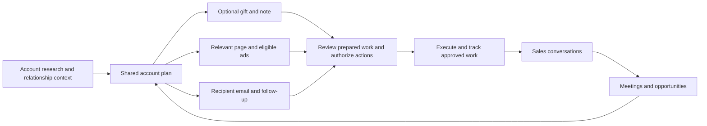

# ABM operating models and the proposed Clue experience

Status: **Research and product recommendation — not an approved implementation contract.**

Researched: 2026-10-25. Branch: feat/direct-mail-infrastructure-ui. No application, provider, purchasing, sending or deployment changes were made for this research.

## Recommendation

Make Clue the place where a team turns account understanding into a coordinated approach, reviews the prepared work, and follows the resulting conversations and opportunities. The central workspace should answer five questions: **why this account, who owns it, what are we doing, what needs my decision, and what happened?**

Direct Mail is one execution channel. It can lead the approach, join later, or be absent. The organizing object must include accounts without gifts. Marketing and sales should use the same account plan, with different default views and responsibilities.

The proposed value proposition is: **Clue researches the account, prepares a coherent outreach plan and its assets, and coordinates approved actions so the team can spend its attention on real buyer conversations.** This is a positioning hypothesis to validate, not a claim that these integrations already work.

The diagram shows linked responsibilities, not a requirement to activate every channel. Different accounts can take different paths within the same project.

## Evidence scope and limits

Reviewed current public product, pricing, help and customer material from Reachdesk, Sendoso, Demandbase, 6sense, Goody, Common Room, Unify and Marketer.com. Customer operating examples include Paycor, Verkada and Invoca. Inspected Marketer.com's public Home, Campaigns and Creatives demo visually; this was not access to its authenticated customer application.

Prices below are publicly displayed software prices or quoting structures on the research date. They are not negotiated quotes or all-in program costs. Customer stories are vendor-published examples, not independently controlled evidence of causal lift. No vendor accounts were connected, subscriptions purchased, or customer records uploaded.

## What the platforms actually organize

| Platform | Operating model observed | Useful lesson for Clue |
| --- | --- | --- |
| Reachdesk | Governed gifting across teams, regions, inventory and CRM workflows; marketing defines available programs and sales activates relevant sends. | Make a prepared program easy for a rep to use, with ownership and costs already understood. [Product](https://www.reachdesk.com/), [team permissions](https://support.reachdesk.com/hc/en-gb/articles/4405053015441-Manage-Teams-Users-and-Campaign-Access-in-Reachdesk) |
| Sendoso | Sending programs combine gift sourcing, fulfillment, integrations and spending controls. Its Send As workflow separates the initiating operator from the person presented to the recipient. | Operator, customer-facing sender and funding source are separate concepts. Preserve all three in the record. [Platform](https://www.sendoso.com/platform), [Send As](https://support.sendoso.com/hc/en-us/articles/29068597888411--Send-As-How-to-Send-on-Behalf-of-another-Sender) |
| Demandbase | Account and buying-group intelligence informs marketing/sales actions and journey measurement. Buying groups explicitly track personas, buying roles and engagement gaps. | An account's engaged champion is not the entire buying committee. Show uncovered roles and coordinated next actions. [Buying groups](https://support.demandbase.com/hc/en-us/articles/36786620946075-Understanding-Buying-Groups), [orchestration](https://www.demandbase.com/products/orchestration/) |
| 6sense | Account prioritization and buying-stage signals connect to marketing, sales and workflow capabilities. | Keep account readiness separate from a mailer's delivery status. An intent score is context for action, not proof that a person wants a gift. [ABM vocabulary](https://support.6sense.com/docs/6sense-product-glossary), [platform](https://6sense.com/platform/account-based-marketing) |
| Goody | A lightweight gifting entry point includes gift links, collections and recipient redemption; team features add budgets and CRM workflows. | Support both a known receiving address and a recipient-confirmation route. Customer selection among three suggestions and recipient gift choice are different workflows. [Pricing/features](https://www.ongoody.com/business/pricing), [sending guide](https://support.ongoody.com/en_us/send-a-business-gift-ryTr4aC2Wl) |
| Common Room | Buyer signals and identity/context feed research, prioritization and activation. | Explain why an account deserves attention now, including the source and confidence of the signal. [Signals](https://www.commonroom.io/product/signals/) |
| Unify | A Play joins a trigger to qualification, prospecting, ownership assignment, sequence enrollment and other actions. A sequence is the message cadence inside that wider workflow. | A reusable approach can coordinate several actions. Users should be able to describe the desired approach without constructing a node graph. [Plays documentation](https://support.unifygtm.com/articles/3322349425-getting-started-with-plays-features-and-tips) |
| Marketer.com | Public demo combines conversational work with persistent campaign and creative records. Its homepage describes previewed launches, approval controls and optional human creative/growth services. | Pair chat with inspectable records and prepared decisions. Do not treat a conversational interface as proof of autonomous execution. [Public product and demo](https://www.marketer.com/) |

AI access is already part of this category: Goody advertises Claude/ChatGPT access through MCP, and Sendoso's current plans include MCP and AI features. Sendoso's March 2026 Oso announcement describes conversational analytics at launch and action-taking as a direction of travel; it does not establish that every envisioned action is now shipped. Clue needs a stronger distinction than “gifting through chat”: grounded account reasoning, coordinated assets, reliable execution and a useful sales handoff. [Goody](https://www.ongoody.com/business/pricing), [Sendoso plans](https://www.sendoso.com/compare-plans), [Oso launch](https://www.sendoso.com/resources/blog/announcing-oso).

## How real teams use gifting

**Paycor — marketing-enabled sales activation.** Marketing preselects gift options. Reps insert gifts into their existing outreach through Reachdesk's extension; sending and engagement data help target the program. The story reports 44% more meetings booked, but its large “pipeline ROI” figure must not be presented as closed-won return. The design lesson is reduced rep effort plus useful context, rather than a standalone gift catalog. [Customer story](https://www.reachdesk.com/customers/paycor).

**Verkada — gifting can lead outbound.** A product-related building-block kit became a repeatable EMEA program. Clay-assisted qualification and address verification connected to Reachdesk; sends/redemptions were visible in Salesforce. Notes varied by industry and relationship stage, while specific prospect knowledge supported bespoke Amazon gifts. This is evidence for both repeatable cohort gifts and selective individual gifts, rather than requiring a unique product for every person. [Customer story](https://www.reachdesk.com/customers/verkada).

**Invoca — different sender and follow-up rules by relationship.** For the holiday acquisition program, marketing sent a gift-choice invitation and an SDR followed up at redemption. For contacts already in pipeline, the relationship-owning rep chose and personalized the send. The published case reports a 50% redemption-to-meeting rate for that holiday campaign; this is not a rate for every invited contact or a general forecast. Delivery created another possible touchpoint. Clue should make the event, owner and next action explicit. [Customer story](https://www.sendoso.com/success-stories/invoca).

These examples support several valid approaches:

| Approach | Starting condition | Role of the gift | What sales needs next |
| --- | --- | --- | --- |
| Gift-led prospecting | Strong account fit and a relevant reason to reach out | Open a conversation with a thoughtful physical touch | Context, approved follow-up and an accountable rep |
| Engagement-led outreach | Relevant first-party activity or a qualified inbound response | Optional additional touch for selected accounts | Evidence of the activity and a useful response |
| Opportunity acceleration | Existing relationship and a concrete buying obstacle | Support a workshop, champion or buying-group engagement | An action tied to the actual obstacle; not an automatic gift for every stalled deal |
| Event follow-through | Invitation, attendance or a substantive conversation | Invitation support, thank-you or continuation | Meeting notes and a distinct follow-up purpose |
| Customer expansion | Adoption milestone or evidence of another useful use case | Appreciation or relationship development where appropriate | Account history and a specific expansion hypothesis |

The last table is Clue's proposed synthesis, not a claim that every source implements every row. Gifting should have a reason and a follow-through plan. Acceptance does not oblige someone to meet, and a gift does not replace a credible business conversation.

## Public pricing and what it means

| Vendor | Verified public commercial structure | Comparison boundary |
| --- | --- | --- |
| Reachdesk | Plans start at **$20,000/year**. Core/Plus/Premium vary by seats, territories and fulfillment capacity. Separate swag sourcing has a **$2,500 minimum order**. | Starting subscription is not an all-in gift budget. [Pricing](https://www.reachdesk.com/pricing) |
| Sendoso | Current page lists Starter offerings, Core, Advanced and Enterprise; **no public dollar subscription price**. | Its terms separate platform/user license fees, a prepaid balance for send costs, and professional services. [Plans](https://www.sendoso.com/compare-plans), [billing structure](https://www.sendoso.com/terms) |
| Demandbase | **Custom quote**, with a platform fee plus a flat per-user fee. | Advertising and data have purchasing entry points; do not infer an all-in media budget from the software quote. [Pricing](https://www.demandbase.com/pricing/) |
| 6sense | Current Sales Intelligence pricing page presents three bundles and a demo request, with **no public dollar amounts**. | That page is not a priced Revenue Marketing offer. No reliable public ABM list price was established in this review. [Pricing](https://6sense.com/platform/sales/pricing/) |
| Goody | Starter **$0**; Pro **$20/user/month billed annually**; Team custom quote. | Free software does not mean free gifts. Team is a company-level package. [Pricing](https://www.ongoody.com/business/pricing) |
| Common Room | Essential **$2,500/month billed annually**, including five seats; higher tiers custom. | Research/prospecting allocations and add-ons affect scope. [Pricing](https://www.commonroom.io/pricing/) |
| Unify | Free; Base **$20/seat/month** and Pro **$60/seat/month**, billed monthly; Business custom annual. | The inspected page places signal-triggered automation in Business; the low seat price is not the full automation package. [Pricing](https://www.unifygtm.com/pricing) |
| Marketer.com | **Proposal based on scope**: platform, added team services and covered work. | Optional services change what the customer is buying. [Pricing explanation](https://www.marketer.com/#:~:text=What%20does%20it%20cost) |

These are different categories and service depths, not interchangeable price quotes. The buying alternatives range from inexpensive gift software to enterprise intelligence and orchestration. Clue should not justify its price merely by matching an enterprise vendor's entry price.

Recommended commercial separation for Clue, subject to a later pricing decision:

1. Platform subscription and explicitly bounded research/creation usage.
2. Gifts and fulfillment: product, inbound shipping, packaging, card/handwriting, outbound shipping, applicable tax/duties and any disclosed service fee.
3. Paid media budget, shown independently.
4. Optional human services, with a clear scope.

Keep the user's preferred gift range and ceiling as search guidance. Locking guidance does not reserve money. Show an itemized final send quote and the approval it requires. Do not hide an extra fulfillment margin inside a vaguely named credit. A small public software price may coexist with substantial product, shipping and service costs.

For product planning, track both customer all-in cost and Clue's actual contribution after sourcing, fulfillment, research and support. Price discovery should establish willingness to pay and operating cost; this research does not justify inventing a final Clue price or promising meetings.

## Project, campaign, account plan and ownership

Preserve the repository's [terminology ruling](../../../../docs/architecture/clue-hq-harness-architecture-and-requirements.md): **project = the end-to-end ABM motion; campaign = a channel program inside it**. External vendors use “campaign” differently; do not import their terminology wholesale.

| Object | Meaning in the proposed experience | Example |
| --- | --- | --- |
| Project | Shared goal, target accounts, budget guidance and team | Enterprise expansion — Q4 |
| Campaign | A channel program contributing to the project | Direct Mail: operations leaders; Email: workshop follow-up |
| Account | Canonical company and its research, relationships and opportunities | ExampleCo |
| Buying group | Relevant people and roles for the particular buying need | Champion, finance buyer, technical evaluator |
| Account plan | Project-specific view of the account's evidence, owners, approach, assets and next actions | Gift to one operator, useful proof for the evaluator, follow-up from the owner |
| Play / approach | Reusable coordination rules across channel programs | Gift-led introduction; event follow-through |
| Artifact | Versioned creative or content, with scope and publication state | Account page, ad variant, note layout, approved email draft |
| Execution | A specific send, publication, ad activation or scheduled action | Priya's mailer; a particular email enrollment |

“Account plan” and “play” are proposed views/models to reconcile with existing backend objects, not instructions to create competing account tables. A buying group is not necessarily the same across every opportunity at one company.

Separate responsibilities visibly:

| Responsibility | Purpose | Where visible |
| --- | --- | --- |
| Project owner | Accountable for the overall outcome | Project header |
| Campaign owner | Runs a specific channel program | Campaign summary; usually marketing/ABM, but assignable |
| Account owner | Coordinates the relationship and next sales action | Account rows, plan and inbox context |
| Sender | Identity the recipient sees | Note signature, email From, page rep block and booking destination |
| Approver | Authorizes the relevant content or spend | Review history with exact approved versions |
| Operator | Person or agent that performed an action | Activity/audit history |
| Funding source | Pays for the action | Cost review and ledger |

Example: Maya in marketing owns the project and direct-mail campaign; Alex owns West-region ExampleCo and appears as the sender. A different account routes to Jamie. Maya can prepare both packages and approve spend if authorized; each rep sees the relevant reply and next action. An action must not silently send as the logged-in marketer merely because they clicked the button.

Proposed assignment precedence: existing canonical/CRM relationship owner → explicit account override → configured territory rule → eligible round-robin fallback → unassigned exception. Preserve a reason and effective date. Territory routing belongs in reusable team settings, not on every gift form. Multiple collaborators are valid, but one accountable owner should be clear. Changing the owner must not rewrite historical senders or silently change an approved email identity.

Resolve conflicting CRM ownership and assignment authority before backend integration. CRM is an integration source; Clue's governed internal records and shared seams remain its application authority.

## The agentic experience

Three UI approaches were considered:

| Approach | Benefit | Problem |
| --- | --- | --- |
| Separate channel dashboards | Operational detail is easy to inspect | Users become the integration layer between screens |
| Chat alone | Natural briefing and revision | Hard to audit, compare recipients, recover context and manage exceptions |
| **Chat plus a shared account plan** | Natural delegation with inspectable work and state | Requires shared IDs, versioned assets and reliable event handling |

Recommend the third. The agent should do the preparation; the UI should make decisions and execution understandable.

### One coherent path

1. **Brief in project chat.** “Find suitable accounts for this offer and prepare a gift-led introduction. Use our existing owners and a $50–100 gift range, with a $120 gift ceiling.” The agent reuses approved product context, brand assets, team settings and preferences; it asks only about consequential missing or conflicting information.
2. **Prepare the account plan.** Research fit and timing, identify the relevant people, resolve ownership, and propose a reasoned approach. Explain what is known, inferred or still missing. A failed qualification should produce a recommendation to skip or investigate, not a fully decorated gift suggestion.
3. **Prepare the connected work.** For each eligible recipient, recommend three gifts, a note, appropriate card/handwriting, a page if useful, and the intended follow-up. For a different account, prepare a useful email or event approach without forcing a gift.
4. **Present a review package.** Show the account rationale, recipient, sender, selected gift, rendered note/page/email, itemized cost and the next action together. Defaults are already filled. Allow direct edits and conversational changes; do not require copying values between screens.
5. **Authorize external actions.** Preserve explicit final gift-spend approval and recipient-ready email approval. Users can review individuals and approve the ready batch. Report exactly what is approved and what remains blocked. A project budget or template approval alone does not authorize a purchase or newly generated email copy.
6. **Run approved work and handle exceptions.** Backend tools place and reconcile orders; fulfillment events drive tracking. Normal Clue quality checks lead to shipment without another routine customer approval. Show package photos. A substitution, changed spend, missing permission or changed rendered message returns only the affected action for review.
7. **Bring sales the conversation.** A real reply, confirmed gift acceptance or an approved delivery-follow-up condition produces the relevant next action for the owner. Show prior touches and an agent-prepared reply. Human replies stop the remaining automated follow-up; an uncertain classification can be held for review.
8. **Learn from outcomes.** Link meetings and CRM opportunity records back to the same account, project and executions. Propose changes based on evidence and coverage, not an unexplained success score.

Example agent update, with illustrative numbers only: “Six accounts are ready. Two need a receiving address and one is already in an active sales conversation. I prepared the gifts, notes and follow-ups for the six; review the $486 total. The other three are held with a proposed next action.” This reduces coordination work without concealing blocked recipients or approvals.

### What can happen without another question

| Work | Proposed authority |
| --- | --- |
| Read authorized context; perform bounded research; compare gifts; draft assets; run internal checks | Proceed inside agreed permissions and research limits |
| Assemble defaults, propose assignments and explain gaps | Prepare automatically; show consequential uncertainty |
| Purchase gifts, send recipient messages, publish pages or launch ads | Require the relevant concrete approval; allow one deliberate batch approval for reviewed items |
| Execute an unchanged approved schedule or respond to its approved trigger | Proceed after rechecking current eligibility; no duplicate approval for the same authorized work |
| Spend more, substitute a gift, change sender/content/destination or expand scope | Invalidate only the affected approval and request a specific decision |
| Routine fulfillment status, package photos and internal reporting | Update from evidence; no customer form to complete |

An agentic product does not mean every external action happens without consent. It means fewer instructions, less data entry and less coordination: the agent prepares, carries context forward and completes the authorized work. Removing approvals the founder explicitly requested would change the product policy, not just improve the interface.

The existing [agent runtime](../../../../docs/architecture/clue-hq-platform-agent-runtime.md) supplies the correct architecture: model judgment chooses work; typed, authorized, budgeted and journaled tools perform domain actions. Use durable jobs and events for long-running waits, idempotency and reconciliation. Do not depend on an open chat window, UI timers, browser automation of arbitrary merchants, or a second research store. Shared claims hold facts; scoped memory holds preferences. Keep design agents on the required solo path.

## Gifts, ads, pages and emails: connected without identical content

The shared account finding is the input. Each channel has a different job:

| Element | Typical scope | Job and connection |
| --- | --- | --- |
| Gift and note | Recipient | Thoughtful opening grounded in permitted, relevant context; identifies the sender |
| Gift-linked page | Account, persona or recipient | Delivers useful evidence or a concrete idea after the note; optional if it adds no value |
| LinkedIn ad | Eligible account audience or account group | Public business message and proof for a broader set of stakeholders |
| Ad landing page | Account group or account | Matches the ad's business promise; may share sections with the gift page |
| Email | Recipient and thread | A relevant introduction, follow-up or reply, with the actual sender and context |

A personal detail suitable for a private gift note should not automatically appear in an account-wide ad. A note may invite a scan; an ad may offer a useful account-relevant insight; both can support the same buying problem without using identical copy.

LinkedIn requires at least **300 member accounts** in an eligible ad-set audience. A large company might support a qualifying audience; a small company's handful of buying-group contacts might not. Clue should show eligibility and propose a suitable cohort or a different channel. It must not promise that a chosen individual saw an ad. [LinkedIn audience requirements](https://www.linkedin.com/help/linkedin/answer/a423690), [privacy explanation](https://www.linkedin.com/help/linkedin/answer/a7161764).

Keep pages in the existing canonical artifact/design system. A card links to a specific page/document version and published destination; it must not contain a disconnected copy of a URL with no ownership. Workspace Artifacts, project Gallery and the mailer are filtered views or references to the same asset.

Distinguish draft, approved, published and retired versions. Editing a draft must not silently change the live page used by an approved send. QR ownership, redirect activation, print assignment and successful destination verification are separate events. Before printing or dispatching a QR-bearing card, verify the actual destination and mapping through the eventual backend contract. Do not put private recipient details in public URLs or expose another account's variant through loose matching.

## Information architecture and page responsibilities

Keep the existing Clue design tokens, type scale, shell, tables, side panels and review controls. The change is in how records connect and what is emphasized, not a new visual identity.

| Surface | Default question it answers | Proposed content |
| --- | --- | --- |
| Home | What needs my attention? | Prepared decisions, incoming conversations and actionable exceptions; role-filtered, with clear ownership |
| Projects | How is this motion progressing? | Chat, account plan, Gallery and results; a concise goal/owner/budget summary |
| Accounts | What do we know and who is responsible? | Research, buying group, owner, active projects and conversation history |
| Direct Mail | What is ready or moving? | Review, approved/order progress, preparation, shipping and exceptions; open the same account context |
| Email | Who needs a response and what is scheduled? | Inbox, recipient review, scheduled work, sequences and execution history |
| Artifacts | Where is the actual asset used? | Canonical library with project, account, type, status and owner filters; reuse and usage links |
| Analytics | Is the work producing useful outcomes? | Progression, meetings, pipeline, costs and bottlenecks with source-aware drill-down |

These are workspace views; project tabs are scoped views of the same records. Keep the requested dedicated Direct Mail section. Avoid a separate top-level destination for every subordinate object such as cards, fonts, QR links, territories, templates and rules. Put reusable configuration in the relevant settings and context where needed.

Marketing's default queue should emphasize prepared campaigns, asset review, budget and coverage. A rep's queue should emphasize owned accounts, replies and next actions. RevOps configures connections, assignments, permissions and outcome mappings. All roles see the same facts; they should not maintain separate campaign copies.

### Email

Use the separately researched email direction as the dependency, not a duplicate feature implemented in this branch. That branch's canonical research is apps/frontend/docs/research/email-infrastructure.md (inspected read-only in the email worktree on 2026-10-25).

Support one-off compose as well as sequences. The message panel should show account/recipient, owner and authorized sender, the relevant prior touches, evidence, rendered copy and trigger. Keep recipient approval bound to the rendered version, sender, attachments and timing/trigger policy. Changes invalidate the affected approval. A validated delivery event satisfying an unchanged approved condition should not require reapproving the same email.

Replies route to the accountable rep, with collaborators visible. Stop/hold rules must cover human replies, opt-outs, bounces, out-of-office conditions, manual intervening messages, disconnected mailboxes, delivery exceptions and uncertain send outcomes. Marketing can understand campaign outcomes without automatically gaining access to every private mailbox thread. Provider authorization and sharing boundaries require explicit backend decisions.

### Artifacts

Default to grouped work, such as project → account → connected asset set. Offer a gallery for visual review and a table for status, ownership and use. Filters should include type, account, project, owner, approval and publication state.

An artifact detail should show why it exists, its current version, source brief, reviewer, linked executions, public destination where applicable and performance coverage. Preserve reusable master templates and derived account variants. A gift product/order is an execution record, while its note/card/page are creative assets; use links rather than forcing all of them into a single generic file type.

### Analytics

Lead with decisions and outcomes rather than decorative totals. Recommended top row: active target accounts, human conversations, meetings held, qualified opportunities, and actual spend. Meetings booked can be a separate precursor. Drill down by project, cohort, owner, territory, approach and channel.

| Layer | Measures | Accuracy boundary |
| --- | --- | --- |
| Coverage | Researched accounts, committee roles covered, qualified/rejected accounts | Explain scope; research completion is not account readiness |
| Preparation | Ready recipients, review backlog, missing addresses, unpublished pages | A prepared draft is not an executed touch |
| Execution | Orders, quality checks, shipments, provider submissions, failures | Merchant delivery to Clue is not customer delivery |
| Engagement | Confirmed acceptance, human replies, relevant page actions | Carrier delivery is not personal receipt; opens/clicks may be automated |
| Sales outcomes | Meetings booked and held, qualified opportunities, progression, wins | Link actual calendar/CRM evidence and avoid duplicate opportunity counts |
| Economics | Actual all-in spend, cost per held qualified meeting, pipeline associated with the program | Pending estimates differ from settled spend; association is not causal ROI |

Every rate needs a denominator, time window, cohort and source. For example: unique contacts with a human reply / unique contacts with a confirmed sent message in the cohort. For cost per meeting, state whether spend includes software allocation and human services. Missing CRM or calendar coverage should appear as “not connected” or “coverage incomplete,” not zero outcomes.

Campaign-associated pipeline can help operations, but should not all be credited to the gift or added across overlapping channel reports. Incrementality needs an appropriate comparison, such as a predeclared holdout or matched cohort with caveats. An agent can summarize observed bottlenecks and propose a test; it cannot turn uncertain attribution into proof.

## Marketer.com: specific design lessons

The public demo's Home centers a request and recent work. Campaigns uses a compact performance table; Creatives offers grid/table organization with preview, state and measures. These are useful references for chat plus persistent work and quick movement from overview to evidence. The sample focuses on ecommerce outcomes, so Clue should use buying-group and sales outcomes instead of copying its purchase/ROAS dashboard. Its site also describes human creative services and confirmation before launches. This review establishes public presentation, not authenticated product behavior. [Inspected reference](https://www.marketer.com/).

For Clue: one dominant next action, compact summaries, visible ownership/status, a contextual detail panel, and progressive disclosure of evidence and advanced settings. Avoid a workflow canvas as the required starting point. Avoid gradients, oversized metric cards, constant banners or an “agent activity” feed that substitutes animation for actual progress.

## Current branch gaps and the sustainable next slice

The current frontend provides the Direct Mail review/tracking foundation, but does not yet implement the system proposed above:

- The campaign-plan rows are derived from mailers, so accounts without gifts are absent.
- Mailer campaign is currently a string label, not a linked campaign with owner and policy.
- Sender signature is text; handwriting style names are not sales-rep identities. Territory routing and authorized sender resolution are not implemented.
- Asset/QR references are optional. The workspace artifact fixture adapter currently returns an empty library; the local pilot page reference is not a canonical generated artifact.
- Approval, credit and tracking behavior are local fixtures. This research adds no real research execution, ordering, email, ad activation, publishing, payment or CRM sync.

Sources in the repository: [Direct Mail architecture](../architecture/direct-mail.md), [API handoff](../api-contracts/direct-mail.md), [mailer schema](../../src/features/direct-mail/model/direct-mail.ts), [artifact repository](../../src/features/artifacts/data/artifact-library.repository.ts). The general [frontend seam](../architecture/frontend.md) remains domain/Zod models → repository adapters → hooks/controllers → presentation. Fixtures and HTTP must share that interface; do not hide mock values in components or fall back to fake success after a live error.

Recommended order, subject to design review before implementation:

1. **Make the account plan concrete.** One project, two sales owners, both gifted and non-gifted accounts, a visible reason for each approach, and coherent sender/owner context. Reuse existing research and account records.
2. **Connect one complete asset set.** Three gift choices, note, canonical page, relevant follow-up and optional eligible ad concept. The same record must open from chat, Gallery, Direct Mail and Artifacts. Include real-looking fictional fixtures with accurate mock labels in developer-facing documentation.
3. **Unify review and handoff.** A ready batch with exact cost/content approval, blocked exceptions, tracking and the sales next action. Coordinate the shared IDs and policy with the email branch; do not implement competing email contracts here.
4. **Add a modest outcome view.** Event-backed fixture data for human reply → meeting held → opportunity, plus realistic missing integrations, failures and zero outcomes. No invented performance proof.
5. **Reconcile backend contracts with Aryan.** Decide ownership authority, sender delegation, artifact/version references, execution events, approval scope, payment settlement, provider reconciliation and visibility. Only then wire the real tools and durable jobs one flow at a time.

Initial demonstration should include: a gift-led account; an email-led account with no gift; a marketing-owned campaign sent as two different reps; a missing-address hold; an ineligible one-account ad audience; a price/substitution change invalidating only the relevant approval; a live-page mismatch blocking QR release; and a human reply stopping a scheduled follow-up.

Do not begin with a new CRM, universal workflow builder, media-buying platform, warehouse console or dozens of asset-management screens. First demonstrate that one shared account plan can carry the complete conversation and execution history without losing ownership or context.

## Decisions still needed before integration

The next review should use the concrete slice above to settle three consequential questions: which canonical system governs account ownership conflicts; who may approve external actions on behalf of each rep/team; and which providers/events are available for the first real end-to-end connection. These need not become a long onboarding questionnaire for every user. Default the product from stored team policy and ask only when evidence leaves a meaningful gap.

No universal “gift first,” fixed follow-up delay, final Clue price, automatic-send permission or attribution model has been approved by this research.
