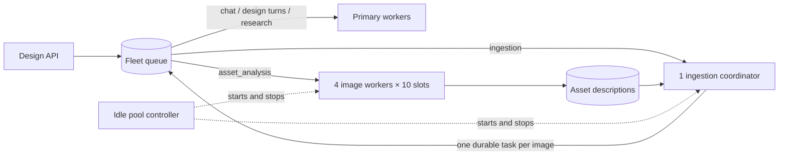

# On-demand brand-ingestion pool

Brand ingestion runs outside the primary fleet's chat, design-turn and research slots.
The same database queue, leases, blob storage and image analyzer are reused.

## Execution



The coordinator captures/parses sources, offers image tasks and collects results. It
has its own slot, so waiting for image tasks never occupies their capacity. Each image
task invokes the existing analyzer with concurrency one. The four image processes
provide forty image slots total, shared by this database's ingestion backlog. The
single coordinator currently advances one ingestion pipeline at a time.

The controller polls every two seconds. It starts the coordinator when an ingestion
is queued and the four image workers when image tasks appear. After sixty seconds
without queued or claimed ingestion/image tasks, it stops all execution children.
Only the controller remains idle; the next ingestion wakes execution again.

Required `kind` capabilities are checked in the atomic SQL claim and again in the
handlers. Primary/embedded design handlers accept only `agent_turn`/`web_turn`;
ingestion handlers accept only `ingestion`; image handlers accept only
`asset_analysis`. An unknown or missing kind stays unclaimed.

## Local commands

Use the workspace launcher, which loads its own database, Redis, storage and ports:

```sh
bash scripts/dev_stack_san_diego.sh up
bash scripts/dev_stack_san_diego.sh status
bash scripts/dev_stack_san_diego.sh restart-ingestion
bash scripts/dev_stack_san_diego.sh down
```

`restart-workers` restarts only the primary workers. When first adopting this change,
restart both the primary workers and the design API to load the new routing rules.
The controller opens no listening port. Its log is
`${DEV_STACK_LOG_PREFIX}_ingestion_pool.log`; child logs are `coordinator.log` and
`analysis.log` under `settings.effective_asset_store_root/ingestion-pool-logs/`.

| Setting | Default | Purpose |
| --- | --- | --- |
| `LUMEN_INGESTION_POOL_WORKERS` | `4` | Image worker processes per controller |
| `LUMEN_INGESTION_WORKER_CONCURRENCY` | `10` | Image tasks per worker |
| `LUMEN_INGESTION_POOL_IDLE_SECONDS` | `60` | Idle time before execution stops |
| `LUMEN_INGESTION_POOL_POLL_SECONDS` | `2` | Backlog and result polling interval |
| `LUMEN_INGESTION_DESCRIBE_CONCURRENCY` | `40` | Existing shared Redis annotation-provider cap |

The annotation-provider cap is independent of the worker count; lower values throttle
model requests below available worker slots. Model, retry and spend configuration are
unchanged. Every result remains linked to its asset and parent ingestion generation.

## Recovery and boundaries

One PostgreSQL session advisory lock elects the controller for a database. Children
are bounded and replaced after crashes with a short backoff. A controller failure
terminates its owned process groups; lease expiry makes unfinished tasks recoverable
when execution returns. Do not launch a second manual execution pool beside the local
controller: manually launched roles are intended for an external process supervisor.

Re-offering an image within the same parent generation does not duplicate its task.
Parent takeover creates new task identities; completed image fingerprints are reused.
Both the parent generation and the child's live lease fence every analysis write.
Terminal child failures settle the parent's progress and clear stranded analysis states.
There is no claim of exactly-once provider billing: a crash after a provider response
but before persistence can require another call on recovery.

These are separate local execution processes. They share the host, database, Redis,
storage and configured provider account. Hard CPU/memory and provider-quota isolation
requires separate deployment resources/quotas; this change does not provision cloud
machines. An external supervisor can run the same role entry points with its own
resource limits and replica count:

```sh
python -m lumen_api.ingestion_pool --role coordinator
python -m lumen_api.ingestion_pool --role analysis
```

Scope is the durable brand ingestion pipeline (website/PDF/ad assets and queued asset
enrichment). The legacy synchronous `POST /brand-kits/{id}/describe-assets` maintenance
endpoint retains its existing behavior and does not consume primary fleet slots. It is
not the normal ingestion path. Platform onboarding synthesis remains a primary agent
task; this pool owns brand capture and image analysis, not ICP/persona synthesis.

## Verification

`tests/design/test_ingestion_pool_db.py` uses four real OS processes and a forty-party
barrier in a mocked vision provider, with real queue claims, leases and description
persistence. It also verifies parent/child fencing and strict SQL routing. Unit tests
cover replay identity, terminal failures, bounded replacement, idle shutdown and wakeup.
Run these against a migrated throwaway database, never another workspace's database.
