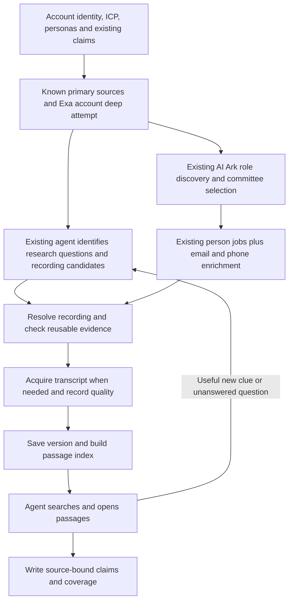

# ARV2 media discovery and reusable transcript research

**Status:** approved by founder 2026-09-22; offline implementation completed and verified; see the acceptance record. Live acceptance and activation remain separate.
**Date / inspected base:** 2026-09-22 / `99253e5d4`, Jerusalem v1.
**Implementation plan:** [ordered work and acceptance gates](../plans/2026-09-22-arv2-media-research.md).
**Depends on:** the locally implemented [AI Ark committee design](2026-09-22-arv2-ai-ark-committee-discovery-design.md), whose live acceptance remains separate.
**Founder update:** AI Ark v2 is now the default for new research launches. Build this media
feature on that updated flow only; preserve historical v1/v2 pins for replay.
The separate default change is committed locally as `b35dc49f2` (70 focused tests passed).

## 1. Outcome and authority

An account or person agent can find a relevant public recording from identity and research
context, consume its actual spoken material, investigate any part of the transcript, follow
useful new clues, and write claims citing the exact saved passage. Another authorized research
job can reuse that recording without paying to transcribe it again. The final research result
states what was searched, acquired, used, inaccessible, uncertain, or left unexplored.

The existing agent owns research questions, candidate relevance, follow-ups, and conclusions.
Tools own URL resolution, acquisition, storage, retrieval, evidence checks, and cost receipts.
No new media agent, scheduler, separate research pipeline, or child agent per search is added.
Source records and indexes are evidence infrastructure; domain findings remain claims.

The founder reviewed and approved this spec and plan, then authorized offline implementation
on 2026-09-22. Paid canaries, rollout and publishing remain separate. The v2 default-selector
change was authorized and committed independently; media v3 remains opt-in pending live review.

Binding foundations:

- [Doc A](../../architecture/clue-hq-platform-agent-runtime.md), especially the agent/tool
  distinction and source persistence before a receipt reaches a model.
- [Shared seams](../../specs/_conventions.md): claim ownership, storage, provider isolation,
  identity, tenancy, and no duplication of shared mechanisms.
- [ARV2 master plan](../../specs/ARV2-MASTER-PLAN.md) and
  [R2 stop ruling](../plans/2026-09-08-arv2-r2-account-agent.md): annotations rather than new
  quality vetoes; no new total-call, monetary, or consecutive-zero-yield caps.
- Existing sensitivity/use restrictions, identity requirements for personal voice, paid-call
  failure semantics, media-seconds ceiling, runtime limits, and person media allowance.

The proposed changes to previous media decisions are explicit: implement direct public YouTube
ingestion through the native Gemini adapter; replace blanket domain-search prohibitions with
contextual identity checks; count substantive media items rather than empty page results;
introduce reusable transcripts and transcript-aware evidence. Historical catalog bytes remain
immutable. The master plan receives an activation-scoped supersession during implementation,
not a statement that this capability is already live.

## 2. Verified starting state and traceability

Paths below are relative to `platform/api/clue_api/arv2/` unless stated otherwise.

| ID | Verified gap | Required result | Acceptance |
| --- | --- | --- | --- |
| G01 | `account_research_tools._youtube_hop` reads metadata and indexed page words only; v1/v2 dossier instructions promise transcription fallback. | Acquire a transcript or report the actual unavailable/partial state. | A01, A02 |
| G02 | `ReadMediaFeedsArgs` needs an RSS/watch URL; there is no episode-page resolver. | Resolve supported public landing pages, feeds, enclosures and YouTube aliases. | A03, A04 |
| G03 | Episode title/number matching misses description-only guests; a loaded feed with no episode stops alternates. | Evidence-backed candidate selection; continue viable alternatives on semantic no-match. | A04 |
| G04 | Six-search guidance and blanket domain bans do not establish adaptive discovery. | Follow research gaps and discovered identity/channel clues; record concise reasons. | A05, A06 |
| G05 | Full transcript reaches a six-quote miner; agent gets only quotes and the first 4,000 characters. | Search and open any authorized passage with surrounding context. | A07, A08 |
| G06 | `embed_chunks` is called only by the provider test. | Production document/query embedding, stored index, retrieval, and lexical fallback. | A07, A09 |
| G07 | `detect_loops` is only called in tests. | Run and preserve transcript quality annotations after every acquisition/repair. | A10 |
| G08 | Media return removes the miner's verbatim/usable verdicts. | Keep qualifications end to end; source-reference structuring prevents relabeling. | A11 |
| G09 | Metadata-level speaker verification does not bind individual turns. | Separate appearance, speaker-turn attribution, timing and text quality. | A12 |
| G10 | Long ASR has no labels/timestamps; fresh quote mining sets timestamps to null. | Preserve real supplied timing, label model estimates, and allow untimed citations. | A12, A13 |
| G11 | `verify_links` checks media claims against web page text. | Verify against the pinned transcript version and offsets. | A11, A13 |
| G12 | No reusable media identity/index or cross-job acquisition owner. | One scoped acquisition, durable replay, version repair and erasure. | A14–A17 |
| G13 | Completion/appearance counts do not prove media coverage. | Stage-specific coverage and accurate final gaps. | A18, A19 |
| G14 | AI Ark behavior uses several literal `version == "v2"` branches. | New media catalog retains all v2 committee/enrichment/lifecycle behavior. | A20 |

The audit ran 208 existing offline tests successfully and reproduced three problems with
in-memory clients: an empty YouTube read wrote an appearance without transcribing; a quote
marked NOT_FOUND/unusable lost those markers on return; metadata alone verified an item.
Passing current tests therefore does not establish the desired new behavior.

PoC evidence is historical: direct video ingestion in
[z4a](../../../.context/arv2-one-account-aiark/z4a_gemini_youtube.py), contextual channel search in
[z4c](../../../.context/arv2-one-account-aiark/z4c_find_nick_video.py), page-to-RSS resolution in
[p2a](../../../.context/arv2-person-depth/p2a_resolve.py), and retrieval in
[z6](../../../.context/arv2-one-account-aiark/z6_embed_retrieval.py). The PoC used selected URLs,
contained a wrong-speaker video and a looping transcript, and its retrieval script referenced
the earlier transcript after a repair. It is an acceptance seed, not proof of autonomous recall.

## 3. First-release scope

### Included

- Discovery through the existing Exa search/contents adapters, including contextual domain or
  channel restrictions and links found by Exa deep research.
- Public YouTube watch/short/share/embed URLs normalized to a video ID; actual transcription
  through native Gemini when no usable source transcript is available.
- RSS/Atom podcast feeds, episode landing pages, Apple podcast lookup when resolvable, HTML
  alternate-feed/structured episode links, and verified public audio enclosures.
- Public webinar/talk pages when they expose a supported YouTube embed, source transcript,
  audio enclosure or direct downloadable audio/video. Direct files use validated MIME/duration
  and the existing media client where supported; inaccessible streaming-only players remain
  a precise coverage gap.
- Transcript quality annotations, versioned evidence, keyword and semantic search, larger
  passage reads, account/person reuse within the authorized workspace, and claim provenance.
- Backend progress/receipt information through current research state and finalization seams.

### Not included in this release

- Login, paywall, DRM or access-control bypass; LinkedIn/X native-video ingestion; private or
  unlisted YouTube; arbitrary browser playback/HLS/DASH capture; platform-wide social crawling.
- A YouTube Data API dependency, a separate vector database, raw-audio embeddings, new agent
  roles, automatic cross-workspace reuse, or visual-scene/slide analysis as a separate product.
- Rebuilding frontend screens, changing AI Ark committee selection or its email/phone policy,
  changing R4 account discovery, or rerunning every historical account.

Unsupported does not mean absent. Preserve the discovered URL, reason and alternate source
options in coverage. Add new host handling by adapter registration, not a second pipeline.

## 4. End-to-end research behavior



### 4.1 Account agent

1. Read the resolved company, pinned ICP/personas, client capabilities, existing claims and
   source inventory. Preserve own-site/ATS/free known-source work. A supplied usable recording
   may be consumed here; do not require a paid search to rediscover a known URL.
2. Attempt Exa account deep research using the existing retry/failure contract. Extract known
   recording URLs and new leaders, prior roles, channels, shows, initiatives and open questions.
3. Make an explicit media-planning pass after that attempt, even when it failed. Questions can
   concern operational constraints, evaluation behavior, priorities, contradictions or voice.
   ICP relevance guides selection but does not justify discarding contradictory material.
4. Search, inspect, read and investigate the most relevant candidates. Each follow-up carries a
   concise purpose and evidence references. Discovery may follow an established channel name
   rather than continue searching only the person's name.
5. Incorporate useful media findings into the account's normal structuring and finalization.
   AI Ark role discovery still follows the account deep attempt. Exhaustive media consumption
   is not a prerequisite for committee discovery or person fanout.

### 4.2 Person agent

Start from the v2 selected profile, identity lock, account claims, ICP/personas and independent
contact enrichment. Reuse relevant recording references from the account. Preserve the useful
initial search angles and one Exa person-depth call, but permit targeted searches of a verified
channel/show/domain. After Exa and after a useful transcript read, reconsider the remaining
questions and new clues. The existing agent makes these tool calls; no follow-up child is born.

Metadata mentioning a colleague, a channel belonging to a namesake, or a previous employer
does not establish the locked subject's voice. Record candidate identity assessments separately
from confirmed personal claims. An account interview can contain valuable company evidence
without supporting a named person's quote.

### 4.3 Stop and sequence semantics

There is no fixed opening-plus-two-round limit and no new total-call/spend/zero-yield cap.
The agent stops when remaining leads lack a useful research purpose, available sources are
exhausted, or existing runtime/media limits are reached. Preserve explicit unfinished questions.
Per-provider retries and one bounded transcript-repair attempt are local operation behavior,
not a new global research stopping rule.

The desired outcome is a better assembled dossier. Exa's standalone report is a separate
artifact: later media findings do not retroactively change it. Known source references may be
included in the initial Exa query; subsequent transcript evidence feeds the platform's synthesis.
Do not add another Exa deep call just because media revealed a new fact.

## 5. Agent-facing contracts

Four tools replace `read_media_feeds` on the new catalog only. Existing v1/v2 tools retain their
schemas. Reuse the underlying search/provider implementations; do not build a competing search
client. Extend `read_account_state` / `read_person_state` with a media section instead of adding
a fifth state tool. The internal ARV2 agents have no generic filesystem read tool; a raw artifact
path alone is not a usable handoff.

| Tool | Input owned by the agent | Server-resolved output |
| --- | --- | --- |
| `discover_media` | Research question, query, optional source-family/domain hints, known evidence refs, target refs within job scope. | Saved discovery ref; candidate refs with URLs, title, publisher/channel, date/duration when known, source/identity evidence, uncertainty, acquisition route, cursor for the saved results. |
| `read_media` | Candidate ref or known public URL, research purpose, episode hint if needed, alternatives, optional explicit repair of a returned version. | Item/version refs; acquisition and quality states; metadata, source-linked outline, available speaker/timing information, small passage preview, index status, attempts and spend/reuse receipt. |
| `search_transcripts` | Question/query; optional authorized item/entity refs; page size/cursor. | Passage refs, exact text, surrounding-turn pointers, relevance components, quality/attribution/timing, cited version and offsets, sources searched and index gaps. |
| `open_transcript` | Version/passage ref; segment cursor or character range; requested neighboring context. | Exact contiguous text with offsets and segment metadata; next/previous cursors; completeness and quality information. |

Rules common to all four:

- Workspace, job, account, resolved contact, authority and provider configuration come from the
  runtime. Agent-supplied names cannot repoint the job. Account targets must be valid related
  entities or explicitly unresolved source candidates; an unresolved name is never a contact ID.
- References are server-issued, workspace-checked and integrity-checked on every read. A guessed
  UUID is not authorization. Unknown/inaccessible/erased references never trigger an automatic
  provider purchase. Inputs and source text are untrusted data, never instructions.
- Results are paged against serialized UTF-8 size, proposed default 12 KiB, including envelope
  headroom. This is a new internal-tool sizing policy, not a claim that ARV2 already runs through
  the platform's 16 KiB governed-receipt validator. Preserve exact long passages across pages;
  never clip text and present the clipped text as complete evidence.
- Discovery cursors page the saved result set. They do not invent provider search pagination.
  Refining a query is a separate attributable provider call. Equal canonical queries in the same
  job reuse a result; changing the rationale alone does not buy another search.
- Query and outline summaries are advisory. Only source passages can back transcript evidence.
  The optional outline uses the existing structuring model, has its own receipt, and cannot
  prevent transcript reads/search if it fails. A segment directory is always available.

Illustrative passage receipt (strings below are explanatory placeholders):

```json
{
  "passage_ref": "server-issued reference",
  "transcript_version_ref": "immutable version reference",
  "text": "Exact stored words from the recording transcript.",
  "start_char": 8124,
  "end_char": 8173,
  "speaker": {"label": "S2", "entity_id": null, "status": "unresolved"},
  "timing": {"start_s": null, "end_s": null, "status": "unavailable"},
  "quality": {"text": "unassessed", "coverage": "partial", "flags": []},
  "source": {"url": "public recording URL", "published_at": null},
  "index_mode": "hybrid"
}
```

The example is a shape, not a fixture: implementation tests generate and validate real offsets.

## 6. Discovery and acquisition

### 6.1 Candidate identity and canonical recording

Use stable publisher identities where available: YouTube video ID; normalized feed identity plus
episode GUID; otherwise the verified enclosure/canonical URL. Normalize supported YouTube URL
forms and remove tracking parameters without removing parameters needed to identify an episode.
Do not merge recordings merely because their titles or guests match. RSS and YouTube copies
become aliases only with explicit cross-links, matching media content evidence, or a recorded
reviewed mapping. Otherwise two distinct recordings may legitimately remain distinct.

Save why a candidate belongs to this account/person, its discovery source, and any contrary
identity evidence. A quoted name or channel title alone is not sufficient. An excluded namesake
remains an exclusion/attempt record, never an appearance attributed to the target.

### 6.2 Episode-page resolver

Fetch a known page; inspect explicit RSS/Atom links, structured episode metadata, supported
embeds and direct media links. Use Apple's public lookup for a valid podcast ID when necessary.
For Spotify and publisher pages, follow available public feed/enclosure metadata; there is no
promise that every landing page exposes playable audio. Host-specific transformations must be
registered and tested against actual source evidence, not guessed string substitutions.

Prefer exact episode GUID/canonical URL, then exact episode number, then title/description
evidence with date/guest context. A unique title-fragment match is usable; multiple plausible
episodes return candidates for the agent to choose. Do not revive the PoC's highest-keyword-score
matcher. A description-only guest is a valid discovery candidate, not automatic voice proof.

Try supplied alternatives after unreadable sources, loaded feeds with no matching episode,
empty indexed text, and unsupported acquisition routes. A provider-wide auth/credit/unknown-spend
failure halts affected paid calls; a forbidden host stays forbidden. Preserve every attempt and
distinguish an alternate upload from an unrelated replacement episode.

### 6.3 Acquisition order

1. Reuse an authorized, available transcript version for the canonical recording.
2. Use an explicit publisher transcript/caption file when the fetched content is actually a
   transcript, and record its origin/completeness. HTML descriptions and page chrome are page
   evidence, not a transcript merely because they came from a watch URL. Text with uncertain
   completeness remains partial and may justify acquisition of the recording.
3. Prefer a verified audio enclosure for spoken-content research when available. Route short
   and long audio using the existing threshold and configured media models.
4. For public YouTube, pass the URL through the native Gemini media adapter. This adds a narrow
   native-video exception beside the existing native long-ASR exception; embedding and ordinary
   text calls keep their current OpenRouter route. Record the exact model/endpoint/prompt.
5. For a direct public audio/video file, validate the fetch and process only supported MIME
   types. Public embedded pages use their supported underlying source. Streaming-only or
   inaccessible players return an honest unsupported/unavailable result with useful metadata.

Retain the existing 200 MiB download limit, 600-second short-audio threshold and 9,000-second
per-job media ceiling unless deliberately changed later. Measure/validate duration instead of
guessing a cheap default. Unknown duration is resolved via metadata/probe before paid dispatch;
an unresolved duration returns a typed gap. Persist reservations against the owning job so a
restart cannot reset spent duration. Reuse and retrieval consume no transcription seconds.

The existing person allowance remains three distinct substantive recordings by default. Empty
pages, source-resolution failures and mere appearance claims consume no item slot. Reserve a
slot before paid acquisition, settle it when content exists, and release known pre-content
failures; uncertain dispatch retains a reservation. Reading/reusing the same recording again
does not take another slot; reusing a new recording counts once toward this job's selection
allowance but costs no transcription. Transcribed yet unverified/suspect content still counts:
the allowance must not become unlimited paid retries. Account jobs retain their existing policy.

Use the established URL-fetch safety seam: validate redirects, block private/local destinations,
bound downloads and parsing, reject credentials in supplied URLs, disable XML external entities,
and revalidate derived enclosure URLs. Never invent a second permissive network client.

## 7. Transcript fidelity, attribution and repair

Persist provider raw responses through the existing artifact/ledger path. Produce an immutable
canonical transcript text artifact and a segment metadata artifact. Offsets are zero-based,
half-open Unicode code-point offsets into the exact stored text; UTF-8 hashes identify the bytes.
The canonicalizer's newline policy is versioned. No later whitespace cleanup changes offsets.
Keep source/provider text recoverable, and record the transform used to produce canonical text.

Three independent dimensions travel with every version and passage:

| Dimension | States / meaning |
| --- | --- |
| Text/coverage | Nonempty vs empty; full/partial/unknown coverage; loop report; truncation/finish reason; source/acquisition method. A clean detector does not prove ASR accuracy. |
| Speaker | Unknown label; named in metadata; speaker label inferred by model; evidence-backed binding of a particular turn to an entity; conflicting identity. Item-level appearance is separate. |
| Timing | Unavailable; model-estimated; supplied source timing; aligned timing if a future supported aligner exists. Exact text offsets always remain available. |

Run `detect_loops` after every transcription and repair. Preserve repeated passages and report
where they begin; also record empty output, provider truncation, missing sections and implausible
timing. These are source-quality annotations, not a new claim-store veto or a declaration that
the whole recording is false. The agent sees warnings on search results and reads.

For an obvious failed/looping/partial transcription, allow one explicit repair operation per
version. Reuse downloaded/uploaded source material where still accessible. Prefer the existing
dedicated ASR route for long audio; use supported video time ranges or segments only after their
wire contract is proven. A provider that cannot repair remains a named limitation. Store a new
version, never silently edit the earlier text. No unlimited model-switch/retry cascade.

Do not synthesize diarization from episode metadata. Where labels are missing, a contextual
attribution pass may propose a binding with supporting introduction/turn references, explicitly
marked as inferred. It cannot upgrade itself to source-confirmed attribution. Unresolved
speaker material can inform cautiously attributed recording/company findings; it cannot be
asserted as the named person's verified voice or turned into a safe personal opener.

Exact-substring verification establishes consistency with the saved transcript, not proof that
ASR perfectly captured the original audio. Keep that distinction in receipts and display data.
Untimed text can support claims. Preserve null timestamps; remove instructions demanding a
timestamp for every quote. Do not calculate playback time from character position or carry old
timestamps into a repaired transcript without alignment evidence.

The six-quote miner becomes an optional convenience built on stored passages, not the only
access to the transcript. Its candidates retain verbatim verdict, attribution, timing, quality,
why/topic and source refs. No intermediate return may strip these fields.

## 8. Evidence storage, reuse and lifecycle

### 8.1 Ownership and logical records

Reuse `StorageBackend`, content-addressed `artifact`, integrity checks, the provider ledger,
identity and claim writer. The following records hold media-specific provenance and derived
indexes; they do not replace the claim store or create a second object spine.

| Proposed record | Responsibility and key constraints |
| --- | --- |
| `arv2_media_item` | Workspace-scoped recording identity, canonical source type/key, metadata provenance, current transcript ref, erasure/expiry state. Unique `(workspace_id, source_type, source_key)`. |
| `arv2_media_alias` | Verified alternate URL/recording identifiers, evidence refs. Workspace-scoped uniqueness; merging aliases never discards acquisition history. |
| `arv2_media_transcript` | Immutable version, item/workspace FK, canonical and segment artifact refs/hashes, acquisition receipt, parser recipe, quality, supersedes ref, acquired/expiry times. |
| `arv2_media_index` | Transcript version + chunk/embedding contract fingerprint + generation, lexical/semantic readiness, operation refs. Unique active generation per contract; never mix versions. |
| `arv2_media_passage` | Rebuildable exact text/offset/speaker-range indexes, ordinal, lexical vector and optional embedding for one generation. FK to the scoped index/version. |
| `arv2_media_attempt` | Per-job research purpose, candidate/read/search/open outcome, source refs, authorized entity bindings, operation refs and stop reasons. No hidden chain of thought or second spend total. |
| `arv2_media_operation` | Shared source-level acquisition/index operation with owner, lease, request fingerprint, stages and durable artifact/ledger refs. Required because the existing operation key includes job ID. |

Use composite workspace foreign keys for references. Schema CHECKs admit only valid states,
valid offset ranges, and consistent timing pairs; erased/expired data is filtered before reads.
Text copied into a passage row is a disposable index verified against the canonical artifact.
Canonical source and transcript bytes have one durable owner, the artifact store.

Keep these modules inside the existing ARV2 research composition until a second real consumer
requires a shared library. Downstream content/design consumes claims and their evidence through
existing seams, never media tables or research internals.

### 8.2 Shared acquisition and crash behavior

Acquisition identity is `(workspace, canonical recording, source revision when known,
acquisition recipe/explicit repair generation)`, not person/job or a wording of the question.
Document embeddings additionally key on transcript hash and embedding contract. Questions and
project interpretations are not part of reusable source text.

Reserve an operation before paid dispatch. Persist stage receipts after fetch/upload/transcribe/
index separately, and make committed results readable before returning refs. Concurrent account
and person jobs attach to the same active owner; they receive `in_progress` plus a reference,
continue other research and revisit without buying again. The shared operation retains its
owner's spend attribution; consumer jobs record reuse, never another charge.

Reuse common lifecycle/fingerprint/artifact helpers from `research_operations.py`; preserve
AI Ark's narrower job-scoped authority. Do not weaken job checks to make cross-job reuse work,
and do not duplicate its state machine in an unrelated implementation.

If a worker dies after possible dispatch with no recoverable response, state is `unknown` and
there is no automatic redispatch. Lease expiry is not proof of no charge. Recover from a saved
response when possible, otherwise expose the gap. A claim-write or index failure after successful
transcription must replay the saved version, not reacquire audio. Late responses after erasure
remain inaccessible. Accounting always points to existing provider-ledger entries.

### 8.3 Scope, replacement and erasure

First-release reusable recordings are public sources stored within one workspace. Jobs may
share their source evidence, while research questions, role/persona interpretations and findings
retain project/subject scope. Search defaults to sources bound to this job's account/person
through inspected candidates or existing evidence; no implicit scan of every workspace transcript.
Private uploads and cross-workspace sharing are outside this release.

Reuse the existing 30-day personal-source retention default for raw media responses, canonical
transcripts, derived passages/embeddings and associated identifying metadata; preserve earlier
applicable expiry and stricter erasure rules. This proposed alignment is an engineering default,
not a statement that old research artifacts already follow it. Expiry makes evidence unavailable
and invalidates index access; it never leaves vectors or excerpt caches readable. A deliberate
new acquisition may refresh expired public evidence; erasure tombstones cannot be bypassed.

Register all recognized personal subjects, including excluded/unselected speakers, against raw
and derived artifacts using the identity/DSAR seam. Unknown speaker labels are not fabricated
identities. Do not bind the wrong speaker to the target to make indexing convenient. On erasure,
invalidate the whole containing recording/version when safe redaction cannot be established;
existing citations do not override privacy erasure. Purge derived rows/caches and physical blobs
through the two-phase cleanup path. Prevent reacquisition via canonical-source tombstones.
An expired claim can remain historical under the shared policy but cannot claim live evidence.

Repair creates a new transcript/version/index generation and atomically advances the default
current pointer. Old citations remain pinned to old text and are annotated `superseded_source` /
`needs_recheck`; they are never silently moved to new offsets. Default search uses the current
generation. Explicit historical reads require authority, availability and a visible stale flag.

## 9. Passage search and context access

Implement both lexical and semantic retrieval in Postgres, using the existing pgvector extension
and no external vector store. Start with exact vector ranking within the authorized media set;
add ANN indexes only when measured corpus size warrants them.

- Chunk at speaker/paragraph/sentence boundaries, targeting 400 tokens and at most 800, with
  up to 80 tokens of overlap. These are versioned recipe defaults, not research budget caps.
  Timestamp-free ASR uses sentence boundaries. An oversized single turn is split without loss.
  Preserve speaker transitions, exact character spans and neighboring segment refs.
- Embed transcript text only through the existing OpenRouter embedding client/model setting.
  Extend the client to embed explicit document chunks and queries; retire duplicate fixed-line
  chunking on the new path. Preserve old helper behavior for legacy callers.
- Pin model/route, returned dimensions, document/query formatting, normalization and recipe in
  the index contract. Request 768 dimensions initially. If unsupported, the adapter may use the
  existing fallback, but the served dimension creates its own compatible contract. Queries must
  match that contract; no padding, silent truncation, mixed model/dimension search or fake vectors.
- Verify the configured endpoint's document/query task support live. Native Gemini options
  must not be assumed available through OpenRouter. Where task types are unavailable, use a
  documented, tested text-format contract on both sides and record it in the fingerprint.
- Lexical search uses exact terms plus PostgreSQL text search; semantic search uses cosine
  similarity. Retrieve up to 20 candidates from each and fuse ranks with reciprocal-rank fusion
  (`k=60`), returning eight by default. Merge duplicate/overlapping hits without dropping offsets.
  Ranking parameters are versioned recipe data, not arbitrary model output.
- Apply workspace, authority, subject/source, erasure, expiry and current-version filters before
  ranking. Validate finite vectors, nonzero norms, batch sizes, dimensions and completion. Never
  mark a partially embedded corpus fully indexed. Index batches have individual replay receipts.
- Missing/failed embeddings return lexical results with `index_mode=lexical` and a named gap.
  Read/open tools still work when the embedding provider is unavailable. Query embeddings can be
  cached within the project/job and contract; never leak private query text across projects.
- Return exact passages and independent quality/attribution labels, not an answer fabricated
  from vector similarity. Preserve relevant contrary evidence. Open neighboring turns before
  interpreting a host's question, hypothetical example or another speaker's statement.

## 10. Claim creation and verification

Extend source inputs with a discriminated transcript-reference form. `structure_material` and
`write_claims` resolve its text, version, offsets, speaker and timing server-side. Agents may
request a subspan; code validates it against canonical text. Do not accept an arbitrary pasted
quote labeled by the caller as verified transcript evidence.

Use existing claim `artifact_key`, `evidence_span`, source URL and typed/versioned write markers
for transcript version, start/end offsets, speaker-binding refs, timing status and quality.
Add indexed lookup for transcript-version claim references so repair/erasure can find dependents.
No new domain fact store is introduced. Claim values still pass through existing sensitivity,
use-class, identity and lenient-write behavior.

`verify_links` dispatches by evidence kind. Web claims retain page checks; media claims resolve
their pinned artifact and compare the recorded span, offsets and attribution, without fetching
an episode's HTML or buying another transcription. Outcomes distinguish exact/partial/missing
text, unknown/conflicting speaker, estimated/missing timing, suspect/superseded transcript and
unavailable evidence. Missing audio access is not evidence that a quote was fabricated.

Quality findings remain annotations. Claims can be stored with deficiencies and uncertainty;
unverified personal voice is not marked outreach-safe. Existing sensitivity and identity/use
restrictions still govern hooks/openers. The deterministic tool must not override truthful
annotations because a model requests `usable=true` or provides a reassuring explanation.

Legacy media claims without a transcript reference return `transcript_reference_missing`;
do not pretend their episode page proves the spoken quotation. Optional historical backfill may
bind an existing saved artifact after integrity/identity checks, but never purchases missing
research or rewrites the answer-key files automatically.

## 11. Coverage, progress and failure semantics

Project receipts and existing state tools expose counts/references for discovered, excluded,
resolved, acquired, reused, searched and cited items; failed attempts and unanswered questions
are also represented. Human-facing text uses source titles and ordinary language, not internal IDs.
Do not equate a completed research job, an appearance claim, or six quotes with complete coverage.

| Outcome | Meaning / next action |
| --- | --- |
| `not_searched` | This source family/question was not investigated; never display no appearances. |
| `no_relevant_candidate` | Searches ran; none matched the relevant subject/question. |
| `identity_unresolved` / `identity_conflict` | Candidate exists; personal attribution is unresolved/excluded. |
| `no_episode_match` / `ambiguous_episode` | Feed loaded; try alternatives or choose a specific candidate. |
| `page_text_only` / `transcript_empty` | Source page was read; recording was not consumed. |
| `unsupported_source` / `source_unavailable` | Recording identified but acquisition is unsupported/inaccessible. |
| `acquisition_in_progress` / `dispatch_unknown` | Existing operation owns work; no duplicate paid request. |
| `transcript_partial` / `transcript_suspect` | Material exists with explicit quality limitations. |
| `transcript_ready` / `reused` | Available version; retrieval may separately be lexical-only. |
| `index_partial` / `embedding_unavailable` | Search coverage is limited; text/open access remains available. |
| `consumed_no_relevant_finding` / `used_in_claims` | Investigation occurred; evidence use is distinct from acquisition. |
| `media_limit_reached` / `runtime_ended` | Remaining candidates/questions were left open under existing limits. |
| `source_expired` / `source_erased` | Reuse is unavailable; erasure never causes automatic repurchase. |

Keep acquisition, index, attribution and research-use states separate fields, not one overloaded
enum or one success boolean. Provider transport outcomes remain provider outcomes.

## 12. Catalogs, settings and compatibility

Propose `arv2-account/v3` and `arv2-person/v3` as the next immutable bundles. v3 includes all v2
AI Ark behavior plus this media feature. Resolve explicit capabilities from catalog versions in
one reviewed map; replace scattered v2-equality checks without enabling unknown future versions.
Audit launch, tool menus, job composition, claim/seed writes, fanout, settlement, replay, privacy
and SQL profile predicates. New account jobs pin matching person resources. Old jobs resume their
original pins. Never reinterpret a v2 job as v3 because a default changed.

Keep `CLUE_ARV2_RESEARCH_CATALOG_VERSION=v2` during media implementation
and tests. Admit v3 in Settings when implemented; activate only via the existing selector after
its explicit live review. No separate media feature-flag matrix. Models remain env configuration,
not resource versions; recipe/provider contracts are recorded per acquisition/index for replay.

| Setting | Proposed treatment |
| --- | --- |
| Existing short/transcribe/embedding model settings | Keep current configured values; validate capabilities rather than assert a model name in tests. |
| `CLUE_ARV2_MEDIA_VIDEO_MODEL` | New native-video setting; proposed default `gemini-3.5-flash-lite`, matching historical PoC use, subject to exact-route canary. Never strip a provider prefix and assume equivalence. |
| Existing media duration, enclosure, person item, runtime/round settings | Retain values; fix durable accounting and empty-item semantics. |
| Chunk/search/receipt defaults | Versioned media recipe data; avoid adding environment variables for every constant. |

Any setting introduced in code must simultaneously appear in `.env.example`, load through
Settings, and preserve local `.env` values. Update the native-Gemini exception comment to include
video. No credentials, DSNs or machine-specific paths enter docs or recorded fixtures.

## 13. Acceptance contract

Offline contracts and live outcome evaluation are distinct. Use provider fixtures/saved source
material for deterministic behavior; a stub cannot establish provider support or discovery recall.

| ID | Required proof |
| --- | --- |
| A01 | Public YouTube source with no indexed transcript produces a real saved transcript through the supported route; citation opens the saved passage. |
| A02 | Empty/description-only YouTube text is not recorded as consumed speech and takes no completed-item slot; unavailable/private video has an honest gap. |
| A03 | Episode page → feed → exact episode → enclosure works without handing the agent an RSS URL. Supported direct-file/webinar embed routes share the same storage path. |
| A04 | Description-only guest, ambiguous episodes, wrong episode numbers, dead feed and loaded-no-match feed exercise selection/alternates without confident wrong matches. |
| A05 | Starting from Nick Fisher's identity, a newly discovered Cocktail Chemistry clue produces a justified follow-up; the wrong creator is excluded. No seeded recording URL. |
| A06 | At least three previously unseen, founder-selected subjects test discovery; no source found, namesake and multiple-speaker cases have accurate coverage. |
| A07 | Gold passages from the beginning, middle and final third are retrievable by exact and paraphrased questions. Hybrid Recall@8 ≥ 90% over at least 30 independently annotated questions. Report lexical-only comparison. |
| A08 | Passage reads retrieve surrounding dialogue and page through the entire source losslessly, including long turns and multibyte text. |
| A09 | Missing credentials, provider failure, partial batches and dimension/model mismatch preserve lexical/open access and never silently compare incompatible vectors. |
| A10 | Saved looping Sanaz transcript triggers a runtime annotation; repaired text creates a new version; current retrieval stops serving old chunks. A non-looping truncated transcript remains partial. |
| A11 | NOT_FOUND/unusable quote qualifications survive every tool/structuring/write/audit boundary. Exact spans are checked against the saved version, not episode HTML. |
| A12 | Host, colleague, namesake, metadata-only identity and unlabeled-ASR cases never become verified personal voice. Source-confirmed and model-inferred bindings remain distinguishable. |
| A13 | Untimed transcripts yield null times; source times survive; model estimates are labeled; repairs never inherit fabricated timing. All evidence offsets resolve exactly. |
| A14 | Concurrent account/person requests for one recording make one acquisition; restart before/after each paid stage and after claim-write failure causes no automatic duplicate spend. |
| A15 | Same-workspace source reuse preserves separate project findings; cross-workspace, out-of-scope, forged and erased refs fail without leaking text or calling a provider. |
| A16 | DSAR/expiry removes raw, canonical, vector, lexical, excerpt and cached access, including late responses and multi-person recordings; canonical-source tombstones prevent reacquisition after erasure. |
| A17 | Repair marks dependent claims for recheck while retaining immutable old citations; old-version access is explicit and unavailable after expiry/erasure. |
| A18 | Finalization separately reports unsearched, inaccessible, unresolved, consumed-empty and used sources; exhausted limits never claim exhaustive research. |
| A19 | Compare current v2 vs new media-enabled research on the same frozen identities/context: account/company findings, personal findings, supported novelty, wrong attribution, latency and provider cost. |
| A20 | v1/v2 replay and v3 AI Ark discovery, exact company lock, saved-profile handoff, independent email/phone enrichment and erasure all remain correct. |

Deterministic integrity/authorization cases require 100% pass. Live acceptance requires zero
known wrong-person voice attributions or fabricated timestamps in the reviewed sample, and
source-backed findings from previously inaccessible transcript sections on at least two known
media-rich subjects. Those findings must matter to an actual research question, not just inflate
claim counts. Small-sample success is coverage evidence, not a completeness guarantee.

Freeze an evaluation manifest containing current source availability, public recording identity,
context/model/catalog pins, independently reviewed passage/attribution expectations and costs.
Separate tests that supply a recording from tests requiring autonomous discovery. Run the
current baseline first; save all failures and negative cases. User-triggered live canaries cover
Probook/Zafran where suitable, Nick/Sanaz known cases, and unseen subjects without seeded URLs.

## 14. Provider facts and open validation

Official documentation reviewed 2026-09-22:

- [Gemini video understanding](https://ai.google.dev/gemini-api/docs/video-understanding)
  documents public YouTube URL input, currently a preview feature. This supports the route,
  not a guarantee that every video/model/endpoint combination works. Exact configured-route,
  long-video completeness, timestamps and cost behavior require recorded canaries.
- [YouTube captions.download](https://developers.google.com/youtube/v3/docs/captions/download)
  requires permission to edit the video. It is not the general public-transcript fallback.
- [Gemini embeddings](https://ai.google.dev/gemini-api/docs/embeddings) documents output
  dimensions and retrieval use. OpenRouter task/dimension support must be checked independently;
  the adapter cannot assume native API options are forwarded unchanged.

The PoC's video/audio cost ratio is a historical measurement, not routing policy or a current
price guarantee. No paid contract probes ran while preparing this spec.

Review choices are concentrated in the scope and defaults above: public source coverage,
native-video exception/model proposal, workspace-only reuse, 30-day source retention, item-count
semantics, attribution labels and the acceptance targets. They do not reopen the approved
AI Ark email/phone or Exa-failure-continuation decisions. A provider limitation discovered during
implementation must be recorded with its effect on scope before claiming the relevant case done.


## Approved implementation record (2026-09-22)

The founder authorized offline implementation of this spec and its plan after review. The base
is `79520ffca`, pulled and already current. Default catalog remains v2 until explicit live review.
Only v3 supersedes legacy fixed-six person sweeps, blanket domain restrictions, indexed-text-only
YouTube handling, excerpt-only transcript access and mandatory/inferred timestamps. AI Ark v2
company locks, SMART discovery, work-email/phone channels, seed reuse and Exa-failure continuation
remain binding. Old v1/v2 resource bytes remain unchanged.

Implementation detail: the first chunk recipe uses a deterministic conservative UTF-8 byte
bound (target 400, maximum 800, overlap 80), which also bounds byte-fallback token counts.
This produces smaller passages than the proposed 400-token target and avoids a tokenizer's
runtime download dependency. Exact offsets/full-source paging remain lossless. The recipe is
part of the embedding contract and changing it creates a new index generation; the final
Recall@8 target still requires the independently annotated live acceptance set.

Native-video metering records provider usage and reserved seconds with an explicit
`usd_unpriced` qualification. The audio PoC price is not reused as a video price. Current billed
USD reconciliation remains a live acceptance requirement before activating v3.

Offline implementation: `5d90cdbe3`; see the [acceptance record](../plans/2026-09-22-arv2-media-acceptance.md)
for measured checks and outstanding live-provider/research-quality acceptance.
