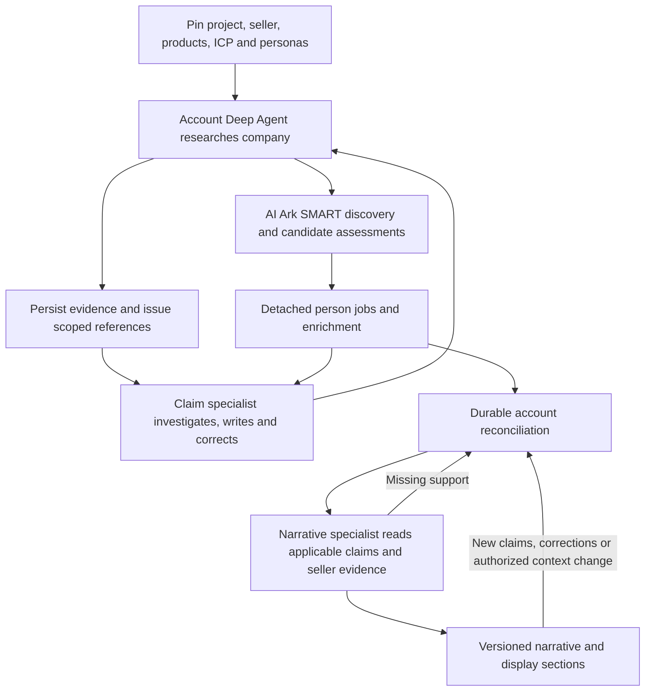

# ARV3 research quality, evidence access and specialist ownership

**Status:** design and implementation plan authorized by the founder 2026-09-22; implementation
in progress. New-profile activation and offline/live acceptance are tracked separately in the plan.
**Date / inspected checkout:** 2026-09-22, `codex/ai-ark-committee-discovery-spec`, `2dd07c55f`.
**Implementation sequence:** [companion plan](../plans/2026-09-22-arv3-research-quality.md).

## 1. Outcome and authority

An account's research must preserve useful findings, attribute them correctly, resolve or expose
contradictions, and explain why the selected seller products matter. A completed job is an
execution result; a trustworthy dossier additionally requires valid evidence, coherent committee
membership, the right project context and current presentation.

Keep the implemented v3 acquisition tools, including v2 AI Ark committee discovery. Give the
per-account agent responsibility for the research outcome, with a claim specialist and a narrative
specialist. Tools and the existing substrates enforce scope, provenance, corrections and replay.
Person research remains detached fleet work; it uses the same claim-specialist capability.

### 1.1 Founder direction captured

- Build on the current v3 flow and retain company-bound AI Ark SMART role discovery, work-email
  and phone enrichment, and continuation with a recorded gap after exhausted Exa research failure.
- Support both the project's exact brand ICP pin and a project-authored ICP variant. Personas
  may likewise come from brand context or a project-specific variant. Scope and lineage must survive.
- Use adaptive briefs and specialist investigation, rather than a parent summary as a substitute
  for original evidence. Explain how this works for at least 50 accounts and multiple clients.
- Reconcile completed person research with committee membership and refresh presentation.
- Use location according to organizational structure and decision remit, not a blanket industry rule.
- Preserve repository logging, observability, tracing and telemetry. Test final behavior at coherent
  development boundaries; do not repeatedly repair tests for temporary intermediate behavior.
- The subsequent founder instruction authorizes implementation of this spec and plan. It does
  not promote the live default, run historical repairs or start another paid research run.

### 1.2 Policy decisions and proposed contract changes

The [ARV2 master plan](../../specs/ARV2-MASTER-PLAN.md) currently implements quality checks as
annotations that never block storage or a page. On 2026-09-22 the founder explicitly adopted
the factual-visibility change in item 1: retain invalid observations for audit, exclude them from
ordinary factual summaries, and keep unresolved findings visible. This resolves that policy decision;
it does not authorize application implementation or approve every remaining contract detail below.

1. **Adopted policy.** Preserve authorized, policy-permitted observations and failed drafts for inspection, but distinguish
   them from applicable factual claims. Invalid claims do not enter ordinary factual summaries;
   unresolved findings remain visible as uncertainty. A page can still render valid partial research.
2. Effective corrections change current reads and invalidate dependent narratives/pages.
3. Being a contact under an account with any live claim is insufficient to establish committee
   membership. Employment and committee relevance receive explicit, separate assessments.
4. Seller-specific presentation is project/context-specific, not one shared page per workspace/subject.
5. Proposed field definitions remain neutral and scoped; an agent cannot write subject-specific
   content into the shared global field catalog.

Privacy/use restrictions remain independent and mandatory. No new monetary, provider-call-count,
or zero-yield veto is introduced. Preserve current provider failure, spend accounting, authority,
runtime and media limits; any change to those limits needs its own explicit decision. Quality
judgment is not a request to persist hidden chain of thought: record concise decisions and evidence.

The master plan records this adoption as an activation-pending amendment. Existing profiles retain
their current behavior until implementation and explicit activation; preserve historical pins.

## 2. Evidence and verified starting state

The baseline is the [Premier v3 comparison](../plans/2026-09-22-arv3-premier-live-comparison.md),
the [cumulative review](../plans/2026-09-22-arv3-cumulative-quality-review.md), and the
[Probook/Zafran comparison](../plans/2026-09-22-arv3-live-poc-comparison.md). They are not a
controlled aggregate quality benchmark. Retained artifacts allow a controlled conversion replay.

| Finding | Required response |
| --- | --- |
| Display pairs Insight Health's name with the ABM platform pitch. | Pin seller/product evidence from the exact project; remove configuration fallback for the new profile. |
| ICP body version and document-row version differ; persona matching rejects the context. | Use document identities, digests and explicit lineage; never equate unrelated integer version counters. |
| Extractors receive selected blocks without access to complete reports. | Durable evidence index with complete originals and processing dispositions. |
| Catalog/context wording becomes source evidence; real quotes are assigned wrong meanings. | Typed evidence references plus field/entity/time/relationship assessment. |
| Correction prose leaves bad claims current. | Governed atomic correction, current-read exclusion and dependency invalidation. |
| Anna's employer conflict is found but she remains a champion in generated pages. | Separate identity, employment and committee judgments; durable reconciliation. |
| Media is acquired and searched but speaker attribution remains unverified. | Passage/turn attribution and quality preserved through claims and display. |
| Expired jobs become active buying signals. | Preserve source dates and distinguish historical listing from current opening. |
| Repeated company facts, large histories and repeated invented-reference errors. | Idempotent mapping, scoped reads, recoverable typed tools and durable bounded delegation. |

Verified code anchors (paths are relative to repository root):

- `platform/api/clue_api/arv2/account_research_agent.py` constructs `create_agent`; changing to
  the governed Deep Agent is a real runtime change.
- `research_context.py` in that directory selects personas by ICP key/front-matter version;
  `account_research_store.read_persona_documents` already limits candidates to brand plus this
  project, preferring project-local documents. Extend this, do not discard scope checks.
- `account_research_launch.py` reads `project_icp_pin` by exact document identity and pins
  artifact bytes. `icp_authoring.py`/`icp_confirmation.py` already support project variants.
- `claim_writer.py`, `account_research_claims.py` and `structuring_client.py` implement lenient
  writes, direct-agent/provider mappings and annotation-only evidence checks. `corrects_claim_id`
  currently becomes a marker; it is not the shared claim-store supersession operation.
- `display/gather.py::client_context` selects the workspace's first brand and a configured pitch.
  `committee_members` uses `contact_entity.account_entity_id` plus existence of live claims.
- `display/blocks.py` already stores superseded sections and detects several claim/prompt changes,
  but its live identity is workspace/subject/page/section, without project context.
- `libs/clue-storage/clue_storage/` already implements workspace-scoped content-addressed artifacts,
  verified reads, filesystem and S3-compatible backends, retention and erasure.
- `research_operations.py`, `provider_ledger.py` and `media_store.py` already persist operation,
  provider and transcript references. Reuse their identities and spending records.
- `platform/agents/clue_agents/runtime.py` and `platform/api/clue_api/specialist_wiring.py` provide
  governed Deep Agent construction, isolated children and `delegate_specialist`. The lockfile pins
  Deep Agents 0.6.12; verify the actual pinned interfaces during implementation.
- `subsystems/research/clue_research/claimstore/claims.py` already provides supersession and
  verification transitions. Extend the shared seam where necessary; do not hand-copy its SQL.

Binding foundations: [output contract](../../architecture/clue-hq-research-architecture-overview.md),
[Doc A delegation](../../architecture/clue-hq-platform-agent-runtime.md#23-subagent-contract-revised-2026-07-18),
[shared seams](../../specs/_conventions.md),
[project context/variants](2026-09-12-project-context-and-icp-authoring-design.md),
[AI Ark design](2026-09-22-arv2-ai-ark-committee-discovery-design.md), and
[media design](2026-09-22-arv2-media-research-design.md).
The newer automatic-targeting ruling in the [projects contract](../../../apps/frontend/docs/api-contracts/projects.md)
remains in force: this spec does not reintroduce a mandatory human confirmation card for every pin.

## 3. Responsibility and end-to-end flow

| Component | Owns | Does not own |
| --- | --- | --- |
| Account Deep Agent | Adaptive research brief; company research; role planning; committee selection; follow-up; reconciliation; final account assessment. | Direct SQL, unchecked provider/model access, or overriding scope/privacy rules. |
| Person research agent | One person's identity/employment investigation, professional research, media and channel enrichment; structured return to the account generation. | Declaring an unresolved employer relationship confirmed for convenience. |
| Claim specialist | Source investigation, typed proposals, semantic assessment, corrections, conflicts and coverage disposition. Shared by account and person jobs. | Discovering arbitrary new accounts or changing seller/project pins. |
| Narrative specialist | Evidence-backed value narrative and page content against a pinned applicable-claim set and seller context; missing-support requests. | Creating account facts in prose or silently replacing claim research. |
| Tools/substrates | Authorization, durable state, exact evidence resolution, checks, writes, idempotency, scheduling, current reads and invalidation. | Choosing a research thesis or inventing missing facts. |



The arrows between domain work represent tool calls and stored references, not private prose
handoffs or subsystem imports. Intermediate account summaries may appear while people run, clearly
marked provisional. The final assessment accounts for completed, failed, suspended and unprocessed
work; partial completion is a legitimate result with explicit gaps.

## 4. Exact project context, including variants

### 4.1 ResearchContextPin

Persist one immutable context manifest per distinct research launch context, referenced by all
account/person/specialist work in that run. It includes:

| Part | Required identity |
| --- | --- |
| Scope | `workspace_id`, `brand_id`, `project_id`; authenticated authority, never model-selected scope. |
| Seller | Exact brand/seller entity plus selected company/product knowledge document IDs, versions, artifact keys and digests. |
| Product selection | Existing selection version and selected product IDs; snapshot product descriptions/capability evidence, not names alone. |
| ICP | Project pin ID, exact document ID, document-row version, key, artifact/digest, `scope=brand|project`, owning project if any. |
| ICP ancestry | `derived_from_document_id` when present; ancestry is informative, not an instruction to substitute the parent. |
| Personas | Explicit document pins with the same scope/version/digest fields and exact source-ICP lineage, or a typed missing/mismatch state. A document may contain multiple personas. |
| Runtime | Immutable role/skill/prompt/catalog/policy refs and digests; actual model settings journaled per execution. |

The launch's manifest has a stable ID/digest; account identity remains a per-account grant rather
than duplicating the seller bundle 50 times. An adaptive brief references this manifest and evidence
IDs; its narrative is guidance, never new source evidence.

### 4.2 Resolution rules

1. Resolve the current authorized project pin through the existing targeting path. Read its exact
   document even if a newer brand document exists. A project-local variant is a full independent
   document with its own key; do not merge the brand parent into it implicitly.
2. Validate workspace, brand and project containment. A different project's document is never a
   candidate even when it has the same name or key.
3. If an explicit persona selection exists for the project, preserve that exact selection. Otherwise
   select an unambiguous compatible project-local persona set first, then a compatible brand set,
   and freeze the selection at launch. Conflicting equally eligible sets return an ambiguity gap.
4. Compatibility means exact source ICP document/digest, or a recorded derivation/compatibility
   relationship to that pin. A brand persona for a parent ICP is not automatically compatible with
   a project variant. A project persona can legitimately specialize a pinned brand ICP.
5. Legacy key/integer references are resolved using recorded synthesis/confirmation lineage and
   immutable artifacts. Distinguish a content version from a row revision minted on confirmation.
   If the link cannot be established, record `lineage_unresolved`; never rewrite a version number
   until it happens to match. New persona writes must record exact source-ICP identity.
6. A persona gap permits account research from the confirmed ICP, labelled as such. Unreadable or
   unauthorized required ICP/product pins follow the existing launch/authority refusal path.
   Missing seller capability evidence permits neutral findings, but no invented product argument.
7. No live job reads “latest persona” or “first brand” after launch. An authorized context change
   creates a new context generation. Factual evidence can be reused after scope/freshness checks;
   fit, role relevance and seller-specific narratives must be reassessed.

Existing automatic-targeting and user-edit authority are preserved. This work fixes research
consumption and lineage; it does not create a second ICP authoring/confirmation workflow.

## 5. Evidence storage and specialist access at scale

### 5.1 Database, object storage and filesystem have different jobs

| Layer | Stored there | Authority |
| --- | --- | --- |
| Postgres | Runs/jobs, grants, context pins, evidence descriptors, claim/assessment/correction history, processing dispositions, generation dependencies and task state. | Canonical identities, permissions and applicable state. |
| Existing `StorageBackend` | Immutable provider responses, source snapshots, reports, normalized text, transcripts and task/result artifacts. | Durable bytes, addressed and governed through Postgres artifact metadata. Production uses shared S3-compatible storage; local development may use filesystem storage. |
| Agent workspace | Read-only materializations of granted context/evidence, bounded indexes, scratch files and pending output artifacts. | Disposable reading/working surface; never the only copy or the source of current truth. |

This is not a choice between a giant database text column and a shared local folder. Keep the
existing `workspace_id/sha256` blob keys; do not invent account-name storage paths or a new store.
The child sees useful virtual paths, while the backend maps them to authorized artifact references.

Raw provider bytes mean the provider response after existing required privacy scrubbing. “Preserve
originals” does not override restrictions on data that must never be persisted.

### 5.2 SourceRef and manifest

Every research result exposed to the agent must first be durably addressable. A descriptor contains:

```text
SourceRef
  source_ref_id, workspace_id, originating_run/job/operation/ledger IDs
  artifact_key, artifact_sha256, media_type, byte_size
  kind: web_snapshot | provider_record | research_report | transcript | seller_document
  source_url? / provider_subject_id?, observed_at, published_at?, valid_until?
  locator: document section / normalized-text range / JSON pointer / transcript version+segments
  parser_or_normalizer_version, parent_source_refs[], quality_metadata
```

Descriptors reference existing media/operation identities; they do not copy transcripts or provider
payloads into job JSON. The same blob may have multiple provenance descriptors: identical bytes do
not prove identical URLs, observation times or entity attribution. Entity association is assessed
per use, not guaranteed by the descriptor.

The run/account evidence manifest is paginated and includes all acquired evidence plus acquisition
failures. New entries advance its revision. A specialist task pins a manifest revision and grants;
later evidence requires an explicit follow-up or grant extension recorded as a new task revision.
The full Exa report is available as a coverage guide and research source, alongside the individually
identified result bodies. A fetched page, an Exa narration and a person quotation remain distinct.

### 5.3 Concrete handoff

After account research returns, the parent delegates a persisted task such as:

```text
role: claim-specialist
scope: this workspace/project/run/account
context_ref: pinned seller/ICP/persona manifest
evidence_manifest_ref: revision 7 of this account's evidence
brief: Prioritize referral intake, operational workflows and buying responsibilities.
       Distinguish historical development from current initiatives; inspect leadership conflicts.
existing_claim_refs: current subject claims
deliverables: written/reused/corrected claim refs, conflicts, gaps, coverage disposition refs
```

The child receives a bounded index and read-only paths, for example:

```text
inputs/context/index.json
inputs/context/icp.md
inputs/context/personas.md
inputs/evidence/index.json
inputs/evidence/<source-ref>/report.md
inputs/evidence/<source-ref>/source.json
```

These are logical workspace paths, not caller-supplied host paths. Small originals may be passed
inline verbatim under Doc A. The full manifest grants access without eagerly copying every source:
materialize large sources on authorized demand and bound the local cache. This requires extending
the current eager file-grant adapter where necessary, not assuming it is already lazy.
Large content is opened selectively. The child can page through the
entire granted manifest, search source text, open surrounding paragraphs, resolve a JSON value or
search/open transcript segments. A bounded return always indicates its continuation/truncation.
The framework's filesystem tools must enforce the same grant and revocation checks as evidence
tools; unrestricted access to another task's directory is never available.

Narrative specialists receive applicable claim references and seller evidence. They may inspect
original sources for clarification, but cannot introduce a new target fact directly into prose.
They return a missing-support request to the parent/claim specialist.

### 5.4 Fifty accounts and multiple clients

- One run can enqueue at least 50 independent account jobs. Evidence bytes persist once per
  workspace/content digest; specialist invocations pass small IDs and indexes, not 50 dossiers.
- Account manifests and grants are isolated. The parent for account A cannot accidentally hand
  account B's bundle to its child; explicit subject checks are made at writes as well as reads.
- Brand context can be referenced by many accounts in the authorized project. Source reuse across
  projects within a workspace requires explicit grants and reuse-policy checks. Interpretation,
  fit, committee roles and narratives retain their project context.
- No cross-workspace artifact deduplication or claim reuse is introduced. Vector/lexical retrieval
  applies workspace and grant filters before returning passages; IDs or digests are not permission.
- Durable fleet leases and configured execution capacity control active work. Fifty enqueued
  accounts are not fifty permanent processes, and do not grant each account an unrestricted
  subagent pool. Initially allow one active claim/narrative specialist per parent execution; person
  jobs retain fleet parallelism. Every child model call consumes the same shared execution capacity.
- An in-slot specialist consumes the parent's allocation rather than an additional fleet lease.
  Never queue a synchronously awaited child behind a pool filled by waiting parents. If a specialist
  must be separately queued, persist the wait and release the parent slot first; concurrency one
  must work without a deadlock.
- Do not hold a database transaction during provider/model I/O or while waiting for people.
  A parent waiting for detached children releases its worker lease and resumes from durable state.
- A lost machine is recoverable from Postgres plus shared artifact storage. No sticky worker or
  host-local absolute path may be necessary. Cache/materialization size and lifetime are bounded;
  whole corpora are never loaded eagerly into every child.
- Reuse the media index. Simple source-index/lexical reads suffice for reports and pages initially;
  a new vector service or embeddings for every report are not prerequisites.

Authorization is checked on each read/write and again before accepting output. Privacy withdrawal
revokes grants, stops affected work, invalidates materializations and prevents cached bytes from
being used in later writes. Evidence/refcount/dependency records join existing retention/DSAR cleanup.

## 6. Concrete claim proposal, assessment and correction contracts

### 6.1 One proposal format, evidence types appropriate to the source

All claim-producing paths use the same subject-locked submission contract. The trusted runtime
supplies workspace/project/run/job/subject identity; model input cannot override them.

```text
ClaimProposal
  operation_key
  field_key, value, claim_kind: observation | attributed_statement | inference
  support[]:
    source_ref_id
    text_range + quoted_text OR json_pointer + expected_value
      OR transcript_version + segment/range + speaker_binding_ref
      OR supporting_claim_ids for an explicitly labelled inference
  source_dates / effective_interval, uncertainty
  field_definition_ref, optional neutral proposed_field_definition
  explanation: concise mapping of evidence to subject, field and relationship
```

Provider mappers submit JSON pointers into saved responses and keep their real provider identity;
they need no invented public URL or natural-language quote. URLs and source kinds are derived from
the resolved descriptor, not whichever URL the model supplies. Reusing a provider result reuses
the mapped claim IDs using `(workspace, subject, source version, mapping version, field, value)`
idempotency. A genuinely newer observation/version is not deduplicated away.

The specialist can submit a batch with item-level receipts. A refusal identifies the exact input
and a valid recovery action. Source IDs are returned by tools and selected from the manifest;
invented transcript IDs never trigger blind repeated paid attempts.

### 6.2 What code checks versus what the specialist judges

| Check | Mechanism | Outcome |
| --- | --- | --- |
| Scope and authority | Code checks authorized subject, context, grant, retention, privacy and source ownership. | Unauthorized writes/reads refused; no foreign data echoed. |
| Evidence existence/integrity | Verify saved bytes, locator bounds, JSON value or transcript version. | Invalid references get typed correction instructions. |
| Quotation fidelity | Resolve exact source span with documented normalization and original offsets. Multiple passages remain separate citations. | No joined passages presented as one verbatim quote; mismatch cannot count as verified quotation. |
| Schema and declared field scope | Shared registry validation; account/contact and product/project scope enforced. | Invalid draft retained as permitted evidence/attempt, not coerced into a nearby field. |
| Meaning | Claim specialist assesses entailment, entity, relationship direction, field definition, qualifiers and time. | Supported, qualified, unresolved or invalid, with source refs and a concise rationale. |
| Freshness and use eligibility | Code applies explicit dates and existing privacy/use policy to the assessed claim. | Historical/expired facts cannot automatically become current intent; use restrictions remain separate. |

Semantic judgment is fallible. Do not claim code can deterministically prove every meaning, or
solve the problem with a universal confidence threshold. Deterministic contradictions override a
model's unsupported approval. Targeted review can investigate ambiguous/high-impact mappings;
no independent judge call is mandated for every ordinary provider field.

Exa report statements may be retained as attributed tier-4 research findings. They are not primary
page quotations or a person's spoken words. A speaker's statement supports that they said it;
it does not automatically establish an independently verified external fact.

### 6.3 Quality and visibility states

Extend the existing assessment/annotation seam with append-only, versioned assessments. Keep these
states distinct from claim lifecycle (`live/superseded`), privacy/use class and job execution status:

| Assessment | Specified behavior under the adopted visibility policy; implementation pending |
| --- | --- |
| `supported` | May support factual presentation subject to freshness, scope and existing use rules. |
| `qualified` | May be presented with mandatory qualifications; inference is labelled, not converted to fact. |
| `unresolved` | Shown as a question/conflict/gap; cannot assert a settled fact or confirmed membership. |
| `invalid` | Retained for authorized inspection/history; excluded from normal factual synthesis/current answers. |
| Not assessed | Not silently equivalent to supported. New-profile synthesis requires assessment; legacy results are labelled legacy/unassessed. |

The structured assessment records dimension verdicts, policy/catalog version, actor/task, evidence
refs and reasons. `outreach_safe` is not overloaded as the quality state. A non-sensitive unknown
EHR or ICP gap is visible in normal research; sensitive material stays restricted or redacted.
No new queue of mandatory human approvals is required for ordinary automated claim assessment.

Use one applicable-claim read policy for current answers, research summaries, narrative synthesis,
committee views and downstream handoff. Raw/audit reads remain explicitly available. Do not fix
only the narrative prompt while generic reads still return the same rejected row as current truth.

### 6.4 Correction operations and atomic effects

The model-visible tool names below are proposed contracts, not claims of existing registrations:

| Operation | Input | Atomic effect / receipt |
| --- | --- | --- |
| `submit_claims` | Typed proposals and idempotency key. | Persist permitted claims/drafts and assessments; return IDs, status and repairable failures. |
| `correct_claim` | Old claim ID(s), expected current assessment/revision, reason, replacement proposal or existing supported replacement ID. | Lock scope/current state; validate replacement; supersede through shared claim-store helpers; append correction receipt and invalidate dependencies. |
| `withdraw_claim` | Claim ID, expected revision, evidence-backed reason. | Record effective rejection without inventing a replacement value; remove from applicable reads and invalidate dependencies. |
| `record_conflict` | Competing claim IDs, affected question/relationship, evidence and unresolved reason. | Preserve both observations; expose disagreement and remove unwarranted certainty. It does not erase inconvenient evidence. |
| `assess_membership` | Contact/account relation, employment evidence, remit, status and expected revision. | Write scoped assessment claims; update the derived committee projection; invalidate affected contact/account narratives. |

Same-field replacement uses `supersede_claim`/`supersede_claims`, behind explicit subject/scope checks
and row locking. Reclassification to a different field withdraws the old classification and writes
the new supported claim in one transaction, linked by a correction receipt. A wrong company
association is a relationship correction, not a contact rename or deletion.

If evidence only proves the previous claim unsupported, withdraw it; do not fabricate the opposite.
If observations reflect a real change over time, retain their effective intervals rather than
calling the older historical observation false. Corrections to project-derived conclusions affect
that context; a correction to a neutral workspace fact invalidates all authorized dependent contexts.

The transaction writes the claim transition, assessment/correction history, dependency revision and
durable refresh offer together. An outbox or the existing recoverable fleet-offer seam delivers
refresh after commit. Replays return the original receipt. Two concurrent corrections use expected
revision checks; the loser receives `revision_conflict` and rereads. No model call occurs under the lock.

On a stale generated write, compare input revisions at commit; discard/reschedule rather than
publishing a paragraph based on a claim corrected while the model was running. Privacy revocation
and relationship invalidation also suppress invalid existing output immediately, before regeneration.

### 6.5 Examples that define behavior

- **Headcount 64:** caller text “AI Ark already wrote…” cannot support a homepage quote. Resolve the
  saved AI Ark JSON value, reuse/write a correctly attributed provider claim, and supersede the
  false-provenance row. The valid number need not be lost to repair its attribution.
- **NPI versus accreditation:** retain NPI registration in its proper registered field. Withdraw
  unsupported accreditation; leave accreditation unknown. Do not turn a schema mismatch into a lie.
- **MedEvolve RCM:** record revenue-cycle technology/operational relevance, not CRM/outbound/ABM
  tooling. Propose a neutral scoped field if the catalog lacks a suitable one.
- **“NOT FOUND” in a report:** record a research gap/disposition. It is neither reputational harm
  nor a factual claim about the person, and must not acquire their LinkedIn page as a fake source.
- **Joined quote:** use separate spans supporting an explicitly synthesized claim, or open a
  contiguous source passage. Do not repair it by silently inventing source text.

## 7. Neutral catalog and finding coverage

Pin catalog/policy versions used for extraction and retain the definitions needed for replay.
Provider mappers keep deterministic field semantics; the specialist reads actual definitions,
inclusion/exclusion examples and entity/value shapes before choosing a field.

Runtime proposed fields use the existing workspace-scoped registry mechanism. Definitions describe
the category, not the observed value or named subject. Keep source material separate from definition
text. Human-authored/global catalog promotion remains an explicit registry operation. Before rollout,
inventory contaminated definitions, create clean revisions, identify affected claims and re-assess
them in a separate repair task; do not silently rewrite past evidence or automatically rerun everyone.

Track processing at report-section/source/passages appropriate to the task, not one row per sentence:
`pending`, `processed`, `partial`, `unavailable`, with dispositions linking claims or reasons such as
`duplicate`, `irrelevant_to_brief`, `insufficient_support`, `conflicting`, `restricted`, `unprocessed`.
Partial processing states include a continuation/cursor or explicit remaining scope. Opening a source
does not mark it processed. Exclusion is a recorded decision, not a guarantee no useful fact exists.

The parent inspects the disposition receipt before concluding research. A high-value omitted topic
can cause focused follow-up; deadline/authority/provider limits produce an honest gap. No claim of
exhaustive web coverage, and no forced conversion of every report sentence into an atomic fact.

## 8. Location-aware person matching and committee assessment

Keep three independent questions:

1. **Person identity:** is this profile/source about this canonical person?
2. **Employment relationship:** does this person currently belong to this exact company, facility,
   subsidiary or relevant parent organization, and during what interval?
3. **Buying relevance:** does their responsibility cover the proposed purchase for this target and
   selected products? A title is a hypothesis, not proof of budget authority.

The agent records an organization-scope assessment from account evidence: local entity, branch,
hospital system, subsidiary, distributed company, parent group, or unresolved; plus purchasing
remit and geographic evidence. These are descriptive judgments, not fixed industry rules.

| Situation | Search and verification behavior |
| --- | --- |
| Independent Little Rock practice with a same-named Katy practice | Use employer domain, facility/city, named colleagues and chronology to disambiguate; a city filter can improve discovery when provider fields support it. |
| Hospital chain with centralized IT/procurement | Search both relevant facility leadership and evidenced system-level decision owners; residence outside the facility city is not disqualifying. |
| Multinational with offshore offices | Permit geography consistent with business-unit/global remit; still verify the employer/subsidiary and actual relationship to the target. |
| Remote worker, missing or stale location | Treat geography as missing/qualified evidence. Broaden overly restrictive searches with a recorded reason; do not infer non-employment from absence. |

Retain exact company identity in AI Ark searches. A justified parent/subsidiary search is a separate,
explicitly scoped search with relationship evidence, not SMART silently broadening the employer.
If the provider cannot express a location filter, use returned fields and corroborating sources;
do not invent request parameters. Employer office location and personal residence are different.

New assessments should be registered typed claims, projected by one committee reader:

- Employment assessment: account/contact refs, current/historical interval, affiliation status
  `supported|unresolved|refuted`, supporting/conflicting refs and scope explanation.
- Committee assessment: context ID, account/contact refs, role hypothesis, decision remit,
  `candidate|supported|needs_verification|excluded`, rationale and supporting claim IDs.

The current `contact_entity.account_entity_id` is a legacy association, not proof of employment.
Do not globally move or merge a person merely to fix a project committee. Preserve canonical identity;
correct relationships through existing identity tools where identity changes are actually needed.

For Anna, conflicting evidence must produce `employment=unresolved` and
`committee=needs_verification`, visible outside a hidden internal warning. Block account-specific
outreach that assumes the disputed relationship while allowing further professional research.
Email/phone availability is independent of employer confirmation and does not resolve the conflict.

## 9. Durable reconciliation and lifecycle

Distinguish an initial account research job finishing from the account's research generation settling.
A generation references the context pin, initial account job, selected person jobs, reconciliation
revision and narrative/display work. It is coordination metadata, not a second claim store.

Proposed generation lifecycle:

```text
researching -> awaiting_people -> reconciling -> synthesizing -> settled
                  |                   |              |
                  +--------> needs_review / suspended <+
```

Zero selected people can advance with a committee gap. Terminal failed/needs-review people do not
block forever: reconcile available findings and record their gaps. Suspended/privacy-stopped work
retains its actual authority state; automatic reconciliation cannot restart it or restore permission.

Person completion persists a result receipt (identity/employment assessment, new/corrected claim IDs,
unresolved questions and source dispositions) and a durable account-reconciliation signal. Signals
coalesce by generation/input revision. The resumed parent reads the complete latest authorized
receipts, requests bounded targeted follow-up when useful, and commits the committee assessment.

Do not keep the original account process alive waiting for five people. Reconciliation is a leased
continuation of the same account ownership/profile with durable references; it is not a new free-form
chat or a duplicate research run. Preserve existing terminal job audit rows. The run's progress
projection additionally accounts for unfinished generation/reconciliation/display work.

Initial synthesis may be provisional. A later person result or correction advances the dependency
revision and refreshes only affected narrative/page sections. A slow or failed person job does not
roll back successful peers or claim research complete without explaining the remaining gap.

Restart, duplicated completion events and a worker crash between commit and queue delivery must
converge on one applicable committee and one current display generation. Old outputs remain history.

## 10. Narrative and display contract

The narrative specialist owns a page-level synthesis task so sections share one coherent argument.
It reads applicable target claims and the exact seller/product/ICP/persona pins. It produces:

- A versioned, persona-keyed value narrative with target claim IDs and seller capability/document
  evidence on both sides of each argument, plus explicit fit/coverage gaps.
- Page-section drafts using the existing display schema and citations. Factual sentences cite
  applicable claims; hypotheses carry their qualifiers. Stronger relevant professional findings
  take priority over generic headlines or certifications.
- Requests for missing supporting claims, returned to the parent instead of invented prose.

Value narratives remain claims with provenance under the existing research output contract; display
blocks remain disposable/rebuildable presentation projections. Reuse relevant narrative types/seams,
but do not revive the old M8D/Stage-0 job/context path in `value_narrative_tools.py` for ARV2 jobs.

Replace the current Luna per-section ownership for new-profile generations. Legacy pinned profiles
remain replayable; they do not also write a new-profile page. Model choices stay configurable per role;
this spec does not claim that a particular stronger model alone fixes evidence integrity.

### 10.1 Project-scoped identity and stale-write protection

New blocks/narratives identify workspace, project, context ID, account/contact, page/section and
generation. Use a unique live-section identity at least as specific as
`(workspace, project, context, subject, page, section)`. A current-page pointer selects the current
generation; history remains readable. All task dedup/cache keys and frontend reads carry the same
context identity. A refresh for project A must never replace project B's narrative about that account.

Record dependencies on claim/assessment revisions, membership revisions, seller/product/ICP/persona
pins, source/transcript versions, catalog/policy and prompt/recipe versions. New relevant evidence
and correction can invalidate a section even if its old text never cited the newly relevant claim.

Publishing compares expected dependency revision atomically. Obsolete drafts become retained history
or discarded attempts, not the current page. A stale page that contains a rejected claim or revoked
relationship must not remain usable for outreach while regeneration waits. Safe unaffected sections
can remain visible with an explicit refresh state.

A context-less account URL may show neutral facts and a project selector. It must not arbitrarily
choose a workspace's first brand or another project's seller argument. An unambiguous authorized
project can be resolved server-side and returned explicitly; ambiguity returns a context-required
state. Old unscoped blocks are legacy, not relabelled as freshly verified project output.

### 10.2 User-visible contract changes for review

The existing [accounts contract](../../../apps/frontend/docs/api-contracts/accounts.md) hides
watch-outs on overview and routes unsafe claims to restricted sections. Required proposed deltas:

- Carry explicit project/context/generation identity on reads and refreshes.
- Separate execution progress from quality state: provisional, reconciled, partial, needs review.
- Show uncertain committee membership as needs verification, not an ordinary confirmed champion.
- Expose non-sensitive research gaps, fit caveats and important omitted-topic dispositions through
  ordinary research UI; keep privacy restrictions distinct.
- Preserve citation kinds: original quotation, provider record, attributed research excerpt and
  labelled inference. Never render a report sentence as a primary-source quotation.

This is the contract-gap proposal, not approval to invent new screens. Before frontend implementation,
record the founder-reviewed payload/layout delta in the canonical accounts/projects contracts and
update Zod schemas/repository adapters before presentation components. Preserve existing page layouts
where possible; evidence/detail access need not make every summary long.

## 11. Media and hiring requirements

Retain the v3 source discovery, acquisition, transcript versioning, embeddings and hybrid retrieval.
The missing quality work is at evidence use and attribution:

- Treat appearance identity, turn-level speaker binding, transcription confidence/coverage and
  timestamps as separate metadata. Episode title/description alone does not identify every speaker.
- Expose supported binding evidence: introduction passages, consistent host/guest context or
  provider-supplied labelled transcript. Model-inferred labels remain qualified until corroborated.
- A claim cites the exact transcript version, segments and honest timestamps. Generated/estimated
  timing is labelled; missing timing is not invented. Ambiguous personal quotes remain ineligible
  for personal-voice/outreach use under existing policy.
- Preserve coverage/repetition warnings. For a relevant passage, inspect surrounding segments and
  alternate source material; repairs produce a new transcript version and dependent rechecks.
- The agent can list real transcript versions after a reference error. Repeating an identical invalid
  read/write returns the saved refusal without a fresh provider call; continued failure ends in a gap
  under existing execution limits, not an infinite repair loop.
- Derive searched/acquired/used/attributed outcomes from durable events. Discovery candidates do not
  count as recordings consumed. Final prose cannot call a channel unsearched after recorded searches.

For hiring, keep source publication, closing/expiry and observation dates, source status and timezone
when given. `open`, `closed`, `historical`, `unknown` are distinct assessments. A future expiry alone
does not prove a role remains open; an already elapsed closing date rules out an unqualified current
opening assertion. A reachable aggregator URL is insufficient evidence for urgency. Preserve useful
historical staffing context without turning it into “act now.”

## 12. Runtime, tools and failure semantics

Construct the per-account Deep Agent through the existing governed runtime patterns. Introduce role
profiles for the claim and narrative specialists, exact resource pins and an ARV2 worker composition
adapter. Do not route long research through the interactive Head-of-ABM turn or change its authority.

Use governed `delegate_specialist` with durable task, grant and result artifacts. Suppress the
framework's unrestricted `task` delegation/default general-purpose child, shell/code execution and
arbitrary filesystem/network tools unless explicitly granted by a later design. Claim specialists
need source reads, registry reads, proposal/correction tools and a missing-evidence request; narrative
specialists need applicable claims/context reads and validated narrative/display writes.

Deterministic AI Ark/ATS field mapping stays code. `structure_material` becomes an adapter to the
new specialist for the new profile or is retired from that profile; it must not leave a second opaque
GPT-5-mini writer active alongside the specialist. Historical profiles keep their original behavior.

Persist specialist task state and receipts using existing delegation operations. Crash recovery
resumes/reuses committed results; provider calls preserve succeeded/failed/unknown distinctions.
Unknown dispatch/spend does not trigger blind repeat purchase. Parent/child model calls use the
existing gateway, spend/incident drain and execution lineage, with no standalone SDK bypass.

Execution allocations share a durable per-account envelope. Delegation cannot reset round/time
allowances; child usage and reconciliation usage are accumulated. Existing monetary policy remains
unchanged. Token/context measurements guide scoped reading and compaction, preserving original refs
and outstanding questions. No claim of lower latency simply because context is split across agents.

## 13. Persistence and migration map

The following logical records are required. Reuse the named existing substrate; table names for new
records are proposed migration names, not APIs already available. No separate evidence database,
agent memory database or second durable claim store is introduced.

| Record | Storage decision |
| --- | --- |
| Context manifest | Add `arv2_research_context_pin`, unique workspace/project/context digest, referencing existing knowledge/product pins and an artifact manifest. Add run `context_id`; child tasks inherit it. |
| Persona lineage | Extend existing knowledge-document/synthesis lineage metadata with exact source ICP ID/digest and variant ancestry; retain old integer fields for compatibility. Explicit selected persona refs live in the context pin. |
| Evidence descriptor/grant | Add `arv2_evidence_ref` over existing artifact/operation/media refs. Existing delegation grants carry permitted refs; an account manifest is a versioned artifact plus indexed scope/revision metadata. |
| Processing disposition | Add `arv2_evidence_disposition` keyed by task/source revision/unit and assessment attempt, carrying claim refs/status/reason. No copied source body. |
| Claim assessment/correction | Extend `arv2_claim_annotation` with typed assessment/correction payload, workspace/context/operation lineage and an idempotency key. Keep old link-audit rows readable. Shared claim lifecycle helpers remain authoritative. |
| Claim dependency/scope | Add a normalized ARV2 claim-context/support association for derived claims and exact source refs; neutral facts keep their existing scope. Dependency indexes support invalidation without scanning every source blob. |
| Employment/committee | Registered claim types plus a derived reader; no competing authoritative membership table. Record context only on project-specific buying relevance, not fabricated employer identity. |
| Account generation | Add `arv2_account_research_generation` for context, parent/child/task references, dependency revision and lifecycle. Existing fleet/delegation tables own leases and attempts. |
| Narrative/display | Claim-backed narrative, existing `display_block` extended with project/context/generation/input-revision identity and indexed dependencies. Replace its unscoped live uniqueness for new rows. |

New foreign keys/queries must include workspace containment and, where relevant, project/subject
containment. Index hot lookups by workspace/project/run/account and artifact/claim dependency IDs;
use bounded pagination. Scope is not enforced by directory names or possession of UUIDs.

Rows/artifacts are committed before references are exposed. Artifact publication uses the existing
record/write/integrity/erasure protocol; new reference tables must be included in refcount and purge
logic. Reuse operation/idempotency primitives rather than a second paid-call ledger. Persist a
reference only after its bytes exist and are verified; abandoned storage writes follow orphan cleanup.

Migrations are additive first, random-hash Alembic revisions, one merged head, reversible and tested
on an isolated database. Do not mark legacy rows supported or infer missing project ownership from
whatever project is newest. Old rows remain readable as legacy; adoption/repair creates new revisions.

## 14. Observability contract

Use `clue_obs` logging/OTel/Langfuse and the shared provider-call ledger, not a parallel logger.
Every parent/child/tool/correction/display attempt must join through workspace, project, run, job,
subject, generation, context, operation/delegation and trace/span IDs as appropriate. Context/role
resource digests and actual model settings make comparisons attributable.

Record concise decisions and outcomes: selected role/location scope and reason, source opened,
proposal accepted/qualified/rejected, correction applied, conflict unresolved, membership changed,
generation resumed, section invalidated/replaced, and material left unprocessed. Do not log hidden
chain of thought. Normal logs/metric labels carry IDs and bounded codes, not report bodies, contact
emails/phones or private context; governed trace/artifact retention follows the existing policy.

Metrics include:

- Supported distinct facts, duplicates reused, invalid/unresolved/qualified findings and corrections
  that actually changed applicable reads; coverage units processed versus pending.
- Membership changes and confirmed-versus-provisional committee counts.
- Media candidates/acquisitions, usable attributed claims and visible quality gaps.
- Queue wait, provider pacing, each attempt's latency, parent/specialist model time, token histories,
  storage reads/bytes, invalidation-to-refresh time and stale-write refusals.
- USD, provider credits, media seconds, and explicit unpriced/unknown-cost outcomes. Do not report
  a total excluding unknown components as a full bill.

Low-cardinality metric dimensions only; high-cardinality IDs belong in traces/logs. Structured tool
refusals must be visible even if the enclosing transport returned successfully. Preserve all retry
attempts, not just final-attempt latency. Flush telemetry on normal/failed worker shutdown.

Model/provider requests, returned tool results and concise decision receipts are the audit evidence
for agent behavior. Do not promise access to private model reasoning that the runtime does not expose.

## 15. Acceptance matrix

These are final-behavior requirements, not a requirement to make a transitional implementation
green at every intermediate edit. Offline proofs are necessary; live quality acceptance remains
separate. Use retained evidence privately and redact fixtures before committing them.

| ID | Scenario | Required proof |
| --- | --- | --- |
| Q01 | Project pins brand ICP while a newer brand revision exists. | Account/person/specialists use exact pinned bytes and selected products; no latest fallback. |
| Q02 | Project-local ICP and persona variants; another project has similarly named documents. | Correct variant/ancestry is pinned; foreign-project reads refused; parent's brand ICP not substituted. |
| Q03 | Project persona specializes brand ICP; brand persona belongs to a variant's ancestor. | Exact compatibility rules applied; valid specialization works and unsupported inheritance is an explicit gap. |
| Q04 | Content version 4, confirmed document-row version 5. | Recorded lineage resolves compatibility where demonstrable; unrelated integer match is never sufficient. |
| Q05 | Insight Health product selection. | Actual narrative/display request and page discuss selected clinical capabilities, never a configured ABM pitch. |
| Q06 | Complete report with relevant detail outside parent's selected excerpts. | Specialist can read that detail and cite its correct source; processing disposition records its outcome. |
| Q07 | Context/catalog text mimics a quote; source span/JSON pointer invalid. | No false source attribution enters ordinary facts; draft remains inspectable; tool gives recovery instructions. |
| Q08 | NPI/accreditation, RCM/CRM, vendor/customer reversal, joined quotes. | Correct entity/field/direction; separate evidence spans; unsupported claims withdrawn/qualified. |
| Q09 | Concurrent correction, replay and crash after transaction commit. | One correction effect, unchanged audit history, current reads corrected, refresh eventually delivered. |
| Q10 | Unsupported claim has no known replacement. | Withdrawal does not invent an opposite value; UI shows unknown/gap; all applicable readers agree. |
| Q11 | Repeated cached AI Ark company mapping. | Same claim IDs reused; no duplicate company lookup spend or repeated mapped facts. |
| Q12 | Local namesake employers, remote hospital executive and global company role. | Local conflict investigated; legitimate distributed remit retained; location alone neither proves nor refutes membership. |
| Q13 | Anna-like conflict discovered after initial account output. | Membership becomes needs verification; ordinary committee/outreach stops assuming employment; page refresh reflects it. |
| Q14 | Person succeeds/fails/suspends; events duplicate or arrive out of order. | Durable reconciliation converges, failed work is disclosed, privacy stops respected, no parent holds a waiting slot. |
| Q15 | Two projects research the same account with different products/personas. | Distinct narratives/cache keys/refreshes; one project's correction of its fit does not replace the other's. |
| Q16 | Claim/context changes while synthesis is in flight. | Stale draft cannot become current; invalid old statements unavailable pending refresh. |
| Q17 | Transcript wrong speaker, repair version, repetition and missing timestamps. | Qualifications survive; no misattributed personal quote; repair invalidates/rechecks dependent claims. |
| Q18 | Expired/undated/confirmed-open job postings. | Historical, unknown and active states remain distinct through actual displayed buying signals. |
| Q19 | Invalid transcript reference repeated. | Recoverable error lists valid next action; no repeated paid operation; final gap truthful. |
| Q20 | Two workspaces, at least 50 accounts each, multiple projects and child jobs. | Scoped evidence/claims/pages, bounded active capacity, no deadlock/starvation under configured scheduling, resumability across workers. |
| Q21 | Storage failure, missing blob, grant revocation and DSAR during a child call. | Fail closed on unauthorized/unavailable references; no data leakage, stale write or privacy resurrection. |
| Q22 | Trace and cost audit including retries/refusals/unpriced video. | Complete parent-child-provider-claim-display joins; explicit unknown cost; no body/PII in ordinary telemetry. |
| Q23 | New workflow versus repaired existing leaf flow on frozen evidence. | Same source/context/model settings where comparable; separate orchestration gains from context/catalog repairs. |
| Q24 | Fresh Premier, Probook and Zafran end-to-end including browser. | Inspect real requests, claims, committee, narrative, citations, gaps and pages; no acceptance based solely on green jobs/counts. |

For Q20 use deterministic provider/model substitutes for the initial load/isolation proof, with
real database, artifact and leased-worker paths. Report actual throughput, maximum active calls,
memory/storage utilization and queue fairness. This is not proof of paid-provider throughput at
that scale; provider-live load is a separate authorized experiment with current quotas recorded.

For Q23 define a reviewed fact/opportunity checklist from retained material: field/entity correctness,
supported useful findings retained, stronger insight selection, effective correction, correct seller
argument, media attribution and visible gaps. Record missed facts and false assertions separately;
neither claim count nor quote-match percentage is an aggregate accuracy score. Model changes are
an explicit experimental factor. A stranger-account check should follow baseline success to detect
overfitting; historical accounts alone do not prove general quality.

## 16. Rollout, compatibility and review points

1. The §1.2 item 1 factual-visibility policy is adopted; do not ask for its approval again.
   Review remaining implementation/contract details and §10.2's frontend contract delta before
   dependent implementation. Policy adoption is not approval of every UI or schema choice.
2. Add storage/context/correction contracts and validate them independently of runtime migration.
3. Activate new immutable profiles only for isolated replay/canary generations after component gates.
   Old job pins remain old; no silent upgrade of running jobs or blanket default change.
4. Run frozen evidence comparison, then authorized fresh live account/person/display/browser tests.
5. Promote the new launch profile only after quality review. Rollback routes new launches to the
   previous owner; it does not erase corrections, relabel legacy content or run two writers together.
6. Historical data repair is separately scoped: inventory affected fields/claims, produce a dry-run
   manifest, review it, then apply idempotent corrections. Do not automatically rerun all clients.

The implementation plan must carry exact schema/tool/resource revisions and final check commands.
All new runtime settings need `.env.example` parity and the consolidated model configuration block;
this specification itself changes no settings. Preserve the user's upstream-sync instruction before
application implementation, after checking the worktree for concurrent changes.

The factual-visibility policy is adopted. Remaining review decisions concern project/context
identity and provisional membership/gap presentation, and implementation-plan approval. Exact model
selection and production concurrency tuning can follow measured baselines without changing the
ownership and evidence contracts. No platform deployment, data migration or live acceptance is
claimed by publication of this document.
