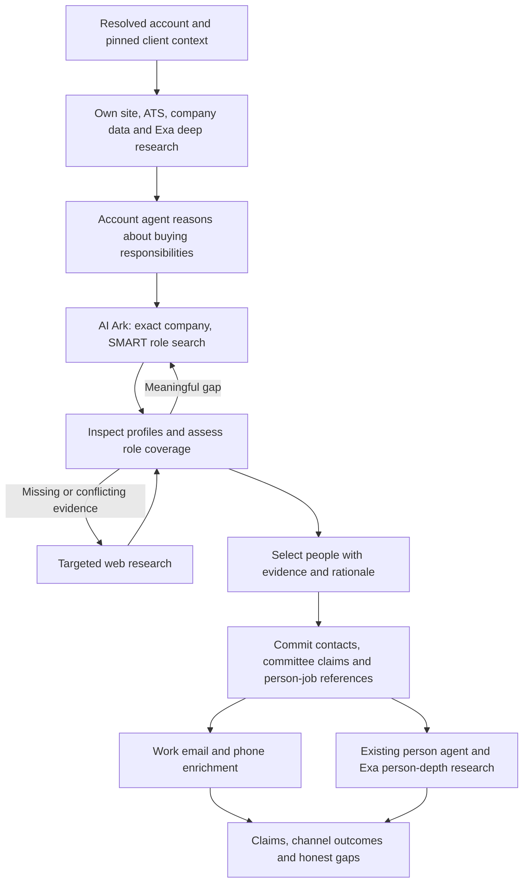

# ARV2: company-scoped buying-committee discovery with AI Ark

**Status:** implementation authorized and completed locally; offline acceptance recorded;
v2 is the default for new launches by the founder's later 2026-09-22 instruction. Live canary
and deployment remain separate and unperformed in the default-change session.
**Date:** 2026-09-22. **Inspected base:** `8df27dd25`, after pulling
`origin/research-streaming` (includes PR #75, general-purpose web search).
**Companion:** [implementation plan](../../plans/2026-09-22-arv2-ai-ark-committee-discovery.md).

## 1. Outcome and authority

After researching an account, its agent uses the client's ICP and persona context to decide
which buying responsibilities matter at that company. It searches AI Ark for people who may
hold those responsibilities, inspects the returned profiles, and selects a reasoned committee.
Selected people receive work-email and phone enrichment alongside individual deep research.
Web research supplies missing people, recent developments and corroboration.

This changes **people discovery inside an existing account**. It does not change the R4
target-account discovery strategy or create another agent, fleet, research lane or contact store.

### 1.1 Founder decisions already made

| Decision | Approved behavior |
| --- | --- |
| Ownership | The existing per-account agent reasons about buying roles after company research, using ICP and persona context. |
| Discovery provider | AI Ark is the primary role-based people-discovery provider. A person's name need not already be known. |
| Matching | Use SMART title matching while keeping the company identity exact; prefer its resolved AI Ark company ID. |
| Agency | The agent can refine role queries, inspect additional pages and judge returned candidates. A matching title alone does not establish a committee seat. |
| Handoff | Reuse the discovered profile in the existing person-research job; do not buy another named-person search to reconstruct it. |
| Channels | Enrich selected contacts for **work emails and phone numbers**. Founder answer, 2026-09-22. |
| Exa failure | After the existing deep-research retry is exhausted, **continue discovery and record the research gap**. Founder answer, 2026-09-22. |
| Web | Use web research for coverage gaps, corroboration and person depth. Independent web discovery of every name is no longer a prerequisite. |

Everything below specifies the proposed engineering realization of those decisions. Defaults
such as page size, context pinning and storage shape are recommendations in this draft, not
additional founder rulings. Approval of the flow does not mean these changes are implemented.

On adoption, this design narrowly supersedes the **name-scoped-only** AI Ark rule in
[ARV2 master plan §3](../../../specs/ARV2-MASTER-PLAN.md) and the **web-first committee** rule in its
R3 row. It preserves ARV2's own-row rule, shared claim substrate, lenient research writes,
sensitivity floor, launch authority, monetary accounting and existing failure law. The older
substrate-era waterfall/quality-veto rules must not be reintroduced through this change.

## 2. What the evidence establishes

The Probook and Zafran experiments show useful AI Ark company/person records and enrichment.
They support making it a first-class discovery provider. They do **not** prove that the exact
SMART role-search flow below has already passed a representative live evaluation.

The early title probe used `contact.title` with `BROAD`; the current API documents a different
title filter and SMART. That probe cannot establish that the documented query fails. It also
does not prove the old request was invalid under the historical API. Preserve this distinction.

Relevant local evidence:

- [Probook research report](../../../../.context/arv2-clue-sample-v3/CLUE-SAMPLE-RUN.md).
- [Zafran AI Ark report](../../../../.context/arv2-one-account-aiark/ONE-ACCOUNT-REPORT.md).
- [Early title probe](../../../../.context/arv2-smoke-cluehq/b1c_ark_probe.py).
- [Historical AI Ark evaluation and live canary](../../../specs/ARV2-ai-ark-contract-notes.md).

Current provider documentation was checked on 2026-09-22. No paid provider requests were made
for this design. Historical employee rosters are comparison material, not current ground truth.

## 3. Current implementation and required changes

Paths in this table are relative to `platform/api/clue_api/arv2/` unless stated otherwise.

| Area | Verified current behavior | Change required |
| --- | --- | --- |
| `ai_ark_client.py` | `people_by_name` requires names and a domain, sends STRICT, fixes page 0 and limits size to 3. | Add role search, typed company ID, paging metadata and stable evidence handles. Keep named lookup for the explicit known-person case. |
| `account_research_tools.py` | `lookup_people` requires known names. `CommitteeCandidate.confirmed_by` and its mappers require a web URL for a named candidate. | Add `discover_people`; accept provider evidence as a distinct selection input. |
| `account_research_driver.py` | Account composition includes pinned ICP and a dynamically selected persona document. `_persona` matches ICP key, not a pinned persona version. | Pin the selected persona reference, or an explicit missing state, and carry it into child jobs. |
| `committee_step.py` | Creates contacts and deterministic person jobs. Input candidate order exists in runtime memory. | Persist ordered selection references and a reference-only person seed in the same durable handoff. |
| Person lookup | `_lookup_person` requires a job-bound LinkedIn URL, then purchases a name search before email export. | Consume the selected source profile; support its stable provider identity even without LinkedIn. |
| Enrichment | Email export is implemented by LinkedIn URL. Phone client/tool is absent. | Export email by the selected AI Ark person ID when present; add phone lookup separately. |
| Claims | Provider profile mappers already exist. `core.work_email` is an object with a verdict; `core.direct_phone` is a string field. | Reuse these mappers/fields, add receipt-linked provenance and a phone mapper. |
| Identity | LinkedIn lookup can find a contact under another account; the existing committee step then uses that account. | Surface employment conflict; never silently fan out the target committee under another employer. |
| Replay | Provider raw artifacts and spend rows exist; ARV2 internal tools have no durable success-result cache. | Persist operation results before exposing reusable handles. Preserve honest unknown-outcome handling. |
| Catalog | ARV2 has separate five-file account/person `v1` catalogs, loaded through current roots with digest checks. | New immutable versions plus explicit per-job version resolution. A version bump alone is insufficient. |

These are internal tools assembled by `build_account_tools` / `build_person_tools`. They are not
the Head-of-ABM toolbelt's versioned `web_search@1`. The newly merged general web-search work
must remain intact; it needs no authority grant change for this feature.

## 4. End-to-end behavior



### 4.1 Account context and company research

Read the resolved account, launch directive, selected product-set version, confirmed ICP,
persona document and already-established claims. Preserve free primary-source work: own site,
available Ashby/Greenhouse/Lever boards and feeds. Reuse a company lookup already performed
during account research when resolving the AI Ark company ID.

The agent attempts account Exa deep research before its first role-discovery search. Its existing
silent-failure retry remains the only special retry introduced by the deep-research contract.
Success makes the report available to role planning. Exhausted failure makes the reason and
remaining evidence available instead. Missing provider configuration is an explicit unavailable
outcome, not an endless retry or a fabricated report.

Use a durable deep-operation outcome to establish that the step was attempted; `job.stage` is
display progress and must not become sequencing authority. An early `discover_people` call
returns a recoverable instruction to finish/attempt company research. A failed Exa outcome
permits discovery. No minimum report quality score is added as a gate. Existing cached valid
research for this job satisfies the step without another spend.

### 4.2 Reason about buying responsibilities

The account agent creates a concise role plan, not a fixed list of job titles for every account.
For each relevant buying responsibility it records:

- A stable role-plan key, the business responsibility and why it matters for the client's product.
- One primary committee-seat hypothesis using the existing seat vocabulary, with other relevant
  responsibilities described in prose.
- Plausible title alternatives; optional seniority/function filters and why they are useful.
- Supporting account claims/report references and the pinned ICP/persona reference.
- Known uncertainties: founder ownership, outsourced function, open role, recent reorganization.

Keep reasoning concise and reviewable; do not request or persist a hidden chain of thought.
The role plan is an agent assessment, not a claim that a particular person holds authority.

For a small founder-led business, a founder or generalist may own several responsibilities.
For a larger organization, a functional leader, practitioner champion, evaluator and budget
owner may differ. These are illustrative patterns, not hardcoded company-size rules.

### 4.3 Search, inspect and refine

Search each justified role cluster within the same locked company. SMART broadens titles;
it does not broaden employer identity. Do not overconstrain the first search by applying every
optional filter. Combine alternative titles with OR semantics. Separate unrelated role clusters
so a crowded function does not hide a smaller one on the first page.

The agent can inspect full relevant professional profile details through the returned handles,
request another page, broaden titles or remove an optional seniority/function restriction.
Each refinement names the coverage gap it addresses. Do not silently truncate a page or
pretend the first results are the full committee. Repeated identical requests return the stored
page rather than another billable call.

The default proposal is 10 results per page, adjustable within the provider's documented
limits. This is a request-size default, not a new total-spend ceiling. Existing committee size,
effort, runtime and provider controls remain distinct. A candidate pool may exceed the final
committee size. An unfiltered company roster is not exposed by this tool.

No new completeness score, minimum number of contacts or all-seats-filled gate is introduced.
Stop when the agent can justify the selected people and remaining gaps, or an existing runtime
limit requires finalization. Record unsearched pages/channels and why work stopped.

### 4.4 Select and hand off

The agent selects by candidate reference and gives a committee role, evidence-backed rationale
and priority order. It does not submit an invented provider ID, retype the profile as authoritative
data, or fabricate a URL. The server resolves identity/title/profile from the stored result.

A person may cover several responsibilities, but the existing committee schema has one primary
seat per selection. Group repeated references to the same person into one selection, retain
secondary responsibilities in the rationale, and create one person job. A broader multi-seat
graph/schema redesign is outside this change.

Distinguish **not found** from **vacant**. An empty search is a coverage gap; claiming an actual
vacancy requires evidence such as an open requisition. Do not use today's `vacant_seat` shortcut
to assert that nobody holds a role merely because the search did not return them.

At account settlement, the existing committee cap is applied to the agent's distinct-person
priority order. Retain the unselected candidate evidence and gap explanation, without enriching
every search result or creating contacts for the whole pool. Launch child jobs only after the
selection/contact/job transaction commits, using the existing fleet and enqueue recovery path.

### 4.5 Enrich and perform person depth

On each selected person's job, materialize the source profile through the existing deterministic
mapper, then begin email and phone operations. Run those operations alongside the existing
person agent's web/Exa depth where provider pacing permits. These are deterministic operations
inside the current person job, not new agents or an independent enrichment pipeline.

The person agent sees the source profile, selection rationale, account context and independent
channel states through `read_person_state`. A thin profile or missing email/phone does not
prevent person research. A failed deep call does not discard successfully enriched channels.
Before final receipt, join in-flight work using the existing bounded shutdown behavior and
report unfinished/unknown outcomes honestly.

The agent's explicit enrichment tool and the driver's initial enrichment must call the same
idempotent operation service. Never have two owners that can buy the same channel concurrently.
The legacy named/LinkedIn lookup remains for an on-demand person with no discovery seed, and
must reuse that same result/claim/enrichment path after identity resolution.

## 5. Tool and provider contracts

### 5.1 `discover_people` — new account-internal tool

Suggested typed input:

```json
{
  "role_key": "demand-owner",
  "responsibility": "Owns pipeline generation for the enterprise motion",
  "rationale": "The account is hiring for enterprise growth; this role may sponsor the product",
  "evidence_refs": ["claim:<id>"],
  "titles": ["Head of Growth", "VP Marketing", "Demand Generation Director"],
  "seniority": [],
  "functions": [],
  "page": 0,
  "size": 10
}
```

The server supplies workspace, run, account, normalized domain and resolved provider company
scope. The agent cannot substitute an unrelated company ID or arbitrary filter JSON. Empty
titles, invalid paging/filter vocabulary and cross-job references are refused before spend.
Unsupported optional filter values are explained; never silently broaden the request.

The provider adapter, not the prompt, constructs the request. The documented company-ID and
title shape is:

```json
{
  "contact": {
    "company": {"latest": {"any": {"include": ["<resolved-company-id>"]}}},
    "experience": {"latest": {"title": {"any": {"include": {
      "mode": "SMART",
      "content": ["Head of Growth", "VP Marketing"]
    }}}}}
  },
  "page": 0,
  "size": 10
}
```

`latest` constrains the primary active role; it must not be silently swapped for previous
employment or a broader current-role search. Concurrent roles need separate validation before
any future expansion. See [AI Ark's filter reference](https://docs.ai-ark.com/docs/ai-agents).

The output includes an operation reference, normalized role/query, company-lock evidence,
page/size, total returned/matching records when available, `has_more`, and candidate summaries.
Each candidate has an opaque reference, provider identity, professional title/headline,
LinkedIn URL if present, matching employment evidence, source freshness when provided, and
a handle to the scrubbed full profile. Never claim to know provider totals when absent.
Use `read_people_result(result_ref, candidate_refs?)` for lossless local expansion with no spend.

SMART and paging support are documented; People Search returns profiles but excludes contact
channels. Price is documented as 0.5 credits per returned person, and pages are zero-based with
at most 100 records. A provider no-match response becomes an empty page, not an account-job
failure. [People Search reference](https://docs.ai-ark.com/reference/people-search-1).

### 5.2 Company lock

Resolve the existing canonical account domain with company search, expose the returned company
ID in `AiArkCompany`, and retain its response receipt. Do not pick the first ambiguous company
result without inspecting identity. Exact normalization may remove scheme, case and `www`;
it must not equate unrelated domains, subsidiaries or parent companies.

When no usable provider company ID exists, permit a **server-bound exact-domain + SMART-title**
search as a recorded fallback. Check the returned employment against that domain. An absent
domain/ID is not permission to search a fuzzy company name. In that case record the AI Ark gap
and use targeted web evidence.

An explicit employer mismatch cannot become a member of the target account. Missing optional
employment fields are marked unknown; the source query's exact company scope is still evidence.
Keep the observed record and conflict annotation without attributing another employer's person
to this committee. [Company Search reference](https://docs.ai-ark.com/reference/company-search-1).

### 5.3 Selection contract

Extend `CommitteeCandidate` with a tagged evidence input:

| Kind | Required identity evidence | Behavior |
| --- | --- | --- |
| `provider_candidate` | Valid candidate handle owned by this account job | Read identity/profile from the persisted result. No web confirming URL required. |
| `web_candidate` | Existing name + real confirming URL/evidence, optional LinkedIn | Preserve supported fallback; later enrichment must still lock the person. |
| `unfilled_role` | Role-plan key and gap reason; optional evidence of actual vacancy | No invented contact and no person job. |

Provider-sourced profile facts use API provenance. Assigning someone as a champion/economic
buyer remains an agent assessment with its own rationale and evidence references. Do not stamp
the committee judgment as provider-certified just because the profile came from AI Ark.
Existing v1 selections remain readable. New provenance cannot depend on a synthetic web URL.

### 5.4 Work email

Extend `export_email` to accept exactly one selected provider person ID or a job-bound LinkedIn
URL. Prefer the ID from discovery. Keep the existing v1 endpoint for the initial implementation,
with explicit semantic handling of a documented no-email 404; do not treat every 404 on every
endpoint as a successful empty result.

The provider documents one credit for a found valid email and zero for no email. This differs
from the current client's fixed no-email profile-cost assumption, so correct the cost reader
and record provenance for estimated versus provider-reported charges. Preserve the returned
email verdict and check date in the existing `core.work_email` shape; no deliverability
guarantee or identity promotion follows from obtaining an address.
[Single-person export reference](https://docs.ai-ark.com/reference/people-export-single).

The existing bulk export/track-ID endpoints are not needed for a selected handful of people.
They would add asynchronous callback/state handling and enrich a different unit of work.
Reusing a discovery profile removes the redundant **named search**; it does not make the
provider's email export free or remove its bundled profile component.

### 5.5 Phone

Add a typed `find_phone` client operation. The documented inputs are `linkedin`, or `domain`
plus `name`; **person ID alone is not a documented phone input**. Derive these inputs from the
selected profile, never from arbitrary agent arguments. A documented no-phone 404 is empty;
the stated price is five credits per found result, zero otherwise.
[Mobile Phone Finder reference](https://docs.ai-ark.com/reference/people-mobile-phone-finder).

The historical canary reported that LinkedIn-only input failed while domain+name worked. The
initial implementation should prefer the working domain+name mode, checking returned identity
against the selected person. Test LinkedIn-only mode explicitly in the live contract canary
before preferring it. Do not probe both modes for every selected person automatically.

When an output identity conflicts, store the observed response as unresolved and do not attach
the number to the wrong contact. If the response cannot establish which same-name person it
returned, preserve a weak/ambiguous binding annotation and leave the usable channel unresolved.
The rest of that person's research continues.

Parse all returned numbers without inventing missing digits/country codes. Deduplicate valid
E.164 values and use the first valid provider-ordered value for existing `core.direct_phone`.
Keep other values in the governed source artifact for later review. Provider ordering is not
a verification certificate. Store source/check-time metadata only when actually supplied.
Phone data does not become an identity key, a personal research hook or proof of permission
to call. This change performs enrichment; it does not initiate outreach.

## 6. Durable state and provenance

### 6.1 Proposed minimal persistence changes

Do not copy full profiles into `finalization_json`, queue payloads or chat messages. Those
copies are hard to erase and would create competing fact stores. Reuse the existing artifact,
provider-ledger, claim and entity substrates; operational rows store references and outcomes.

| Change | Proposed fields / purpose |
| --- | --- |
| New ARV2 research-operation record | Operation ID, workspace/run/job/account scope, kind, canonical request fingerprint, state, attempt/lease data, ledger/result references, response artifact key + digest, timestamps and typed error/gap code. No second raw-response blob. |
| Run context pin | Persona document ID/version/artifact key/digest or explicit missing/unreadable state, alongside existing ICP/product pins. |
| Job input references | Versioned reference-only seed: parent account job, selected candidate receipt/record locator, selection claim IDs, expected account, and explicit profile ref + digest. |
| Ordered selection checkpoint | Selection claim IDs with ordinal and handoff state; no names, titles, email or phone duplicates. It may live in the typed job receipt rather than a new table. |
| Shared entity-provider binding | Workspace + provider + provider subject ID → canonical contact ID, source evidence reference and binding state. Unique in workspace/provider/subject, using the identity seam. |

The operation record is not a second spend ledger. Its result points to the existing ledger,
which remains authoritative for spend. Candidate handles are derived from the owned operation,
artifact digest and record locator; validate ownership and artifact hash every time. They are
not bearer authorization for another workspace to read a profile.

Persist professional source facts as claims only when a contact is selected. Unselected profiles
remain governed provider results, not visible committee members. Expose complete profile
material to the selecting agent by reference, so narrowing the inline summary loses no evidence.

Use `ClaimDraft.artifact_key`, source key, provider record ID, JSON path and operation/ledger
reference to connect claims to their actual source bytes. Extend the deterministic mapper once;
do not introduce a separate account-side and person-side version. Keep any existing lenient
`source_missing` URL annotation honest; a provider artifact can supply evidence without pretending
that an API URL is a browsable page.

### 6.2 Replay and uncertainty

Canonicalize filters as semantic data: normalized case/whitespace where appropriate, stable
set order for OR terms, explicit company lock, page, size, endpoint and contract version.
Do not include free-form rationale in the paid-query fingerprint. The same search can support
several role hypotheses without being bought repeatedly.

Operation states: `pending`, `running`, `succeeded`, `empty`, `failed`, `unknown`.
An empty response is a reusable completed result. Channel operations have separate identities
so a phone failure cannot cause another email charge. Changed pages/filters are different
operations; a deliberate refresh is an explicit new attempt, not a silent replay.

Acquire an operation lease before spending. Save the scrubbed response and ledger result,
then commit its reusable result reference before returning a candidate handle. Recover a
crashed worker from a persisted response without reissuing the provider request. A lost worker
after dispatch but before durable response recording is **unknown**, not safely retryable by
assumption. Preserve the existing stop-on-unknown-spend law and provide an actionable reason.
Do not promise exactly-once external billing: these provider endpoints do not establish that.

The ordered selection checkpoint closes the account finalization-to-fanout crash window:
re-settlement reads claim references, checks they remain live, and resumes contact/job creation
idempotently. Replayed selections do not consume the final committee cap twice. Existing
deterministic person job IDs and unique constraints remain the job-creation latch.

### 6.3 Context pinning

Select the persona once at launch, using the current workspace/brand/project precedence, and
persist its exact bytes' reference and digest. Preserve the confirmed ICP pin and product-set
version. Account retries and children read the same persona, not whichever document was newest
when that worker started. On launch replay, reuse the existing run's pins.

Check explicit ICP-document lineage/version when the persona provides it. If historical
metadata only names an ICP key, record `persona_lineage_unverified` rather than falsely claiming
a version match. Missing/unreadable persona is a visible context gap: use the pinned ICP and
account evidence to propose role hypotheses without manufacturing a persona document. This
non-blocking default is a recommendation for review. Research must never fetch chat history to
reconstruct missing client context.

### 6.4 Identity and employment

Resolve selected people through the shared identity seam: existing provider binding, then
normalized LinkedIn, then the existing account-scoped name evidence with its ambiguity rules.
Provider ID and LinkedIn pointing to different contacts is an identity conflict requiring
resolution; do not let one silently win. A provider ID without LinkedIn can still anchor this
selected profile and its email export.

Do not merge two distinct provider identities merely because names match. When a name-only
existing contact cannot be established as the same person, retain the unresolved candidate
and gap rather than overwriting that contact. Creating a newly anchored contact on a clean
miss and preserving its provider binding is supported. Repeated selection reuses that contact.

An existing contact attached to another employer needs an explicit employment-conflict outcome.
Do not silently reparent it or launch the target account's committee member under the other
account. This feature does not redesign employment history or automatically move contacts.
Record the new evidence and continue with other candidates; unresolved membership remains a gap.

These are attribution boundaries, not quality thresholds. A conflicting observation may be
stored without being asserted as a fact about the wrong account/person.

### 6.5 Erasure and retention

The current comment excluding candidate blobs from final receipts is intentional. Extend
existing artifact-subject and erasure mechanisms to cover discovery results, selection claims,
provider bindings, operation references and person seeds. Do not assume that today's DSAR
code already handles new ARV2 reference kinds.

A search response contains several people, including unselected candidates. Mapping only the
selected person to the whole page is insufficient. Register subject locators for each returned
provider identity, link canonical contacts when resolved, and ensure an erasure invalidates
handles and cached reconstructions before further use. Use the existing storage lifecycle to
remove/redact affected material; do not retain erased text merely because another person shared
the page. If the storage seam cannot redact safely, invalidate/purge that page and let surviving
claims record an unavailable source until explicitly refreshed. Document the chosen mechanism
in the implementation contract review and test it before activation.

Preserve current sensitive-field scrubbing **before raw persistence**, including birth dates.
Bind unselected results to the workspace's artifact-retention rules. If those rules do not
specify an expiry, settle retention during the contract review; do not create an indefinite cache.
Do not place email, phone or full names in operation labels, progress events or tracing tags.

## 7. Failure, spend and progress behavior

| Situation | Required outcome |
| --- | --- |
| Account Exa call exhausts retry | Record gap; proceed to role planning with available evidence. |
| No AI Ark company ID | Exact-domain role query if safely bound; otherwise web fallback and named gap. |
| Zero role matches | Empty result; agent may refine or use web. No fabricated vacancy. |
| Too many matches | Inspect page metadata; refine or paginate. Do not assert exhaustive coverage. |
| AI Ark unsupported filter / malformed request | Recoverable typed refusal; correct the input, not blind retries or silent broadening. |
| Authentication, credits or provider halt | Preserve existing provider failure/incident behavior; stop the affected spend path and finalize with gaps or use an available independent source. |
| Transient rate limit / transport / 5xx | Existing bounded retry and `Retry-After` behavior, through the shared caller. Respect unknown-spend semantics. |
| Email or phone not found | Store channel outcome; keep the selected person and continue depth. |
| Email found, phone fails | Preserve email and its spend; retry only eligible phone work. |
| Wrong employer / identity conflict | Preserve evidence; do not attribute it to the target contact. Continue other candidates. |
| Runtime limit | Finalize known claims and selected members; report incomplete discovery/channels/depth. |
| Erased or inaccessible seed | Do not read or silently repurchase it. Return the appropriate unavailable/erased outcome. |

Use the shared `ProviderCaller`, artifact sink, ledger and incident path for every operation.
Preserve existing AI Ark pacing until the actual account's rate limit is verified; concurrent
person jobs must share token-scoped pacing rather than each believing it owns the whole rate.
Any new setting must appear in `.env.example` at introduction, with existing local values kept.
Prefer existing settings to adding a feature-flag matrix.

For planning only, provider credit estimate = `0.1 × company records + 0.5 × people returned
+ 1 × found emails + 5 × found phone results`, excluding agent/Exa spend and repeated attempts.
The ledger records actual/estimated components and their basis separately. Do not convert
credits to dollars using an assumed subscription. No additional hard monetary ceiling or
automatic mass enrichment is introduced.

Progress should distinguish role discovery, committee selection, contact enrichment and
person depth using existing activity/job surfaces. Record counts, role gaps, provider outcome
codes and references. Avoid internal IDs as user-facing labels and never report “fully verified
committee” merely because channel lookup succeeded. Quality measures annotate research rather
than mechanically vetoing stored information.

## 8. Display and scope boundaries

Existing account/contact views continue reading claims. AI Ark facts must be represented as
provider evidence; an agent's committee rationale must remain visibly an assessment. Test that
source rendering can reach the correct evidence through existing authorized read seams.

The inspected accounts feature has no direct-phone presentation contract despite the registered
`core.direct_phone` field. This design includes acquiring and storing phones, not an invented
phone widget. Before adding a visible phone slot, perform the repository-required frontend
contract-gap review and update [accounts contract](../../../../apps/frontend/docs/api-contracts/accounts.md).
The implementation must report backend enrichment and visible UI support separately.

Out of scope: R4 company discovery strategy; AI Ark personality analysis; preview/bulk-export
optimization; full company rosters; new outreach/sending behavior; multi-seat committee schema;
new research agents; Gemini/transcript-search gaps; a generic provider marketplace; changes to
general-purpose `web_search@1`; broad identity or privacy-substrate rewrites.

## 9. Compatibility and rollout

1. Implement additive schema and contracts while v1 remains active. No backfill may trigger
   paid discovery/enrichment or reselect historical committees.
2. Create immutable `arv2-account/v2` and `arv2-person/v2` resources. Store/resolve explicit
   profile references and manifest digests per job. Map old jobs without a ref to their known
   v1 catalog; never reinterpret an old hash as v2.
3. Preserve v1 decoding/tool behavior for queued v1 jobs. New launches select v2 only once
   integration checks pass. Existing in-flight jobs finish with their original authority.
4. Validate with replayed/synthetic fixtures and an isolated database first. The live canary
   below is a separate, explicitly initiated validation run; this planning session authorizes
   neither provider spending nor deployment.
5. **Later founder supersession, 2026-09-22:** default new launches to v2 now, with live review
   still outstanding. Rollback selects v1 for future launches while retaining v2 readers and
   data; it does not strip columns or downgrade a live DB.

If maintaining both catalog versions is unexpectedly expensive, propose a drain-and-relaunch
rollout before implementation; do not silently break pinned jobs on deployment.

## 10. Acceptance criteria

### 10.1 Offline and isolated-database proof

| ID | Observable proof |
| --- | --- |
| A01 | A scripted account agent discovers a previously unknown name through company+SMART-title search; no prior name search or confirming web URL is needed. |
| A02 | The wire body uses the documented nested title path, exact company ID (or explicit domain fallback), SMART, requested page and size. No bare roster or substituted account is possible. |
| A03 | A successful account deep call precedes discovery; an exhausted failure also permits discovery and leaves a visible gap. A progress label alone cannot satisfy this ordering. |
| A04 | ICP/persona pins survive account retry and child dispatch; mismatched lineage and absent persona are explicit. No cross-project/persona or chat-history fallback. |
| A05 | Agent can read the full source profile, paginate and refine; repeated equivalent queries reuse the result, and remaining pages are not hidden. |
| A06 | Provider facts carry receipt/artifact/path provenance; committee role is separately synthesized and explained. No fake URL or fabricated responsibility. |
| A07 | One contact/job per selected distinct person; stable provider ID works without LinkedIn. Different people with the same name do not collapse. |
| A08 | Provider/LinkedIn conflicts and another employer's existing contact cannot contaminate the target committee. |
| A09 | Seeded person job performs zero additional named-person searches; email uses the seed's ID. Web/on-demand path still works with its existing subject lock. |
| A10 | Email and phone run independently of person depth; no-email/no-phone outcomes are empty, and either channel failure preserves the other claims. |
| A11 | Phone uses documented inputs, correctly parses recorded shapes and refuses wrong-person attribution. Email verdict survives mapping. No channel becomes an identity key. |
| A12 | Costs distinguish search, email and phone; empty exports do not incur the obsolete fixed estimate as actual spend. Unknown billing is not silently called zero. |
| A13 | Crash after persisted result resumes without re-spend; concurrent identical operation executes once locally; uncertain post-dispatch crash records unknown. |
| A14 | Crash between selection and fanout recovers ordered live claim references; settlement/enqueue replay creates no duplicate jobs or committee claims. |
| A15 | Cross-workspace handle access, artifact tampering, stale/erased references and multi-person-page erasure are covered. Raw sensitive fields are scrubbed before persistence. |
| A16 | v1 jobs remain readable/runnable on their pins, v2 jobs use v2, and rollback changes future launches without rewriting historical jobs. |
| A17 | Registered fields and claim-backed reads remain compatible; existing email and committee presentation passes. Phone storage is not falsely reported as a shipped UI slot. |
| A18 | One Alembic head; reversible migration smoke on an isolated disposable DB; ARV2 import/legacy-read guards remain green. |

### 10.2 Live proof: Probook and Zafran

Run the actual v2 account/person path using the current approved ICP/persona context, not a
script preloaded with the historical people's names. Retain scrubbed request/response receipts,
selected claims, job links and spend. Explicitly test both the ID-bound role search and the
phone contract discrepancy; never use a successful mocked request as the live result.

Compare on both accounts: useful responsibilities covered, current-employment accuracy,
wrong-company/same-name contamination, plausible overlooked people, weak or unsupported seat
assignments, email/phone hit rates, duplicate paid lookups, total credits, Exa/model cost and
latency. Use a fresh human-reviewed reference set. Historical PoC names help assess regressions
but do not prescribe the answer or an exhaustive roster.

Safety/correctness pass conditions: no wrong-company writes; no invented contacts; every selected
person traceable to evidence; no redundant named search for seeded people; real empty/failure
handling; channel output and spend accounted for. Relevance/recall results must be reviewed and
reported, not rounded into a claim that AI Ark always finds the best committee. If a company has
no useful role-search coverage, that is an actionable canary result, not a fabricated pass.

### 10.3 Accepted implementation contracts

The founder authorized implementation of the companion plan on 2026-09-22. These engineering
defaults accompany the already approved flow, both channels and Exa-failure behavior:

1. Default 10-result role pages; agent-controlled refinement/paging without a new spend veto.
2. Persona pinning with visible, non-blocking missing/lineage-unknown states.
3. Reference-only operation/selection/seed storage and a shared provider-identity binding.
4. Exact-domain fallback when a company ID is unavailable; explicit employment conflicts.
5. Enrichment inside the existing person job, concurrent with depth, selected contacts only.
6. Additive v2 rollout preserving v1 jobs; backend phone storage first, frontend phone slot only
   after its contract review.

The detailed work order, touched files and verification gates are in the companion plan.

### 10.4 Engineering decisions made during implementation

- Results and channel operations use version-1 reference envelopes. Canonical requests identify
  paid operations; reasoning text is an assessment and never a billing key. Two-hour ownership
  leases become `unknown` when abandoned; expiration never authorizes an automatic repurchase.
- v2 pins all five catalog resources. Nullable historical job refs resolve to v1. Persona pins
  identify the original artifact and digest; missing, unreadable, lineage-mismatch and unverified
  lineage are explicit. Children use the same run pin.
- Personal provider artifacts expire after 30 days. Every returned subject is indexed, including
  candidates not selected. Erasure invalidates the whole shared page, even when other live claims
  cite it; readers refuse immediately and the maintenance sweep purges the blob. Surviving claims
  can retain evidence references whose source is unavailable. No silent page reconstruction.
- Contact, provider and artifact checks guard late writes; a response arriving after a privacy
  stop is retained only as an unreadable billing receipt. Account-side selection copies are
  reachable by full erasure. Raw sensitive birth-date keys are removed before persistence.
- AI Ark pacing is shared by token within a process and serialized across worker processes with
  a database advisory lock; existing minimum-gap and halt behavior remain authoritative.
- Provider credit headers are metered. Documented result arithmetic is explicitly inferred
  (`cost_source=estimate`, `credit_basis=documented_result_arithmetic`). Unknown billing retains
  a preflight estimate; no-email/no-phone results use documented zero-result arithmetic.
- The new registered `account.committee_search_assessment` is an agent assessment, with role,
  rationale, evidence and result references. Phone claims use existing `core.direct_phone` and
  do not imply verification, consent or DNC clearance. No frontend phone slot was added.

The [acceptance record](../../plans/2026-09-22-arv2-ai-ark-committee-acceptance.md) separates local
proof, baseline failures, and outstanding live validation. The founder subsequently requested
the v2 default: Settings, `.env.example` and local `.env` now select `v2`; no historical research
is re-run. The media-research spec builds on this v2 behavior.
