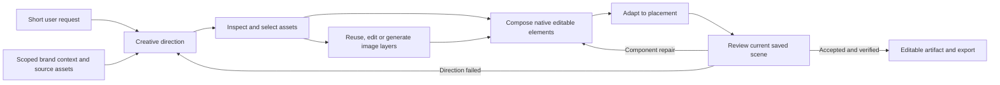

# Design Agent V1: a coherent skill family and a cross-brand test

Status: implementation in local validation, 2026-09-13. **Eighteen candidate
playbooks** are implemented and enabled on localhost through on-demand discovery.
The original four-playbook scope below records the earlier plan; the full-family
continuation at the end is the current scope. Reference custody, acceptance,
timing and crop safeguards are implemented. Ordinary-request diagnostics have
run, but the paired cross-brand benchmark is incomplete and the four-minute
finished-creative target has not passed. Branch: `codex/design-agent-v1`.

The latest approved provider round delivered three new square drafts through
ordinary Home requests and the normal Design handoff, without supplied asset IDs,
skill names, prescribed headlines or layouts. There are now saved current-family
samples across all four local brand workspaces. Five families have live selection
evidence; thirteen remain candidates without rendered coverage in this test.
Model acceptance, usable editing and human creative quality remain separate gates.

| Latest ordinary request | Actual family and imagery | Delivery and remaining issue |
| --- | --- | --- |
| AWS Cloud and AI Day Türkiye invitation | event-webinar; new artwork conditioned on three genuine event originals; independent logo and five text layers | Saved draft, about 11 minutes. Acceptance correctly refused after another preflight changed headline pixels. Small date/venue copy and loose spacing remain. |
| Google Cloud / Glance customer story | customer-spotlight; new photograph conditioned on a Gemini ad; independently fetched Glance logo and supplied Google Cloud logo | Saved and model-accepted, about 19 minutes. It inspected the Glance comic but deliberately selected another campaign's photo treatment. Small support/CTA and conventional composition remain. |
| Conduit introduction | type-led-positioning; one fresh blurred background conditioned on an ingested website original; native copy and authentic logo | Saved and model-accepted after one revision, about 15.5 minutes. Background treatment is closer; supporting copy still needs stronger feed-scale hierarchy. |

Native text edit → save → reload → restore passed for all three. Canonical PNG
and SVG exports preserve the restored scenes and versions (AWS v23, Google v56,
Conduit v35). The exported PNGs match the frozen final previews. These are
ordinary-request diagnostics, not a paired causal benchmark or a 240-second pass.
Clue's two earlier saved samples remain unchanged. Ports 3021–3024 serve distinct
local workspace contexts through a shared local backend/database; they are not
four independent database installations or cloud deployments.

## Earlier four-playbook implementation evidence and remaining gate

- A separate scene knowledge view now serves the family and removes conflicting
  fixed-layout policy from that view. Website knowledge remains compatible.
- Ordered source bytes, roles, framing and provider outputs are recorded. A real
  Conduit image run used three inspected sources and generated a new, matching
  blurred background; it still failed composition and delivery-time review.
- Final acceptance requires current preflight, rendered bytes and a registered
  passing critique. Valid unaccepted drafts survive. Model acceptance alone is
  still not human visual acceptance.
- Clue and Google Cloud ordinary awareness requests completed with distinct brand
  typography/identity. Neither establishes the four-minute finished-delivery
  target. Source fixtures for Conduit, Clue, AWS and Google Cloud are isolated
  local test workspaces with explicitly partial kits and evidence gaps.
- Live failures motivated an exact source-pixel crop tool, content-based preview
  freshness, and trusted checkpoint persistence even when an existing preview is
  reused. These repairs are part of the implementation, not improved benchmark
  scores. Preserve the earlier failures in the denominator.
- Clue and Google Cloud native text edits survived save/reload; restored scenes
  and exported PNGs exactly matched their original outputs. AWS durably saved a
  31-operation checkpoint before stopping, but its own review rejected the
  composition. Its kit also lacks the declared Arial font file. It remains an
  unaccepted draft with a partial-fixture gap.
- Runtime tracing identified avoidable final-critique reserialization and a
  conflict between the four-minute target and legacy four-minute repair-floor
  guidance. Candidate fixes reuse the registered review and permit one focused
  quality repair when hard headroom exists. Target misses remain visible;
  changing this guidance does not demonstrate a faster or better live output.
- A subsequent ordinary AWS repair on the final runtime resized the existing
  logo and made support readable without changing the copy. It finalized once
  using the registered review and exported through the browser. It took 5m10s,
  remained a scoped edit rather than strict creative acceptance, and did not
  resolve the weak overall composition or the partial brand-kit warning.
- The 16-row comparison manifest is prepared in ignored evaluation storage.
  Diagnostics changed code between runs, so they cannot establish a controlled
  old/new-guidance win. Freeze the final runtime and reset eligible output/caches
  before that comparison. Human review, repeatability, proof/workflow coverage
  and promotion remain open.

Operational results and exact verification are recorded in
[`_memory/2026-09-13-design-skill-family-implementation.md`](../../../_memory/2026-09-13-design-skill-family-implementation.md).

## Decision

Build the shared family together, then validate its parts and its complete
behavior. Six procedural responsibilities support the original four playbooks
and the fourteen additional candidates now authorized by the user. Candidate
availability is separate from promotion: each still needs cross-brand evidence.
Skill count is not a quality metric, and playbooks are not fixed page templates.

Keep the current scene director/author roles during the first comparison. A
single scene agent remains a separate experiment after the skill comparison;
changing models, roles, references and skills together would obscure the result.
The brand-preparation agent and the Head of ABM work remain separate.

Three development subagents reviewed skill boundaries, runtime contracts and
cross-brand evaluation. The coordinator reconciled the findings and verified
the important source seams. These are development reviewers, not additional
agents being added to each customer generation run.

## Why adding more skills alone will not work

The [previous audit](design-agent-v1-harness-audit.md) established that skills
are discoverable and selected reference pixels can reach the image provider.
It did not establish autonomous short-request performance or cross-brand quality.
The following table records the pre-implementation findings at `e0d73952`;
the implementation status above describes which mechanisms have since changed:

| Finding | Evidence and implication |
| --- | --- |
| Composition has competing authorities | The [router](../apps/agent_runtime/knowledge_docs/AGENT.md) puts format decisions first, while the pinned [block catalog](../apps/agent_runtime/knowledge_docs/knowledge/design/blocks/README.md) prescribes full patterns and calibrated dimensions. Updating only a new skill leaves those instructions in context. |
| Shared craft rules are contradicted | Several format skills still mandate inverse text on saturated backgrounds. The shared contrast skill instead checks actual luminance. Image skills disagree about when generation is appropriate. One canonical rule must govern each decision. |
| Identity and product treatment are inconsistent | A pinned logo example constructs a chip and typeset company name. A story rule rejects bitmap text broadly, although authentic product screenshots legitimately contain text. Asset role must determine treatment. |
| Full acceptance is not reliably enforced | [finalize_run](../apps/agent_runtime/lumen_agent/tools/substrate.py) trusts caller-supplied status, does not require a passing typed critique, and only checks preflight when cached diagnostics exist. A source-extracted, stubbed probe returned `accepted` with a false critique, a blocker, and no preview or preflight. This demonstrates a tool-level gap, not proof that this exact path caused a past visual failure. |
| Reference identity loses important information | [generation_key](../apps/api/lumen_api/image_cache.py) sorts reference digests, while the provider preserves reference order. Reversing references produces the same key in a pure probe. Role/order-sensitive instructions could therefore reuse the wrong cached result; no historical collision was established. |
| The timing report uses a different target | [run_view.py](../scripts/run_view.py) displays ten-minute completion and four-minute first-preview gates. This assignment requires a saved, visible, usable creative within three to four minutes. |

Fixing acceptance checks does not teach visual taste. The earlier reviewer also
approved work the founder rejected. A valid machine critique remains only one
part of evaluation; independent visual review must judge the whole creative.

## Six responsibilities, one direction record

| Logical scene/ad responsibility | Sole decision ownership | Starting material |
| --- | --- | --- |
| `creative-direction` | Audience, objective, supported message, original copy, optional artwork CTA, playbook choice | `clarify-design-brief`; shared reader-language and claim guidance |
| `art-direction-and-assets` | Inspect sources; distinguish inspiration, artwork, product and identity; decide what is preserved and what varies | `brand-imagery`, `reference-conditioned-ads`, `reference-image-direction` |
| `image-operations` | Execute reuse, edit or generation using the selected sources; inspect results and retain variants and receipts | `generative-imagery` and existing asset tools |
| `compose-scene` | Build content-driven native text, buttons, vectors and independent image placements | `create-design`; shared token, contrast and effect resources |
| `adapt-placement` | Exact canvas, placement constraints, protected crops and native recomposition | Existing square/story/display/cover/print format guidance |
| `review-and-revise` | Judge the full result; distinguish technical repair, component replacement and failed-direction recomposition | `visual-review`, `repair-design` |

These are procedures available to the same design runtime, not six mandatory
LLM agents or six serial model calls. A type-led design may skip generation.
Independent required image jobs may run concurrently within the run budget.

One versioned `CreativeDirection` record carries intent, evidence references,
exact copy, optional artwork CTA, separate channel copy, playbook, visual
invariants, selected sources and their roles, intended layers, requested
placement, and unresolved gaps. Later revisions amend this record explicitly.
Do not create disconnected copy, image, composition and review briefs.

Each selected source records its authorized scope, origin, digest, role,
operation, protected regions, intended scene node and review target. Generated
assets retain the actual provider input/output receipt. This belongs behind
existing runtime and asset seams; a Markdown field alone cannot enforce it.

### Migration boundary: preserve website behavior

Six responsibilities are the target architecture, not an instruction to add six
replacement directories or delete/rename all 28 existing skills immediately.
The smallest first implementation adds `scene-brief-copy`, one scene
family contract and routing table, four playbooks and selected component
resources. It reuses existing tool and craft mechanisms. Keep directories flat
for the current loader and account for existing readers before changing paths.

- Scene/ad-specific procedures move under the six owners. Existing entry points
  may temporarily be short routing adapters that refer to canonical guidance;
  they must not retain a second body of competing rules.
- Keep `brand-and-tokens`, `color-and-contrast`, `effects` and website-used asset
  guidance accessible to website callers. Share canonical craft facts rather
  than requiring a website to run a scene-composition procedure.
- Preserve `campaign-landing-page`, `campaign-page-workflow`,
  `conversion-copywriting`, `create-website`, `edit-website`, `review-website`,
  `design-guidance`, `plan-design`, `repair-cloned-sections`, and
  `custom-components`. Renaming website `plan-design` is unnecessary here.
- Keep `print-bleed-marks` as a specialist route. Display banners, profile
  covers, print and feed ads retain distinct purposes and placement rules.
- The scene router and scene-pinned pattern instructions must change with the
  family. Patterns become examples; components may be reused without imposing
  a full-page composition. Deliver a versioned scene-specific knowledge view,
  without changing the website's existing skill index, prompt assembly or pins.
  This needs a real runtime/materialization seam: adding a paragraph while still
  delivering conflicting legacy bodies does not resolve their authority.
- Existing skill IDs can route to the scene owner in that view while website
  callers retain their current sources. Include view identity and content in
  the materialization stamp. Do not change a shared workspace's view during an
  active run. The website-context equivalence check is an explicit regression
  gate, not an assumption that retaining filenames preserves behavior.
- Replace stale tool instructions with the actual role's capability reference.
  A skill cannot invent a tool argument or a native-vector extraction service.

The precedence is: authorized task and product scope; authentic identity and
supported evidence; placement/engine constraints; selected visual direction;
optional playbook examples. No example can force a CTA, a logo substitute, an
unreadable foreground, or a two-column layout.

### Skills, components and brand data have different jobs

Skills explain when to use a component and how to judge it. Reusable components
implement measured headline/support text, CTA geometry plus native label,
authentic-logo placement, protected image frames, quote/attribution blocks,
metric/qualifier blocks and native connectors/effects. They must remeasure for
content changes, preserve unique node IDs and use the checked engine operations.
The current full-page DSL examples are not yet a parameterized component system.

Brand-specific logo bytes, font files, button geometry, artwork treatments,
approved claims, screenshots and examples remain scoped brand data. Do not put
Conduit's petals or any company's palette into global skills. Source UI/photos
may remain independent images; that does not make their internal pixels editable.
Headline/body/button labels and authored vector geometry must remain native.

## Four initial playbooks

| Playbook | Evidence needed | What can vary |
| --- | --- | --- |
| Type-led positioning | A supported promise and usable brand typography | Hierarchy, composition and optional artwork; awareness may omit a button |
| Authentic product demonstration | Real screenshot/photo and a supported capability | Framing, crop, callouts and context; preserve product and identity pixels |
| Attributed proof | Approved quote or metric, source and qualification | Editorial treatment and layout; do not invent testimonials or numbers |
| Workflow contrast | A grounded process or capability comparison | Native panels, labels, connectors and illustration; no invented outcome metrics |

Each playbook contains fit/non-fit criteria, required evidence, variable
composition choices, component/layer options, counterexamples, and behavioral
evaluation cases. The catalog can grow toward 15–20 families, but add a family
only when it introduces a decision or evidence requirement existing ones cannot
express. A new background color is not a new family.

## Expansion policy: four is the starting point

The founder explicitly requested that expansion remain part of the roadmap
(2026-09-13). Grow toward roughly 15–20 useful creative families as coverage is
demonstrated. Do not silently stop at the initial four, or treat the target as a
fixed limit on what the agent can compose. The six shared responsibilities stay
the foundation; each new playbook reuses their copy, asset, composition,
placement and review capabilities.

### How a new family earns a place

1. **Record a real coverage gap.** Use ordinary user requests, observed failed
   cases and inspected references. State the unmet intent or evidence structure.
   Distinguish a retrieval/tool defect, a brand-context gap, a composition
   variant and a genuinely different creative procedure before writing a file.
2. **Extend at the right level.** A new palette, texture, logo or product image
   belongs in scoped brand context. A different composition within the same
   reasoning belongs in an existing playbook. A new ad purpose or evidence
   structure may deserve a new playbook. Missing crop, retrieval or vector
   functionality needs a tool/component change, not an invented skill command.
3. **Author a candidate playbook.** Include discovery description, when to use
   and avoid it, required evidence, copy decisions, source roles, preserve/vary
   rules, native/raster layer plan, component choices, placement adaptations,
   counterexamples and a small set of ordinary-request evaluations. Reference
   canonical shared rules instead of repeating them.
4. **Test the behavior.** Capture how the current family handles those requests,
   then compare the candidate with fixed sources, models and runtime settings.
   Trial each new family on at least three distinct, ready product brands,
   including one held out from authoring and a missing-evidence case. Repeat
   representative cases without operator coaching. Check first-pass quality,
   editability, source fidelity and finished-creative latency; retain failures.
5. **Promote or revise.** Keep candidates separate from the default production
   catalog until human visual acceptance and the relevant mechanical gates
   pass. Promotion records the version and evaluation evidence. Run selected
   regression cases from existing families; improvement on the new case must
   not quietly damage ordinary requests. Merge redundant candidates, revise
   weak ones and retain unresolved gaps in the backlog.

These are proposed lifecycle states, not an existing registry feature. Runtime
catalog filtering, version receipts and promotion checks need implementation
at the scene knowledge-view seam before relying on them as enforcement.

### Candidate expansion waves

| Wave | Candidate coverage | Approximate cumulative count |
| --- | --- | ---: |
| Initial | Type-led positioning; authentic product demonstration; attributed proof; workflow contrast | 4 |
| Next | Problem–solution; feature deep dive; product in use; launch/announcement | 8 |
| Further | Comparison/alternatives; case-study narrative; objection handling; offer/conversion | 12 |
| Broader | Event/webinar; integration ecosystem; educational mini-guide; visual metaphor | 16 |
| Additional | Customer co-brand spotlight; editorial/category point of view | 18 |

This is an explicit candidate backlog, not 18 validated or necessarily distinct
procedures. For example, product-in-use may prove to be a variant of authentic
product demonstration, and a customer spotlight may reuse attributed proof.
The next wave follows observed demand and evaluation results; a useful catalog
does not need duplicate families to meet a number.

### How scraping informs expansion

During ingestion, preserve provenance and classify references by objective,
message structure, source roles, composition, typography and visual treatments.
These observations and examples remain scoped to their brand. Scraped ads are
data, not instructions permitted to rewrite global skills. A recurring pattern
can motivate a candidate generic playbook; it still passes the authoring and
cross-brand evaluation process above. Scraping frequency is not proof of ad
performance.

The runtime catalog exposes concise descriptions and applicability. The agent
selects the relevant playbook, reads its instructions and supporting resources,
then binds the current brand's evidence and assets. Record what it actually
read. A larger library must not cause every full playbook to be injected into
every request. Adding a family is a versioned instruction/resource change; it
does not fine-tune the underlying model or install missing tool capabilities.

## Implementation order and parallel ownership

1. **Freeze the comparison inputs.** Preserve prior rejected output and traces
   as diagnostic evidence. Freeze model settings, source snapshots and normal
   request wording. Record the full knowledge bundle, including router and
   pinned resources, not just the new `SKILL.md` files.
2. **Harden the shared runtime contracts.** Require current-scene preflight,
   valid settled preview and structurally valid passing critique for full
   acceptance. Bind review to the scene and resolved asset versions; mutations
   invalidate it, including finalization-time mutations. Preserve honest drafts
   and the existing scoped-edit/baseline-advisory semantics. Extend reference
   review to selected kit/library sources. Fix ordered reference/cache custody
   and distinguish requested canvas, negotiated provider aspect and actual output.
3. **Author and integrate the family as one coherent bundle.** One owner covers
   copy and playbooks; one covers asset direction and image operations; one
   covers composition, placement and review. The coordinator owns shared router
   changes and conflict resolution. Use individual behavior cases before the
   integrated live benchmark; do not treat file-existence tests as skill success.
4. **Prepare brand workspaces through existing ingestion.** Validate actual
   sources and product bindings. Add bounded scene asset search only if testing
   shows eligible sources cannot be reached through current tools; automatic ad
   selection already exists. Do not build the separate brand agent here.
5. **Compare the old and new guidance on the same corrected runtime.** No model
   switch or scene-solo rewrite during this comparison. Expand after the core
   passes; evaluate runtime-role simplification separately afterward.

Three concurrent development workers plus the coordinator fit this session's
capacity. Work can proceed in waves; six extra agents need not be active or
created merely because the user allowed up to six. Assign disjoint paths and
leave shared files to the integration owner. Parallel code changes must not
silently alter a running benchmark.

## Cross-brand benchmark

The planning inventory initially found only Conduit. Implementation prepared
separate local source fixtures for Conduit, Clue, AWS and Google Cloud through
existing ingestion and kit seams. The original Conduit workspace is preserved.
These are approved partial kits, not production-ready product libraries: missing
proof, authentic product UI and other readiness gaps are recorded per fixture.

Before any batch, each workspace needs a verified company/product identity,
supported claims, inspected logo variants, usable fonts and source availability.
Inspect pixels as well as labels. Missing proof or product imagery must be a
reported readiness gap; deliberately thin libraries get explicit test cases.
Do not import or copy the separate image-model experiment folder into this repo.

| Stage | Outputs | Purpose |
| --- | ---: | --- |
| Paired core | 4 brands × 2 ordinary requests × 2 bundles = **16** | Autonomous copy, source selection and complete composition |
| Proof coverage | 2 evidence-ready brands × 1 request × 2 bundles = **4** | Validate sourced proof; unavailable proof stays unvalidated |
| Workflow coverage | 2 brands × 1 request × 2 bundles = **4** | Validate native explanatory composition |
| Fresh candidate repeats | 1 predetermined core request per brand = **4** | Check repeatability without feedback |
| Variety | 2 brands × 3 requested alternatives = **6** | Check differences in idea and composition |
| Adaptation | 2 predetermined accepted concepts, one 4:5 and one 9:16 = **2** | Check native recomposition and protected crops |

Start with 16 outputs; the optional complete pilot is 36. It is not a promise of
that many paid generations: a creative may need no new raster. Compute and
record the provider-cost ceiling from configured prices before funded execution.

Core request examples: “Create a square LinkedIn awareness ad for our product”
and “Make a square LinkedIn ad showing how our product helps a new customer.”
Stored context supplies the brand and product. Do not include skill names,
internal IDs, headlines, image prompts or layout prescriptions. User-attached
references are a separate test, not a substitute for autonomous retrieval.

Reserve one product brand for evaluation after the family is frozen; its assets
may be ingested and validated, but its creative examples must not inform skill
authoring. Also reserve an unused reference family and adaptation prompts.
Randomize baseline/candidate order. Do not tune between cases in the batch.
Both bundles must start from the same immutable eligible asset/claim snapshot
and empty case history. Enforce eligibility at retrieval: benchmark-generated
assets must not enter later cases' source corpus. Isolate generated-result
caches between arms and record cache hits; separate chats alone do not prevent
this contamination.

Score the untouched first delivery. Two human reviewers, blind to the bundle
and timing, separately rate idea/copy, component quality, whole composition,
brand fidelity and variety on 0–5 scales against the frozen brand reference set.
Assess reference relevance as well as fidelity. Mechanical gates cover claims,
authentic identity, exact dimensions, asset loading, overflow, protected crops
and native editability. Model self-scores cannot replace this review.

For accepted outputs, edit actual text, save, reload and export in the browser.
For each brand/strategy also move a logo/image and alter native button geometry
where present. Preserve the first scene before these verification edits. Inspect
exported pixels; an SVG wrapper containing a raster is not native vector proof.

Timing starts at user submission and ends when the saved artifact is visible,
settled and usable with a valid export. Record queue, first preview, save and
visible-ready times separately. Include internal repairs/retries; operator
corrections form separate assisted results. Target ≤240 seconds, stretch ≤180;
use a common ten-minute diagnostic ceiling and retain timeouts in the denominator.
Three-option batch time is not total time divided by three.

Independent brand quality cases can run concurrently under a fixed, recorded
worker/provider limit shared by both bundles. Run isolated latency controls too;
do not compare a queued baseline with an unloaded candidate. Every reported
customer-facing duration still includes actual queue time.

An initial decision rule: at least seven of eight candidate core outputs are
human-accepted and ready within 240 seconds, each brand has a passing case, and
no accepted output violates a hard gate. Report every result and duration. This
small pilot does not establish universal reliability or an advertising lift.

### Evidence and isolation

Each case manifest ties together the workspace/product/kit, code and skill
digests, original request, skills actually read, assets retrieved/viewed/selected,
source roles, provider inputs, canvas/aspect/crop decisions, timing and usage,
first scene/version/PNG, critiques, repairs and browser edit/export proof.
Missing evidence is a named gap, not inferred success.

One frozen runtime can serve different brand workspaces with separate projects,
chats, documents, scoped storage/cache and browser tabs. Verify workspace binding
before submission and in the run receipt. A tab does not isolate data.
Concurrent code strategies require separate branches/worktrees, services, ports,
databases or isolated snapshots, queue namespaces, storage, caches, agent working
directories, logs/PIDs, builds and scratch paths. Never let competing strategy
workers consume the same queue. Migration tests use a disposable database.

Before live spend, test missing/mislabeled logos and fonts, unsupported proof,
inaccessible or cross-workspace sources, relevant assets outside the recent
window, kit-only fidelity review, untrusted source instructions, aspect/crop
negotiation, delayed asset publication, provider timeout/duplicate retry,
save/reload failure, and stale/failed/missing review. Expect bounded, honest
failure or a supported alternate direction, never a fabricated success.

## External checks and limits

[Deep Agents documentation](https://docs.langchain.com/oss/python/deepagents/skills)
describes loading skill metadata first and reading selected instructions and
resources on demand. This supports the family organization; the installed
runtime remains the authority for actual discovery behavior.

[LinkedIn's current image specifications](https://www.linkedin.com/help/linkedin/answer/a427596/)
include square, landscape and vertical formats; square is a sound first control,
not the only LinkedIn format. Placement is independent from the creative family.
Phone portrait is 9:16, not 16:9. Recheck placement-specific safe regions using
current platform guidance and previews at execution time. Meta's direct page
redirected to login during this review; no fresh universal safe-area measurements
were established.

Harvested references and human preference can assess visual fit. They do not
establish CTR, conversion or ROAS. Those require a separate campaign experiment.

## Implementation work packages

Execution authorized by the founder on 2026-09-13. Baseline code is `e0d73952`.
Work in the existing branch/worktree. Use focused behavioral tests, preserve
website behavior, keep customer artifacts in ignored local storage, and never
push. Parallel implementers have disjoint file ownership; the coordinator owns
shared integration and local commits. Do not spawn additional agents from a
worker, edit another owner's files, create worktrees, or change models/services.

### Task 1: Scene skill family and materialized knowledge view

Own runtime `materialize.py`, `harness.py`, `prompts.py`, `config.py`, new
`models/creative_direction.py`, `knowledge_docs/` and focused new/affected tests
for these areas. The coordinator owns `tools/substrate.py`, render/view tools,
other models and runtime finalization. Task 2 owns the image provider/cache.
Task 3 owns evaluation scripts.

Implement the minimal scene family: one autonomous brief/copy entry point,
four playbooks (type-led positioning, authentic product, attributed proof,
workflow contrast), a shared direction contract and coherent scene routing.
Preserve existing website skill index, prompts and pins. Remove contradictory
legacy policy from the delivered scene view instead of adding one more rule
beside it. Use canonical shared mechanics and preserve current skill IDs for
other callers. Selective loading must work through the actual materializer and
DeepAgents harness; content stamps must include the view. Support old/new scene
bundles for controlled evaluation, with the old behavior as a compatible
default until the coordinator enables the candidate locally. Any added runtime
flag must have default parity in root/subsystem examples; coordinate ownership
with the root before editing env examples. Never print or modify secret values.

The direction record must carry copy, evidence references, playbook, intent,
source roles, preserve/vary choices, layer plan, placement and review needs.
Define a small typed schema and tell the coordinator the exact file/tool seam
for validation; do not invent unavailable commands. Shared component guidance
must preserve native text/geometry and authentic independent logo/product
images, allow optional CTAs and typography-only results, and recompose rather
than force fixed patterns. Never hardcode a company or the control-test copy.

Write failing behavior tests before code changes for view isolation, discovery,
materialization stamp invalidation and valid/invalid direction records. Test
actual behavior rather than required-word presence alone. Use prior failed
controls as negative skill evidence; include short-request evaluation cases.
Report exact modified files, red/green commands and unresolved integration
needs. Do not claim visual quality from these offline tests.

### Task 2: Provider reference custody, cache identity and aspect reporting

Own `apps/api/lumen_api/image_provider.py`, `image_cache.py` and their focused
tests only. The coordinator integrates runtime/API callers; propose their
changes without editing `tools/substrate.py`, `main.py` or shared config files.

Preserve the order of input references in generation-cache identity and include
operation/reference-framing semantics when supplied. Keep compatible defaults
for existing callers and valid cache hits. Add a precise optional role-aware
reference interface for source/treatment/composition inputs if the existing
adapter can carry it; authentic UI/logo preservation must use existing edit or
placement paths, never a promise that generation preserves exact pixels.
Distinguish requested canvas/aspect, effective provider negotiation and returned
image dimensions in result/provenance. Do not expand provider capabilities from
guesswork, change the configured model or call paid providers for unit tests.

Demonstrate the reversed-order cache collision with a failing test, then fix
it. Test same-request stability, role/operation sensitivity, source edit digest,
uncorrupted reference transport and aspect negotiation with fake transport.
Report the exact optional signature/provenance fields for coordinator wiring,
red/green commands and compatibility concerns. No services, database writes,
browser actions, new dependencies or external image experiment access.

### Task 3: Evaluation measurement and reproducible case preparation

Own `scripts/run_view.py`, focused tests and a minimal reusable evaluation
helper only if existing tooling cannot express the cases. No runtime/API/
knowledge/config files, live provider calls, browser actions or database writes.
Read-only local database metadata and source discovery are allowed; do not
print credentials or customer content.

Implement explicit finished-creative measurement separated from queue time,
first preview, agent completion and save time. The current four-minute first-
preview label must not imply the four-minute finished-creative goal is met.
Preserve existing historical metrics and label absent evidence as unavailable.
Prepare the four-brand/two-normal-request paired matrix, snapshot/receipt
requirements and first-pass versus repair separation using existing run-view
surfaces. Record a frozen eligible-source corpus and generated-result cache
isolation requirement; do not claim isolation unless the execution seam
enforces it. Tell the coordinator what is still needed for real local launch.

Write behavior tests for timing semantics, missing timestamps, retries and
comparison validity. Keep new files minimal; raw evidence belongs in ignored
local control storage. Report red/green commands and metadata-readiness gaps.

### Task 4: Coordinator acceptance, integration and live verification

Own runtime acceptance, fresh preflight/preview/review binding, selected-source
review registration, caller wiring and source role integration; coordinate all
shared files. Enforce validated current-scene acceptance while retaining honest
drafts and edit-scoped advisory semantics. Add targeted failing regressions.
Inspect and review each implementation diff, resolve actual test failures and
run the applicable combined runtime/API/website-equivalence gates.

Freeze baseline and candidate inputs; restore the existing local app as needed.
Run an ordinary-request Conduit comparison through the real platform, inspect
images and native scenes, and verify edit/save/reload/export in the browser.
Prepare other brands via normal local platform paths and run the benchmark only
when readiness and isolation are real. Record timing, input receipts and first
delivery separately from repairs. Fix observed failures at their responsible
layer, keep failed outputs, and report remaining quality gaps honestly.

## Full-family continuation — September 13, 2026

The user has authorized the full candidate family now. The original four remain;
fourteen additional playbooks extend communicative coverage. These are available
capabilities, not eighteen compulsory templates or eighteen runtime agents.

| Coverage | Candidate playbooks |
| --- | --- |
| Positioning and explanation | type-led-positioning, problem-solution, visual-metaphor, editorial-pov |
| Product and workflow | authentic-product, feature-deep-dive, product-in-use, workflow-contrast, integration-ecosystem |
| Proof and evaluation | attributed-proof, customer-spotlight, case-study-narrative, comparison-alternatives, objection-handling |
| Campaign purpose | launch-announcement, offer-conversion, event-webinar, educational-guide |

Each additional family has conditional composition approaches, copy/evidence
decisions, source-preservation rules, native/raster layer responsibilities,
missing-evidence behavior and counterexamples. Research and authored scenario
comparisons support candidate instruction design; they do not certify performance
or rendered quality. CTA presence, wording and treatment come from relevant
inspected originals and the requested intent. Source ads are evidence to assess,
not automatically good examples or evidence of campaign effectiveness.

The scene catalog is derived from the actual registered skill metadata. Its
descriptions remain available to the director and author on model calls; bodies
can be loaded or re-read during composition, review and subsequent revisions.
The author can validate a revised creative direction. Proof/product prerequisites
are declared as catalog data, and source-linked quote attribution is enforced
across families. These are evidence requirements, not layout rules. The candidate
removes inherited canvas-derived type floors while retaining measured readability,
authentic logo variants and native composition. Website/legacy guidance stays
separate.

Current source expansion added five unique public AWS originals and five Google
Cloud originals through the existing custody seams. AWS includes two stills and
three animated GIFs; Google includes five stills. All ten served bytes match
their recorded source hashes and are unavailable under another workspace. This
is a bounded reference expansion, not full ad ingestion or automatic labeling.
The separate Brand Asset Intelligence worktree owns that larger context loop.

Before live samples, freeze candidate source/config and fix the discovered image
observation MIME error: original JPEG/GIF bytes were being labeled PNG. Preserve
original custody, expose actual still-image MIME, and label any first-frame-only
observation explicitly. A Conduit source audit also found uploaded references and
a prior generated output; preserve the earlier specific provider-transfer approval
boundary and exclude prior generated output from reference-quality claims.

Next live verification uses one or two fresh ordinary requests per existing
workspace on ports 3021–3024. Requests state purpose and format, without skill
names, asset IDs, prescribed copy or layout instructions. Record what the agent
actually reads, selected sources and family, model pins, original prompts, first
delivery, repairs, native edit/save/reload/export evidence and elapsed time.
Catalog/offline checks are implemented; visual acceptance, repeatability and the
three-to-four-minute finished-creative target remain unproven until those runs.

Initial candidate verification passed **1867 tests with 7 skipped**. Image
observations carry correct MIME and explicit still-frame semantics for animated
references, with original custody preserved. The three initial ordinary requests
are now terminal; their evidence is retained separately from repairs.

| Initial case | Observed family / image operation | Result |
| --- | --- | --- |
| AWS executive guide | educational-guide; two generated components conditioned on a verified AWS original | Saved and editable; native text save/reload/restore and PNG/SVG exports verified; about 15 minutes; oversized logo remains a composition concern. |
| Google Gemini Enterprise | type-led-positioning; authentic public ad photo crop | Local preview only; durable replay failed on duplicate hero_img and document stayed at version 0. Not a delivered creative. |
| Clue account research to campaigns | workflow-contrast; authentic site/product images and deterministic crops | Saved and editable; native text save/reload/restore and PNG/SVG exports verified; about 23 minutes; small text and undersized product detail remain quality failures. |
| Conduit | Not submitted in this continuation | Specific provider-transfer approval is pending for uploaded references/context; no alternate-channel retry. |

Actual traces show selected playbooks read by both director and author; skills
remain available during revision. AWS selected no artwork CTA; Clue selected one.
This is ordinary-request coverage evidence, not a matched baseline/candidate
benchmark or proof that all eighteen families meet the quality bar. Clue has
public website assets but no harvested ad references in this corpus.

Follow-up reliability fixes are committed locally as `cbaa5fa1`: native dotted
brand tokens and actual kit size steps, truthful reference-origin wording, and
per-run scene/ledger/render/final-file/checkpoint transactions. Exact Google
replay and four snapshot races were reproduced before fixes. Integrated runtime
verification for that checkpoint passed 1,878 tests with 7 skipped; fresh corrected
platform runs remain the next gate. No engine, model or brand-kit changes were
made. The next local commit, `ff120f56`, checks accepted-scene freshness again at
runner return and adds an illustrative 360px-wide readability observation beside
the unchanged full preview. Preview selection, freshness and both pixel reads
share the existing per-run transaction. Source bytes, exports and acceptance
receipts remain unchanged. Final combined runtime verification with the actual
helper passed **1,905 tests; one live-provider smoke was intentionally skipped**.
Independent reviews passed. Fresh ordinary Google and Clue cases completed after
restarting the idle local workers:

| Post-repair case | Saved result | Observed limits |
| --- | --- | --- |
| Google Gemini introduction | type-led-positioning; v51, 51 operations replayed; 599.902 seconds from confirmation to durable completion. Native support edit/save/reload/restore verified through v52/v53; browser PNG/SVG export succeeded. Canonical PNG exactly matches the accepted preview. | Sparse composition, small support/CTA. The direction and author chose surface.page #EEEEEE and text.primary #5F6368 despite lighter fields and darker display ink in the originals. Retokenization later selected the equal-value surface.card alias; it did not change pixels. The source/kit compromise happened before authoring and was explicitly accepted by review. |
| Clue introduction | type-led-positioning; v78, eight native nodes, 862.954 seconds from confirmation to durable commit. Five full/proxy observations; authentic independent logo, no generated imagery or CTA. Browser display and canonical PNG/SVG exports verified; PNG exactly matches acceptance. | Proxy revealed faint eyebrow text and motivated revision, but the final agent critique still accepted a faint small eyebrow. Native editing was already tested on the first Clue sample and was not repeated on this second sample. |

These follow-ups establish successful saving after the replay repair and actual
use of the readability observation. They do not establish a causal quality win:
Google changed composition, Clue changed its brief, and the runtime observation
changed. Both still miss 240 seconds. All eighteen families are callable; only
three have live selection evidence in this continuation. The remaining fifteen
need rendered cross-brand evaluation before promotion. Conduit generation remains
pending its specific provider-transfer approval; its assets were preserved.

The next quality gate must preserve a source-derived visual direction through
authoring and final review, including source-versus-kit color/typography choices,
readability at the intended display scale and whether the composition earns its
space. A valid machine critique is insufficient when visible defects remain.
Keep deterministic mechanisms for custody, measurements, editability and durable
saving; retain flexible composition and CTA decisions. Brand acquisition,
descriptive labeling and interpretation remain in the separate brand-agent worktree.

The latency audit attributes 80–99% of measured runtime to model-call spans;
initial direction consumes 203–219 seconds before authoring. Optimizing local
rendering or merely adding more skills will not achieve 240 seconds. After the
mechanical-fix baseline, test context reuse, batched independent inspection and
less repeated discovery/reporting with the same sources and model settings.
Retain visual review and durable acceptance; report the four-minute target as
failed until a real finished creative meets it. The separate brand-agent worktree
owns richer asset interpretation, acquisition coverage and source-readiness repair.

## Discovery and direction-review checkpoint

Local commit `87cd88a3` addresses three observed harness gaps:

- The compact brand card exposed only 10 of Google's 42 supplied colors. The
  candidate now exposes the complete pinned color definitions through on-demand
  `brand_colors.json`, preserving aliases, modes, descriptions and provenance.
  This does not change the kit or override its logo constraints.
- Relevant AWS event and Google customer-story originals were outside the four
  automatically selected references. Candidate `state.json` now points to
  `source_assets.json`, listing currently available reference, kit and library
  sources, view targets and existing metadata. Missing descriptions and unknown
  origins remain explicit. This does not widen the source cap, perform semantic
  search, create labels or establish advertiser ownership.
- Candidate acceptance now requires a review of every preserved property and
  review requirement against the current validated direction. Semantic revisions
  need an explicit reason and fresh review. Unresolved deviations cannot receive
  accepted status merely from a passing score. The observations remain model
  judgments; the schema cannot certify visual quality.

Independent reviews passed. The complete runtime suite with the real helper
passed **1,930 tests, with one live-provider test intentionally skipped**.
Website/legacy behavior, engine, model settings and brand kits are unchanged.
The source/config manifest is frozen separately from earlier run evidence.

Next ordinary-request cases are an AWS Cloud and AI Day Türkiye invitation and
the Google Cloud/Glance customer story. Their prompts prescribe neither source
IDs nor skills, copy or composition. Observe catalog reads, actual viewed
sources, chosen playbooks, first delivery, native editability and elapsed time.
Conduit also needs its first current-family sample once its transfer scope is
approved. No new rendered output validates this latest checkpoint yet.

Automatic approval review rejected the planned guidance microtest's transfer
of internal skill instructions/configuration-derived content to OpenRouter
without specific consent. No provider calls occurred in that test; no alternate
submission was used. Provider-backed testing now awaits explicit consent for
the actual internal guidance and brand/reference payloads. The earlier Conduit
uploaded-reference approval remains pending. These blocks do not invalidate
the local checks, but they prevent claiming improved creative quality or the
four-minute target from this checkpoint.

## Approved live round and the next reliability gate

The user subsequently explicitly approved internal skill prompts and relevant
brand/reference images, including Conduit uploads, being sent to OpenRouter and
the configured downstream providers. That supersedes the pending-approval state
above. The live round kept source commit `87cd88a3`, runtime text roles
`x-ai/grok-4.6` and image model `openai/gpt-image-2` fixed. Development subagents
used GPT-6 Astra; they did not replace the app's configured runtime model.

The catalog worked as a discovery surface: relevant event/customer-story sources
outside the automatic newest-four references were found and viewed. Google read
parts of the catalog and complete-palette file plus searched them; do not claim
that it read every entry. Conduit's generated background used one genuine
website image, not an old generated creative. Google's newly fetched Glance logo
has website-source custody and matching stored-byte hashes. Original advertiser
assets, generated components and final compositions remain distinguishable.

The three live runs are frozen under ignored evaluation storage in
`full-family-20260913/{aws-event,google-glance,conduit-introduction}-discovery-review`.
These preserve prompts, source receipts, tool traces, first previews, revisions,
terminal state and editing/export checks. No hand-edited quality improvement was
substituted for the agent's first delivery.

Observed failures now guide narrow fixes:

1. **Reference choice still needs evaluation.** Google found the exact story
   reference but chose a different campaign's treatment. More source access alone
   cannot solve this. Test whether the chosen treatment serves the specific
   brief before adding families or prescribing a single brand-wide style.
2. **Explicit type edits can be undone.** A runtime retokenization pass infers
   typography from stale numeric values even when a new scalar token was
   explicitly requested. A real-helper regression reproduces a requested 24px
   repair resolving back to 20px. Preserve authored tokens; let core validate
   them. Do not repair scene JSON or change the brand kit to hide it.
3. **Freshness needs a visible handoff.** AWS's extra preflight changed real
   headline pixels after review. The final guard was correct. Expose current
   preflight/preview/registered-review status in the candidate render summary so
   the agent can renew the actual review when necessary.
4. **Concurrent planning edits need transactions.** Google's 21 edits to one
   direction file included repeated replacements. The backend's separate
   read/replace/write steps can lose concurrent edits. Reproduce with barriers
   and protect canonical file paths, retaining independent-file concurrency.
   Do not claim every observed retry was caused by this race.
5. **Per-run log attribution must survive concurrency.** Callback records with
   correct run IDs were routed into the most recently configured run file.
   Preserve isolated handler lifetimes and filter by actual run ID. This is a
   logging defect, not evidence that brand inputs leaked between model graphs.

Time remains a release failure. Google used 75 model calls, approximately
1,000 seconds of model wait, and 4.11 million aggregate input tokens across
growing conversation histories; 90.3% of input tokens were reported cached.
These totals are not unique source size or uncached billing. Two image calls,
planning/report rewrites, repeated inspections and repair overhead all matter.
After the reproduced reliability fixes, the next controlled experiment should
reduce repeated discovery/reporting and compare a single scene agent against
the current director/author handoff with sources/models held fixed. Do not raise
budgets or remove visual review to claim the four-minute target.

### Reliability follow-up verified and loaded locally

The four narrow repairs are committed locally and loaded into the restarted
stack. Explicit typography tokens survive retokenization, same-file workspace
edits are serialized, candidate rendering exposes authoritative freshness, and
scene/website run logs have isolated, bounded handler lifetimes. The logging
change also covers two independently reproduced teardown races: removing one
handler could skip a peer's event, and a late event could reopen a closed file.
Both independent repros now pass; the acceptance requirements remain intact.

The final agent-runtime suite passed **1,984 tests, with one skipped** in 48.87s.
The frozen Conduit typography replay now retains the requested 25px and 1.35
line height; invalid explicit tokens still reach core diagnostics. These are
mechanical regression results, not new visual-quality or latency measurements.
Local commits: `741f8b80`, `e002ff76`, `c06f00ee`, `193e391f`.

Before restart, all 74 local Fleet tasks were done and all 34 design runs were
terminal. The APIs and four Fleet worker processes are healthy after restart.
Saved drafts were reopened and visually checked in all four brand tabs, with
Edit off; the previews are expanded for review. The AWS missing-Arial fallback
warning and the separate Home interview-routing failure remain explicit gaps.
The brand frontend instances and existing kits were preserved.

Next evaluation remains reference-choice quality and execution efficiency on
frozen, ordinary requests, followed by coverage of the thirteen untested
families. The final reliability patch has not yet had another provider-backed
generation round. The full quality/promotion goal and 240-second target remain
open; neither test count nor model acceptance closes them.

## Single-agent comparison after reliability repairs

Task 12 adds an explicitly selected, default-off scene-only single-agent mode.
The one owner receives copy/direction, compilation, assets, review and finalization
tools plus the same progressive skill catalog, evidence contract, filesystem
permissions, checkpoints, cancellation and acceptance enforcement. It creates no
author/reviewer model and exposes no delegation tool. Shared scene instructions
become actor-neutral; all eighteen family bodies remain unchanged. Website and
default scene topology are preserved. Removing handoff reports is not removal of
source inspection, current-pixel critique or authoritative tool traces. The SDK's
empty subagent list still enables a general-purpose agent; the isolated adapter
must omit that capability without modifying process-global profiles.

Task 13 tests four brands per arm, as explicitly requested: Clue, AWS, Google
Cloud and Conduit. Each arm launches all four independent workspace requests
together, using fresh projects/threads and ordinary short briefs. Both arms use
the same source commit, models, budgets, kits and available source corpus; only
scene topology changes. Record actual admitted inputs and output contamination
checks; a mismatch invalidates a causal comparison instead of being hidden.
Earlier Clue and three-brand deliveries are diagnostic history, not these controls.
Observe first delivery, all source/image custody, actual skill reads and calls,
review freshness, native edit/save/reload/export, visual quality and 240-second
finished-delivery target. One paired output per brand is a screening experiment,
not statistical proof or complete family validation. No production promotion.

Input-parity limit confirmed before dispatch: ordinary saved generations enter
the workspace asset library, and generation cache entries survive archive. The
control prep therefore preserves receipts, archives identified experimental
outputs, and resets only the backed-up perworkspace request cache. Fresh Home
conversations can produce different handoff briefs, and multi-style ad selection
may choose different automatic references. Compare admitted payloads; mismatched
pairs are end-to-end screening, not isolated causal evidence about topology.

### Four-brand comparison completed (local, 2026-09-13)

Task12's implementation and Task13's eight-run screening are complete at
`536f4d65`. Full runtime regression verification: 2,004 passed, one skipped.
All four fresh controls were dispatched together, then all four fresh solo
requests together. User briefs contained no asset IDs, skills, copy, layout or
image prompts. Source hashes, kits, budgets and models stayed fixed: Grok4.6
medium and GPT Image2. The only runtime switch was scene_solo false→true.
The eighteen family bodies were unchanged.

| Brand | Director/author control | Solo | Model calls, control→solo |
| --- | --- | --- | --- |
| Clue | 22:05, unaccepted warning draft | 6:00, accepted | 69→26 |
| AWS | 16:36, unaccepted warning draft | 6:51, accepted | 63→25 |
| Google Cloud | 30:18, budget stop/unaccepted draft | 12:09, accepted | 65→41 |
| Conduit | 14:31, accepted after target exceeded | 7:03, accepted | 52→25 |

Times measure design-run creation to terminal, excluding the Home handoff and
manual UI QA. All eight missed240seconds. Runtime acceptance is not a human
quality verdict. Total calls249→117 is encouraging screening evidence, not a
repeatability or statistical claim. The selected families were type-led
positioning (Clue/Conduit), event-webinar (AWS), and customer-spotlight (Google).
Five families have selection evidence across the broader work; thirteen still
need provider-backed coverage. Do not call all eighteen visually validated.

Admission receipts show byte-identical user briefs and handed-off brief text
for each pair, with exact matching source-catalog records (25/25/75/97).
Per-run IDs necessarily differ; Conduit's project title additionally includes
“hospitality”. Seven earlier experiment images were reversibly hidden before
controls; thirteen new control assets were hidden before solo. Original asset
records/digests/recency remained unchanged. Per-workspace generation caches were
backed up and reset; provider/logo caches were not purged. Chosen references and
image actions can differ as agent decisions. Every solo graph declared one
orchestrator model and zero delegation calls. Every solo generated exactly one
GPT Image2 component with actual reference-image receipts. Google changed from
ten deterministic crops of an original ad to a generated photographic hero.
Logos and marketing text remained separate layers.

All eight artifacts passed native edit→save→reload, followed by exact restoration
of their original scene JSON. All eight passed browser SVG export, and local
API verification captured both SVG and1080×1080PNG bytes using the browser's
non-persisting export profile. SVGs contain2–4 native text elements and independent
image elements. API exports did not change document versions. Those QA results
prove the editing/export mechanics, not reference quality or copy effectiveness.

A significant evidence correction: Google's control repaired `$radius.pill`
before its final scene was saved. An old critique still cited that repaired
failure; the final geometry had not received a current review before timeout.
The post-run saved draft exports successfully. Follow-up work must distinguish
historical compile errors, current validity, current visual review and acceptance;
outer run success and the word “proposed” cannot stand in for those facts.

Visual review remains below the intended release bar: Clue's control support
has inadequate bottom spacing; solo copy is more compact but generic and small
at feed scale. AWS's weak hierarchy, missing Arial files and pixelated source
wordmark remain. Google solo is clearer and more relevant, but its lengthy
support and headline orphan need attention. Conduit broadly preserves the wash
and typography language but has weak supporting copy and excessive empty space.
No hand-authored quality repair was substituted for any first delivery.

Ignored receipts and frozen originals live under
`.design-runs/evaluation/skill-family-v1/solo-four-brands-20260913/`, including
`paired-all-terminal-20260914T065137Z.json`, input/source checks and each arm's
`qa-exports/receipt.json`. The four solo artifacts are open at3021–3024.
The single-agent mode is still an explicitly selected local experiment; default
scene/website topology and production remain unchanged. Next: repair review/status
truthfulness at the existing seams, strengthen reference/typography/logo quality
checks, then repeat ordinary-request evaluation before wider family coverage.
