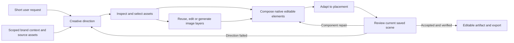

# Design Agent V1: a coherent skill family and a cross-brand test

Status: reviewed implementation proposal, 2026-09-13. No new family has been
loaded into the runtime and no new creative benchmark has been run for this
proposal. Branch: `codex/design-agent-v1`.

## Decision

Build the shared family together, then validate its parts and its complete
behavior. Use six procedural responsibilities and four initial creative
playbooks. Expand the playbook library only when these work across brands.
Skill count is not a quality metric, and playbooks are not fixed page templates.

Keep the current scene director/author roles during the first comparison. A
single scene agent remains a separate experiment after the skill comparison;
changing models, roles, references and skills together would obscure the result.
The brand-preparation agent and the Head of ABM work remain separate.

Three development subagents reviewed skill boundaries, runtime contracts and
cross-brand evaluation. The coordinator reconciled the findings and verified
the important source seams. These are development reviewers, not additional
agents being added to each customer generation run.

## Why adding more skills alone will not work

The [previous audit](design-agent-v1-harness-audit.md) established that skills
are discoverable and selected reference pixels can reach the image provider.
It did not establish autonomous short-request performance or cross-brand quality.
The current checkout adds the following evidence:

| Finding | Evidence and implication |
| --- | --- |
| Composition has competing authorities | The [router](../apps/agent_runtime/knowledge_docs/AGENT.md) puts format decisions first, while the pinned [block catalog](../apps/agent_runtime/knowledge_docs/knowledge/design/blocks/README.md) prescribes full patterns and calibrated dimensions. Updating only a new skill leaves those instructions in context. |
| Shared craft rules are contradicted | Several format skills still mandate inverse text on saturated backgrounds. The shared contrast skill instead checks actual luminance. Image skills disagree about when generation is appropriate. One canonical rule must govern each decision. |
| Identity and product treatment are inconsistent | A pinned logo example constructs a chip and typeset company name. A story rule rejects bitmap text broadly, although authentic product screenshots legitimately contain text. Asset role must determine treatment. |
| Full acceptance is not reliably enforced | [finalize_run](../apps/agent_runtime/lumen_agent/tools/substrate.py) trusts caller-supplied status, does not require a passing typed critique, and only checks preflight when cached diagnostics exist. A source-extracted, stubbed probe returned `accepted` with a false critique, a blocker, and no preview or preflight. This demonstrates a tool-level gap, not proof that this exact path caused a past visual failure. |
| Reference identity loses important information | [generation_key](../apps/api/lumen_api/image_cache.py) sorts reference digests, while the provider preserves reference order. Reversing references produces the same key in a pure probe. Role/order-sensitive instructions could therefore reuse the wrong cached result; no historical collision was established. |
| The timing report uses a different target | [run_view.py](../scripts/run_view.py) displays ten-minute completion and four-minute first-preview gates. This assignment requires a saved, visible, usable creative within three to four minutes. |

Fixing acceptance checks does not teach visual taste. The earlier reviewer also
approved work the founder rejected. A valid machine critique remains only one
part of evaluation; independent visual review must judge the whole creative.

## Six responsibilities, one direction record

| Logical scene/ad responsibility | Sole decision ownership | Starting material |
| --- | --- | --- |
| `creative-direction` | Audience, objective, supported message, original copy, optional artwork CTA, playbook choice | `clarify-design-brief`; shared reader-language and claim guidance |
| `art-direction-and-assets` | Inspect sources; distinguish inspiration, artwork, product and identity; decide what is preserved and what varies | `brand-imagery`, `reference-conditioned-ads`, `reference-image-direction` |
| `image-operations` | Execute reuse, edit or generation using the selected sources; inspect results and retain variants and receipts | `generative-imagery` and existing asset tools |
| `compose-scene` | Build content-driven native text, buttons, vectors and independent image placements | `create-design`; shared token, contrast and effect resources |
| `adapt-placement` | Exact canvas, placement constraints, protected crops and native recomposition | Existing square/story/display/cover/print format guidance |
| `review-and-revise` | Judge the full result; distinguish technical repair, component replacement and failed-direction recomposition | `visual-review`, `repair-design` |

These are procedures available to the same design runtime, not six mandatory
LLM agents or six serial model calls. A type-led design may skip generation.
Independent required image jobs may run concurrently within the run budget.

One versioned `CreativeDirection` record carries intent, evidence references,
exact copy, optional artwork CTA, separate channel copy, playbook, visual
invariants, selected sources and their roles, intended layers, requested
placement, and unresolved gaps. Later revisions amend this record explicitly.
Do not create disconnected copy, image, composition and review briefs.

Each selected source records its authorized scope, origin, digest, role,
operation, protected regions, intended scene node and review target. Generated
assets retain the actual provider input/output receipt. This belongs behind
existing runtime and asset seams; a Markdown field alone cannot enforce it.

### Migration boundary: preserve website behavior

Six responsibilities are the target architecture, not an instruction to add six
replacement directories or delete/rename all 28 existing skills immediately.
The smallest first implementation adds `scene-creative-direction`, one scene
family contract and routing table, four playbooks and selected component
resources. It reuses existing tool and craft mechanisms. Keep directories flat
for the current loader and account for existing readers before changing paths.

- Scene/ad-specific procedures move under the six owners. Existing entry points
  may temporarily be short routing adapters that refer to canonical guidance;
  they must not retain a second body of competing rules.
- Keep `brand-and-tokens`, `color-and-contrast`, `effects` and website-used asset
  guidance accessible to website callers. Share canonical craft facts rather
  than requiring a website to run a scene-composition procedure.
- Preserve `campaign-landing-page`, `campaign-page-workflow`,
  `conversion-copywriting`, `create-website`, `edit-website`, `review-website`,
  `design-guidance`, `plan-design`, `repair-cloned-sections`, and
  `custom-components`. Renaming website `plan-design` is unnecessary here.
- Keep `print-bleed-marks` as a specialist route. Display banners, profile
  covers, print and feed ads retain distinct purposes and placement rules.
- The scene router and scene-pinned pattern instructions must change with the
  family. Patterns become examples; components may be reused without imposing
  a full-page composition. Deliver a versioned scene-specific knowledge view,
  without changing the website's existing skill index, prompt assembly or pins.
  This needs a real runtime/materialization seam: adding a paragraph while still
  delivering conflicting legacy bodies does not resolve their authority.
- Existing skill IDs can route to the scene owner in that view while website
  callers retain their current sources. Include view identity and content in
  the materialization stamp. Do not change a shared workspace's view during an
  active run. The website-context equivalence check is an explicit regression
  gate, not an assumption that retaining filenames preserves behavior.
- Replace stale tool instructions with the actual role's capability reference.
  A skill cannot invent a tool argument or a native-vector extraction service.

The precedence is: authorized task and product scope; authentic identity and
supported evidence; placement/engine constraints; selected visual direction;
optional playbook examples. No example can force a CTA, a logo substitute, an
unreadable foreground, or a two-column layout.

### Skills, components and brand data have different jobs

Skills explain when to use a component and how to judge it. Reusable components
implement measured headline/support text, CTA geometry plus native label,
authentic-logo placement, protected image frames, quote/attribution blocks,
metric/qualifier blocks and native connectors/effects. They must remeasure for
content changes, preserve unique node IDs and use the checked engine operations.
The current full-page DSL examples are not yet a parameterized component system.

Brand-specific logo bytes, font files, button geometry, artwork treatments,
approved claims, screenshots and examples remain scoped brand data. Do not put
Conduit's petals or any company's palette into global skills. Source UI/photos
may remain independent images; that does not make their internal pixels editable.
Headline/body/button labels and authored vector geometry must remain native.

## Four initial playbooks

| Playbook | Evidence needed | What can vary |
| --- | --- | --- |
| Type-led positioning | A supported promise and usable brand typography | Hierarchy, composition and optional artwork; awareness may omit a button |
| Authentic product demonstration | Real screenshot/photo and a supported capability | Framing, crop, callouts and context; preserve product and identity pixels |
| Attributed proof | Approved quote or metric, source and qualification | Editorial treatment and layout; do not invent testimonials or numbers |
| Workflow contrast | A grounded process or capability comparison | Native panels, labels, connectors and illustration; no invented outcome metrics |

Each playbook contains fit/non-fit criteria, required evidence, variable
composition choices, component/layer options, counterexamples, and behavioral
evaluation cases. The catalog can grow toward 15–20 families, but add a family
only when it introduces a decision or evidence requirement existing ones cannot
express. A new background color is not a new family.

## Expansion policy: four is the starting point

The founder explicitly requested that expansion remain part of the roadmap
(2026-09-13). Grow toward roughly 15–20 useful creative families as coverage is
demonstrated. Do not silently stop at the initial four, or treat the target as a
fixed limit on what the agent can compose. The six shared responsibilities stay
the foundation; each new playbook reuses their copy, asset, composition,
placement and review capabilities.

### How a new family earns a place

1. **Record a real coverage gap.** Use ordinary user requests, observed failed
   cases and inspected references. State the unmet intent or evidence structure.
   Distinguish a retrieval/tool defect, a brand-context gap, a composition
   variant and a genuinely different creative procedure before writing a file.
2. **Extend at the right level.** A new palette, texture, logo or product image
   belongs in scoped brand context. A different composition within the same
   reasoning belongs in an existing playbook. A new ad purpose or evidence
   structure may deserve a new playbook. Missing crop, retrieval or vector
   functionality needs a tool/component change, not an invented skill command.
3. **Author a candidate playbook.** Include discovery description, when to use
   and avoid it, required evidence, copy decisions, source roles, preserve/vary
   rules, native/raster layer plan, component choices, placement adaptations,
   counterexamples and a small set of ordinary-request evaluations. Reference
   canonical shared rules instead of repeating them.
4. **Test the behavior.** Capture how the current family handles those requests,
   then compare the candidate with fixed sources, models and runtime settings.
   Trial each new family on at least three distinct, ready product brands,
   including one held out from authoring and a missing-evidence case. Repeat
   representative cases without operator coaching. Check first-pass quality,
   editability, source fidelity and finished-creative latency; retain failures.
5. **Promote or revise.** Keep candidates separate from the default production
   catalog until human visual acceptance and the relevant mechanical gates
   pass. Promotion records the version and evaluation evidence. Run selected
   regression cases from existing families; improvement on the new case must
   not quietly damage ordinary requests. Merge redundant candidates, revise
   weak ones and retain unresolved gaps in the backlog.

These are proposed lifecycle states, not an existing registry feature. Runtime
catalog filtering, version receipts and promotion checks need implementation
at the scene knowledge-view seam before relying on them as enforcement.

### Candidate expansion waves

| Wave | Candidate coverage | Approximate cumulative count |
| --- | --- | ---: |
| Initial | Type-led positioning; authentic product demonstration; attributed proof; workflow contrast | 4 |
| Next | Problem–solution; feature deep dive; product in use; launch/announcement | 8 |
| Further | Comparison/alternatives; case-study narrative; objection handling; offer/conversion | 12 |
| Broader | Event/webinar; integration ecosystem; educational mini-guide; visual metaphor | 16 |
| Additional | Customer co-brand spotlight; editorial/category point of view | 18 |

This is an explicit candidate backlog, not 18 validated or necessarily distinct
procedures. For example, product-in-use may prove to be a variant of authentic
product demonstration, and a customer spotlight may reuse attributed proof.
The next wave follows observed demand and evaluation results; a useful catalog
does not need duplicate families to meet a number.

### How scraping informs expansion

During ingestion, preserve provenance and classify references by objective,
message structure, source roles, composition, typography and visual treatments.
These observations and examples remain scoped to their brand. Scraped ads are
data, not instructions permitted to rewrite global skills. A recurring pattern
can motivate a candidate generic playbook; it still passes the authoring and
cross-brand evaluation process above. Scraping frequency is not proof of ad
performance.

The runtime catalog exposes concise descriptions and applicability. The agent
selects the relevant playbook, reads its instructions and supporting resources,
then binds the current brand's evidence and assets. Record what it actually
read. A larger library must not cause every full playbook to be injected into
every request. Adding a family is a versioned instruction/resource change; it
does not fine-tune the underlying model or install missing tool capabilities.

## Implementation order and parallel ownership

1. **Freeze the comparison inputs.** Preserve prior rejected output and traces
   as diagnostic evidence. Freeze model settings, source snapshots and normal
   request wording. Record the full knowledge bundle, including router and
   pinned resources, not just the new `SKILL.md` files.
2. **Harden the shared runtime contracts.** Require current-scene preflight,
   valid settled preview and structurally valid passing critique for full
   acceptance. Bind review to the scene and resolved asset versions; mutations
   invalidate it, including finalization-time mutations. Preserve honest drafts
   and the existing scoped-edit/baseline-advisory semantics. Extend reference
   review to selected kit/library sources. Fix ordered reference/cache custody
   and distinguish requested canvas, negotiated provider aspect and actual output.
3. **Author and integrate the family as one coherent bundle.** One owner covers
   copy and playbooks; one covers asset direction and image operations; one
   covers composition, placement and review. The coordinator owns shared router
   changes and conflict resolution. Use individual behavior cases before the
   integrated live benchmark; do not treat file-existence tests as skill success.
4. **Prepare brand workspaces through existing ingestion.** Validate actual
   sources and product bindings. Add bounded scene asset search only if testing
   shows eligible sources cannot be reached through current tools; automatic ad
   selection already exists. Do not build the separate brand agent here.
5. **Compare the old and new guidance on the same corrected runtime.** No model
   switch or scene-solo rewrite during this comparison. Expand after the core
   passes; evaluate runtime-role simplification separately afterward.

Three concurrent development workers plus the coordinator fit this session's
capacity. Work can proceed in waves; six extra agents need not be active or
created merely because the user allowed up to six. Assign disjoint paths and
leave shared files to the integration owner. Parallel code changes must not
silently alter a running benchmark.

## Cross-brand benchmark

The current read-only local inventory found only Conduit among Conduit/Convert,
Clue, Amazon/AWS and Google: two projects and one distinct brand kit. This is
presence, not asset readiness. No additional workspace was created by this review.
Amazon and Google product selection is pending; AWS and Google Cloud are the
provisional B2B choices, not confirmed brand bindings.

Before any batch, each workspace needs a verified company/product identity,
supported claims, inspected logo variants, usable fonts and source availability.
Inspect pixels as well as labels. Missing proof or product imagery must be a
reported readiness gap; deliberately thin libraries get explicit test cases.
Do not import or copy the separate image-model experiment folder into this repo.

| Stage | Outputs | Purpose |
| --- | ---: | --- |
| Paired core | 4 brands × 2 ordinary requests × 2 bundles = **16** | Autonomous copy, source selection and complete composition |
| Proof coverage | 2 evidence-ready brands × 1 request × 2 bundles = **4** | Validate sourced proof; unavailable proof stays unvalidated |
| Workflow coverage | 2 brands × 1 request × 2 bundles = **4** | Validate native explanatory composition |
| Fresh candidate repeats | 1 predetermined core request per brand = **4** | Check repeatability without feedback |
| Variety | 2 brands × 3 requested alternatives = **6** | Check differences in idea and composition |
| Adaptation | 2 predetermined accepted concepts, one 4:5 and one 9:16 = **2** | Check native recomposition and protected crops |

Start with 16 outputs; the optional complete pilot is 36. It is not a promise of
that many paid generations: a creative may need no new raster. Compute and
record the provider-cost ceiling from configured prices before funded execution.

Core request examples: “Create a square LinkedIn awareness ad for our product”
and “Make a square LinkedIn ad showing how our product helps a new customer.”
Stored context supplies the brand and product. Do not include skill names,
internal IDs, headlines, image prompts or layout prescriptions. User-attached
references are a separate test, not a substitute for autonomous retrieval.

Reserve one product brand for evaluation after the family is frozen; its assets
may be ingested and validated, but its creative examples must not inform skill
authoring. Also reserve an unused reference family and adaptation prompts.
Randomize baseline/candidate order. Do not tune between cases in the batch.
Both bundles must start from the same immutable eligible asset/claim snapshot
and empty case history. Enforce eligibility at retrieval: benchmark-generated
assets must not enter later cases' source corpus. Isolate generated-result
caches between arms and record cache hits; separate chats alone do not prevent
this contamination.

Score the untouched first delivery. Two human reviewers, blind to the bundle
and timing, separately rate idea/copy, component quality, whole composition,
brand fidelity and variety on 0–5 scales against the frozen brand reference set.
Assess reference relevance as well as fidelity. Mechanical gates cover claims,
authentic identity, exact dimensions, asset loading, overflow, protected crops
and native editability. Model self-scores cannot replace this review.

For accepted outputs, edit actual text, save, reload and export in the browser.
For each brand/strategy also move a logo/image and alter native button geometry
where present. Preserve the first scene before these verification edits. Inspect
exported pixels; an SVG wrapper containing a raster is not native vector proof.

Timing starts at user submission and ends when the saved artifact is visible,
settled and usable with a valid export. Record queue, first preview, save and
visible-ready times separately. Include internal repairs/retries; operator
corrections form separate assisted results. Target ≤240 seconds, stretch ≤180;
use a common ten-minute diagnostic ceiling and retain timeouts in the denominator.
Three-option batch time is not total time divided by three.

Independent brand quality cases can run concurrently under a fixed, recorded
worker/provider limit shared by both bundles. Run isolated latency controls too;
do not compare a queued baseline with an unloaded candidate. Every reported
customer-facing duration still includes actual queue time.

An initial decision rule: at least seven of eight candidate core outputs are
human-accepted and ready within 240 seconds, each brand has a passing case, and
no accepted output violates a hard gate. Report every result and duration. This
small pilot does not establish universal reliability or an advertising lift.

### Evidence and isolation

Each case manifest ties together the workspace/product/kit, code and skill
digests, original request, skills actually read, assets retrieved/viewed/selected,
source roles, provider inputs, canvas/aspect/crop decisions, timing and usage,
first scene/version/PNG, critiques, repairs and browser edit/export proof.
Missing evidence is a named gap, not inferred success.

One frozen runtime can serve different brand workspaces with separate projects,
chats, documents, scoped storage/cache and browser tabs. Verify workspace binding
before submission and in the run receipt. A tab does not isolate data.
Concurrent code strategies require separate branches/worktrees, services, ports,
databases or isolated snapshots, queue namespaces, storage, caches, agent working
directories, logs/PIDs, builds and scratch paths. Never let competing strategy
workers consume the same queue. Migration tests use a disposable database.

Before live spend, test missing/mislabeled logos and fonts, unsupported proof,
inaccessible or cross-workspace sources, relevant assets outside the recent
window, kit-only fidelity review, untrusted source instructions, aspect/crop
negotiation, delayed asset publication, provider timeout/duplicate retry,
save/reload failure, and stale/failed/missing review. Expect bounded, honest
failure or a supported alternate direction, never a fabricated success.

## External checks and limits

[Deep Agents documentation](https://docs.langchain.com/oss/python/deepagents/skills)
describes loading skill metadata first and reading selected instructions and
resources on demand. This supports the family organization; the installed
runtime remains the authority for actual discovery behavior.

[LinkedIn's current image specifications](https://www.linkedin.com/help/linkedin/answer/a427596/)
include square, landscape and vertical formats; square is a sound first control,
not the only LinkedIn format. Placement is independent from the creative family.
Phone portrait is 9:16, not 16:9. Recheck placement-specific safe regions using
current platform guidance and previews at execution time. Meta's direct page
redirected to login during this review; no fresh universal safe-area measurements
were established.

Harvested references and human preference can assess visual fit. They do not
establish CTR, conversion or ROAS. Those require a separate campaign experiment.
