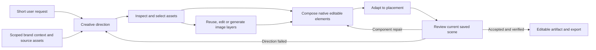

# Design Agent V1: a coherent skill family and a cross-brand test

## Current status — September 15, 2026

The catalog and substantial runtime/editor repairs are implemented locally, but
reliable creative quality and the four-minute delivery target remain unmet.
The historical checkpoints below record evidence at their own dates; this
status supersedes their older coverage counts and pending-restart statements.

| Goal | Current evidence | Status |
| --- | --- | --- |
| Full callable family | 18 family playbooks and 12 shared support skills in the scene manifest | Implemented locally |
| Actual use | 27 distinct explicit skill read requests: 15 families and all 12 support skills | Exercised, not proof of comprehension |
| Rendered family coverage | 13/18 families selected with evaluated rendered output | Partial; approximately 72% coverage only |
| Cross-brand qualification | No family has passed repeated human quality, source, editing and latency gates across the required brands | 0/18 qualified |
| Four local brand workspaces | Clue 3021, AWS 3022, Google Cloud 3023, Conduit 3024; separate workspace scopes, shared local backend/Postgres | Operational; not cloud deployments |
| Reference-driven generation | Selected originals, provider input/output custody, crops, generated components and independent scene layers exercised | Implemented; source relevance and treatment still inconsistent |
| Native editing/export | Prior fresh four-brand batch passed editing, undo, save/reload and PNG/SVG export checks | Verified for that frozen batch; not automatically every subsequent revision |
| Approved taste across fresh runs | Body-free selection and per-call scoped preference delivery are implemented and tested; production wiring is default-off pending output-history erasure and governed preference capture | Staged; no automatic taste learning claim |
| Finished creative within 240 seconds | Latest fresh four-brand generation took Clue 629.974s, AWS 551.077s, Google 724.118s, Conduit 355.176s | 0/4 pass; scoped repairs are a separate measure |
| Supporting-copy balance | Four scoped repairs enlarged support; user rejected Conduit's 42px result and approved their own 32px correction | Shared guidance corrected; fresh autonomous validation pending |
| One-to-one ABM | Existing scene agent exposes logo fetching and independent placement; complete account-to-scene handoff and account batch not validated | Ready for a bounded pilot, not full account workflow |
| Production promotion | Candidate remains local on codex/design-agent-v1 | Not promoted or pushed |

Selected/rendered families: type-led-positioning, authentic-product,
attributed-proof, workflow-contrast, feature-deep-dive, product-in-use,
launch-announcement, event-webinar, integration-ecosystem, educational-guide,
visual-metaphor, customer-spotlight and editorial-pov. Case-study-narrative and
offer-conversion have read requests but no selected/rendered evaluation.
Problem-solution, comparison-alternatives and objection-handling have neither.

The 12 support skills are scene-brief-copy, create-design, plan-design,
reference-image-direction, reference-conditioned-ads, generative-imagery,
brand-imagery, visual-review, repair-design, brand-and-tokens, effects and tools.
Composition variants and the 21 shared knowledge resources are not additional
independently qualified subskills. Four of those resources are pinned.

Most elapsed generation time is in model-call spans and repeated deliberation,
inspection, authoring and repair, rather than local rendering. Earlier measured
runs spent 80–99% in model calls; that historical attribution is not a measured
breakdown of all development time. Investigation also uncovered real replay,
isolation, text measurement, SVG color, token and inspector defects. Repairing
them was necessary, but successive diagnostic batches are not a clean causal
comparison or proof that skill expansion improved the customer outcome. Model
self-acceptance repeatedly disagreed with independent/user visual review.

Next priority is to preserve the user's approved typography and test one shared
account-adaptation capability on a bounded pilot; do not wait for all 18 families
or expand the catalog further first. Readability, hierarchy, brand treatment and
grounded copy remain joint requirements. The separate 60-call Task26 diagnostic has
made zero calls and remains unapproved. Brand Asset Intelligence, Head of ABM,
website work and production release remain outside this implementation.

## Historical implementation record

Status at the earlier checkpoint: implementation in local validation, 2026-09-14. **Eighteen candidate
playbooks** are implemented and enabled on localhost through on-demand discovery.
The original four-playbook scope below records the earlier plan; the full-family
continuation at the end is the current scope. Reference custody, acceptance,
timing and crop safeguards are implemented. The eight-run topology comparison and
latest four-case coverage round cover all four brands in director/author and
single-agent configurations. The broader skill-family benchmark remains incomplete and the four-minute target
has not passed. Branch: `codex/design-agent-v1`.

The earlier approved provider round below delivered three new square drafts through
ordinary Home requests and the normal Design handoff, without supplied asset IDs,
skill names, prescribed headlines or layouts. There are now saved current-family
samples across all four local brand workspaces. Eight families have live selection
evidence; ten remain candidates without rendered coverage in this test.
Model acceptance, usable editing and human creative quality remain separate gates.

| Earlier ordinary request | Actual family and imagery | Delivery and remaining issue |
| --- | --- | --- |
| AWS Cloud and AI Day Türkiye invitation | event-webinar; new artwork conditioned on three genuine event originals; independent logo and five text layers | Saved draft, about 11 minutes. Acceptance correctly refused after another preflight changed headline pixels. Small date/venue copy and loose spacing remain. |
| Google Cloud / Glance customer story | customer-spotlight; new photograph conditioned on a Gemini ad; independently fetched Glance logo and supplied Google Cloud logo | Saved and model-accepted, about 19 minutes. It inspected the Glance comic but deliberately selected another campaign's photo treatment. Small support/CTA and conventional composition remain. |
| Conduit introduction | type-led-positioning; one fresh blurred background conditioned on an ingested website original; native copy and authentic logo | Saved and model-accepted after one revision, about 15.5 minutes. Background treatment is closer; supporting copy still needs stronger feed-scale hierarchy. |

Native text edit → save → reload → restore passed for all three. Canonical PNG
and SVG exports preserve the restored scenes and versions (AWS v23, Google v56,
Conduit v35). The exported PNGs match the frozen final previews. These are
ordinary-request diagnostics, not a paired causal benchmark or a 240-second pass.
Clue's two earlier saved samples remain unchanged. Ports 3021–3024 serve distinct
local workspace contexts through a shared local backend/database; they are not
four independent database installations or cloud deployments.

The latest four-brand topology comparison is recorded at the end of this plan.
Its timings and saved artifacts are actual observations, but its context isolation
is not a proven causal control: a subsequent audit reproduced sibling-run file
access through the shared scene backend. The Clue trace requests a prior Conduit
critique and AWS control-run feedback. Frozen logs do not include returned tool
bodies, so historical ingestion is unverified; equal source catalogs alone do not
prove equal or isolated model context. New provider comparisons must first verify
that each run can read only its own files and the intended shared knowledge.

The September 14 corrections fence scene filesystem tools to the active run and
shared read-only instructions, including aliases, recursive searches and symlinks.
Both scene topologies use the fence; the website backend retains its existing
contract. The exact historical sibling requests now return no data. Current
preflight/preview/review evidence is separated from historical feedback, and chat
distinguishes an accepted design, scoped edit and unaccepted saved draft.

The earlier missing-guide diagnosis was incorrect: zero explicit component-guide
reads did not mean missing context. The scene manifest already pins its canonical
body, and the factory inlines that body into the solo system prompt. Frozen source,
configuration and materialized bytes support that reconstruction; these live logs
did not capture complete model input messages. The redundant initial-read request
added in `00efde8c` is now removed, while applying the loaded guide remains required.
An offline test of the real solo graph confirms the first model message contains
the entire guide exactly once and keeps family bodies available on demand.
The existing placement preview also reports resolved native text em sizes at its
actual 360px content scale. These are observations for the agent, not prescribed
font sizes or a new visual-quality acceptance gate. The completed four-brand round
below exercised these changes with ordinary requests for Clue's human review, an
AWS AI guide, Google Cloud's enterprise AI positioning, and Conduit's OPERA integration.
No additional family is promoted merely because these mechanics pass tests.

## Earlier four-playbook implementation evidence and remaining gate

- A separate scene knowledge view now serves the family and removes conflicting
  fixed-layout policy from that view. Website knowledge remains compatible.
- Ordered source bytes, roles, framing and provider outputs are recorded. A real
  Conduit image run used three inspected sources and generated a new, matching
  blurred background; it still failed composition and delivery-time review.
- Final acceptance requires current preflight, rendered bytes and a registered
  passing critique. Valid unaccepted drafts survive. Model acceptance alone is
  still not human visual acceptance.
- Clue and Google Cloud ordinary awareness requests completed with distinct brand
  typography/identity. Neither establishes the four-minute finished-delivery
  target. Source fixtures for Conduit, Clue, AWS and Google Cloud are isolated
  local test workspaces with explicitly partial kits and evidence gaps.
- Live failures motivated an exact source-pixel crop tool, content-based preview
  freshness, and trusted checkpoint persistence even when an existing preview is
  reused. These repairs are part of the implementation, not improved benchmark
  scores. Preserve the earlier failures in the denominator.
- Clue and Google Cloud native text edits survived save/reload; restored scenes
  and exported PNGs exactly matched their original outputs. AWS durably saved a
  31-operation checkpoint before stopping, but its own review rejected the
  composition. Its kit also lacks the declared Arial font file. It remains an
  unaccepted draft with a partial-fixture gap.
- Runtime tracing identified avoidable final-critique reserialization and a
  conflict between the four-minute target and legacy four-minute repair-floor
  guidance. Candidate fixes reuse the registered review and permit one focused
  quality repair when hard headroom exists. Target misses remain visible;
  changing this guidance does not demonstrate a faster or better live output.
- A subsequent ordinary AWS repair on the final runtime resized the existing
  logo and made support readable without changing the copy. It finalized once
  using the registered review and exported through the browser. It took 5m10s,
  remained a scoped edit rather than strict creative acceptance, and did not
  resolve the weak overall composition or the partial brand-kit warning.
- The 16-row comparison manifest is prepared in ignored evaluation storage.
  Diagnostics changed code between runs, so they cannot establish a controlled
  old/new-guidance win. Freeze the final runtime and reset eligible output/caches
  before that comparison. Human review, repeatability, proof/workflow coverage
  and promotion remain open.

Operational results and exact verification are recorded in
[`_memory/2026-09-13-design-skill-family-implementation.md`](../../../_memory/2026-09-13-design-skill-family-implementation.md).

## Decision

Build the shared family together, then validate its parts and its complete
behavior. Six procedural responsibilities support the original four playbooks
and the fourteen additional candidates now authorized by the user. Candidate
availability is separate from promotion: each still needs cross-brand evidence.
Skill count is not a quality metric, and playbooks are not fixed page templates.

Keep the current scene director/author roles during the first comparison. A
single scene agent remains a separate experiment after the skill comparison;
changing models, roles, references and skills together would obscure the result.
The brand-preparation agent and the Head of ABM work remain separate.

Three development subagents reviewed skill boundaries, runtime contracts and
cross-brand evaluation. The coordinator reconciled the findings and verified
the important source seams. These are development reviewers, not additional
agents being added to each customer generation run.

## Why adding more skills alone will not work

The [previous audit](design-agent-v1-harness-audit.md) established that skills
are discoverable and selected reference pixels can reach the image provider.
It did not establish autonomous short-request performance or cross-brand quality.
The following table records the pre-implementation findings at `e0d73952`;
the implementation status above describes which mechanisms have since changed:

| Finding | Evidence and implication |
| --- | --- |
| Composition has competing authorities | The [router](../apps/agent_runtime/knowledge_docs/AGENT.md) puts format decisions first, while the pinned [block catalog](../apps/agent_runtime/knowledge_docs/knowledge/design/blocks/README.md) prescribes full patterns and calibrated dimensions. Updating only a new skill leaves those instructions in context. |
| Shared craft rules are contradicted | Several format skills still mandate inverse text on saturated backgrounds. The shared contrast skill instead checks actual luminance. Image skills disagree about when generation is appropriate. One canonical rule must govern each decision. |
| Identity and product treatment are inconsistent | A pinned logo example constructs a chip and typeset company name. A story rule rejects bitmap text broadly, although authentic product screenshots legitimately contain text. Asset role must determine treatment. |
| Full acceptance is not reliably enforced | [finalize_run](../apps/agent_runtime/lumen_agent/tools/substrate.py) trusts caller-supplied status, does not require a passing typed critique, and only checks preflight when cached diagnostics exist. A source-extracted, stubbed probe returned `accepted` with a false critique, a blocker, and no preview or preflight. This demonstrates a tool-level gap, not proof that this exact path caused a past visual failure. |
| Reference identity loses important information | [generation_key](../apps/api/lumen_api/image_cache.py) sorts reference digests, while the provider preserves reference order. Reversing references produces the same key in a pure probe. Role/order-sensitive instructions could therefore reuse the wrong cached result; no historical collision was established. |
| The timing report uses a different target | [run_view.py](../scripts/run_view.py) displays ten-minute completion and four-minute first-preview gates. This assignment requires a saved, visible, usable creative within three to four minutes. |

Fixing acceptance checks does not teach visual taste. The earlier reviewer also
approved work the founder rejected. A valid machine critique remains only one
part of evaluation; independent visual review must judge the whole creative.

## Six responsibilities, one direction record

| Logical scene/ad responsibility | Sole decision ownership | Starting material |
| --- | --- | --- |
| `creative-direction` | Audience, objective, supported message, original copy, optional artwork CTA, playbook choice | `clarify-design-brief`; shared reader-language and claim guidance |
| `art-direction-and-assets` | Inspect sources; distinguish inspiration, artwork, product and identity; decide what is preserved and what varies | `brand-imagery`, `reference-conditioned-ads`, `reference-image-direction` |
| `image-operations` | Execute reuse, edit or generation using the selected sources; inspect results and retain variants and receipts | `generative-imagery` and existing asset tools |
| `compose-scene` | Build content-driven native text, buttons, vectors and independent image placements | `create-design`; shared token, contrast and effect resources |
| `adapt-placement` | Exact canvas, placement constraints, protected crops and native recomposition | Existing square/story/display/cover/print format guidance |
| `review-and-revise` | Judge the full result; distinguish technical repair, component replacement and failed-direction recomposition | `visual-review`, `repair-design` |

These are procedures available to the same design runtime, not six mandatory
LLM agents or six serial model calls. A type-led design may skip generation.
Independent required image jobs may run concurrently within the run budget.

One versioned `CreativeDirection` record carries intent, evidence references,
exact copy, optional artwork CTA, separate channel copy, playbook, visual
invariants, selected sources and their roles, intended layers, requested
placement, and unresolved gaps. Later revisions amend this record explicitly.
Do not create disconnected copy, image, composition and review briefs.

Each selected source records its authorized scope, origin, digest, role,
operation, protected regions, intended scene node and review target. Generated
assets retain the actual provider input/output receipt. This belongs behind
existing runtime and asset seams; a Markdown field alone cannot enforce it.

### Migration boundary: preserve website behavior

Six responsibilities are the target architecture, not an instruction to add six
replacement directories or delete/rename all 28 existing skills immediately.
The smallest first implementation adds `scene-brief-copy`, one scene
family contract and routing table, four playbooks and selected component
resources. It reuses existing tool and craft mechanisms. Keep directories flat
for the current loader and account for existing readers before changing paths.

- Scene/ad-specific procedures move under the six owners. Existing entry points
  may temporarily be short routing adapters that refer to canonical guidance;
  they must not retain a second body of competing rules.
- Keep `brand-and-tokens`, `color-and-contrast`, `effects` and website-used asset
  guidance accessible to website callers. Share canonical craft facts rather
  than requiring a website to run a scene-composition procedure.
- Preserve `campaign-landing-page`, `campaign-page-workflow`,
  `conversion-copywriting`, `create-website`, `edit-website`, `review-website`,
  `design-guidance`, `plan-design`, `repair-cloned-sections`, and
  `custom-components`. Renaming website `plan-design` is unnecessary here.
- Keep `print-bleed-marks` as a specialist route. Display banners, profile
  covers, print and feed ads retain distinct purposes and placement rules.
- The scene router and scene-pinned pattern instructions must change with the
  family. Patterns become examples; components may be reused without imposing
  a full-page composition. Deliver a versioned scene-specific knowledge view,
  without changing the website's existing skill index, prompt assembly or pins.
  This needs a real runtime/materialization seam: adding a paragraph while still
  delivering conflicting legacy bodies does not resolve their authority.
- Existing skill IDs can route to the scene owner in that view while website
  callers retain their current sources. Include view identity and content in
  the materialization stamp. Do not change a shared workspace's view during an
  active run. The website-context equivalence check is an explicit regression
  gate, not an assumption that retaining filenames preserves behavior.
- Replace stale tool instructions with the actual role's capability reference.
  A skill cannot invent a tool argument or a native-vector extraction service.

The precedence is: authorized task and product scope; authentic identity and
supported evidence; placement/engine constraints; selected visual direction;
optional playbook examples. No example can force a CTA, a logo substitute, an
unreadable foreground, or a two-column layout.

### Skills, components and brand data have different jobs

Skills explain when to use a component and how to judge it. Reusable components
implement measured headline/support text, CTA geometry plus native label,
authentic-logo placement, protected image frames, quote/attribution blocks,
metric/qualifier blocks and native connectors/effects. They must remeasure for
content changes, preserve unique node IDs and use the checked engine operations.
The current full-page DSL examples are not yet a parameterized component system.

Brand-specific logo bytes, font files, button geometry, artwork treatments,
approved claims, screenshots and examples remain scoped brand data. Do not put
Conduit's petals or any company's palette into global skills. Source UI/photos
may remain independent images; that does not make their internal pixels editable.
Headline/body/button labels and authored vector geometry must remain native.

## Four initial playbooks

| Playbook | Evidence needed | What can vary |
| --- | --- | --- |
| Type-led positioning | A supported promise and usable brand typography | Hierarchy, composition and optional artwork; awareness may omit a button |
| Authentic product demonstration | Real screenshot/photo and a supported capability | Framing, crop, callouts and context; preserve product and identity pixels |
| Attributed proof | Approved quote or metric, source and qualification | Editorial treatment and layout; do not invent testimonials or numbers |
| Workflow contrast | A grounded process or capability comparison | Native panels, labels, connectors and illustration; no invented outcome metrics |

Each playbook contains fit/non-fit criteria, required evidence, variable
composition choices, component/layer options, counterexamples, and behavioral
evaluation cases. The catalog can grow toward 15–20 families, but add a family
only when it introduces a decision or evidence requirement existing ones cannot
express. A new background color is not a new family.

## Expansion policy: four is the starting point

The founder explicitly requested that expansion remain part of the roadmap
(2026-09-13). Grow toward roughly 15–20 useful creative families as coverage is
demonstrated. Do not silently stop at the initial four, or treat the target as a
fixed limit on what the agent can compose. The six shared responsibilities stay
the foundation; each new playbook reuses their copy, asset, composition,
placement and review capabilities.

### How a new family earns a place

1. **Record a real coverage gap.** Use ordinary user requests, observed failed
   cases and inspected references. State the unmet intent or evidence structure.
   Distinguish a retrieval/tool defect, a brand-context gap, a composition
   variant and a genuinely different creative procedure before writing a file.
2. **Extend at the right level.** A new palette, texture, logo or product image
   belongs in scoped brand context. A different composition within the same
   reasoning belongs in an existing playbook. A new ad purpose or evidence
   structure may deserve a new playbook. Missing crop, retrieval or vector
   functionality needs a tool/component change, not an invented skill command.
3. **Author a candidate playbook.** Include discovery description, when to use
   and avoid it, required evidence, copy decisions, source roles, preserve/vary
   rules, native/raster layer plan, component choices, placement adaptations,
   counterexamples and a small set of ordinary-request evaluations. Reference
   canonical shared rules instead of repeating them.
4. **Test the behavior.** Capture how the current family handles those requests,
   then compare the candidate with fixed sources, models and runtime settings.
   Trial each new family on at least three distinct, ready product brands,
   including one held out from authoring and a missing-evidence case. Repeat
   representative cases without operator coaching. Check first-pass quality,
   editability, source fidelity and finished-creative latency; retain failures.
5. **Promote or revise.** Keep candidates separate from the default production
   catalog until human visual acceptance and the relevant mechanical gates
   pass. Promotion records the version and evaluation evidence. Run selected
   regression cases from existing families; improvement on the new case must
   not quietly damage ordinary requests. Merge redundant candidates, revise
   weak ones and retain unresolved gaps in the backlog.

These are proposed lifecycle states, not an existing registry feature. Runtime
catalog filtering, version receipts and promotion checks need implementation
at the scene knowledge-view seam before relying on them as enforcement.

### Candidate expansion waves

| Wave | Candidate coverage | Approximate cumulative count |
| --- | --- | ---: |
| Initial | Type-led positioning; authentic product demonstration; attributed proof; workflow contrast | 4 |
| Next | Problem–solution; feature deep dive; product in use; launch/announcement | 8 |
| Further | Comparison/alternatives; case-study narrative; objection handling; offer/conversion | 12 |
| Broader | Event/webinar; integration ecosystem; educational mini-guide; visual metaphor | 16 |
| Additional | Customer co-brand spotlight; editorial/category point of view | 18 |

This is an explicit candidate backlog, not 18 validated or necessarily distinct
procedures. For example, product-in-use may prove to be a variant of authentic
product demonstration, and a customer spotlight may reuse attributed proof.
The next wave follows observed demand and evaluation results; a useful catalog
does not need duplicate families to meet a number.

### How scraping informs expansion

During ingestion, preserve provenance and classify references by objective,
message structure, source roles, composition, typography and visual treatments.
These observations and examples remain scoped to their brand. Scraped ads are
data, not instructions permitted to rewrite global skills. A recurring pattern
can motivate a candidate generic playbook; it still passes the authoring and
cross-brand evaluation process above. Scraping frequency is not proof of ad
performance.

The runtime catalog exposes concise descriptions and applicability. The agent
selects the relevant playbook, reads its instructions and supporting resources,
then binds the current brand's evidence and assets. Record what it actually
read. A larger library must not cause every full playbook to be injected into
every request. Adding a family is a versioned instruction/resource change; it
does not fine-tune the underlying model or install missing tool capabilities.

## Implementation order and parallel ownership

1. **Freeze the comparison inputs.** Preserve prior rejected output and traces
   as diagnostic evidence. Freeze model settings, source snapshots and normal
   request wording. Record the full knowledge bundle, including router and
   pinned resources, not just the new `SKILL.md` files.
2. **Harden the shared runtime contracts.** Require current-scene preflight,
   valid settled preview and structurally valid passing critique for full
   acceptance. Bind review to the scene and resolved asset versions; mutations
   invalidate it, including finalization-time mutations. Preserve honest drafts
   and the existing scoped-edit/baseline-advisory semantics. Extend reference
   review to selected kit/library sources. Fix ordered reference/cache custody
   and distinguish requested canvas, negotiated provider aspect and actual output.
3. **Author and integrate the family as one coherent bundle.** One owner covers
   copy and playbooks; one covers asset direction and image operations; one
   covers composition, placement and review. The coordinator owns shared router
   changes and conflict resolution. Use individual behavior cases before the
   integrated live benchmark; do not treat file-existence tests as skill success.
4. **Prepare brand workspaces through existing ingestion.** Validate actual
   sources and product bindings. Add bounded scene asset search only if testing
   shows eligible sources cannot be reached through current tools; automatic ad
   selection already exists. Do not build the separate brand agent here.
5. **Compare the old and new guidance on the same corrected runtime.** No model
   switch or scene-solo rewrite during this comparison. Expand after the core
   passes; evaluate runtime-role simplification separately afterward.

Three concurrent development workers plus the coordinator fit this session's
capacity. Work can proceed in waves; six extra agents need not be active or
created merely because the user allowed up to six. Assign disjoint paths and
leave shared files to the integration owner. Parallel code changes must not
silently alter a running benchmark.

## Cross-brand benchmark

The planning inventory initially found only Conduit. Implementation prepared
separate local source fixtures for Conduit, Clue, AWS and Google Cloud through
existing ingestion and kit seams. The original Conduit workspace is preserved.
These are approved partial kits, not production-ready product libraries: missing
proof, authentic product UI and other readiness gaps are recorded per fixture.

Before any batch, each workspace needs a verified company/product identity,
supported claims, inspected logo variants, usable fonts and source availability.
Inspect pixels as well as labels. Missing proof or product imagery must be a
reported readiness gap; deliberately thin libraries get explicit test cases.
Do not import or copy the separate image-model experiment folder into this repo.

| Stage | Outputs | Purpose |
| --- | ---: | --- |
| Paired core | 4 brands × 2 ordinary requests × 2 bundles = **16** | Autonomous copy, source selection and complete composition |
| Proof coverage | 2 evidence-ready brands × 1 request × 2 bundles = **4** | Validate sourced proof; unavailable proof stays unvalidated |
| Workflow coverage | 2 brands × 1 request × 2 bundles = **4** | Validate native explanatory composition |
| Fresh candidate repeats | 1 predetermined core request per brand = **4** | Check repeatability without feedback |
| Variety | 2 brands × 3 requested alternatives = **6** | Check differences in idea and composition |
| Adaptation | 2 predetermined accepted concepts, one 4:5 and one 9:16 = **2** | Check native recomposition and protected crops |

Start with 16 outputs; the optional complete pilot is 36. It is not a promise of
that many paid generations: a creative may need no new raster. Compute and
record the provider-cost ceiling from configured prices before funded execution.

Core request examples: “Create a square LinkedIn awareness ad for our product”
and “Make a square LinkedIn ad showing how our product helps a new customer.”
Stored context supplies the brand and product. Do not include skill names,
internal IDs, headlines, image prompts or layout prescriptions. User-attached
references are a separate test, not a substitute for autonomous retrieval.

Reserve one product brand for evaluation after the family is frozen; its assets
may be ingested and validated, but its creative examples must not inform skill
authoring. Also reserve an unused reference family and adaptation prompts.
Randomize baseline/candidate order. Do not tune between cases in the batch.
Both bundles must start from the same immutable eligible asset/claim snapshot
and empty case history. Enforce eligibility at retrieval: benchmark-generated
assets must not enter later cases' source corpus. Isolate generated-result
caches between arms and record cache hits; separate chats alone do not prevent
this contamination.

Score the untouched first delivery. Two human reviewers, blind to the bundle
and timing, separately rate idea/copy, component quality, whole composition,
brand fidelity and variety on 0–5 scales against the frozen brand reference set.
Assess reference relevance as well as fidelity. Mechanical gates cover claims,
authentic identity, exact dimensions, asset loading, overflow, protected crops
and native editability. Model self-scores cannot replace this review.

For accepted outputs, edit actual text, save, reload and export in the browser.
For each brand/strategy also move a logo/image and alter native button geometry
where present. Preserve the first scene before these verification edits. Inspect
exported pixels; an SVG wrapper containing a raster is not native vector proof.

Timing starts at user submission and ends when the saved artifact is visible,
settled and usable with a valid export. Record queue, first preview, save and
visible-ready times separately. Include internal repairs/retries; operator
corrections form separate assisted results. Target ≤240 seconds, stretch ≤180;
use a common ten-minute diagnostic ceiling and retain timeouts in the denominator.
Three-option batch time is not total time divided by three.

Independent brand quality cases can run concurrently under a fixed, recorded
worker/provider limit shared by both bundles. Run isolated latency controls too;
do not compare a queued baseline with an unloaded candidate. Every reported
customer-facing duration still includes actual queue time.

An initial decision rule: at least seven of eight candidate core outputs are
human-accepted and ready within 240 seconds, each brand has a passing case, and
no accepted output violates a hard gate. Report every result and duration. This
small pilot does not establish universal reliability or an advertising lift.

### Evidence and isolation

Each case manifest ties together the workspace/product/kit, code and skill
digests, original request, skills actually read, assets retrieved/viewed/selected,
source roles, provider inputs, canvas/aspect/crop decisions, timing and usage,
first scene/version/PNG, critiques, repairs and browser edit/export proof.
Missing evidence is a named gap, not inferred success.

One frozen runtime can serve different brand workspaces with separate projects,
chats, documents, scoped storage/cache and browser tabs. Verify workspace binding
before submission and in the run receipt. A tab does not isolate data.
Concurrent code strategies require separate branches/worktrees, services, ports,
databases or isolated snapshots, queue namespaces, storage, caches, agent working
directories, logs/PIDs, builds and scratch paths. Never let competing strategy
workers consume the same queue. Migration tests use a disposable database.

Before live spend, test missing/mislabeled logos and fonts, unsupported proof,
inaccessible or cross-workspace sources, relevant assets outside the recent
window, kit-only fidelity review, untrusted source instructions, aspect/crop
negotiation, delayed asset publication, provider timeout/duplicate retry,
save/reload failure, and stale/failed/missing review. Expect bounded, honest
failure or a supported alternate direction, never a fabricated success.

## External checks and limits

[Deep Agents documentation](https://docs.langchain.com/oss/python/deepagents/skills)
describes loading skill metadata first and reading selected instructions and
resources on demand. This supports the family organization; the installed
runtime remains the authority for actual discovery behavior.

[LinkedIn's current image specifications](https://www.linkedin.com/help/linkedin/answer/a427596/)
include square, landscape and vertical formats; square is a sound first control,
not the only LinkedIn format. Placement is independent from the creative family.
Phone portrait is 9:16, not 16:9. Recheck placement-specific safe regions using
current platform guidance and previews at execution time. Meta's direct page
redirected to login during this review; no fresh universal safe-area measurements
were established.

Harvested references and human preference can assess visual fit. They do not
establish CTR, conversion or ROAS. Those require a separate campaign experiment.

## Implementation work packages

Execution authorized by the founder on 2026-09-13. Baseline code is `e0d73952`.
Work in the existing branch/worktree. Use focused behavioral tests, preserve
website behavior, keep customer artifacts in ignored local storage, and never
push. Parallel implementers have disjoint file ownership; the coordinator owns
shared integration and local commits. Do not spawn additional agents from a
worker, edit another owner's files, create worktrees, or change models/services.

### Task 1: Scene skill family and materialized knowledge view

Own runtime `materialize.py`, `harness.py`, `prompts.py`, `config.py`, new
`models/creative_direction.py`, `knowledge_docs/` and focused new/affected tests
for these areas. The coordinator owns `tools/substrate.py`, render/view tools,
other models and runtime finalization. Task 2 owns the image provider/cache.
Task 3 owns evaluation scripts.

Implement the minimal scene family: one autonomous brief/copy entry point,
four playbooks (type-led positioning, authentic product, attributed proof,
workflow contrast), a shared direction contract and coherent scene routing.
Preserve existing website skill index, prompts and pins. Remove contradictory
legacy policy from the delivered scene view instead of adding one more rule
beside it. Use canonical shared mechanics and preserve current skill IDs for
other callers. Selective loading must work through the actual materializer and
DeepAgents harness; content stamps must include the view. Support old/new scene
bundles for controlled evaluation, with the old behavior as a compatible
default until the coordinator enables the candidate locally. Any added runtime
flag must have default parity in root/subsystem examples; coordinate ownership
with the root before editing env examples. Never print or modify secret values.

The direction record must carry copy, evidence references, playbook, intent,
source roles, preserve/vary choices, layer plan, placement and review needs.
Define a small typed schema and tell the coordinator the exact file/tool seam
for validation; do not invent unavailable commands. Shared component guidance
must preserve native text/geometry and authentic independent logo/product
images, allow optional CTAs and typography-only results, and recompose rather
than force fixed patterns. Never hardcode a company or the control-test copy.

Write failing behavior tests before code changes for view isolation, discovery,
materialization stamp invalidation and valid/invalid direction records. Test
actual behavior rather than required-word presence alone. Use prior failed
controls as negative skill evidence; include short-request evaluation cases.
Report exact modified files, red/green commands and unresolved integration
needs. Do not claim visual quality from these offline tests.

### Task 2: Provider reference custody, cache identity and aspect reporting

Own `apps/api/lumen_api/image_provider.py`, `image_cache.py` and their focused
tests only. The coordinator integrates runtime/API callers; propose their
changes without editing `tools/substrate.py`, `main.py` or shared config files.

Preserve the order of input references in generation-cache identity and include
operation/reference-framing semantics when supplied. Keep compatible defaults
for existing callers and valid cache hits. Add a precise optional role-aware
reference interface for source/treatment/composition inputs if the existing
adapter can carry it; authentic UI/logo preservation must use existing edit or
placement paths, never a promise that generation preserves exact pixels.
Distinguish requested canvas/aspect, effective provider negotiation and returned
image dimensions in result/provenance. Do not expand provider capabilities from
guesswork, change the configured model or call paid providers for unit tests.

Demonstrate the reversed-order cache collision with a failing test, then fix
it. Test same-request stability, role/operation sensitivity, source edit digest,
uncorrupted reference transport and aspect negotiation with fake transport.
Report the exact optional signature/provenance fields for coordinator wiring,
red/green commands and compatibility concerns. No services, database writes,
browser actions, new dependencies or external image experiment access.

### Task 3: Evaluation measurement and reproducible case preparation

Own `scripts/run_view.py`, focused tests and a minimal reusable evaluation
helper only if existing tooling cannot express the cases. No runtime/API/
knowledge/config files, live provider calls, browser actions or database writes.
Read-only local database metadata and source discovery are allowed; do not
print credentials or customer content.

Implement explicit finished-creative measurement separated from queue time,
first preview, agent completion and save time. The current four-minute first-
preview label must not imply the four-minute finished-creative goal is met.
Preserve existing historical metrics and label absent evidence as unavailable.
Prepare the four-brand/two-normal-request paired matrix, snapshot/receipt
requirements and first-pass versus repair separation using existing run-view
surfaces. Record a frozen eligible-source corpus and generated-result cache
isolation requirement; do not claim isolation unless the execution seam
enforces it. Tell the coordinator what is still needed for real local launch.

Write behavior tests for timing semantics, missing timestamps, retries and
comparison validity. Keep new files minimal; raw evidence belongs in ignored
local control storage. Report red/green commands and metadata-readiness gaps.

### Task 4: Coordinator acceptance, integration and live verification

Own runtime acceptance, fresh preflight/preview/review binding, selected-source
review registration, caller wiring and source role integration; coordinate all
shared files. Enforce validated current-scene acceptance while retaining honest
drafts and edit-scoped advisory semantics. Add targeted failing regressions.
Inspect and review each implementation diff, resolve actual test failures and
run the applicable combined runtime/API/website-equivalence gates.

Freeze baseline and candidate inputs; restore the existing local app as needed.
Run an ordinary-request Conduit comparison through the real platform, inspect
images and native scenes, and verify edit/save/reload/export in the browser.
Prepare other brands via normal local platform paths and run the benchmark only
when readiness and isolation are real. Record timing, input receipts and first
delivery separately from repairs. Fix observed failures at their responsible
layer, keep failed outputs, and report remaining quality gaps honestly.

## Full-family continuation — September 13, 2026

The user has authorized the full candidate family now. The original four remain;
fourteen additional playbooks extend communicative coverage. These are available
capabilities, not eighteen compulsory templates or eighteen runtime agents.

| Coverage | Candidate playbooks |
| --- | --- |
| Positioning and explanation | type-led-positioning, problem-solution, visual-metaphor, editorial-pov |
| Product and workflow | authentic-product, feature-deep-dive, product-in-use, workflow-contrast, integration-ecosystem |
| Proof and evaluation | attributed-proof, customer-spotlight, case-study-narrative, comparison-alternatives, objection-handling |
| Campaign purpose | launch-announcement, offer-conversion, event-webinar, educational-guide |

Each additional family has conditional composition approaches, copy/evidence
decisions, source-preservation rules, native/raster layer responsibilities,
missing-evidence behavior and counterexamples. Research and authored scenario
comparisons support candidate instruction design; they do not certify performance
or rendered quality. CTA presence, wording and treatment come from relevant
inspected originals and the requested intent. Source ads are evidence to assess,
not automatically good examples or evidence of campaign effectiveness.

The scene catalog is derived from the actual registered skill metadata. Its
descriptions remain available to the director and author on model calls; bodies
can be loaded or re-read during composition, review and subsequent revisions.
The author can validate a revised creative direction. Proof/product prerequisites
are declared as catalog data, and source-linked quote attribution is enforced
across families. These are evidence requirements, not layout rules. The candidate
removes inherited canvas-derived type floors while retaining measured readability,
authentic logo variants and native composition. Website/legacy guidance stays
separate.

Current source expansion added five unique public AWS originals and five Google
Cloud originals through the existing custody seams. AWS includes two stills and
three animated GIFs; Google includes five stills. All ten served bytes match
their recorded source hashes and are unavailable under another workspace. This
is a bounded reference expansion, not full ad ingestion or automatic labeling.
The separate Brand Asset Intelligence worktree owns that larger context loop.

Before live samples, freeze candidate source/config and fix the discovered image
observation MIME error: original JPEG/GIF bytes were being labeled PNG. Preserve
original custody, expose actual still-image MIME, and label any first-frame-only
observation explicitly. A Conduit source audit also found uploaded references and
a prior generated output; preserve the earlier specific provider-transfer approval
boundary and exclude prior generated output from reference-quality claims.

Next live verification uses one or two fresh ordinary requests per existing
workspace on ports 3021–3024. Requests state purpose and format, without skill
names, asset IDs, prescribed copy or layout instructions. Record what the agent
actually reads, selected sources and family, model pins, original prompts, first
delivery, repairs, native edit/save/reload/export evidence and elapsed time.
Catalog/offline checks are implemented; visual acceptance, repeatability and the
three-to-four-minute finished-creative target remain unproven until those runs.

Initial candidate verification passed **1867 tests with 7 skipped**. Image
observations carry correct MIME and explicit still-frame semantics for animated
references, with original custody preserved. The three initial ordinary requests
are now terminal; their evidence is retained separately from repairs.

| Initial case | Observed family / image operation | Result |
| --- | --- | --- |
| AWS executive guide | educational-guide; two generated components conditioned on a verified AWS original | Saved and editable; native text save/reload/restore and PNG/SVG exports verified; about 15 minutes; oversized logo remains a composition concern. |
| Google Gemini Enterprise | type-led-positioning; authentic public ad photo crop | Local preview only; durable replay failed on duplicate hero_img and document stayed at version 0. Not a delivered creative. |
| Clue account research to campaigns | workflow-contrast; authentic site/product images and deterministic crops | Saved and editable; native text save/reload/restore and PNG/SVG exports verified; about 23 minutes; small text and undersized product detail remain quality failures. |
| Conduit | Not submitted in this continuation | Specific provider-transfer approval is pending for uploaded references/context; no alternate-channel retry. |

Actual traces show selected playbooks read by both director and author; skills
remain available during revision. AWS selected no artwork CTA; Clue selected one.
This is ordinary-request coverage evidence, not a matched baseline/candidate
benchmark or proof that all eighteen families meet the quality bar. Clue has
public website assets but no harvested ad references in this corpus.

Follow-up reliability fixes are committed locally as `cbaa5fa1`: native dotted
brand tokens and actual kit size steps, truthful reference-origin wording, and
per-run scene/ledger/render/final-file/checkpoint transactions. Exact Google
replay and four snapshot races were reproduced before fixes. Integrated runtime
verification for that checkpoint passed 1,878 tests with 7 skipped; fresh corrected
platform runs remain the next gate. No engine, model or brand-kit changes were
made. The next local commit, `ff120f56`, checks accepted-scene freshness again at
runner return and adds an illustrative 360px-wide readability observation beside
the unchanged full preview. Preview selection, freshness and both pixel reads
share the existing per-run transaction. Source bytes, exports and acceptance
receipts remain unchanged. Final combined runtime verification with the actual
helper passed **1,905 tests; one live-provider smoke was intentionally skipped**.
Independent reviews passed. Fresh ordinary Google and Clue cases completed after
restarting the idle local workers:

| Post-repair case | Saved result | Observed limits |
| --- | --- | --- |
| Google Gemini introduction | type-led-positioning; v51, 51 operations replayed; 599.902 seconds from confirmation to durable completion. Native support edit/save/reload/restore verified through v52/v53; browser PNG/SVG export succeeded. Canonical PNG exactly matches the accepted preview. | Sparse composition, small support/CTA. The direction and author chose surface.page #EEEEEE and text.primary #5F6368 despite lighter fields and darker display ink in the originals. Retokenization later selected the equal-value surface.card alias; it did not change pixels. The source/kit compromise happened before authoring and was explicitly accepted by review. |
| Clue introduction | type-led-positioning; v78, eight native nodes, 862.954 seconds from confirmation to durable commit. Five full/proxy observations; authentic independent logo, no generated imagery or CTA. Browser display and canonical PNG/SVG exports verified; PNG exactly matches acceptance. | Proxy revealed faint eyebrow text and motivated revision, but the final agent critique still accepted a faint small eyebrow. Native editing was already tested on the first Clue sample and was not repeated on this second sample. |

These follow-ups establish successful saving after the replay repair and actual
use of the readability observation. They do not establish a causal quality win:
Google changed composition, Clue changed its brief, and the runtime observation
changed. Both still miss 240 seconds. All eighteen families are callable; only
three have live selection evidence in this continuation. The remaining fifteen
need rendered cross-brand evaluation before promotion. Conduit generation remains
pending its specific provider-transfer approval; its assets were preserved.

The next quality gate must preserve a source-derived visual direction through
authoring and final review, including source-versus-kit color/typography choices,
readability at the intended display scale and whether the composition earns its
space. A valid machine critique is insufficient when visible defects remain.
Keep deterministic mechanisms for custody, measurements, editability and durable
saving; retain flexible composition and CTA decisions. Brand acquisition,
descriptive labeling and interpretation remain in the separate brand-agent worktree.

The latency audit attributes 80–99% of measured runtime to model-call spans;
initial direction consumes 203–219 seconds before authoring. Optimizing local
rendering or merely adding more skills will not achieve 240 seconds. After the
mechanical-fix baseline, test context reuse, batched independent inspection and
less repeated discovery/reporting with the same sources and model settings.
Retain visual review and durable acceptance; report the four-minute target as
failed until a real finished creative meets it. The separate brand-agent worktree
owns richer asset interpretation, acquisition coverage and source-readiness repair.

## Discovery and direction-review checkpoint

Local commit `87cd88a3` addresses three observed harness gaps:

- The compact brand card exposed only 10 of Google's 42 supplied colors. The
  candidate now exposes the complete pinned color definitions through on-demand
  `brand_colors.json`, preserving aliases, modes, descriptions and provenance.
  This does not change the kit or override its logo constraints.
- Relevant AWS event and Google customer-story originals were outside the four
  automatically selected references. Candidate `state.json` now points to
  `source_assets.json`, listing currently available reference, kit and library
  sources, view targets and existing metadata. Missing descriptions and unknown
  origins remain explicit. This does not widen the source cap, perform semantic
  search, create labels or establish advertiser ownership.
- Candidate acceptance now requires a review of every preserved property and
  review requirement against the current validated direction. Semantic revisions
  need an explicit reason and fresh review. Unresolved deviations cannot receive
  accepted status merely from a passing score. The observations remain model
  judgments; the schema cannot certify visual quality.

Independent reviews passed. The complete runtime suite with the real helper
passed **1,930 tests, with one live-provider test intentionally skipped**.
Website/legacy behavior, engine, model settings and brand kits are unchanged.
The source/config manifest is frozen separately from earlier run evidence.

Next ordinary-request cases are an AWS Cloud and AI Day Türkiye invitation and
the Google Cloud/Glance customer story. Their prompts prescribe neither source
IDs nor skills, copy or composition. Observe catalog reads, actual viewed
sources, chosen playbooks, first delivery, native editability and elapsed time.
Conduit also needs its first current-family sample once its transfer scope is
approved. No new rendered output validates this latest checkpoint yet.

Automatic approval review rejected the planned guidance microtest's transfer
of internal skill instructions/configuration-derived content to OpenRouter
without specific consent. No provider calls occurred in that test; no alternate
submission was used. Provider-backed testing now awaits explicit consent for
the actual internal guidance and brand/reference payloads. The earlier Conduit
uploaded-reference approval remains pending. These blocks do not invalidate
the local checks, but they prevent claiming improved creative quality or the
four-minute target from this checkpoint.

## Approved live round and the next reliability gate

The user subsequently explicitly approved internal skill prompts and relevant
brand/reference images, including Conduit uploads, being sent to OpenRouter and
the configured downstream providers. That supersedes the pending-approval state
above. The live round kept source commit `87cd88a3`, runtime text roles
`x-ai/grok-4.6` and image model `openai/gpt-image-2` fixed. Development subagents
used GPT-6 Astra; they did not replace the app's configured runtime model.

The catalog worked as a discovery surface: relevant event/customer-story sources
outside the automatic newest-four references were found and viewed. Google read
parts of the catalog and complete-palette file plus searched them; do not claim
that it read every entry. Conduit's generated background used one genuine
website image, not an old generated creative. Google's newly fetched Glance logo
has website-source custody and matching stored-byte hashes. Original advertiser
assets, generated components and final compositions remain distinguishable.

The three live runs are frozen under ignored evaluation storage in
`full-family-20260913/{aws-event,google-glance,conduit-introduction}-discovery-review`.
These preserve prompts, source receipts, tool traces, first previews, revisions,
terminal state and editing/export checks. No hand-edited quality improvement was
substituted for the agent's first delivery.

Observed failures now guide narrow fixes:

1. **Reference choice still needs evaluation.** Google found the exact story
   reference but chose a different campaign's treatment. More source access alone
   cannot solve this. Test whether the chosen treatment serves the specific
   brief before adding families or prescribing a single brand-wide style.
2. **Explicit type edits can be undone.** A runtime retokenization pass infers
   typography from stale numeric values even when a new scalar token was
   explicitly requested. A real-helper regression reproduces a requested 24px
   repair resolving back to 20px. Preserve authored tokens; let core validate
   them. Do not repair scene JSON or change the brand kit to hide it.
3. **Freshness needs a visible handoff.** AWS's extra preflight changed real
   headline pixels after review. The final guard was correct. Expose current
   preflight/preview/registered-review status in the candidate render summary so
   the agent can renew the actual review when necessary.
4. **Concurrent planning edits need transactions.** Google's 21 edits to one
   direction file included repeated replacements. The backend's separate
   read/replace/write steps can lose concurrent edits. Reproduce with barriers
   and protect canonical file paths, retaining independent-file concurrency.
   Do not claim every observed retry was caused by this race.
5. **Per-run log attribution must survive concurrency.** Callback records with
   correct run IDs were routed into the most recently configured run file.
   Preserve isolated handler lifetimes and filter by actual run ID. This is a
   logging defect, not evidence that brand inputs leaked between model graphs.

Time remains a release failure. Google used 75 model calls, approximately
1,000 seconds of model wait, and 4.11 million aggregate input tokens across
growing conversation histories; 90.3% of input tokens were reported cached.
These totals are not unique source size or uncached billing. Two image calls,
planning/report rewrites, repeated inspections and repair overhead all matter.
After the reproduced reliability fixes, the next controlled experiment should
reduce repeated discovery/reporting and compare a single scene agent against
the current director/author handoff with sources/models held fixed. Do not raise
budgets or remove visual review to claim the four-minute target.

### Reliability follow-up verified and loaded locally

The four narrow repairs are committed locally and loaded into the restarted
stack. Explicit typography tokens survive retokenization, same-file workspace
edits are serialized, candidate rendering exposes authoritative freshness, and
scene/website run logs have isolated, bounded handler lifetimes. The logging
change also covers two independently reproduced teardown races: removing one
handler could skip a peer's event, and a late event could reopen a closed file.
Both independent repros now pass; the acceptance requirements remain intact.

The final agent-runtime suite passed **1,984 tests, with one skipped** in 48.87s.
The frozen Conduit typography replay now retains the requested 25px and 1.35
line height; invalid explicit tokens still reach core diagnostics. These are
mechanical regression results, not new visual-quality or latency measurements.
Local commits: `741f8b80`, `e002ff76`, `c06f00ee`, `193e391f`.

Before restart, all 74 local Fleet tasks were done and all 34 design runs were
terminal. The APIs and four Fleet worker processes are healthy after restart.
Saved drafts were reopened and visually checked in all four brand tabs, with
Edit off; the previews are expanded for review. The AWS missing-Arial fallback
warning and the separate Home interview-routing failure remain explicit gaps.
The brand frontend instances and existing kits were preserved.

Next evaluation remains reference-choice quality and execution efficiency on
frozen, ordinary requests, followed by coverage of the thirteen untested
families. The final reliability patch has not yet had another provider-backed
generation round. The full quality/promotion goal and 240-second target remain
open; neither test count nor model acceptance closes them.

## Single-agent comparison after reliability repairs

Task 12 adds an explicitly selected, default-off scene-only single-agent mode.
The one owner receives copy/direction, compilation, assets, review and finalization
tools plus the same progressive skill catalog, evidence contract, filesystem
permissions, checkpoints, cancellation and acceptance enforcement. It creates no
author/reviewer model and exposes no delegation tool. Shared scene instructions
become actor-neutral; all eighteen family bodies remain unchanged. Website and
default scene topology are preserved. Removing handoff reports is not removal of
source inspection, current-pixel critique or authoritative tool traces. The SDK's
empty subagent list still enables a general-purpose agent; the isolated adapter
must omit that capability without modifying process-global profiles.

Task 13 tests four brands per arm, as explicitly requested: Clue, AWS, Google
Cloud and Conduit. Each arm launches all four independent workspace requests
together, using fresh projects/threads and ordinary short briefs. Both arms use
the same source commit, models, budgets, kits and available source corpus; only
scene topology changes. Record actual admitted inputs and output contamination
checks; a mismatch invalidates a causal comparison instead of being hidden.
Earlier Clue and three-brand deliveries are diagnostic history, not these controls.
Observe first delivery, all source/image custody, actual skill reads and calls,
review freshness, native edit/save/reload/export, visual quality and 240-second
finished-delivery target. One paired output per brand is a screening experiment,
not statistical proof or complete family validation. No production promotion.

Input-parity limit confirmed before dispatch: ordinary saved generations enter
the workspace asset library, and generation cache entries survive archive. The
control prep therefore preserves receipts, archives identified experimental
outputs, and resets only the backed-up perworkspace request cache. Fresh Home
conversations can produce different handoff briefs, and multi-style ad selection
may choose different automatic references. Compare admitted payloads; mismatched
pairs are end-to-end screening, not isolated causal evidence about topology.

### Four-brand comparison completed (local, 2026-09-13)

Task12's implementation and Task13's eight-run screening are complete at
`536f4d65`. Full runtime regression verification: 2,004 passed, one skipped.
All four fresh controls were dispatched together, then all four fresh solo
requests together. User briefs contained no asset IDs, skills, copy, layout or
image prompts. Source hashes, kits, budgets and models stayed fixed: Grok4.6
medium and GPT Image2. The only runtime switch was scene_solo false→true.
The eighteen family bodies were unchanged.

| Brand | Director/author control | Solo | Model calls, control→solo |
| --- | --- | --- | --- |
| Clue | 22:05, unaccepted warning draft | 6:00, accepted | 69→26 |
| AWS | 16:36, unaccepted warning draft | 6:51, accepted | 63→25 |
| Google Cloud | 30:18, budget stop/unaccepted draft | 12:09, accepted | 65→41 |
| Conduit | 14:31, accepted after target exceeded | 7:03, accepted | 52→25 |

Times measure design-run creation to terminal, excluding the Home handoff and
manual UI QA. All eight missed240seconds. Runtime acceptance is not a human
quality verdict. Total calls249→117 is encouraging screening evidence, not a
repeatability or statistical claim. The selected families were type-led
positioning (Clue/Conduit), event-webinar (AWS), and customer-spotlight (Google).
Five families have selection evidence across the broader work; thirteen still
need provider-backed coverage. Do not call all eighteen visually validated.

Admission receipts show byte-identical user briefs and handed-off brief text
for each pair, with exact matching source-catalog records (25/25/75/97).
Per-run IDs necessarily differ; Conduit's project title additionally includes
“hospitality”. Seven earlier experiment images were reversibly hidden before
controls; thirteen new control assets were hidden before solo. Original asset
records/digests/recency remained unchanged. Per-workspace generation caches were
backed up and reset; provider/logo caches were not purged. Chosen references and
image actions can differ as agent decisions. Every solo graph declared one
orchestrator model and zero delegation calls. Every solo generated exactly one
GPT Image2 component with actual reference-image receipts. Google changed from
ten deterministic crops of an original ad to a generated photographic hero.
Logos and marketing text remained separate layers.

All eight artifacts passed native edit→save→reload, followed by exact restoration
of their original scene JSON. All eight passed browser SVG export, and local
API verification captured both SVG and1080×1080PNG bytes using the browser's
non-persisting export profile. SVGs contain2–4 native text elements and independent
image elements. API exports did not change document versions. Those QA results
prove the editing/export mechanics, not reference quality or copy effectiveness.

A significant evidence correction: Google's control repaired `$radius.pill`
before its final scene was saved. An old critique still cited that repaired
failure; the final geometry had not received a current review before timeout.
The post-run saved draft exports successfully. Follow-up work must distinguish
historical compile errors, current validity, current visual review and acceptance;
outer run success and the word “proposed” cannot stand in for those facts.

Visual review remains below the intended release bar: Clue's control support
has inadequate bottom spacing; solo copy is more compact but generic and small
at feed scale. AWS's weak hierarchy, missing Arial files and pixelated source
wordmark remain. Google solo is clearer and more relevant, but its lengthy
support and headline orphan need attention. Conduit broadly preserves the wash
and typography language but has weak supporting copy and excessive empty space.
No hand-authored quality repair was substituted for any first delivery.

Ignored receipts and frozen originals live under
`.design-runs/evaluation/skill-family-v1/solo-four-brands-20260913/`, including
`paired-all-terminal-20260914T065137Z.json`, input/source checks and each arm's
`qa-exports/receipt.json`. The four solo artifacts are open at3021–3024.
The single-agent mode is still an explicitly selected local experiment; default
scene/website topology and production remain unchanged. Next: repair review/status
truthfulness at the existing seams, strengthen reference/typography/logo quality
checks, then repeat ordinary-request evaluation before wider family coverage.

## Four-brand coverage round after corrections (2026-09-14)

All four provider runs on frozen `00efde8c` are terminal. Each used one solo
orchestrator and no delegation. The evidence is frozen under
`.design-runs/evaluation/skill-family-v1/coverage-four-brands-20260914/`:
`clue-aws-audit.json`, `google-cloud/audit.json`, `conduit/audit.json` and
`google-conduit-audit.md`. These observations precede the redundant-read cleanup;
that cleanup has only offline verification so far.

| Brand / selected family | Runtime outcome | Runtime wall time | Model calls |
| --- | --- | --- | --- |
| Clue / feature-deep-dive | Accepted with current design receipt | 310.570 s | 22 |
| AWS / educational-guide | Accepted with current design receipt | 354.534 s | 22 |
| Google Cloud / editorial-pov | Accepted with current design receipt | 486.256 s | 24 |
| Conduit / integration-ecosystem | Saved unaccepted draft; completed_with_warnings, target_exceeded | 526.869 s | 33 |

Times are the runtime's recorded wall durations, excluding Home handoff and
manual QA; they are not finished-creative measurements. All four exceeded the
240-second target, and no hard budget was exhausted. Outer execution succeeded
for all four; that status does not make the Conduit draft accepted. Feature-deep-dive,
editorial-pov and integration-ecosystem add selection evidence, bringing the
observed family count to eight; ten remain without rendered coverage. This is
neither a matched causal benchmark nor promotion of the selected families.

All four made an assetless image declaration despite the already-inlined guide.
The guide body matches frozen source and is below its truncation cap. No missing
pin was observed. These errors do not establish missing context or justify
another guide-loading mechanism. The full initial
request digest was not recorded; future delivery receipts remain a proposed
observability improvement, not implemented behavior.

Model acceptance still exceeds the observed quality evidence: Clue strengthens
an observed review UI into an unsupported universal every-draft claim in this
frozen evidence set; Clue/AWS accept small support at feed scale, and AWS accepts
an Arial-to-Inter fallback. Google's repaired CTA remains small relative to its
source. Conduit correctly rejects its missing Integration label, but attributes
it to contrast: the actual child order paints the full-bleed background over the
label, so darker text alone would not repair it. No manual repair replaced any
first delivery. All four then passed a real native-text edit, saved database
readback, browser reload, and visible edited-value verification. Original scene
JSON was restored exactly through the editor: document versions Clue 18→19→20,
AWS 15→16→17, Google 22→23→24, Conduit 55→56→57. The initial Clue accessibility
setValue attempt did not persist; Playwright textarea fill and blur did persist
in all four. That distinguishes an automation/input-path limitation from an
unproven editor defect. PNG and SVG exports were verified for all four at
1080×1080, with native SVG text and independent image layers, and no version
mutation from export. These are mechanics checks; human quality remains open.

All four generation requests were submitted within 13.152 seconds and ran
concurrently, using ordinary brief text and agent-selected references. The
click-to-terminal measurements were 317.853s / 362.200s / approximately 493s /
approximately 539s for Clue / AWS / Google / Conduit. These exclude deliberate
Home-to-design handoff waiting and subsequent manual QA; even this narrower
completion interval missed four minutes in all four cases.

Receipts are saved beside the frozen first deliveries as `qa-native-edit-saved.json`,
`qa-native-restored.json`, `qa-native-roundtrip.json` and `qa-exports/receipt.json`.
All four new ads remain open in their matching localhost browser tabs (3021–3024).
The post-run prompt cleanup passed 42 focused tests, including an actual first
model-message assertion that the component guide is inlined once and selected
family bodies remain progressively loaded. This cleanup has no new live-run
quality result. Local stack session 89189 remains running; no production changes
or pushes were made.

### Task 14: Align construction and repair guidance with existing tools

The four-case audit reproduced assetless-image compilation failures in every
brand despite the inlined guide. Existing core placement converts a reserved
empty leaf frame into a real image or vector; the public tool description says
an image node is required. Conduit separately failed to inspect paint order
before diagnosing missing text as contrast. Repair these shared instructions,
not the compiler, brand templates or automatic acceptance.

Requirements:
- Correct public `asset(place)` and `place_asset_in_node` descriptions, and the
  canonical scene components guide. For raster/logo assets, an existing image
  or intentionally reserved empty leaf `fr` is supported; placement changes the
  leaf in place, preserving its identity/geometry. Populated containers cannot
  be consumed; missing IDs remain errors. Do not imply native vectors become
  raster images. Known real asset IDs remain valid directly in DSL.
- Give a small executable mechanical example of reserve frame → generate when
  needed → inspect → place returned asset into that same frame. It is not a
  full-page template. Container-plus-image-child is an alternative only once
  the child has a real asset ID. No dummy images, new insertion tool, compiler
  relaxation, extra guide loading or universal layout rules.
- Amend the shared scene review guide: when expected text/artwork is absent,
  inspect the actual tree and resolved geometry for parent/order and placement
  before attributing absence to color. Current inspect does not expose every
  opacity/clipping field; retain those as hypotheses unless another available
  observation supports them. Only assert a cause supported by evidence, accounting
  for pinned rendering semantics. A bounding-box overlap alone is not proof
  of occlusion; no new automatic detector or automatic reordering.
- Use the exact offline reproductions in the ignored image-construction and
  layer-review audit reports. Exercise real public placement with leaf frames,
  native sibling preservation, ledger replay/inverse and refusal cases. Reuse
  existing test fixtures where possible; do not add wording-mirror tests.
- Preserve all eighteen playbooks, website semantics, current acceptance,
  source custody and service/model settings. Root owns provider comparison,
  source freeze, restarts, docs closeout and browser QA. No provider or DB writes
  during this implementation. Stage explicit files and commit locally only.

Evidence inputs are `.superpowers/sdd/design-agent-v1-skill-family-plan/` files
`image-construction-audit.md` and `layer-review-audit.md`; the four frozen source
runs remain the baseline. Offline passage proves mechanics and instruction
consistency; live model behavior and quality require the next four-brand run.

### Task 15: Finalize candidate scenes from their registered review

The four frozen runs wrote/registered critique JSON, then sent the exact decoded
object again in finalize_run. The recorded finalization model calls took
19.903–23.143 seconds, while the tool body took under 84 ms. The optional omission
path already works and is advertised; another reminder is not a strong correction.

- At the existing candidate scene tool-binding seam, expose one `finalize_run`
  facade without `critique_json`, a path or a replacement reference argument.
  Preserve its name, all other arguments/defaults and same underlying finalizer.
  Omission consumes the registered review; do not duplicate acceptance logic.
- Apply to the candidate scene topology where this registered-review workflow is
  authoritative (solo and director/author candidate); preserve legacy, website,
  direct/internal finalizer users and warning exits. Never bind two finalizers.
- Preserve missing/rejected/stale/mutated review, direction and preview checks,
  accepted-design versus scoped-edit distinctions, warnings and draft retention.
  A facade cannot make a review valid. Do not remove review writing or necessary
  post-repair review, and do not add a new critic or model call.
- Test the actual first model-bound schema, not just an intermediate callable;
  prove candidate omission + current registered passing review works, missing/
  rejected/stale evidence still refuses acceptance, one tool is bound, legacy
  scene explicit-critique behavior is retained, and the website's existing
  `finalize_web_run` schema is unchanged. Use existing real-graph and
  acceptance tests; TDD for the new facade. No shared DB or provider calls.
- Read `.superpowers/sdd/design-agent-v1-skill-family-plan/review-latency-audit.md`
  for exact evidence and the existing binding seam. Root owns plan/memory, live
  services, environment and four-brand comparison. Stage explicit paths, local
  commits only. Report offline capability separately from unmeasured live savings.

### Task 16: Let the scene agent inspect and extract an explicit animated frame

All three newly harvested AWS GIF originals have nearly blank first frames and
useful subsequent content (165/234/165 frames). The frozen agent explicitly says
its GIF stills are blank. Current `view` emits only frame zero and `crop_image`
refuses every animated source, so these references are unavailable for useful
selection even though their original bytes exist. This is an image-tool gap,
not a need to scrape synthetic substitutes or change the separate brand agent.

- Add optional `frame_index` to the existing source-asset view operation. It is an
  explicit nonnegative integer, never a bool/coerced fractional index. Existing
  default static and preview behavior remains. Explicit frame selection requires
  original bytes/digest in the authorized run asset context, never an unknown
  thumbnail or a substituted frame. Return clear bounded errors for unavailable,
  unsupported, corrupt or out-of-range input. Do not treat an asset ID as a path.
- Describe animated source frame count and how to inspect a specific frame when
  the original is available. Label selected index and decoded frame dimensions,
  source digest and still-only observation honestly. Do not claim an animation
  was reviewed or automatically choose a supposedly best frame. A placeholder or
  near-blank first frame is not grounds to say the entire source has no content.
- Extend existing `asset(action="crop_image")` with the same optional frame
  selection rather than adding a duplicate persistence pipeline. With an explicit
  valid index, extract the chosen decoded frame's requested source-pixel rectangle
  (including the full frame) to an independent PNG. Preserve original bytes,
  dimensions, alpha/displayed pixels, license checks, ready/source scope, digest
  verification, existing canonical asset registration and explicit later placement.
  Existing implicit animated cropping stays refused. No model or network call.
- Receipt must bind original source digest/ID, selected frame index/count, decoded
  coordinate system, crop rectangle and output digest. Preserve generated-origin
  and placeholder refusal through crop ancestry; do not launder generated output
  into advertiser evidence. No fake claim that a extracted frame is AI-generated.
- Support GIF first as the directly observed format; other animated formats may
  be clearly refused until tested. Respect existing bounded image decode checks.
  GIF disposal/compositing and transparency require real animated fixtures; do
  not prove this with a mocked image decoder or a static file renamed GIF.
- Test exact selected decoded pixels on multi-frame GIFs, transparency/disposal,
  source immutability, full-frame/subregion extraction, bad indices/types/MIME/
  digest, current scoped-asset resolution and ancestry. Verify tool argument
  coercion cannot bypass validation, default still/preview behavior remains,
  and derived frames can be inspected and explicitly placed by current tools.
- Update only canonical scene image/reference guidance to explain this conditional
  workflow, not a fixed number of references or mandatory animation sampling.
  The agent selects frames and chooses whether imagery is useful to the ad.
- Root owns plan/memory, browser/provider generation and service changes. Keep
  brand-ingestion/website agents unchanged. Stage explicit paths, local commits
  only. Verify the real AWS originals offline after fixture tests; rendered
  source views are diagnostics and must not become fake new campaign originals.

### Task 17: Frozen four-brand verification after tool repairs

Once the relevant source repairs are reviewed, freeze source, runtime settings,
references and eligible experimental outputs. Reuse the four ordinary requests
from coverage-four-brands-20260914 for a simultaneous all-four construction/
review comparison before widening family coverage. Count every failed compile,
actual reference use, image generation/extraction/placement, model calls, current
review and finalization arguments, first preview and saved terminal latency.
Preserve first deliveries. Verify native edit/save/reload/restore and export on
all four again where generated scenes differ; never substitute a manual design
repair for autonomous success. Next, exercise uncovered communicative purposes
using supported brand evidence, including animated-source frames when relevant.
The four-minute target and human creative quality remain unproven until measured.

GIF decoding verification uses the installed Pillow implementation and real
disposal/transparency fixtures; the format behavior is documented in
[Pillow's image-format handbook](https://pillow.readthedocs.io/en/stable/handbook/image-file-formats.html).
Decoded later frames may use a different mode from frame zero. Preserve their
displayed pixels rather than assuming the opening frame's palette applies.

## Subsequent coverage opportunities

The frozen-source audit identifies ten families without selected/rendered
coverage. After Task17, these three complete four-brand batches provide ten
selection opportunities and two regressions. They do not guarantee selection:
the agent may reasonably choose another family. Submit only the ordinary brief;
keep the family hypothesis and audit evidence outside the user request.

| Batch | Brand | Ordinary brief | Family hypothesis |
| --- | --- | --- | --- |
| 1 | Clue | Create a square LinkedIn ad showing revenue teams what the review interface in Clue looks like. | authentic-product |
| 1 | AWS | Create a square LinkedIn ad for executives who are unsure how to move beyond experimenting with AI tools. | problem-solution |
| 1 | Google Cloud | Create a square LinkedIn ad telling the story of how Glance worked with Google Cloud to help shoppers imagine clothes on themselves. | case-study-narrative |
| 1 | Conduit | Create a square LinkedIn ad about what Wynwood House's customer-experience lead said about the quality of Conduit's AI replies. | attributed-proof |
| 2 | Clue | Create a square LinkedIn ad about a revenue-team member reviewing and commenting on a draft in Clue during their workday. | product-in-use |
| 2 | AWS | Create a square LinkedIn ad that makes the move from AI tools to AI outcomes easy for executives to picture. | visual-metaphor |
| 2 | Google Cloud | Create a square LinkedIn ad encouraging business teams to download Google Cloud's guide about Gemini Enterprise. | offer-conversion |
| 2 | Conduit | Create a square LinkedIn ad introducing Conduit's published voice-agent tool update to hospitality operators. | launch-announcement |
| 3 | Clue | Create a square LinkedIn ad for revenue teams who worry about losing their say over agent-written drafts. | objection-handling |
| 3 | AWS | Create a square LinkedIn ad to get executives to download AWS's guide on moving from AI adoption to AI autonomy. | educational-guide regression |
| 3 | Google Cloud | Create a square LinkedIn ad introducing Gemini Enterprise to business teams. | type-led-positioning regression |
| 3 | Conduit | Create a square LinkedIn ad helping hospitality operators compare the tools available to Conduit's voice agents and chat agents. | comparison-alternatives |

Six supporting originals were visually inspected and hash-matched to the frozen
workspace registry: Clue's capability-human image; AWS LinkedIn ad1550429314;
Google ads1541315494 and1419693646; Conduit ads1513892706 and1502755166. The
ignored `remaining-family-cases.md` audit retains exact asset IDs, hashes/source
paths and provenance. This is local frozen-source evidence, not a fresh check of
current offers or release dates.

Evidence limits are part of the evaluation. The Clue UI shows available review
controls and also an Auto-approved state; it does not substantiate mandatory
human review of every draft. Its example names/chart percentages are not customer
proof. Wynwood's quote identifies a role and organization, not a person's name.
Conduit's satirical one-star review is not a verified endorsement. Its voice/chat
comparison supports published tool parity, not competitor superiority. The
Google offer is a guide download, without proven free-trial, pricing or promotion
terms. If the agent chooses educational-guide for that request, offer-conversion
remains uncovered; do not force a different label. A family selection alone still
does not establish quality, cross-brand generality or the four-minute target.

Tool-repair checkpoint: Tasks14–16 are implemented and independently reviewed
at aaee28dc,48cc4888,5adc78a4 plus8c6d8d2a. Full runtime at5adc78a4:
2253 passed,7 skipped. The final missing-thumbnail guidance correction has
28 affected passing tests and scoped review approval. Three authentic AWS GIF
originals passed offline selected-frame checks with unchanged custody. These
results establish tool mechanics; Task17 must still establish live behavior.

## Task17 results: fresh concurrent ads in all four workspaces

Completed September14 at frozen revision `e7977668`. Each brand received a new
project, thread, document and design run through the local browser. The four
design submissions span 16.910 seconds. The preceding ordinary briefs were
repeated unchanged, followed by `Go ahead and create it.` No headline, asset ID,
skill name, layout prescription or reference attachment was supplied. Each agent
discovered its catalog, loaded instructions and selected its own references.
Every actual model call remained the solo Grok4.6 orchestrator; configured
author/reviewer fields are not evidence of active separate agents.

Ready source catalogs exactly matched each brand's preceding frozen catalog.
Ten preceding test-linked additions were reversibly archived and four generation
caches backed up/reset; originals and earlier artifacts remain. Warm logo/provider
caches, stochastic choices and different call counts prevent a causal speedup
claim. All 262 frozen source-file hashes remained unchanged through generation
and QA. No source, model or environment tuning occurred inside this comparison.

| Brand / localhost | Selected family | Design runtime | First delivery | Native QA |
| --- | --- | ---: | --- | --- |
| Clue /3021 | feature-deep-dive | 479.864s | Model accepted; unsupported universal approval claim | Pass |
| AWS /3022 | educational-guide | 502.589s | Model accepted; small type and declared-font fallback | Pass |
| Google Cloud /3023 | editorial-pov | 488.105s | Unaccepted warning draft; image competes with copy | Pass |
| Conduit /3024 | integration-ecosystem | 475.746s | Model accepted; faint small Integration label | Pass |

Runtime measures the inner design run, excluding Home handoff and later QA.
First previews also missed 240 seconds: 315.005/360.016/368.768/325.400 seconds.
Persisted documents remain drafts; model acceptance is a separate receipt, not
human approval or publication. These four repeated families add no coverage;
eight of18 have selected/rendered observations, not validated creative quality.

Construction improved: 11 compiles with zero DSL diagnostics, compared with16
compiles and six failures previously. All four finalizers consumed registered
reviews without repeating critique JSON. Google's rejecting review remained
unaccepted despite clean preflight. Clue/AWS repaired an invalid `eyebrow` copy
role each; Conduit repaired malformed direction JSON. Failed attempts are retained.

Actual imagery: Clue reused its authentic review UI PNG and wordmark SVG. AWS
made two reference-conditioned image calls, then cropped the generated cubes;
wash and cube art are generated, logo authentic. Google generated one companion
from two original ads, tried two crops and used the full generated image finally.
Conduit reused landscape/wordmark and cropped Oracle Hospitality from its
published OPERA ad after two unsuccessful logo-fetch selections. Crop receipts
retain source digests and generated ancestry. AWS inspected GIF frames0/40 but
used a static guide reference for generation: extraction and later provider
forwarding remain untested live.

Root inspected all four final 1080×1080 PNGs and browser canvases. Mechanical QA
changed native text through the editor, saved, reloaded/reopened, verified the
changed textarea and restored the exact original complete scene JSON. Versions:
Clue21→22→23, AWS23→24→25, Google31→32→33, Conduit42→43→44. PNG and SVG
exports succeeded without version mutation; native SVG text/image counts are
4/2,3/3,3/2,2/3. Temporary selection highlights were removed; four tabs remain
open with artifact panels expanded. These passes do not constitute creative approval.

Clue's cited illustration shows review controls and Auto-approved, but does not
support “Nothing ships without a human pass” or every draft entering a queue.
Self-review missed that scope inflation. Google's blue wedge crosses under
headline/support, reducing readability as its review identified. Conduit's label
is now visible but faint and small at feed scale. AWS reports missing declared
Arial files and deterministic Inter fallback. Home interview-recording failures
preceded successful design handoffs; normal authentication/onboarding and
HeadABM were not validated by these local tests.

Most recorded runtime is in model/image-tool spans: Clue471.005/0 seconds,
AWS332.508/162.392, Google372.801/109.675, Conduit468.634/0. Image-tool time
includes waiting and local custody work, not pure provider server time. The
four-minute and quality goals remain open. Investigate shared copy-evidence and
review enforcement plus feed-scale readability before the remaining coverage
batches. Preserve dynamic wording, composition and CTA choice; avoid prescribed
brand prompts or keyword bans. Every future arm needs a fresh concurrent batch
including all four brands, never an old Clue result substituted for a new run.

Fresh artifacts:

- [Clue](http://localhost:3021/projects/prj_1ca96ce19f5452dea5396a8e3b7feb7c/chats/thr_531c21fa861a5f449dd3bb681941266e?surface=ad)
- [AWS](http://localhost:3022/projects/prj_5d50af9e6907548aa87fbbf1af1984cb/chats/thr_af2c9f29054f5ed38cfd9b89dffd9ba2?surface=ad)
- [Google Cloud](http://localhost:3023/projects/prj_0d0b4c2085d351ed8399b061cebb2b17/chats/thr_8e68f82c003258bfbe12a575082e7d06?surface=ad)
- [Conduit](http://localhost:3024/projects/prj_1500d78ee08d5efcb9122379d337e006/chats/thr_9aab8421f4445a6f91ee3f2c9ebc978e?surface=ad)

Frozen evidence: `subsystems/clue-design/.design-runs/evaluation/skill-family-v1/repairs-four-brands-20260914/`.
Independent audit: `.superpowers/sdd/design-agent-v1-skill-family-plan/task-17-runtime-audit.md`.
Evidence stays local. No push, production, website/brand-agent edits or changes
to the separate image-model experiment.

### Task 18: Bind whole-creative review to the actual native copy

Task17 exposed a structural acceptance defect: the direction declares native
copy, but the runtime only checks the agent's chosen preserve/review checklist.
The existing positive direction-review fixture even accepts a scene containing
only a red panel. A separate semantic failure labels a universal product promise
as positioning and accepts it based on a screenshot of review controls.

Implement a bounded candidate-only extension of the current direction review:

- Derive a complete, untruncated inventory of actual native text in the current
  exported page scope. Reuse current resolved/preflight scene and render-page
  association. Do not use the forty-row truncated display table as authority.
  Factor shared traversal into one focused observation module if needed; do not
  duplicate hidden/pinned-node rules or introduce a new scene engine.
- Accepted reviews explicitly bind each declared copy ID to actual text node
  occurrences and the exact current words, allowing whitespace-only reflow.
  Planned layer IDs may differ from real node IDs. Support separately authored
  text fragments and repeated occurrences with explicit, unambiguous bindings.
  Unknown/duplicate bindings, absent or changed copy and extra unreviewed native
  text cannot pass. Empty text is not a copy obligation. Known hidden/unreachable
  nodes cannot fulfill visible-copy promises. Pinned absolute rendering must
  retain its existing semantics. If instances or unresolved observations cannot
  be bound reliably with the existing core, report that limit explicitly rather
  than pretending coverage; raise an architectural question before broadening.
- Every bound copy occurrence has concise support and placement-readability
  judgments. Support statuses: supported, nonfactual, unsupported, unverified.
  Readability statuses: readable, unreadable, unverified. Record evidence IDs
  drawn from that copy block's declared evidence plus reasons and source limits.
  Supported factual copy requires cited declared evidence; nonfactual requires
  an explanation. The agent-selected positioning label exempts nothing from
  review. Acceptance refuses unsupported/unverified or unreadable rows.
- Judgment examines the full sentence's subject, scope, modality and implied
  product promise, including contrary evidence. Readability covers every required
  copy occurrence at the intended placement using the existing current preview
  and feed proxy. Do not add universal font-size, layout, CTA or banned-word rules.
- Return the actual review inventory through an existing appropriate observation
  tool/receipt so the agent can construct valid bindings without guessing. Bind
  it through existing direction digest and scene/preview review freshness. Keep
  incomplete rejected reviews useful; only whole-creative acceptance demands
  complete passing coverage. Scoped edit_applied must remain possible without
  recertifying unrelated copy or falsely claiming whole-ad acceptance.
- Preserve legacy and website payloads, existing source custody, current solo
  topology/model, finalizer registration reuse and hard limits. Native text inside
  authentic raster product images is not editable-copy inventory. Do not add OCR,
  another reviewer agent, brand ingestion, new crawling or an engine rebuild.
- This change verifies binding/coverage and declared evidence IDs. Existing
  EvidenceReference.source/excerpt remain model-authored; do not label them
  independently verified or claim semantic truth from a passing schema. Resolving
  arbitrary supplied-context evidence to stronger source handles needs a separate
  bounded contract; do not invent a new source store within this task.
- Update only shared candidate direction/review/copy guidance and tool contract
  needed to consume this extension. Avoid copying policy into all18 playbooks.

TDD first: reproduce acceptance of the real-helper red-panel scene while headline
is declared; then reject it and make positive fixtures contain actual copy.
Cover different planned/actual IDs, exact versus whitespace-changed words,
fragments/repeated occurrences, missing/extra/duplicate native copy, hidden and
unreachable nodes, unsupported/unverified judgments, unknown evidence IDs,
current direction/scene/preview freshness, incomplete rejection and scoped-edit
versus full acceptance. Use real scene/helper behavior, not mocked acceptance.
Retain all existing acceptance and website compatibility checks. Unit tests
cannot establish whether a sentence is true or aesthetically readable.

One implementation owner, explicit-path local commit, independent review. Root
owns plan/memory, services, provider calls and browser testing. After mechanical
verification, run frozen cross-brand semantic/readability contrast diagnostics
and a fresh concurrent four-workspace platform batch with ordinary user briefs.
Report source limits, first-delivery quality and added latency; no promotion based
on a passing self-review or structured test alone.

Task18 implementation clarifications: metric unavailability (for example rotated
text) is distinct from uncertainty about text identity or visibility. Known words
can bind while the visual review judges readability without reliable em metrics.
One complete occurrence's ordered fragments belong to one exported page; repeat
the complete occurrence explicitly for another page. Candidate review may declare
whole_creative/default or scoped_edit. Scoped registration requires a seeded
scene and validated edit intent; existing target/operation predicates remain and
final accepted always requires whole_creative. Model-facing inventory uses the
established virtual workspace paths, never host filesystem receipt paths.

Task18 mechanical implementation is committed as `dc63cbf4`. The real-helper
missing-headline regression initially reproduced false acceptance. The focused
copy suite now has40 passing checks. One complete runtime run had2265 passes,
29 failures and7 skips; every failed file was included in the subsequent243
passing affected checks after fixing obsolete fixtures and a legacy config
access. Two final test-only additions passed in the40-copy check. No clean full
rerun is claimed. Independent review found one remaining model-facing path
serialization defect in direct `inspect(copy_review)`; correction and re-review
are required before restart or live dispatch. Offline inventory of the four
frozen Task17 scenes finds4/3/3/2 actual native-copy occurrences with no unresolved
binding observations; this is coverage evidence, not semantic or visual proof.

A separate guided semantic diagnostic sent the exact six original public-source
images, source metadata and eighteen short candidate claims to four concurrent
Grok4.6-medium leaf calls using the previous frozen shared guidance. Evaluator
labels were withheld. All five deliberately scope-inflated sentences were
rejected, including the two unsupported Clue sentences from Task17. Some
conservative disagreements remain around advice versus implied product promise.
This is an explicit-review attention diagnostic, not an ordinary platform request,
new skill validation or a causal comparison. Calls took39.1–79.5seconds. Provider
cost and governed cost fields disagree; zero governed cost is not evidence of a
free call. Automatic approval initially rejected the image transfer as nonpublic;
unauthenticated retrieval of all six exact public originals verified identical
SHA256 bytes, and re-review then allowed the unchanged diagnostic.

Visual reinspection corrected one evaluator note: the dark Google source's blue
CTA visibly says “Baixe o guia”; it is not blank. The original frozen input is
retained with append-only errata. Diagnostic evidence is isolated under ignored
`copy-review-diagnostic-20260914/`. No source assets or scenes were changed by it.

Task19 remains an audit only: redundant post-finalize prose, render-to-preview
view turns and direction-write-to-validation turns cover98.830seconds of observed
spans across Task17's four runs, about10% of their986.304seconds beyond the combined
four-minute targets. These are possible savings, not measured causal gains, and
cannot explain away the full latency gap. No harness shortcut is implemented.

Task18 review correction committed as `745f3a6d`: direct inspect and render share
public virtual-path serialization while internal host receipts retain freshness
checks. Three regressions first failed, then83 affected tests passed. Independent
scoped re-review: spec compliant and quality approved. Nine previous test-linked
image/crop additions were recoverably archived, four generation caches backed up
and cleared, and exact original ready catalogs matched. Next live batch freezes
candidate source at745f3a6d, solo Grok4.6 medium, same four ordinary requests.

### Task18 live results: fresh concurrent samples in all four workspaces

All four generation requests were submitted within9.997seconds through the
browser after the same ordinary home briefs and identical “Go ahead and create
it.” handoff message. Each starts a new unseeded document. No supplied headline,
layout, skill name or attachment. Candidate source remained745f3a6d;263 unique
code/resource hashes matched. These are source-file counts, not image counts.

| Workspace | Runtime | Model calls | Final native copy bindings | Generated artwork |
| --- | ---: | ---: | ---: | --- |
| Clue3021 | 261.721s | 18 | 3/3 | None; authentic review UI and lockup |
| AWS3022 | 453.391s | 19 | 2/2 | One GPT Image companion, original campaign JPEG supplied |
| Google Cloud3023 | 549.100s | 24 | 3/3 | One GPT Image companion, two original campaign JPEGs supplied |
| Conduit3024 | 384.523s | 18 | 2/2 | None; original landscape/wordmark and fetched Oracle logo |

All79 Design model completions used the sole orchestrator role, Grok4.6, with
medium effort configured. Eight compiles had zero errors. All four final copy
reviews covered exact current text and current direction/scene/preview receipts;
all four model results accepted, while document lifecycle remains draft. No live
malformed-copy or stale-copy refusal was attempted; those are offline test claims.
Google rejected its first preview for an orphan headline line and wrong body font,
then revised and registered a fresh accepted review. First and final previews are
retained separately. Conduit recovered one missing-asset placement by registering
the already available kit landscape through the existing tool. None meets240s.
Aggregate calls fell120→79 and runtime1946.304→1648.735seconds versus Task17;
three runs were shorter, Google longer. Different chosen copy/images/repairs and
warm provider/logo caches prevent a causal claim about the change's speed effect.

Native text edit→save→reload→restore passed in all four browsers. Complete
restored scenes equal their first-terminal scenes. Versions14→16,12→14,23→25,
27→29 reflect only temporary QA edits, now removed. PNG1080×1080 and SVG exports
passed with unchanged canonical versions; SVG native text/image counts are3/2,
2/2,3/2,2/3 respectively. Reload returns to the gallery; reopening the saved
artifact exposes persisted edits. One initial Clue selection attempt did not
update inspector state; reload/reopen resolved it, with no confirmed cause or
source fix. Tokenized Clue headline inspector displays raw Inter/16 defaults
while rendered text is Season Mix at67.5; typography-field parity remains a
separate existing editor concern, not a successful font-edit test.

Post-QA comparison found no changes to any existing asset's status, digest,
MIME type or record JSON across34/90/504/601 total records. Launch-ready subsets
remain32/80/487/586; actual run catalogs25/25/75/97 match the previous arm.
Prior admitted manual/crop records stay disclosed; this is not a claim every
catalog item is an untouched scraped original.

**Quality remains unaccepted.** Clue's sentence “Drafts sit in review until your
team comments, requests changes, or approves.” is marked supported by visible
controls, while the same review acknowledges Auto-approved and insufficient proof
of a mandatory gate. Matching evidence IDs does not fix that reasoning failure.
Conduit approves a tiny, faint Integration label (~4.17px at360-wide display).
Google fixed its headline but retains a small isolated CTA and support; its
editorial advice is not verified product capability. AWS uses narrower copy and
a coherent companion image, with small support text and the pre-existing Arial
kit warning still present. Root inspected original/final pixels; model acceptance
does not establish feed readability, brand approval or marketing effectiveness.

The next judgment experiment must test these frozen failures alongside supported
counterexamples before another full creative batch. Do not add a brand-specific
ban or another generic instruction and assume it works. Keep the independent
source/truth assessment separate from copy-binding mechanics and clarify its
latency cost before promotion. Task19 remains audit-only; remaining creative-family
coverage and four-minute delivery are still open. Any next creative arm must again
contain all four brands concurrently.

Fresh artifacts retained in browser tabs13–16:

- [Clue](http://localhost:3021/projects/prj_45b2089314da5f08844ff4ecbb401e14/chats/thr_c6654738a65c543cbaaa6f0b8336a417?surface=ad)
- [AWS](http://localhost:3022/projects/prj_64a5f6d8f5c251f7a56dda32b6a6cb72/chats/thr_b515ea9dedfe5266938b6b93ea5fb254?surface=ad)
- [Google Cloud](http://localhost:3023/projects/prj_63757db312b157d39903a67f5aeb8d47/chats/thr_1a021c992f2d5a028b4c5aacd645715c?surface=ad)
- [Conduit](http://localhost:3024/projects/prj_e8b4da36eb4151c49e17978c0cca34ae/chats/thr_98e907846d515c57a2ca657be13dbd91?surface=ad)

Evidence: ignored `copy-binding-four-brands-20260914/`; independent audit
`.superpowers/sdd/design-agent-v1-skill-family-plan/task-18-live-audit.md`.
Local stack session83351 remains active. No production, push or separate worktree
changes. The broader family goal stays open.

### Task 20: Isolate factual judgment from the author's approval rationale

Diagnostic only, within the approved four-brand validation work. No runtime
topology, model, source library, skill body or platform document changes. The
prior guided test withheld expected labels but exposed descriptive case IDs such
as `scope_inflation`; this is a potential answer cue. It is not a clean blind
baseline. Preserve that receipt and correct the methodology in this new probe.

Freeze 18 cases: all ten exact Task18 native copy occurrences with their companion
copy, plus one narrow supported and one unsupported contrast per brand. An
independent read-only source audit confirmed six original image hashes. Keep
scope limits explicit: advertiser metadata is not the guide body; a UI illustration
is not a shipping policy; a named integration does not prove sync mechanics.
Clue's headline is a contextual ambiguity and is not scored as a binary truth.

Run two conditions, four simultaneous brand calls each, through the existing
Grok4.6 medium factory. Identical current guidance, original pixels, metadata,
copy and ordering; the single intervention adds the actual author's support
assessment. Expected outcomes and descriptive IDs stay in a separate local key;
model payloads use shuffled opaque IDs. The source records and system messages
must compare equal between conditions. Never send expected reasons to the model.

Before provider calls, classify outcomes: unsupported/unverified means the copy
cannot pass the factual-support check; supported/nonfactual permits this narrow
check only. Primary cases are Clue's actual `until` clause and four strengthened
controls. Report false refusals on narrow positive controls as well as catches;
classifying a supported invitation as nonfactual is not a failure. Inspect every
reason, including the ambiguous headline and Google advisory wording. Record
per-brand latency, usage and provider cost discrepancies. One sample per condition
cannot prove causality or reliability; it can reject a proposed mechanism.

This is a focused semantic probe, not another full creative run, visual evaluation
or evidence of human readability. No independent runtime reviewer is added based
only on successful guided results. Decide the next bounded change from the result
and the latency cost. The existing four live artifacts remain the user deliverables.

Task20 result: both conditions refused all five predeclared stronger claims,
including the actual Clue `until` sentence. Neither condition established reliable
acceptance: each permitted only two of four narrow positive controls. Clean
questioned AWS and Conduit; author-assessment questioned AWS and Google. AWS and
Conduit are scope ambiguities in the scoring key (advertised resource/connection
versus verified live behavior), not definite false refusals. Google's second
judgment demanded an English guide and current availability that the invitation
did not promise. Resource and integration labels were frequently classified
nonfactual, despite asserting identity when read with their companion copy.

Independent input audit passed: six exact original image hashes, five guidance
bodies from745f3a6d, opaque IDs and no expected-label/reason/origin leakage; request
pairs differ only by `author_assessment`. That intervention contains the complete
support assessment (status, evidence refs, reason and limitations), not rationale
prose alone. Controls have no direct assessment, so their changes could be
stochastic or batch-context effects. One sample per condition identifies neither
a causal author-bias effect nor the reason full-agent self-review failed.

All eight calls completed on the same configured Grok4.6 medium model. Four-brand
dispatch spans0.565s and0.679s. Clean elapsed Clue77.187/AWS54.541/Google68.089/
Conduit71.480s; author53.485/57.107/70.303/60.222s. Provider-reported cost sums
0.144950 and0.143644; governed cost_cents remains0, an accounting discrepancy.
The initial local attempt stopped before requests because dotenv loaded after
imports; corrected order preserved the frozen payload. No failed provider call
was concealed or silently retried.

Decision: no production semantic veto or additional runtime agent from this
probe. First make the evidence-scope contract explicit: depicted appearance,
faithful advertiser assertion, and independently established product behavior
are different judgments. Public image-byte custody alone does not authenticate
a manually entered catalog caption. The design harness must preserve this
distinction when consuming source context; source harvesting/labeling remains
owned by the separate brand worktree. Calibrate the existing supported and
unsupported contrasts against that boundary before adding acceptance authority.
Human readability still needs its own validation; this test says nothing about
whether small text is readable. The four live artifacts were retained in browser
tabs13–16, with correct workspace/port names. Clue's actual canvas was reconfirmed
visually; the DOM's lingering designing status does not reflect the visible
finished canvas and is not evidence of a new running job.

Evidence: ignored `judgment-isolation-20260914/{probe.py,frozen-input.json,
scoring-key.json,clean/,author/,assessment.json}`. No skill body, product code,
model/topology setting, original image, saved creative or service was changed.
The full family goal, remaining coverage and four-minute target remain open.

### Task 21: Calibrate the shared copy-support instructions

Use the Task20 failure as the baseline: full sentence scope can be checked, but
the evaluator mixes source-faithfulness, source authentication and independent
verification. Change the existing shared review section only; no new runtime
agent, model, tool, schema, skill registration or source-library rule. A source
assertion is not automatically externally true. Its faithful representation and
its authority need separate reasoning in the existing reason/source_limits fields.
Labels identifying a resource or integration can carry factual meaning; invitations
do not silently claim language, current availability or measured outcomes.

One author prepares a replacement review resource in ignored SDD scratch. Root
freezes that candidate before calls and tests it against the old resource. Keep
same model, original images, metadata, task, companion copy and opaque IDs. Add
explicitly attributed source statements and unsupported verification promises
to clarify the boundary; retain all ten actual native strings and prior contrasts.
Expected labels remain hypotheses outside model input. Read every refusal and
contextual ambiguity. Use five fresh samples per viable variant; stop a failed
candidate rather than spend toward an arbitrary pass count. A good result must
retain rejection of Clue's unsupported waiting clause and unsupported mechanics,
while preserving faithful source-level statements without inventing authority.

If repeated evidence supports the change, apply exactly the tested resource bytes.
Inspection found the brief/copy entry point already references the shared rule
and its positioning warning is compatible; preserve that tested entry point.
Run existing resource loading/contract
checks and independent review. A successful micro-test is not a full creative
quality claim. The following live validation must again use fresh concurrent
ordinary requests in all four workspaces, frozen source catalogs and current
receipts, with native editing/export checks and first-delivery timing. Do not
advance remaining-family promotion on prose tests alone.

Task21 calibration result: forty calls completed, five fresh samples per brand
and condition. All four brands started within1.073s in each round. Inputs match
except the review resource: same Grok4.6 medium, six original image hashes,
catalog records, companion copy and opaque IDs. No expected labels, descriptive
IDs or author judgments reached the model. Alternating condition order in repeats
2–5 reduces simple ordering effects; these remain calibration cases authored
from the same examples, with contrast-rich appended pairs, not held-out evidence.

Both conditions blocked45/45 primary unsupported samples and retained25/25 direct
source-description samples. There is no demonstrated improvement in that primary
score. The candidate consistently distinguishes supplied resource/connection
assertions from independent verification: Conduit's narrow connection becomes
supported at supplied-caption scope, and Google's guide invitation is supported
without requiring unseen contents or English availability. AWS's guide audience
is supported as catalog wording, but its composite topic remains refused. The
AWS title itself varies (three supported, one nonfactual, one unsupported), so
this is not universal consistency. Eight short labels/advice, three scope-sensitive
cases and the ambiguous Clue headline are reported separately from primary accuracy.
The candidate blocks that contextual Clue headline in all five repeats; the
control blocks it in two. This does not establish a universal slogan policy.

Decision: apply only the exact tested review resource on the experimental scene
route, subject to existing projection checks and independent review. `supported`
means faithful at the stated source scope; unknown authority and unverified live
behavior stay explicit. It is not source authentication, factual verification,
production approval or evidence of improved rendered ads. No additional runtime
reviewer, model, schema, source-data change or acceptance authority is introduced.
Full-agent evaluation remains necessary before judging whether this helps the
actual Clue copy failure; focused reviewers already rejected that clause before
this change. No new live creative was generated during this diagnostic.

Provider-reported cost0.574512 control +0.578612 candidate; governed cost_cents
still0, an accounting discrepancy. Per-call medians60.843s and53.211s are not
creative latency measurements or causal speed evidence. Raw results and matched
request checks: ignored `copy-scope-repeats-20260914/{probe.py,repeat-series.py,
assess.py,assessment.json,control/,candidate/}`. Candidate review SHA256
`90b40766b9e0c725ed213f7a7b020031ad7cdbf2dac6f42a3b3653eb0b040fc5`.

Read-only runtime/source check: all four workspaces idle; original registry
records unchanged. Only the prior AWS and Google generated images are newly
ready relative to the previous frozen catalog; keep them out of future reference
arms with the existing recoverable quarantine. Browser tabs13–16 still show the
correct four workspace/port names and finished artifacts.

A parallel readability audit found no established local delivery or unit defect:
all four final preview views logged full image +360px proxy delivery; final QA
PNG bytes match reviewed PNGs. Historical outbound payloads are not logged, so
provider handling remains unproven. The critiques instead justify readability
using full-size visibility, contrast or matching the source despite small text.
Full preview and literal copy are available before proxy assessment. A possible
next diagnostic is a four-brand full+proxy versus proxy-only comparison with
hidden transcription targets; it is not yet run, and transcription alone cannot
establish human readability. Do not implement a universal font-size threshold
or claim an image-delivery fix from this audit.

Task21 implementation checkpoint: applied exactly the frozen candidate bytes.
The existing scene-family projection/isolation suite passed22 tests (author7.36s;
independent stored verification6.87s after the reviewer requested inspectable
test evidence). Scoped diff check passes. Independent review found no issues
for local experimental live validation; it verified20 request pairs,60 image
payloads and all40 raw results. No other resource was changed. The ignored
`source-scope-four-brands-20260914` folder prepares the next normal four-workspace
comparison; this checkpoint does not claim its generation or quality result.

Task21 live comparison completed on 2026-09-14. Four fresh ordinary browser
requests used the same briefs as Task18, followed by “Go ahead and create it.”
No prescribed copy, skill names, asset IDs or attached reference images were
supplied. Design requests were submitted within2.856s across Clue3021, AWS3022,
Google Cloud3023 and Conduit3024. Same solo Grok4.6 medium configuration; all263
frozen source hashes stayed unchanged through generation and QA. Two prior
generated images were recoverably archived before dispatch; original catalogs,
saved ads and blobs remain intact. Warm provider/logo caches and stochastic
decisions prevent attributing a timing difference to the changed resource.

| Brand | Selected family | First preview | Generation finished | Model result |
|---|---|---:|---:|---|
| Clue3021 | feature-deep-dive |337.355s|757.617s|accepted|
| AWS3022 | educational-guide |339.004s|405.588s|accepted|
| Google Cloud3023 | editorial-pov |365.868s|427.267s|accepted|
| Conduit3024 | integration-ecosystem |278.271s|482.562s|draft with warnings|

These are inner generation timings. Initial home request through outer terminal
took915.170/568.451/588.662/648.631s respectively, including the handoff and
second-message barrier. All four miss240s. The126 actual LLM calls were all
orchestrator calls, none failed;16 compiles total. No human creative-quality
pass or new family coverage is claimed.

All four native text edits persisted through browser reload. Restoring the
original text restored the exact complete canonical scene (Clue59→61,
AWS16→18, Google20→22, Conduit46→48). Non-persisting PNG and SVG exports passed
for all four without changing versions; each PNG matches its final reviewed
server PNG. SVG retains4/4/2/3 native text nodes and two independent image
elements per brand. Original registry rows34/91/505/601 retained identical
status/digest/MIME/full record JSON. Only AWS and Google each added one image.
The fresh ads remain open in browser tabs17–20, one workspace per port.

Findings that block promotion:

- **Partial resource loading:** all four called the review resource, but Google
  and Conduit requested only its first80 lines; the changed copy-support section
  starts at85. AWS requested100 lines, omitting the later status/limits and
  readability instructions. Clue subsequently requested80–200. Resource
  availability/projection is not evidence of complete consumption. The focused
  calibration supplied the complete resource; this live batch did not.
- **Factual review still weak:** Clue initially marked “before work leaves the
  product” supported from visible review controls. It removed that clause while
  repairing a text orphan, not because its factual review rejected the condition.
  The final imperative headline still uses “every”; do not infer a product-wide
  gate from the screenshot. AWS's guide topic remains supplied catalog wording,
  not verified guide-body content.
- **Review registration/recovery:** Conduit's final critique file validates as
  SceneVisualCritique with reference_fidelity2, but both accepted finalizations
  saw0; it correctly ended as an unaccepted draft. The model noted the file had
  not registered. Clue also had a typed-review refusal and spent additional calls
  repairing the review before acceptance. Inspect file-write/edit observation
  and current-round binding before changing scores or adding another reviewer.
- **Brand identity and renderer parity:** Conduit uses corporate Oracle instead
  of the Oracle Hospitality lockup and typesets “conduit” rather than using its
  authentic reversed wordmark. The live browser shows the Oracle mark red while
  the canonical server preview/export is black. Cause not yet established;
  successful export does not establish browser/server visual parity. The browser
  also displays Clue's eyebrow differently from the complete server export.
- **Feed readability:** small supporting copy/CTA and Conduit's pale Integration
  chip remain weak. The reviews still excuse small text by full-size visibility
  or matching the source. No universal font threshold is justified by this test.
- **Product UX:** reload returns each thread to Gallery, requiring the saved ad
  to be reopened; drafts were not lost. Clue and Google's preliminary “Save your
  answer” calls failed while the design handoff still succeeded. AWS's Arial kit
  warning obscures part of the canvas; the warning alone does not prove that its
  actual Ember headline used a fallback.

Next bounded work: make complete selected review instructions discoverable and
test their actual consumption; reproduce current-review registration on edit;
trace browser/server logo and text parity. Preserve the four-brand barrier in
each new live arm. Do not spend another family-coverage batch while calling
these known failures a pass. Evidence: ignored
`source-scope-four-brands-20260914/assessment.json`, frozen initial handoffs,
first-preview/first-terminal receipts, native edit snapshots and qa-exports.

### Task 22: Surface rejected file reviews before finalization

The Task21 trace disproves the missing-write/edit-hook hypothesis. Both paths
invoked registration. Conduit was rejected because its eyebrow cited evidence
not declared for that copy block; Clue had a duplicate native-copy binding.
Registration correctly invalidated the previous receipt. The filesystem backend
silently discarded the observer result, so the agent saw a saved file followed
by a misleading empty-review/fidelity failure at finalization.

The narrow repair returns the real registration error through the existing
write/edit result, explicitly distinguishing the saved file from an unregistered
review and directing repair of that file. Current-run/round/path, copy evidence,
scene/direction/preview freshness and acceptance checks remain unchanged.
Nine failing cases reproduced the hidden diagnostic (eight controls passed);
after repair all17 pass. The combined focused suites passed295 tests; independent
review passed233 and found no actionable findings. No new Ruff diagnostics.
Live recovery, creative quality and timing still require the all-four comparison.

The pagination investigation also confirmed that the installed file backend
returns only the requested lines, without total-line/continuation metadata.
This arm leaves guidance unchanged to isolate review feedback. Complete selected
resource consumption remains unresolved; do not claim the copy guidance was
applied merely because its path appears in a tool call.

Task22 independent read-only parity probes found two renderer defects. Oracle's
exact stored/cached/served SVG uses a CSS-class fill; native Skia SVG DOM renders
it black while the browser HTML-image path renders it red. Fresh helper export
reproduced the black interior, so this is not a changed asset or screenshot color
profile. Clue's HUMAN REVIEW shapes to129.96px with the correct font in both
paths, but Taffy requests an available-width976 measurement that the frontend
bridge does not supply. Its unconstrained/solved-width122 records miss the exact
key, leaving heuristic width122 and clipping at maxLines1. Supplying the976
measurement in memory yields130; supplying122/130 does not. Neither renderer
has changed in this diagnostic arm. Fixes require actual WASM/CanvasKit/native
regression coverage and the normal engine rebuild gates.

After restart, one Google Sans500 browser request returned401 before the design
API; other faces succeeded. The native helper loaded the exact available bytes.
A failed browser face persists until the kit-loading effect remounts/version
changes. Its blanket Inter warning is inaccurate when Google Sans400 remains
available. Preserve server generation evidence but verify browser loading after
remount before accepting typography parity. The original401 cause is unresolved;
do not describe this as a proven persistent expired token or change authentication.

### Task 22 live result and completion accounting

The fresh four-brand arm ran on checkpoint `f57d5658`, with ordinary Home
requests and the same “Go ahead and create it” handoff submitted concurrently
from the browser. No reference attachment, prescribed copy, asset ID or skill
name was supplied. The runtime remained solo Grok 4.6 with candidate guidance;
the file-review diagnostic was the only product change in this arm.

| Workspace | Runtime result | Generation time | Native edit/save/reload/restore; PNG/SVG export |
| --- | --- | --- | --- |
| Clue | Model-accepted | 427.261s | Passed; original restored at v50 |
| AWS | Model-accepted | 592.774s | Passed; original restored at v27 |
| Google Cloud | Unaccepted draft | 505.302s | Passed; original restored at v27 |
| Conduit | Unaccepted draft | 435.073s | Passed; original restored at v33 |

These are design-run times; initial handoff and subsequent manual QA are
additional. All119 model calls belonged to the solo orchestrator, with zero
provider-call failures. AWS and Google registered one newly generated layer
each. All pre-existing asset registry records remained byte-for-byte unchanged
as serialized. All263 frozen source hashes matched after QA. Each export PNG
matched its final reviewed server preview exactly; SVG retained native text
(Clue4, AWS2, Google3, Conduit3) and independent image elements. Exports did not
advance document versions. This proves persistence/export mechanics, not browser
pixel parity or creative quality.

Google's review initially used an invalid readability status, `partial`, then
registered a corrected review about six seconds later. It correctly retained
the failing creative as a draft: the full-bleed recrop put crystals and a blue
wedge behind the copy/logo, losing the reference's quiet type field. Conduit
still has an unwanted injected logo, a typeset replacement wordmark, the wrong
Oracle lockup variant and weak feed-size text. Clue's HUMAN REVIEW clipping
persists in the browser despite the complete server preview. AWS's final
two-line headline and authentic Ember typography are substantially more legible
than its first clipped preview; its missing-Arial kit warning remains. Google's
previous Google Sans500 HTTP401 cleared on reload (the same asset returned200),
with no authentication changes. None of these observations promotes a family.

**Current accounting:** the actual candidate manifest registers30 skills:
18 creative families and12 supporting workflow skills. Eight families have live
selection evidence: type-led-positioning, workflow-contrast, feature-deep-dive,
event-webinar, integration-ecosystem, educational-guide, customer-spotlight and
editorial-pov. That is44.4% family coverage, not44.4% goal completion. The latest
batch has2/4 model acceptances,4/4 persistence/export passes and0/4 finished
within240seconds. Zero families have satisfied the complete repeatable
cross-brand quality, editability and latency promotion gate. There is no
defensible single overall completion percentage yet.

Next: repair the reproduced renderer parity defects and verify consumption of
the complete selected review resource, then rerun the same four-brand control.
Ten families still need live coverage; adding more families does not resolve the
known defects. Evidence is preserved in the ignored evaluation folder
`review-feedback-four-brands-20260914/assessment.json` and its frozen source,
registry, first-terminal, browser-edit and export receipts.

### Task 23: Repair the measured browser/native rendering defects

Native SVG parsing now resolves embedded static CSS through one shared transient
preparation path for scene rendering and thumbnails. It preserves stored SVG
bytes and vector export data. The exact Oracle image in the saved Conduit ad now
exports red: the inspected logo region changed from13,214 black/0 source-red
pixels to0 black/13,214 source-red pixels. Fresh PNGs for Clue, AWS and Google
remain byte-identical to the preceding exports. All four document versions were
unchanged by the nonpersisting export checks. Static CSS2.1 selectors/cascade are
supported; external stylesheets, at-rules and full browser CSS parity are not.
Previously stored preview images have not been rewritten.

For text, the core reports missing measurement inputs to the browser, including
source-node identity, exact available width and explicit shrink-probe size.
CanvasKit measures those actual requests and returns them through the existing
bounded convergence loop. Token identities now participate in invalidation.
Unresolved convergence is visible in an editor warning, not silently successful.
The real nested-fill WASM/CanvasKit regression changed from114px heuristic width
to the required236px shaped width. The saved Clue ad visibly shows the complete
HUMAN REVIEW label after reload. No authored scene/asset changes were required.

Verification completed in engine-gate order:1,157 Rust workspace tests, release
helper build, WASM rebuild with HANDSHAKE OK (`3e9f42eae167`), then disposable-DB
runtime2,320 passed/1 skipped and API2,334 passed/6 skipped. The four focused
frontend files pass83 tests; design-system build and full lint complete; the
production Next build passes in a temporary isolated copy. Full standalone tsc
still reports pre-existing errors outside the changed paths and is not a green
gate. Independent review found no new blocking defect. Browser Clue/AWS/Conduit
mount after the matching-build restart; AWS's existing missing-Arial kit warning
remains. Google3023 requires normal reauthentication, so its current-build
browser check is pending despite successful backend exports.

This checkpoint repairs rendering mechanics; it does not establish improved
creative quality, speed, new family coverage or production readiness. Native
heuristic overflow/max-lines diagnostics and browser font retry remain separate
limitations. Next, repair selected-resource pagination visibility, then compare
the same four ordinary requests after all four browser sessions are usable.
Evidence: ignored `renderer-parity-20260914/assessment.json`, JUnit outputs,
export receipts, preserved logs and inline browser observations.

### Task 24: Expose incomplete reads of selected guidance

The last four-brand run used a 136-line review guide. Clue requested both
windows; AWS and Conduit requested only the first 80 lines, and Google requested
the first 100. The installed SDK returned successful excerpts without total
line counts or continuation notices. These ranges establish what was requested,
not what the model understood; incomplete reading is not the sole quality issue.

Candidate scene file reads now retain the SDK's exact numbered excerpt and add
an unnumbered notice with the source range, total lines and next offset. Tail
excerpts explicitly distinguish reaching the end from reading the whole file.
Truncated, empty or changed sources receive conservative notices. Selected
guidance remains on demand; ordinary files, permissions, legacy scenes and
website behavior retain their existing contracts. The same middleware covers
candidate solo and delegated roles. One shared prompt instruction asks the agent
to follow continuation offsets for resources it chooses to apply.

Independent verification: 214 focused SDK, graph, catalog, family, solo, workspace
isolation and website tests passed. The scripted graph tests prove response
delivery, not autonomous continuation or creative improvement. Async graph tests
omit the existing incompatible budget callback (`run_inline` is absent); no
production budget behavior changed. Metadata uses a second contained read and
excerpt comparison, not an atomic snapshot. Authored guidance stays frozen during
live comparisons.

No new creatives were generated in this checkpoint. Counts remain 30 registered
skills, 18 families, 8 live-exercised families and zero fully qualified families.
The next comparison must run the same ordinary requests across all four brands
after normal Google workspace reauthentication. Source catalogs and prior
artifacts remain unchanged; two previous generated layers have been identified
for recoverable exclusion but not archived yet. Evidence: ignored
`guidance-pagination-20260914/`, including baseline read ranges, implementation
notes and `parent-verification.log`.

## Task 25: selected-guidance live comparison (2026-09-14)

The simultaneous Clue/AWS/Google Cloud/Conduit arm on `283314a8` is
complete. All 264 frozen source hashes and runtime configuration remained
unchanged. Original registry records are identical; the new records are one
generated image each for AWS and Google, and two independently stored crops for
Conduit. Evidence: `.design-runs/evaluation/skill-family-v1/`
`guidance-pagination-20260914/assessment.json`.

| Brand | Inner runtime | Agent acceptance | Browser text edit/save/reload | PNG/SVG export |
| --- | ---: | --- | --- | --- |
| Clue | 190.756 s | Accepted | Passed; original restored | Passed |
| AWS | 489.135 s | Accepted | Passed; original restored | Passed |
| Google Cloud | 502.786 s | Accepted | Passed; original restored | Passed |
| Conduit | 525.429 s | Accepted | Passed; original restored | Passed |

All four export PNGs equal their final server previews; exports did not change
document versions. Restored versions are 16/27/25/36. SVGs retain 3/3/3/1 native
text nodes and 2/2/2/3 independent images. Browser inspection confirms the fixed
Clue label and red Oracle mark. Existing Arial fallback warning remains on AWS.
These are editing/rendering checks, not independent creative approval.

All four real graph histories ultimately received all 136 lines of the unchanged
review guide (previously one of four). The audit found 61 annotated ToolMessages;
returned tails include readability guidance. Conduit requested its tail 5m39s
after the first segment; Google still did not finish the separate typography
resource. Delivery is established, comprehension and complete catalog consumption
are not. Provider HTTP request bodies were not captured.

Quality still prevents promotion: Clue's accepted support copy adds a shipping
relationship not established by its screenshot. Its own critique admits the
limitation while calling the relation a reasonable restatement. Google's final
blue motif still overlaps the headline/support field; its long 17px support is
too small at feed scale. Conduit's authentic partner mark is improved, but the
small Integration label and dark-wordmark plate remain compromises; an integration
identity is less informative than the requested explanation of how it works.
AWS has a legible main idea but small CTA/support and an awkward last headline
line. No score or model acceptance overrides these findings.

Only Clue's inner generation meets 240 seconds. End-to-end first-message delivery
does not: the 158.1-second initial Home-to-design gap includes both platform
handoff and operator wait. Warm logo/provider caches and one stochastic sample
prevent attributing timing or quality differences solely to pagination.

The count remains 30 registered skills, 18 families, 8 live-exercised families,
and zero fully qualified families. Next, test a compact source-counterexample
procedure in realistic authoring contexts before changing shared copy guidance.
In parallel, run the next ordinary four-brand coverage cases on unchanged source;
retain each actual selected family and first delivery, including repeated routing
or failures. Do not rename a selected family merely to increase coverage.

## Task 27: ordinary requests broaden coverage (2026-09-14)

Four concurrent ordinary requests on frozen `d67a775b` produced new ads in all
four local workspaces. The prompts named the product/use case, not a skill,
asset ID, headline or layout. All 264 source hashes and runtime settings stayed
fixed. Every pre-existing registry row is unchanged; AWS added one generated
image, Google two, and Conduit one. Clue reused authentic product and logo assets.
Google also fetched the Glance logo through the agent's tool; that asset ID was
already in the registry, so it is not counted as a newly registered asset.

| Brand | Selected family | Inner runtime | Agent outcome | Text edit/reload/restore | Export matches reviewed preview |
| --- | --- | ---: | --- | --- | --- |
| Clue | authentic-product | 287.905 s | Accepted | Passed | Yes |
| AWS | editorial-pov | 371.068 s | Accepted | Passed | No: supporting text |
| Google Cloud | customer-spotlight | 726.985 s | Accepted | Passed | No: supporting text |
| Conduit | attributed-proof | 532.331 s | Unaccepted draft | Passed | Yes |

The two newly exercised families are authentic-product and attributed-proof:
**10/18 (55.6%) live coverage, zero fully qualified families.** Google's complete
read of case-study-narrative does not count as selection; it chose the already
covered customer-spotlight. Eight families remain unexercised: problem-solution,
product-in-use, launch-announcement, comparison-alternatives, case-study-narrative,
objection-handling, offer-conversion and visual-metaphor. All nine selected or
considered family-resource reads in this batch were returned completely in real
graph ToolMessages; this proves delivery, not understanding.

All four have native text and separate imagery/logo layers. Browser text edits
survived reload, and the exact original persisted scenes were restored at
versions 16/20/39/43. PNG/SVG exports succeeded without changing those versions;
SVGs retain 3/2/3/6 text nodes and 2/2/3/2 images. However, AWS and Google exported
supporting text differs from the agent-reviewed final PNG: 8,193 and 16,280 RGB
pixels respectively, confined to their support-copy regions. This difference is
present despite exact scene restoration, so successful export is not visual
parity. Investigate the preview-to-persistence boundary before another generation
round. A separate Clue inspector observation shows raw Inter/16 for a token-styled
headline rendered in Season Mix; its display/edit behavior also needs correction.

Quality still has material gaps. The critiques accept support, CTA and attribution
at roughly 4–9 nominal em pixels in the illustrative 360px feed proxy. Google
needed a second image generation to remove baked ad copy/framing; the final
independent illustration follows the source's shopping-story treatment. Conduit
autonomously found the existing Dale Brackett review creative and reproduced its
words, but source pixels do not independently establish genuine customer speech.
Its final rejection is for an upper-weighted card and large punchline gap, not
for provenance or small text. Preserve those separate unresolved findings.

There were 112 solo model calls and no failed model completions. No case meets
240 seconds even before Home handoff and browser QA. The 419-second handoff gap
includes operator time and a separate approval discussion; it is not pure system
latency. A read-only review-serialization audit estimates only 3–8% fewer review
characters from replacing repeated bindings with references. That does not justify
claiming a speedup or removing review judgments. Google's direction-schema and
write/read/edit recovery consumed another 59.707 model seconds; investigate that
separately from required art-direction work.

Evidence: ignored `coverage-next-families-20260914/assessment.json`, source and
registry snapshots, first-terminal traces, browser persistence/export receipts,
`family-coverage-audit.md` and `review-serialization-audit.md`. Task 26's separate
copy-procedure diagnostic remains paused: automatic approval review rejected its
specific external payload/destination; the user requested an explanation, not
authorization. Zero diagnostic calls have run. No production changes or push.

## Task 28: preserve typography through color-token replay (2026-09-14)

The Task27 export discrepancy was a runtime-to-persistence defect. A paint-only
retokenization operation detached the text role when applied to resolved solid
paints, but retained it when replayed against already-tokenized authored paints.
Later canonical resolution therefore gave AWS and Google different support-copy
leading in their saved exports. The core's behavior for an actual authored color
edit is intentional; the automatic paint-rebind builder was missing binding intent.

The builder now carries the existing text kind and its explicit token bindings
when rebinding paint on role-styled text. It does not change brand-role precedence,
website guidance, engine sources, models or the authored copy. Two real-helper
regressions first failed with the missing role and now pass, including scalar
overrides, repeated preflight and input immutability. The 284 related runtime,
acceptance, export and website checks pass; an independent review found no defect.
The focused 11-case replay file was rerun successfully at closeout. Scoped lint
comparison finds no new violations; existing file-level violations remain.

Offline replay used all four original operation ledgers, exact pinned brand kits
and hash-verified fonts. It reproduced the original preview and saved export for
every brand, including both discrepancies. Replacing only retokenization batches
with the fixed builder produces equal runtime/persisted PNG pixels, text kinds
and computed geometry for all four. SVGs match except their document-ID attribute.
Clue and Conduit remain unchanged; corrected AWS/Google previews match their
existing saved exports. Root reran this proof successfully. Evidence lives in
ignored `coverage-next-families-20260914/export-parity-replay/` and
`color-token-replay-20260914/`.

This is deterministic rendering proof, not a new autonomous quality pass. Existing
artifacts were not rewritten. Small text, copy grounding, raw inspector values,
and generation latency remain open. Next, refresh idle local workers and run the
second ordinary four-brand coverage batch with source catalogs frozen and prior
experimental imagery recoverably excluded. Task26 remains paused pending explicit
approval; no diagnostic calls are included in this checkpoint.

## Task 29: preserve brand typography during manual edits (2026-09-14)

The Task27 Clue document exposed a separate editability defect: its authored
placeholder was Inter 16/400 while its pinned role rendered Season Mix 67.5.
The inspector displayed the placeholder. Editing one font property could detach
the role and reset other properties to those placeholders.

The inspector now reads effective typography through the renderer's resolver,
using only the selected document's exact kit/version. Its hydration updates when
that asynchronous kit arrives. A manual family, size or weight edit preserves the
other effective fields, retains compatible scalar bindings, and clears bindings
that would otherwise reactivate a previously shadowed value. Re-entering the
visible value is a no-op. Browser leading/tracking precedence now matches core:
the role overrides numeric leading/tracking, while the size token overrides role
size. No Rust sources or agent guidance changed.

Typography controls remain blank and unavailable until all referenced values
can be resolved, with a status message. Content/color/alignment editing continues.
This includes missing roles, unresolved indirect family references and a delayed
response from another brand or kit version. Unsupported aliases are refused for
manual typography edits; this does not implement full client alias/mode parity.

Verification: seven unavailable-map/UI regressions and five indirect-reference
regressions failed before their fixes. The mounted real session/controller/panel
test proves async hydration without replacing the scene, pin/version switching,
late-response rejection and missing-role refusal; removing the new hydration
dependency reproduces its failure. Real WASM cases cover family/size/weight edits,
the raw-equal size case, preserved and shadowed scalar tokens, JSON replay and
undo. The broader 127-file editor/chat-shell suite passed 2,372 tests, with one
pre-existing browser ClipboardEvent/DataTransfer test skipped in JSDOM. Design
system build, final isolated production Next build and lint passed; two existing
unused-helper lint warnings remain. Standalone tsc reports the same 55 diagnostic
errors as HEAD with the same generated route types, none introduced by this diff.
Independent review has no remaining findings. Evidence is in ignored
`inspector-typography-20260914/`.

Live browser save/reload/export of this typography fix is still outstanding.
Normal four-brand sessions expired. Automatic approval review rejected submitting
a saved test password whose use had not been explicitly authorized; user sign-in
was requested, and no alternate credential path was attempted. A subsequent
read-only browser check timed out, then the browser inventory returned no available
browser surfaces. This is not evidence that the existing user tabs were closed.

The separate 60-call copy diagnostic remains paused without approval and has made
zero calls. The next four-brand batch is prepared but not launched: prior generated
layers were recoverably excluded and original source catalogs retained. The full
goal remains 18 creative families plus 12 support skills; 10/18 families have live
exercise evidence and zero are fully qualified. No new quality or latency result
is claimed by this editor checkpoint.

## Task 30: fresh four-brand samples and native edit/export verification

Normal authentication recovered the four existing local workspaces. A fresh
concurrent batch used ordinary Home requests and the same follow-up, “Go ahead
and create it.” The requests contained no asset IDs, skill names, headlines,
layout specifications or image-generation prompts. The agent selected its own
references and loaded the family resources. Catalogs were frozen and previous
experimental imagery excluded before launch; first-terminal documents, previews
and traces were captured before manual QA. Source at dispatch was `0bc02055`.

| Brand | Selected family | Inner run, seconds | Independent first-delivery concern |
|---|---|---:|---|
| Clue | product-in-use | 562.756 | Small support/CTA; review-before-send implication exceeds the visible review evidence |
| AWS | visual-metaphor | 370.630 | Source treatment holds, but static cubes weakly express the requested transition |
| Google Cloud | educational-guide | 625.692 | Small support/CTA; weak spatial hierarchy despite an authentic guide offer |
| Conduit | launch-announcement | 548.789 | Sourced percentages omit their essential resolution label/context |

All four finalizers accepted. Independent review does not qualify them. Coverage
is now **13/18 exercised, zero fully qualified**: product-in-use, visual-metaphor
and launch-announcement are new; educational-guide was already exercised.
Offer-conversion remains unexercised. These counts are not a percentage of goal
completion. All four miss 240 seconds. The Home-to-follow-up interval also
contains 168.160 seconds of operator delay, excluded from inner-run timing.

Native QA on these new documents changed headline size by one, then changed a
brand font family (Clue, Google, Conduit) or weight (AWS). Read-back through the
actual typography resolver and exact pinned kit verified the requested change
and preservation of all other effective fields. Normal Undo twice restored each
exact first-terminal scene, including token bindings; brand kits were unchanged.
Reload/reopen showed the original inspector values. User-edited older Clue v19
was excluded from mutations and must never be restored to obsolete v16.

All four native UI PNG exports are 1080 square and RGB-pixel-identical to their
frozen final previews. SVG exports preserve native text and independent imagery;
their sole XML difference from previews is the root document ID. This proves
preview-to-export consistency, not full browser-canvas pixel parity. A suspected
Clue headline face difference was not reproduced by the actual CanvasKit painter
offline: it selects the same Season Mix face and matches line breaks/metrics to
0.011px, with rasterization differences. The live canvas reports no font
diagnostics; do not infer a font bug from the screenshot alone. AWS still displays an unavailable
Arial warning even though the tested headline uses Amazon Ember. Reload opens
the gallery, requiring the artifact to be reopened. These are separate issues.

The latency audit reproduced false empty palette searches: agents used regex
syntax against a literal-only grep tool after partially reading a 760-line,
42-token palette. The candidate-only scaffold now emits the same JSON data with
one complete token per line (48 lines for these catalogs). Aliases, modes,
provenance, ordering and string escaping are preserved; legacy/website behavior
is unchanged. A real filesystem-backend regression failed before and passed
after the change; 43 adjacent tests passed and independent review found no
actionable defect. This formatting repair has no measured live speedup yet.
It does not address the larger direction-writing, image wait and repair costs.

The user's restrained charcoal/cream Clue correction is explicit taste feedback,
not a universal palette rule. Same-document continuation sees the edited scene;
fresh design legs do not yet receive scoped preferences. The existing memory
write and assembly seams are the intended owners. A future integration needs
trusted user-quote capture, canonical brand scope, a body-free selection pin,
scoped resolution and erasure/replay tests; do not concatenate preference bodies
into durable design prompts or claim automatic learning from canvas persistence.

Evidence: ignored `coverage-second-families-20260914/` contains source/input
freezes, first-terminal artifacts, independent review, timing measurements and
`typography-qa/` receipts plus native exports. The separate Task26 diagnostic
still has zero calls and remains paused without payload approval. Fresh read-only
verification confirms the older user Clue document remains exactly v19. Next
address actual feed-scale review and source-context preservation, and implement
the scoped preference handoff before qualifying these families or claiming
the four-minute target. Keep the full goal active.

## Task 31: enforce reported copy gaps and an explicit viewing condition

The Task30 Clue and Conduit runs read the complete shared review resource. Their
failures were not missing skill discovery: the accepted Clue review acknowledged
that the source did not establish before-send timing, and Conduit's direction
deliberately removed the resolution caption despite retaining its percentages.
Both reviews could label those occurrences supported/nonfactual and still pass.

Candidate copy review now requires an explicit `source_gaps` assessment. Reported
omitted necessary context, added meaning or unresolved contradiction blocks
acceptance even when the support status passes. Rejected/historical records remain
parseable. Shared brief-copy and review guidance compare whole meaning, including
implied relationships, and preserve a statistic's necessary visible companions
across layers. Source-level fidelity does not require pretending a supplied claim
was independently verified. This enforces reported gaps; it does not independently
prove semantic entailment or guarantee the model notices every gap.

Native sizing has a separate, caller-selected profile. `compact-feed-v1` in the
versioned candidate manifest defines a 360px viewing width and an 8px minimum
normalized native nominal em. That conservative rejection floor is an internal
test condition, not a platform specification, target typography scale or evidence
of readability above it. It cannot measure raster text, actual glyph shape,
contrast, clipping or a transformed visual result. The existing PNG-aware preview
table remains unchanged; its rounded proxy measurement is a different quantity.

Set `LUMEN_AGENT_SCENE_REVIEW_PROFILE=compact-feed-v1` only for explicitly scoped
feed evaluations. The default and current local value are empty/disabled. Page
units and the agent's direction cannot choose or evade the caller's profile.
When enabled, every bound fragment needs a current resolved measurement at or
above the minimum for whole-creative acceptance. Rotation/skew does not exempt
the untransformed nominal size. Scoped user edits keep their limited acceptance
boundary. The selected profile and its values bind the review receipt; changing
them invalidates acceptance. Unknown/malformed profiles fail closed. Website and
legacy review ignore this setting. Root/subsystem environment examples document it.

Real-helper regressions failed before these changes and pass afterward. Coverage
includes missing/contradictory source assessments, complete quantitative companions,
tiny text despite a readable label, exact floor boundaries, fragmented/repeated
copy beyond the display table's row limit, canonical units, transforms, pinned
descendants, ambiguous typography, scoped edits, default-off behavior, environment
loading and stale/malformed profile records. The broader candidate suite passed;
the final affected subset passed 133 tests, and the independent profile/preview
subset passed 92 (overlapping counts). Root lint comparison leaves the same 203
pre-existing diagnostics and no introduced diagnostics. Independent code review
found no remaining actionable issue. No core/provider calls were added.

No new generation or latency result is claimed by this checkpoint. The running
app has not been restarted onto this change, and the optional profile is not
enabled locally. Coverage remains 13/18 exercised, zero fully qualified. Fresh
ordinary four-brand delivery is still required to establish behavioral improvement.
The older user-edited Clue scene remains exact v19 with its charcoal/cream palette.
Fresh-session preference assembly is still missing; preserve that feedback in the
scoped-memory integration rather than hardcoding it into shared creative skills.

## Task 32: coherent composition and the user's revision controls

The user's four screenshots identify composition failures that valid geometry
and independent layers did not prevent. Clue combines a product crop and an
unrelated office portrait, with peach accents contrary to the selected treatment.
Google separates the title, support, artwork and action into disconnected regions.
AWS's material vocabulary does not visibly explain its claimed transition.
Conduit's cyan/white vector treatment is liked; its support needed to sit closer
to the headline. The user's saved v58 achieves that by changing support geometry
only: two lines instead of three, with a measured visible gap of 31 px instead of 148 px.
These measurements document that edit, not a universal layout prescription.

The shared component procedure now measures text lines versus allocated frames,
composes related copy and CTA together, reflows the dependent positions and
preserves approved text groups. Placement adaptation applies the same procedure.
Review evaluates the complete visual argument and whether each image earns its
place. Educational-guide applies it to resource invitations; product-in-use
requires a visible task connection for a companion; visual-metaphor selects the
supported relationship before its material treatment. No new families, separate
runtime agents, fixed coordinates or brand-specific palettes were added.

Baseline Q failures remain frozen. The focused delivery/copy/direction suite
passed 107 tests and mechanical review checked the inspector and span capabilities.
These checks do not establish creative improvement. Four normal chat revisions
were dispatched together at 2026-09-15T07:11:59.972Z, with short user-feedback
requests and existing editable scenes. Preserve the saved Conduit grouping and
older protected Clue v19. Record the new run IDs explicitly because these are
existing projects. This is conditioned revision testing; neither prior generated
assets nor warm caches are being reset. It is not a causal first-delivery or
latency benchmark. The optional sizing profile remains disabled.

A trace audit separates 30 available skills (18 families + 12 support), 27 distinct skill
read requests (15 families + 12 support), and 13 families selected with rendered evidence.
Case-study-narrative and offer-conversion were read without becoming the selected
family. Alongside those two, problem-solution, comparison-alternatives and
objection-handling lack selected/rendered evaluation evidence. No family yet
meets all cross-brand, source, visual, editing and 240-second qualification gates.

### Task32 result: all four conditioned revisions finished

| Brand | Saved version / runtime outcome | Inner seconds | Independent finding |
| --- | --- | ---: | --- |
| Clue | v47 / edit_applied | 464.247 | Competing portrait removed; peach support/CTA, small type, loose spacing and product crop concerns remain. The direction incorrectly described the existing peach value as cream. |
| AWS | v36 / accepted | 622.147 | New artwork visibly progresses from scattered pieces to an assembled volume; excessive headline-to-artwork separation remains. |
| Google Cloud | v50 / edit_applied | 520.603 | Headline, support and CTA form a clearer group; support and CTA remain only 7.17px and 5.67px nominal em at the 360px proxy. |
| Conduit | v76 / edit_applied | 635.172 | Exact approved headline/support geometry preserved; source-supported resolution caption added; cyan/white retained. Unrequested corner and stat-style changes prevent exact preservation of the rest of the chart. |

All 166 captured trace-file hashes verified. Old user-approved Clue remains exact
v19; Conduit's v58 headline/support position, size, text and typography are exact
in v76. Its chart corners nevertheless changed from 28 to 10, and stat leading
and tracking changed. Clue's style token changed from type.title to type.headline,
but frozen resolved scenes retain Season Mix; no font-family regression is proven.
The optional compact sizing gate remained disabled, so this batch does not test it.

The observed outcomes are partial improvements, not four quality passes. All four
missed 240 seconds. Complete fresh native editing/export QA was not repeated on
these revisions; prior-batch receipts cannot certify them. No fifth corrective
run was submitted before the user's request for the 16-hour status report.
Evidence is frozen under ignored composition-revisions-20260915/, including
observer-terminal-verification.json and independent-review/. Local fleet and
design queues were idle after terminal capture. Keep the full goal active.

## Next implementation proposal: repeatable variants and account-specific ads

The September15 user question adds an explicit planning emphasis: repeatable
imagery/creative generation and one-account ads with a relevant company, its
logo and tailored messaging. The current four-brand tests treat Clue, AWS,
Google Cloud and Conduit as four advertisers. They do not validate Clue as one
advertiser personalizing ads to those companies as target accounts.

Keep the current scene view and shared family; a knowledge view is an instruction
bundle, not a visual output or a composition variant. Add account adaptation as
a cross-cutting capability, not eighteen duplicate account-specific families.
One design agent remains responsible for final copy, artwork, composition and
review. Research/Head-of-ABM supplies scoped account references, persona, supported
value narrative and campaign intent through the existing handoff; its separate
agent implementation is outside this worktree's current design assignment.

Proposed sequence, not implemented scaling functionality:

1. Stabilize the shared repair/preservation behavior and deliver explicit saved
   preferences to fresh runs through the scoped-memory seams. Keep full-family
   qualification open while fixing these shared failures.
2. Record an approved creative direction with selected source versions, palette,
   typography, logo treatment, image relationships and editable layer roles.
   Generate deliberate concept/composition alternatives from that direction;
   retain inspected background/artwork variants with their actual generation
   receipts. Reuse a suitable approved component, edit it, or generate a new
   component as the concept requires. Do not regenerate logos/product screenshots
   or duplicate a flattened full ad. This variation record guides choices rather
   than imposing a fixed page template on every future creative.
3. Separate advertiser identity from target-account context. Keep advertiser
   brand-kit ownership stable. Target account ID/name/authentic logo, persona,
   relevant claim references and value narrative are separate inputs. Target
   logo presence is optional and must not imply a customer/partner relationship.
   Tailor the argument and proof, not only the company-name string.
4. Build one account-specific editable exemplar through the design agent. After
   approval, pin the design revision and map stable versus variable text/image
   roles onto the existing content-schema/slot-binding contract. Account IDs and
   logos resolve deterministically; persuasive account copy is drafted from the
   scoped evidence. Reflow within the contract, report overflow, and revise the
   template when the design itself must change. Preserve source and version
   lineage; no silent truncation or tiny-font rescue.
5. Prove a small matrix: one advertiser, three evidence-ready target accounts and
   three distinct concepts (nine derivatives), plus a long-name/missing-asset
   case. Check correct identities, materially relevant messaging, editable
   layers, visual variation and latency. Compare derivation latency separately
   from first-concept image generation; neither hides repairs. Expand across
   advertiser brands only after this account-adaptation path works.

Doc S remains the content/slot authority. Current source inspection confirms core
BindingAudience and derive_instance exist, while subsystems/content/clue_content
is still a scaffold. The presence of content-exemplar guidance or an engine
primitive does not prove an operational batch personalization product. Implement
through those existing seams after reconciling the content-schema handoff; do
not duplicate the content plane inside scene runtime or silently replace the
platform's existing content-drafter role. No account-ad run or scaling job has
been launched by this planning update.

## Task 33: scoped repair verification

The ordinary Clue color/readability correction finished at document v50. The
updated `repair-design` skill was requested explicitly and its materialized hash
matches the source. Dispatch-to-final metrics was 179.050 seconds, including
15 model calls; the corrected preview arrived after 139.632 seconds. The earlier
42.173-second preview metric describes the unchanged baseline, not the repair.

Support and button fill now resolve to the headline's warm cream. Headline,
background, logo and product nodes remain unchanged; the protected older Clue
document remains exactly v19. Browser reload/reopen and native PNG/SVG export
completion were observed. The current downloads have not yet been matched to
the frozen preview bytes, so prior export-parity receipts do not certify v50.

The provisional typography regression interpretation is corrected: raw support
leading changed from 1.35 to 1.5, but its prior role already resolved to 1.5.
The live combined edit preserved effective family, weight, leading and tracking.
A separate real-helper replay test exposed a latent fill-only defect: detaching
the role can expose authored fallback typography when operations are reapplied.
That needs a shared checked-edit fix, not another brand-specific prompt rule.

This is a conditioned repair, with no new image generation, not fresh creative
qualification. Remaining copy/crop/hierarchy concerns and full-family coverage
stay open. Evidence lives in ignored `scoped-palette-repair-20260915/`.

## Task 34: scoped-preference delivery prerequisite

The shared memory read contract now has `select` and `resolve`: a durable pin
contains the canonical scope, selected IDs, original journal ID and bundle hash,
with no preference body or trigger text. Resolution verifies the journal and
current selected records, and returns typed stale/unavailable outcomes after
content, label, identity, eligibility or switch changes. Unrelated new memories
do not silently change an existing run's selection. Legacy `assemble` remains.
The platform transaction wrapper implements both methods; account scope is now
included in the existing journal JSON without a schema migration.

Independent root verification passed all 86 memory tests against a disposable
database, including 32 new selection/wrapper cases, plus focused lint/types and
all 26 import contracts. An initial sandbox run skipped the database tests and
was not counted as integration verification.

The read prerequisite does not yet deliver preferences to the design agent.
Still required: trusted scope/selection on the design envelope, runtime-only
labeled context, explicit preference capture through the governed write seam,
and matching erasure/replay handling. These must be verified together before
claiming that taste learned in one design reaches a fresh design run.

## Task 34 continuation: checked edit preservation and staged preference context

The separate fill-only replay defect is fixed in shared Rust checked editing,
with the selected kit/mode passed by both the agent and human HTTP edit paths.
Unrequested effective typography survives role detachment and replay; undo
restores the exact authored scene. Local commit `215af2da` contains this unit.
Verification: Rust 1,165 passed; runtime 2,455 passed/1 skipped; API 2,347 passed/
6 skipped; frozen Clue replay/undo 10/10; rebuilt helper/WASM stamp
`28e1d9988ecd`. Frontend vendor copy is refreshed. These checks do not qualify
a new family or prove browser/export pixel parity.

Preference delivery now freezes a body-free selection on the design envelope,
records conservative erasure dependencies, and resolves labeled advice at each
model call. The runtime rechecks durable turn/scope/kit authority and privacy
fencing before and after the read. Advice stays out of saved input/checkpoint
state; debug system-input traces omit its data block. A durable local-run
binding and active lock make owned runtime files discoverable and prevent
physical cleanup from reporting success while that runtime still writes.
Preference-enabled legacy runner overrides are refused.

`CLUE_DESIGN_PREFERENCE_CONTEXT_ENABLED=false` is the explicit rollout gate,
documented in the root example and kept off locally. Ordinary platform memory
and existing scene generation keep their previous route while off. The
producer/resolver/gate battery passed 205 tests without skips. Model echoes in
platform context artifacts, linked checkpoints and run workspaces have tested
erasure/fencing support, but delivered scenes, snapshots, templates and generated
assets still need complete version/dependency closure. The preference writer
through the governed write seam is also absent. Do not enable this feature or
claim automatic taste learning until both are validated.

No new provider generation or account-specific batch was run in this slice.
The next creative work remains approved-direction variants, followed by the
shared account-adaptation pilot described above; brand/ABM ownership remains
separate. Qualification stays 0/18, selected/rendered coverage 13/18.

Task34 live verification: default-off integration committed locally as
`cd5a4450`. The local stack was restarted after confirming idle queues; all four
brand frontends serve the rebuilt WASM bytes and reopened the correct saved
canvases. Clue's native inspector reports Season Mix and cream #F8F5DC without
any field edits. Its PNG/SVG export UI reported success, but fresh downloaded
bytes were not located, so byte parity remains unproven. AWS still reports its
missing Arial asset and deterministic Inter fallback. No new generation or
family qualification occurred. Console echo suppression passed actual echo,
reconfiguration, concurrency and inherited-context regression tests.

## Tasks 35–36: fresh directions, text sizing and user calibration

Four fresh ordinary requests used the solo design agent with real source images
delivered to image generation. The selected input digests match original website
or imported ad assets, not prior generated artwork. The candidate source catalog
now discloses recorded generated ancestry, including derived crops; that is not
independent advertiser authentication. The available ready ad counts were Clue
0, AWS 11, Google 10 and Conduit 12. These field tests did not isolate every
library variable and do not establish a causal improvement from the skills.

All four fresh generations missed 240s. Three self-accepted; Google retained an
unaccepted draft. Model-call spans consumed 77–86% of runtime; there were no exact
duplicate file reads in this batch. Late image requests and review recovery also
contributed. Conduit's treatment was closer to the reference but support was tiny;
Google still had disconnected composition and a copy-support gap. The authoring
receipts and visuals are in ignored `repeatable-directions-20260915/`.

Four normal scoped size repairs completed in Clue 207.331s, AWS 224.870s, Google
244.392s and Conduit 148.762s of inner design runtime. The parent independently
compared the final scenes: every original word, fill, source asset and complete
headline/logo/artwork node was preserved. Support became 42/40/43/42px respectively
on 1080-wide pages. Those numbers describe what happened, not desired defaults.
The user rejected Conduit's 42px size as too large and manually changed it to
32px; native browser inspection confirmed 32, regular weight and the preserved
words/color. The user approves that version. This is a human-corrected result,
not an autonomous first-delivery quality pass.

The proposed `readable-feed-v1` 12px-at-360 numeric floor and 12–14px working range
were withdrawn because they would reject the user's approved treatment and
encourage overcorrection. Shared composition/review instructions now evaluate
legibility and subordinate hierarchy together using the actual font, brand
references, same-scale before/after views and supplied user correction. They
explicitly avoid a universal size, ratio or inherited cross-brand preference.
The original optional `compact-feed-v1` is unchanged and defaults stay empty.
Selected-profile delivery in initial state/brief is retained and tested.

Live receipts caught a configuration gap: API-only restart did not change the
inline design jobs' preexisting fleet-worker settings. All four scoped repairs
ran with no numeric profile; they exercised shared instructions, not the proposed
gate. After idle checks, the API's temporary override was removed; the workers
were never changed. Health returned engine stamp `28e1d9988ecd`. The final focused
suite passed 258 tests with no skips; test lint and diff checks passed. No fresh
generation has yet validated the latest hierarchy correction. Full-family
qualification and fresh downloaded export-byte parity remain open.

Next: use an approved editable direction as the base for requested variations,
then one advertiser with three evidence-ready accounts through three concepts.
Reuse the existing `fetch_logo` tool and scene bindings; keep advertiser identity
separate from target identity and do not imply a customer/partner relationship.
Explicit account name/domain plus supplied verified context can support an
isolated pilot before account-selector integration. The durable logo/account
binder found today belongs to the web route; do not call that proof of the scene
handoff. Content scaling remains scaffolded. Audit the account branch before
pulling/integrating it; no such merge or one-to-one pilot has occurred here yet.

## Task 37: shared account-adaptation skill and ordinary-request pilot

Add one on-demand supporting skill, `account-adaptation`, to the scene candidate
view. It composes with the existing 18 communicative families; it is not a new
family, agent, account database, research engine or batch-content subsystem.
Keep the website/legacy view unchanged. Implement through the existing
`knowledge_docs/views/scene/skills/`, manifest, scene brief entry point and shared
review resources. Cover real catalog discovery/materialization in
`test_scene_skill_family.py` rather than only counting names or matching prose.

The skill should distinguish advertiser brand ownership, target company identity,
account facts, persona/use-case hypothesis, campaign intent and relationship
evidence. Use only supplied or actually retrieved context; metadata, a logo and
co-placement do not establish target needs or a customer/partner relationship.
Use existing `creative-direction.json` evidence/copy/source_roles/preserve/vary/
review_needs fields; do not add unsupported direction fields or opaque research
IDs. A company name/domain is enough to start an identity-specific invitation,
but cannot manufacture account research. Record that limited personalization
honestly. Ambiguous company identity or required missing proof is a specific gap.

Inspect the current approved scene before adapting it. Preserve its advertiser
kit, effective type, palette and successful groups where the request calls for
variants; recompose where different words/images genuinely require it. Never
transfer the recently approved Conduit32px size to other brands as a default.
Choose whether the target name/logo belongs in the concept and use an explicit
addressing treatment when necessary to avoid implying endorsement. No compulsory
dual-logo row, CTA pill, fixed coordinates or fixed page skeleton.

Use the already exposed `fetch_logo(domain, company_name)` after a page exists,
view the real returned asset and place a suitable lockup as an independent layer
through checked tools. Honor cached provenance and actual missing-family cells;
do not repaint, recreate or generate a logo. Respect unavailable/needs_review
results, with a named text-only treatment when the request permits it. Newly
fetched assets must use actual supported direction/source behavior; inspect and
test that seam rather than inventing asset IDs or pretending an unavailable
asset is in the initial reference catalog.

Resolve the page-required/source-ID circularity in the candidate solo prompt:
allow a page-only bootstrap with explicit dimensions for required authentic-logo
acquisition before the first complete direction. Fetch and view the real logo,
then validate the complete direction before creative-node composition or new
artwork generation. This narrowly scoped exception avoids a throwaway direction
and revision; it does not waive creative-direction validation. Align shared scene
wording and the actual bound solo-prompt test. Legacy and website prompts stay
unchanged.

Review the complete visual argument, exact identity/logo, evidence-scoped copy,
reading order at placement size, editable layers and preserved properties.
Vary account messaging only when evidence changes the argument. Do not claim
all-account scaling or a connected account picker: engine audience/slot tools
are primitives and content scaling remains a separate seam.

Verification: real knowledge delivery/routing and existing logo/source/direction
tests, plus pressure cases for an ambiguous name, missing logo, unsupported
partnership, identity-only input, long target name and preserved advertiser
branding. Record the ordinary-request live pilot separately from static guidance
review. First run an editable exemplar on one advertiser/account through the
normal signed-in platform route; verify actual skill reads, logo provider/result
custody, source evidence, final pixels and saved independent layers before the
planned three-account/three-concept expansion. Use a new document/session to
preserve user-approved artifacts. Keep repeated four-advertiser qualification
open; a one-account pilot does not replace it.

### Task 37 checkpoint — 2026-09-15

Source implemented in `d449f272`, with review correction `8645fa9b`. One new
on-demand support skill brings the candidate catalog to 31 skills: 18 families
and 13 support capabilities. The fetched-logo source seam already existed;
this change adds the procedure, actual delivery tests and consistent candidate
page-only source preparation. Focused verification: 151 tests, zero skips;
review correction reproduced the eager-context conflict and passed four focused
checks. Independent source re-review approved. No website/legacy or engine change.

The ordinary Clue-to-Conduit request was submitted through the signed-in Home
composer, with no skill name, prescribed headline/layout or attached images.
Home opened a new design session; its interview-capture tool failed because the
local project has no client entity. A normal “Create it.” follow-up started the
design. This setup limitation is recorded separately from design generation.

The agent read account-adaptation itself, selected type-led-positioning, fetched
Conduit's authentic website SVG and preserved separate Clue/Conduit image layers
and native copy. The saved draft reloaded, and the native inspector exposed its
supporting text. Parent visual review does **not** accept this creative: the
large gaps, detached target-logo block, small secondary type and peach support
need work. Authored outer padding72 was overridden by card.padding32; the
inspector showed72 while rendered geometry used32. This is a concrete authoring/
resolved-geometry seam to investigate, not a reason to hardcode32 globally.

Runtime: 400.749 seconds, 38 model calls, first preview320.411 seconds, seven
compiles, two rounds. It missed240 seconds. Three critique schema refusals and
undefined spacing-token repair contributed; model self-acceptance is not human
quality acceptance. No new raster artwork was generated for this type-led
concept. Do not count this as a qualified family or connected account scaling.

Evidence: ignored `account-adaptation-20260915/pilot-audit.json` plus complete
frozen first-terminal files. All267 source files matched the pre-pilot freeze.
User-approved Conduit scene remained byte-equivalent canonically at version19;
new pilot remained version54 through inspection. Further edit/export mutation
checks were not run after visual failure. Existing four-brand qualification
remains open. Only owned idle designAPI/fourworkers were reloaded; runtime
supervisor session28212 remains live. No push, production changes, or optional
copy-diagnostic provider calls.

### Proposed goal reset — recommendation, not applied

Preserve this task, local commits and evidence. The current broad goal is still
unfinished; do not mark it complete or discard its failure history. The next
active goal should be a bounded release checkpoint: eight fresh ordinary-request
ads (two per Clue/AWS/Google/Conduit) meeting human visual acceptance, authentic
reference/logo custody, readable subordinate copy, editable save/reload/export
and the four-minute finished-creative target; then three explicit-input 1:1
account ads with correct target identity and no invented relationship claims.
Track each output's failures and timing rather than skill count as success.
Further family expansion, brand intelligence, account-setup integration and
Head-of-ABM work remain separate backlog scopes. No goal status was changed by
this recommendation.

### Active qualification goal — 2026-09-15

The replacement goal is now active, verified through the goal service. It requires
eight fresh ordinary-request creatives (two per advertiser) and three account
ads, with human visual acceptance, native edit/save/reload/export evidence and
finished delivery within four minutes. No previous failure becomes a pass.
Additional families, brand intelligence and account setup remain backlog.

### Task 38: Complete review-contract delivery and concise preflight results

Fix two demonstrated model-context defects before qualification. Current solo
guidance names a schema below but supplies only the legacy envelope; the first
100-line read of the scene guide ends inside its example. The account pilot then
made three correctly refused schema submissions. Its successful preflight also
returned roughly 15 KB of raw token/layout operation arrays repeatedly, although
the complete report already exists in the current run's iteration directory.

Scope: candidate scene runtime only. Keep all validators, tools, current evidence,
receipts, source access, strict finalization and legacy/website behavior intact.

1. Move a complete, compact review contract and valid unverified rejected example
   to the beginning of the existing scene review guide. Include all nested enums,
   exact native copy bindings, support.source_gaps, and accepted versus rejected
   coverage rules in the first normal 100-line read. Detailed creative guidance
   stays accessible below. Correct candidate prompt references; retain the legacy
   envelope for legacy callers. One canonical candidate contract, no duplicate
   handwritten schema and no automatic passing judgments.
2. Preserve full preflight.json and trace payloads. For candidate model-facing
   results only, omit raw token/layout operation arrays from the immediate return,
   retaining complete diagnostics, effective brand, autofix/collision findings,
   relevant status and operation counts. Return a real current-run virtual path
   for the full report, readable through the existing scoped file backend. Do
   not truncate diagnostic lists or change scene operations/acceptance semantics.
3. Test actual materialization plus first-window read and Pydantic parsing;
   test file-observer rejection/correction for invalid enum, misplaced source
   gaps and incomplete accepted copy. Existing rejection/freshness/legibility
   gates remain. Test candidate return versus complete saved/trace report,
   full-report scoped read, and byte-equivalent legacy return. Reproduce the
   delivery/volume failures before editing production code.

No new providers, env flags, model changes, engine edits or live service changes
in this task. Do not claim these source tests prove taste or the four-minute
goal; the fresh platform outputs remain the required evidence. Implementation
report and review artifacts belong to the existing ignored SDD directory.

### Task 39: Preserve deliberate geometry and effective typography

The pilot's padding changed because LUMB0806 recommended card padding as the
repair for a deliberate numeric margin. The model explicitly took that advice;
canonical resolution correctly applied a different value. Separately, repeated
retokenization matched text roles using family/weight/size but ignored leading
and tracking, causing actual measured typography changes and collision repairs.

1. Correct gap/padding governance messages and hints in the shared core. Preserve
   diagnostic code, subjects, severity, strict/advisory enforcement and all token
   resolution/edit semantics. Do not name an arbitrary or nonexistent token as
   an equivalent repair. Explain that a binding changes the resolved geometry;
   intentional literals can remain when policy is advisory. Align the shared
   brand-and-tokens guidance; no fixed dimensions or brand-specific exception.
   Apply the same truthful guidance to LUMB0805 unbound typography: do not
   prescribe a body-role replacement that can change family, size, leading or
   tracking. Preserve its code/severity and strict enforcement; distinguish
   missing binding from an invalid visual treatment. Otherwise the honest
   retokenizer would leave literals that the next model repair silently undoes.
2. Correct live lumen_agent.retokenize role selection so all effective
   typography fields written by a role are equivalent before that role is
   inferred. Preserve explicit tokens and checked authored/replayed operations.
   A matching size ramp can still bind when a whole style is not equivalent.
   Default inference must preserve numeric size too, including near-role values;
   use zero default size-snap tolerance. Preserve the existing explicit positive
   tolerance parameter as an opt-in size-only snap, with no other style drift.
   This task does not create a new font size or acceptance floor.
   Account for optional role values, resolved literal state, and active modes:
   never infer an effective match from a different mode's defaults. Use existing
   canonical semantics or conservatively decline ambiguous inference rather
   than implementing a competing resolver.
3. First reproduce exact leading/tracking changes with real helper operations,
   two preflight cycles, equal-family/weight roles and a size-ramp override.
   Verify explicit numeric line-height repair survives and authored ledger
   replay matches runtime. Test live module, not frozen archive imports.
   Verify advisory/strict, asymmetric margins, empty/nonstandard spacing kits,
   and literal-vs-explicit-token precedence. Never mutate scenes in Python.

Independent review follows focused tests. Task 39 and dependent Task 40 share
one final integration gate after both source corrections; neither is release
qualified before it passes. Required engine gate remains ordered:
Rust workspace tests, release helper, WASM rebuild/handshake, runtime suite, API
suite. Parent coordinates the full gate and owned idle runtime reload; no test
failures are concealed or weakened. Browser spacing-binding/edit parity is a
separate measured issue and is not claimed fixed by this task. All fresh output
qualification still follows source verification, with the same eight-plus-three
goal and no promotion based solely on static checks.

### Task 40: Align native canvas geometry with canonical export

The existing browser engine lays out authored fallback spacing, while export
resolves the same scene's kit tokens first. For the pilot this means a stored
72-point margin with a 32-point token can display and export differently. Native
controls also show fallback values and retain a hidden binding on numeric edits.
These are real qualification gaps; do not avoid them by selecting only unbound
scenes for the test set.

Add exact pinned-kit/mode context to the existing WASM derivation boundary and
reuse the shared Rust token resolver before layout. Keep authored scene values,
bindings, operation history and undo as authority; derive resolved geometry on
a clone, never bake tokens into the saved authoring scene to make it look right.
Share scene-medium option normalization with canonical preflight. No duplicate
TypeScript alias/mode resolver and no per-brand layout exceptions. Loading,
reconciliation, optimistic/streamed operations, kit changes, measurement relayout
and undo/redo must use the same derivation. Hit testing must follow the resulting
geometry. Unknown tokens, unavailable exact kit pins and unsupported context
must remain visible diagnostics, not silent substitution of another kit.

Expose effective spacing values at the existing inspector adapter seam. An
explicit numeric gap edit replaces only its own binding. Padding uses a single
token for all four sides: before replacing it for one-side editing, materialize
the other sides from the same effective tuple so they remain unchanged. Preserve
unrelated bindings and authored undo values. Reconcile and document the prior
token-preserving numeric-edit test as an intentional correction of ineffective
user input. Presentation components remain transport-free.

First reproduce literal72/token32 using the real browser-engine code and compare
canonical server geometry. Cover unbound literals, aliases/modes, missing tokens,
asymmetric numeric edits, successive operations, undo/reload, kit switching and
stale async context. Retain font/measurement diagnostics and distinguish equal
spacing semantics from claims of pixel-perfect text measurement across engines.
Use existing Rust, WASM-wrapper and frontend adapter/loader tests. Complete the
ordered engine gates and frontend gates, refresh the served frontend WASM,
restart only owned idle services, and verify the retained pilot without editing
the user-approved Conduit document. Then dispatch the frozen eleven-case
qualification matrix through the normal signed-in platform workflow.

Implementation boundary confirmed by source review: the saved document GET
currently strips attached kit JSON, and historical effective-brand metadata
does not establish current export selection. Add a read-only `render_context`
beside the scene on that existing response, selected by the same server helpers
as normal export. Include exact selected kit/mode/provenance and context identity;
do not persist or silently rebind it. Document the additive correction in the
existing frontend projects contract and validate it at the data adapter.

The shared WASM engine keeps authored and resolved presentation snapshots
separate. Paint, measurement keys, hit testing and inspector effective values
consume the paired presentation; operation construction/history continue to use
authored state. Carry paired deltas through optimistic edits and streamed reveal,
not the newest presentation paired with an older authoring frame. A pending or
failed context must be explicit, including unsupported modes and attached-kit /
scene-pin mismatches. No same-ID latest-kit substitution.

This correction targets the platform's four local workspaces. Preserve the
existing standalone editor's no-context engine API behavior; mirror new shared
types only where required for compatibility. Migrating its separate application
loader and UI is not part of the current platform qualification. Tests must
still prove old no-context calls do not regress. No claim of fixing every
standalone editor surface is made.

Source and independent review are complete in `c43bc1ee` and `f43955c8`;
`268ecc17` and `26db3fbb` correct test expectations/naming only. Browser artifacts
were rebuilt in `a13ef584`. The combined ordered gate passed: Rust workspace,
release helper, WASM/handshake (`9fcd0ae6b11e`), 2,546 runtime tests (one live
provider skip), and 2,355 API tests (six skips) on a disposable database.
The real browser artifact passed 20 tests; frontend tests passed 2,887 with one
skip, and its production build, design-system build and lint passed (two
inherited lint warnings). Manual full `tsc` still reports 55 pre-existing test
diagnostics, independently matched against the baseline. These automated
results do not establish visual quality, four-minute delivery, or downloaded
export custody. Runtime reload completed; the live follow-up and remaining
qualification boundary are recorded below.

### Task 41: Make account identity part of the ABM composition

Source and independent review complete in `0b9e9d89` and `e5bbc4c6`.
Candidate prompts, the bound logo tool and its returned guidance agree on both
treatments; legacy behavior is preserved. Focused implementation verification
passed 250 tests and scoped independent re-review passed seven. Fresh visual,
editing and latency qualification remains pending; the shared automated
integration gate has now passed, as recorded under Task40.

User clarification on 2026-09-15 supersedes the pilot's detached target-logo
chip. Support two deliberate treatments: an optically balanced advertiser ×
target lockup near the top, or a target logo/recognizable favicon integrated as
a primary identity anchor. These are compositional options, not two mandatory
templates. Select from campaign intent, supplied direction and relevant examples.
Do not require an extra “For the marketing team” caption or a CTA on every ad.

Keep both real logos independently placeable and replaceable; the separator is
native text or geometry. Use appropriate authentic variants and clear space,
without recoloring, stretching or generating a company mark. Preserve the
advertiser's voice and visual system unless a deliberate departure is requested.
Company-specific relevance can be carried by artwork copy, accompanying channel
copy, or both. A company-name substitution alone is not a relevance argument.
Do not invent account pains, installed tools, performance, or a relationship.
A requested × lockup is permitted; unsupported written partnership/customer
claims are not. Avoid adding blanket disclaimer labels that undermine the
requested treatment.

Use the existing direction record: source_roles identifies logo sources; layer
purpose and preserve/vary describe the visual relationship. Its copy list stays
limited to native artwork text. No new account schema or publishing subsystem:
when accompanying copy is requested, return it separately as a labeled draft
in `finalize_run.summary`, the existing durable response handoff. Never bake it
into the raster or report it published.
Full channel delivery/account setup remains outside this task.

Remove the candidate scene preflight's hidden advertiser-logo auto-insertion.
It currently invents an overlay even when the selected composition deliberately
uses only the target logo. Candidate composition and review own this decision;
the existing legacy place-once behavior is preserved. Do not replace the overlay
with another automatic layout, weaken source checks or accept missing logos by
default. Align the on-demand account skill, shared ABM review guidance and any
conflicting candidate instructions. Keep the complete actionable support skill
within the ordinary first read window; detailed mechanical logo rules can link
to the existing tool guidance.

Focused regressions must prove actual delivered skill availability and candidate
preflight behavior for target-only, dual-logo, intentionally unbranded and seeded
edits, including repeated preflight and legacy place-once behavior. Both logos
and the separator remain independent native/asset layers. No model-call test
claims visual qualification. Update the prepared three-account test matrix to
cover the two requested treatments plus one autonomous choice, without asset IDs,
pixel coordinates, skill names or prewritten headlines. Record that two cases
explicitly request an ordinary compositional preference; the third remains an
unprescribed autonomy test. All eight general brand prompts remain unchanged.

Task 41 follows Task 39 source review before the larger Task 40 canvas correction,
so the current user steering is implemented promptly. All three changes share
the already required final combined integration gate and fresh output evaluation.
Do not overwrite the failed pilot or the user-approved Conduit composition.

### Live qualification checkpoint — September 15, after `b237b9e6`

The retained-canvas check exposed a compatibility gap that enriched test kits
had hidden: existing kits omit the medium axis, while canonical export injects
digital/print from the scene. The reviewed correction accepts those built-in
values only when the axis is absent, preserving declared restrictions and invalid
mode rejection. Rendering failures now have a separate diagnostic from fonts.
Full Rust tests, release helper, WASM/handshake `62c7de8b022e` and 2,888 frontend
tests passed (one skip); the actual-WASM regression is included. The eight-file
source freeze remained unchanged through these checks. Both retained canvases
render after the owned runtime reload.

Local native QA on the failed pilot verified text save/reload and canonical PNG
preview at v55, then restored the exact original scene at v56. The protected
Conduit remains v19 with identical scene hash. A saved download file was not
observable; that part of export qualification remains unverified. Nonblocking
canonical rendering diagnostics remain visible, including PDF metadata advice.

Four fresh ordinary Home sessions are open, but all eleven creative generations
remain undispatched. Automatic approval review rejected Send twice, including
an evidence-based retry using the recorded earlier consent. A direct question is
pending for the exact OpenRouter/Grok4.6/GPT Image2 payload and eleven-test scope.
No alternate provider submission was attempted; the separate sixty-call copy
diagnostic remains unapproved and unused. Record Home/setup delay separately
from generation-submission timing when testing resumes. No quality, speed, or
new ABM-creative success is claimed at this checkpoint.

### Eleven-case qualification result — September 15, 2026 (local time)

The user explicitly approved the pending provider transfer. All eleven prepared
cases then ran through the normal local platform flow, on the frozen runtime
and existing provider configuration. The separate sixty-call copy diagnostic
was not used. Four awareness requests, four product requests and three Clue
account ads are saved; the goal remains **unqualified**, not complete.

| Case | Finished delivery | Agent verdict | Independent finding |
| --- | ---: | --- | --- |
| Clue awareness | 9m49s | Accepted | Uneven text contrast and disconnected logo plate |
| AWS awareness | 7m54s | Accepted | Support/action too small at feed scale |
| Google Cloud awareness | 8m22s | Accepted | Small support and detached action |
| Conduit awareness | 6m25s | Accepted | Small support and excessive headline/support gap |
| Clue product | 8m12s | Accepted | Coherent authentic UI; small, peach support still misses the requested treatment |
| AWS product | 6m26s | Accepted | Coherent comparison message; small support |
| Google Cloud product | 7m24s | Accepted | Promising hierarchy and separate artwork; timing/export qualification incomplete |
| Conduit product | 6m55s | Warning draft | Correctly rejected clipped meaningful product UI |
| Clue → Conduit | 3m38s | Accepted | Requested authentic logo pair works; message remains generic |
| Clue → AWS | 5m18s | Accepted | Target-only favicon and separate platform-copy draft work; account message remains generic |
| Clue → Google Cloud | 5m35s | Accepted | Authentic logo pair works; account hypothesis is not verified account research |

Delivery is generation submission to the matching durable turn commit, including
queue/startup and final persistence. Home setup and operator/approval waits are
recorded separately, not silently counted as model generation. Only **1/11**
passes the 240-second timing requirement; mean delivery is 414.424 seconds.
The eleven runs used 301 model calls and six image-generation calls. No critique
schema failures occurred. Ten runtime acceptances are not ten human quality
passes; no output has passed all completion criteria together.

Twenty distinct skill files were read. Five primary creative families were
selected: type-led positioning, educational guide, launch announcement, authentic
product and comparison/alternatives. Account-adaptation was used in all three
ABM runs. Other read skills do not count as independently exercised families or
validated coverage. This batch does not promote any family to fully qualified.

The image traces confirm autonomous source selection and inspection. All six
new image calls used explicit, previously viewed references; asset IDs, ordered
digests, MIME types and requested roles match the application receipts. Four
awareness images, one AWS product image and one Google product image were newly
generated. Clue product reused authentic UI; Conduit product used deterministic
crops of original UI. ABM ads used native type and independently placed authentic
logos, with no new image generation. This evidence establishes what the
application sent, not which pixels the provider internally attended to. Clue's
library remains website/reference material, not a harvested-ad corpus.

The three ABM runs fetched real target logos and kept identity assets editable
as independent image layers. Conduit used Clue × Conduit; AWS used its official
favicon alone; Google Cloud used the two real logos with a native separator.
AWS's separate companion-copy draft is present in the durable completion event.
No explicit customer or partnership claim was found. However, all three reused
“Build sharper ABM campaigns” from an inspected Clue reference. Target identity
and audience invitations are not evidence of differentiated account research.

Native text edit/save/reload was verified through the real editor in all four
product documents, then each was restored to its exact first-terminal scene
hash. Conduit awareness passed the same check. The protected user-approved
Conduit document was excluded. The browser rendered a canonical PNG export
preview; a saved download file and complete current-scene export qualification
remain unverified. Intermittent chat-only sign-in messages and a stale
“Agent is designing” accessibility status were observed despite terminal jobs;
neither should be interpreted as a live generation or worked around with an
authentication bypass.

Two diagnoses must remain separate:

- **Visual judgment:** the complete component guide was already inlined, and the
  actual 360px preview plus resolved type measurements were delivered. Conduit
  still accepted 21px support (7px at 360px display width) and an 82px message gap.
  Other runs correctly rejected comparable failures. This is inconsistent
  application of available guidance, not proof of missing skill delivery. A
  mandatory extra read or identical preview would not address the evidence.
- **Runtime ordering:** a round-two note write and repair compile can execute
  concurrently. The compile sees the old directory-based round and refuses at
  its cap before the note creates the new directory. Product Clue reproduced
  the earlier R37 failure and spent two recovery calls (14.450s). The bounded
  repair makes candidate-solo round authority runtime-owned, consumed by actual
  construction after a registered rejection; metadata files cannot grant more
  budget. Offline verification cannot claim a measured live speed improvement.

Retained evidence: `.design-runs/evaluation/skill-family-v1/qualified-delivery-20260915/`
contains the frozen inputs, all first-terminal snapshots, independent audit,
native edit/restoration hashes, exact timestamps and source receipts. It is
local evaluation evidence, not new production knowledge or brand assets.

### Task 42: Runtime-owned candidate repair rounds

The delayed round-note/compile schedule was reproduced through the real solo
ToolNode with only the filesystem writer delayed. The first repair compile
incorrectly hit round one's cap. The correction gives candidate-solo construction
the round transition after a registered rejection. Notes are optional evidence,
not budget authority. Compile transitions occur under the existing scene lock
before the cap check; checked authoring changes and verified autofixes share the
same lifecycle. Changed preflight resolution and final empty-page cleanup do not
consume construction rounds. A seeded review with no construction uses the root
critique path. Preview custody, budget advice and metrics use the same authority;
legacy/delegated behavior remains unchanged.

Independent review caught and corrected an initially overbroad common commit
hook that counted verification/cleanup as construction. The parent reran the
focused behavioral matrix: 277 passed. Full final-source runtime verification
and final review are recorded at the closing checkpoint below. The eleven
qualification outputs predate this correction, so they establish no live savings.

### Task 43: Preserve requested account relevance

Candidate-only account-adaptation, brief/copy and shared review instructions now
distinguish explicit identity-only/exact-copy adaptations from requests for
audience/use-case relevance. The latter require a supported advertiser capability
joined to the supplied task; absent account research permits a proposed use or
invitation, not a silent downgrade to a logo swap. A common campaign headline is
still allowed when the complete artwork/requested companion copy carries the
argument. Reference wording teaches voice and claim limits rather than becoming
mandatory new-brief copy. There is no new schema, tool, judge or runtime agent.

Five fresh-context application probes covered a hotel-operations invitation,
an exact-copy logo swap, an unsupported 50% outcome, target-only artwork with
relevance in requested companion copy, and a field-event use case. The revised
guidance produced the intended scope in all five; the unsupported outcome stayed
an explicit unfulfilled requirement. The account skill remains within the first
100 lines, and the 23-test skill-routing/materialization suite passed. Independent
instruction review found no actionable regression.

These are fictional instruction-comprehension probes, not matched repetitions,
a causal uplift estimate or rendered output from the platform's generating
model. The revised skills require fresh platform qualification. Typography
calibration remains unresolved; neither this change nor Task42 claims to fix
the Conduit support-size/gap failure.

### Closing checkpoint: verified fixes loaded locally

Two reviewed changes are committed locally on `codex/design-agent-v1`:

- `c26b25a7`: preserve requested account relevance in candidate copy skills.
- `5f98b2b7`: make candidate repair rounds owned by runtime construction.

After the final runtime edit and independent review resolution, the full agent
runtime suite passed: **2,560 passed, 1 skipped in 93.69 seconds**, exit zero.
The parent also independently ran the 277-test focused behavioral matrix.
The full command set `LUMEN_AGENT_RUN_LIVE=0` and selected the existing release
helper through `LUMEN_CORE_HELPER`; its SHA-256 matches the frozen baseline.
An earlier partial run invoked Cargo's debug helper on each operation because
that setting was absent. Its partial counts are not completion evidence. No
engine rebuild, persistent configuration change or provider call was needed.

At 2026-09-16 01:02:50 UTC, after read-only queue and process-ownership checks,
only this checkout's design API and four fleet workers were reloaded onto
`5f98b2b7`. The frontends, platform APIs, database, storage and brand workspaces
were preserved. `/build-info` returned HTTP 200 and engine `62c7de8b022e`.
Browser reloads on 3021–3024 showed the correct workspace identities and all
four product artifacts reopened and visibly rendered. The existing AWS Arial
fallback, PDF font diagnostics and intermittent Conduit chat-only sign-in alert
remain recorded issues; opening a canvas does not clear them. No authentication
bypass was introduced. The process receipt is retained beside the test evidence.

The goal remains active. **The approved eleven-case batch is complete; the
quality and four-minute delivery goal is not.** No further provider batch or
optional sixty-call diagnostic was submitted. These source fixes postdate all
eleven generated results, so this checkpoint claims neither a post-fix creative
quality improvement nor measured latency savings.

Next qualification should isolate the remaining failures: calibrate typography
and grouping against the approved brand examples at actual feed size; verify
account-relevant copy while preserving requested logo-only/exact-copy scope;
measure a fresh finished delivery after the race fix; and prove that exported
files are saved and match their scenes. Keep the same ordinary-request boundary
and frozen references. Expand family coverage after those results, rather than
counting additional instructions as successful creative coverage.

### Task 44 — expose measured text edges; do not mistake evidence for taste

Read-only trace review of the failed Conduit awareness and Clue product cases
confirmed explicit `font_size($type.size.lg)` selection resolving to 21px.
The component guide was fully delivered, the 360px proxy was viewed, and the
agent nevertheless accepted 7px nominal proxy text as “decipherable.” This is
not a renderer shrink or a missing skill load. Another mandatory guide read is
not a supported fix. Reference analysis was qualitative; context growth is
observable, but neither proves why the model chose that token.

A separate grouping error is measurable. Clue's critique used the support
box bottom at y=320 and product top at y=344 to claim a 24-point gap. The last
measured support line ends at y=284.5: the line-box-to-product gap is 59.5.
Conduit's last headline line to first support line is 81.375 points.

The shared native-text observation now exposes core-measured line top/bottom
and allocated top/bottom separately, in unrotated page-space points. The same
evidence is included with the existing preview, using its current preflight
and byte binding, without another core or provider call. Missing/invalid lines,
unsupported transforms and unresolved observations remain unavailable; the
engine's page-level pinned semantics are preserved. These are line boxes,
not pixel-tight ink, and no automatic neighbor relationship or pass threshold
is inferred. Existing acceptance and optional font policies are unchanged.

Verification: ten new regressions failed before implementation; the focused
matrix passed **160 tests**. After independent review, the complete runtime
suite passed **2,570 tests, 1 skipped in 93.29s**, exit zero. A read-only replay
of all eleven saved scenes produced observations for thirty native text nodes.
Evidence is retained in `qualified-delivery-20260915/line-geometry-replay.json`
and `line-geometry-runtime-tests.log`. The new native-copy code and test file
pass Ruff; the view module retains pre-existing lint findings, with none added
by this change. No engine, database, brand kit or saved creative was changed.

This improves evidence quality, not yet creative quality. The approved batch
remains 0/11 fully qualified and 1/11 inside four minutes. Next typography work
must test whether review distinguishes the user's rejected small/oversized
support from the approved local composition. Keep those examples local to
their brand and composition; do not turn the approved 32px into a universal
rule. Any new provider diagnostic or generation batch is separate from the
completed eleven-case approval; the optional sixty-call diagnostic is unused.

Loaded local commit `5fb38cd1` at 2026-09-16 01:28:39 UTC after ownership and
idle-queue verification. The design API and four workers are running; the API
reports HTTP 200 and unchanged engine stamp `62c7de8b022e`. Existing services
and saved artifacts were preserved. Browser inspection of the Clue product
export confirmed a fully decoded 1080×1080 PNG, and its actual returned image
was inspected. The in-app browser does not support content-file export; final
OS download custody remains unverified. No provider calls were made this turn.

### Task 45 — isolate typography judgment before another generation batch

Prepared three matched native renders from the protected, user-approved Conduit
document v19. Only supporting font size varies: 21, 32, and 42. These are local
experimental values for this composition, not new brand or platform defaults.
The Rust helper produced full PNGs and the same 360px placement proxies used by
the agent. The original database scene was read twice and remained identical.
Visual inspection reproduces the user's distinction: tiny support, balanced
support, and heavier two-line support competing with the headline.

The saved source also retains a 39.843-point fixed support box. Its 32-point
type measures a 48-point line; the 42-point variant measures two 63-point lines.
Preflight correctly records LUMV0903 for those variants. These diagnostic
renders retain the original box and all errors; they are not accepted exports.
No production gate was relaxed and the user's document was not repaired or
overwritten. The headline's existing 500-to-420 weight substitution and PDF
font warnings remain recorded. This does not establish why fresh runs chose
21-point type, and must not be presented as that root cause.

Five blinded review-only requests are frozen in the ignored evaluation folder
`qualified-delivery-20260915/typography-calibration/review-probe-input.json`.
They use the current review/components guides, full renders plus compact
proxies, and permuted labels. The user-preference answer key stays separate.
The model configuration was checked: Grok 4.6, medium reasoning, candidate
skills, solo mode. This is a narrow visual-judgment diagnostic, not a replay of
the full harness or evidence of cross-brand quality. Additional provider
approval was requested after preparation; no requests have been submitted.
The original eleven-test approval is complete and the sixty-call diagnostic
remains unused.

Independent latency audit of the frozen eleven traces attributes 3,825.227 of
4,558.667 aggregate seconds to 301 model calls (83.9%), and 624.168 seconds to
six image generations (13.7%). Direction-writing/revision spans total 755.830
seconds and critique-writing spans 572.632 seconds; these include reasoning,
not just JSON serialization. Asynchronous image overlap has an optimistic
ceiling below 38.645 seconds per image case before required work. It cannot
alone establish four-minute delivery. A same-model reasoning-effort comparison
is a future bounded hypothesis after quality calibration, not an implemented
optimization or authorization to lower quality. No runtime setting changed.

### Task 46 — verify download delivery and isolate AWS font provenance

Browser export verification now distinguishes a success toast from a saved file.
All eleven tabs reported `PNG exported`; six actual newly downloaded PNGs were
found and their bytes matched the corresponding browser preview data URLs by
SHA-256. These are the four product ads plus the Clue-to-Conduit and Clue-to-AWS
account ads. The four awareness ads and Clue-to-Google account ad remain
unverified at the filesystem boundary. Three baseline attempts on Clue awareness
through both browser-control methods produced no matching download. A temporary
0-to-2000ms object-URL revocation experiment also produced no matching file after
reload. It was reverted, with the original source hash restored. The result
does not establish a revocation race or a permanent frontend fix. Evidence:
`qualified-delivery-20260915/browser-download-proof-20260916.json` and
`download-lifetime-experiment.json`. No saved creative was modified.

The AWS audit identified a specific source-data failure. Frozen kit v3's body
and CTA guidance came from cookie-warning/modal and chat-widget selectors.
Its Arial body asset contains no faces, while the agent card does not expose
that absence before direction. The original runs used the provided role tokens;
their first Arial-to-Inter warnings arrived after direction, and the agent
accepted the fallback. This is not evidence that the agent invented Arial.

Retained official-source DOM, CSS and screenshot establish a different visible
marketing role: Amazon Ember Display 400 for the What's new card body, and
Display 500 for the hero CTA. Their existing workspace records point to official
AWS font URLs; both local binaries match recorded digests and intrinsic font
names/weights. This supports those website roles, not every AWS campaign's type.

Matched offline native comparisons were prepared under
`qualified-delivery-20260915/aws-font-correction/`. A kit-only replay did not
change already-resolved scene fonts, as expected. Checked DSL font operations
on copies of the two AWS scenes then removed all three Arial fallback warnings
without preflight errors. Copy, type sizes and authored unrelated nodes were
preserved; a float serialization difference in computed line geometry was
excluded from the authored-node equality check after inspecting its exact diff.
Visual review caught a remaining failure: the Display 500 face lacks U+2192,
and the awareness CTA's arrow becomes a missing-glyph box. Both new font cmaps
confirm that absence. No corrected kit or scene was published. Other derived
Arial roles and contradictory brief/audit prose still need scoped correction;
the diagnostic override is explicitly not a publishable kit.

Next work is concrete: correct representative-role provenance, expose declared
face/glyph gaps before direction, and use a supported glyph or an independent
native vector for the arrow. Then verify the resulting version through the
editor/export path. Do not treat this font diagnosis as cross-brand creative
success or expand the skill catalog to compensate for incorrect brand data.
The five typography review calls remain prepared and unsubmitted pending the
separate requested approval; this turn made zero model/provider calls. Overall
qualification remains **0/11 fully passing, 1/11 within four minutes**.

### Task 47 — declared font context and faithful native glyph fallback

Candidate scene cards now expose raw font-slot references, bounded face/weight
declarations and recorded representative-face glyph gaps before direction.
They distinguish declarations from actual loaded availability; no recorded gap
does not establish full character coverage. Engine alias/mode resolution remains
authoritative. Legacy and website cards are unchanged. The focused card suite
passes 38 tests, and independent review found no blockers.

The AWS arrow failure was a native rendering defect: enabling Skia fallback on
a byte-backed TypefaceFontProvider did not supply its missing character matcher.
The shared paragraph builder now explicitly lists the primary and default font,
matching the existing CanvasKit fallback boundary. It does not select unrelated
loaded brand families. Glyph diagnostics inspect the actual laid-out paragraph,
including styled spans, using painted glyph IDs rather than a separate probe or
Skia's cache-dependent unresolved-character list. Unrenderable visible glyphs
produce LUMS0106 errors; supported fallback remains a reported substitution.

Independent review caught and removed two initial regressions before deployment:
a base-style probe could reject valid bold spans, and fallback through every
loaded family could disagree with the editor/SVG. A repeated-render regression
then exposed the cached missing-character reporting defect. The final 104-test
focused suite includes actual glyph visitation, raster pixel equivalence, both
span-coverage directions, repeated shaping and unsupported third-family behavior.
The synthetic bold fixture is derived from bundled Inter, not AWS font bytes.

Final native workspace gate: 1,182 passed. Release helper rebuilt; WASM handshake
passes at unchanged core stamp `62c7de8b022e`. Full agent runtime: 2,579 passed,
one live-provider test skipped. Full API gate: 2,355 passed and six skipped on a
newly created, dedicated local database, with provider credentials blanked for
the test process. Independent final review approved the implemented scope.
An initial WASM attempt needed cache permissions; a guard also rejected a mistyped
expected commit hash before running any tests. Both were corrected and retried.

The rebuilt helper visibly replaces the AWS diagnostic copy's missing-character
box with the intended arrow. All eleven retained scenes pass native preflight
using their exact saved kit versions, with no source-scene writes. Evidence lives
under `qualified-delivery-20260915/` in the `font-fallback-*` and `glyph-*` files.
These are rendering/regression results, not new creative-quality qualification.
The AWS font-kit override is still a diagnostic draft; it is not published and
does not silently repin existing ads. Typography calibration, fresh account-copy
qualification, end-to-end latency and the five unverified downloads remain open.

Deployment check: local commit `ca7835b4` was loaded into the idle, owned design
API and four workers at `2026-09-16T02:59:41Z`; build-info returned HTTP 200 and
engine stamp `62c7de8b022e`. The four existing product canvases were visually
checked on ports 3021–3024 and retain their correct workspace and brand. This
does not qualify their layouts or claim a fresh generation pass. Existing PDF
font-subsetting warnings and AWS's saved missing-Arial declaration remain.

The Google browser check reproduced an intermittent font HTTP 401 and then a
chat sign-in error. Normal Home/back/reopen navigation recovered the chat and
removed the font-unavailable warning, without changing or bypassing authentication.
The same recovery was recorded in Task 22; the underlying request/retry defect
remains open. No brand kit was published or saved creative altered. The overall
qualification result remains **0/11 fully passing and 1/11 within four minutes**.

### Task 48 — publish source-correct AWS typography for future local runs

The AWS test workspace now uses approved brand-kit version 5 for new documents.
It preserves the latest v4 logos, imagery and non-typography data, restores the
verified Amazon Ember font slot, and binds the marketing text roles to the
retained official Amazon Ember Display 400/500 binaries. Matching retained DOM
elements to their CSS supports the inspected headline, subtitle, section title,
body and CTA roles. This is evidence for those website elements, not every AWS
advertising campaign. Unobserved roles and existing size defaults are explicitly
labelled as derived; ad composition must still follow the selected reference.

Cookie/chat-derived typography claims were removed from the brief and grammar
audit. The curation caller explicitly preserves these advisory extensions after
typed engine normalization and verifies that the scene agent card includes the
corrected guidance. No global brand-specific rule or new skill was introduced.

Both retained AWS ads were replayed as native copies using the corrected font
bindings, preserving copy, authored positions, type sizes and imagery. Both had
zero preflight errors, no Arial fallback warnings, and inspected PNG outputs.
The arrow fallback renders correctly with the previously verified helper fix.
These font comparisons do not qualify the existing small supporting text or
prove that a fresh agent will choose a better composition.

Publication used the canonical local tool path with version-4 concurrency checks.
The first attempt supplied a descriptive value to the source enum and rolled back;
the corrected source=manual retry and subsequent approval succeeded. A fresh
read-only check verifies the v5 digest and latest-approved selection, all 83 saved
documents unchanged, and all 13 earlier kit versions unchanged. Browser inspection
on port 3022 confirms both loaded font samples and the corrected role descriptions.
Saved ads keep their original version pins, including the protected Conduit edit.

The existing product_ready metadata remains true, but PDF-subsetting and missing
mode/asset-token warnings remain visible. That metadata is not a creative-quality
verdict. Evidence is retained under `qualified-delivery-20260915/aws-font-correction/`.
No provider calls were made. Qualification remains **0/11 fully passing and 1/11
within four minutes**; typography calibration, fresh ABM relevance, latency and
five download-file proofs remain open.

### Task 49 — verify all eleven native PNG downloads

All eleven retained qualification creatives now have actual downloaded PNG files
whose bytes match their complete browser preview payloads. This closes the five
missing delivery proofs from Task 46: the four awareness ads and the Google Cloud
account-specific ad. The original six-file record remains intact; the completed
matrix is `qualified-delivery-20260915/browser-download-recovery-20260916.json`.

The old Clue awareness tab still announced a successful export without saving a
file. A previously successful product tab saved another matching file through the
same application code. The browser tool's download-event listener timed out in
both cases, so that listener was not a valid delivery signal. Opening the exact
awareness document in a fresh temporary browser tab recovered the normal native
Export PNG action. Reusing that fresh tab recovered the other four missing files.
No frontend patch or direct API/file-copy workaround was used. This demonstrates
tab-specific recovery, not a permanent explanation or fix for the older tab.

Long preview data URLs must be read in bounded chunks for hashing: a single DOM
string return was truncated near 200,000 characters. The incomplete digest was
discarded; the complete Clue preview, read in 64,000-character slices, matched the
previous recorded digest and the newly downloaded file. All eleven files were
independently checked on disk. A read-only database comparison confirms all 83
saved scene hashes, versions and brand-kit pins are unchanged after the exports.

No model/provider calls were made. The actual approval history confirms that the
eleven-generation allowance was consumed and the separate five-review typography
question remains pending. Export evidence does not improve the frozen visual or
latency verdict: **0/11 fully qualified, 1/11 within four minutes**. The next work
is typography calibration and fresh account-specific quality/speed qualification,
not further skill-family expansion.

### Task 50 — validate the typography comparison before provider review

The prepared 32px and 42px comparisons inherited a fixed text-box height that
native preflight correctly flags as too short. A matched local test changed only
that box to content-hugging height, separately at 21px, 32px and 42px. All three
then passed native preflight. Their rendered PNG bytes are identical to the
original prepared images; decoded pixel equality also passes. The inherited
box did not clip pixels, so it does not confound the visual comparison.

The protected user-approved Conduit version 19 is unchanged, as are the five
prepared review requests and their images. Native copies and the exact equality
checks are retained in `typography-calibration/box-height-comparison.json`. This
does not establish which hierarchy the model will prefer and introduces no
global font-size requirement or production code change.

No provider call is running. The separately requested five-review authorization
remains unanswered after three consecutive goal turns with that dependency.
The original eleven-generation approval is consumed. Additional model judgment
and fresh quality/speed qualification therefore remain gated on explicit provider
authorization; the full objective and its criteria remain unchanged.

### Task 52 — exact account logos and account composition (2026-09-15)

Authorized scope: integrate the supplied Logo.dev credential privately, keep
Brandfetch as a complementary source, strengthen account-ad skills, and produce
one new square LinkedIn creative in each existing advertiser workspace.
The separate brand-ingestion agent and account-list/template scaling stay separate.

- `fetch_logo`: Logo.dev Brand API + Brandfetch + official-site retrieval feed the
  existing measured-ink/completeness arbiter. No generated/recolored mark, parent
  domain substitution, or monogram fallback. Original bytes remain separate layers.
- Logo.dev exposes one optional wide brandmark and square logo, not an original
  light/dark variant family. Missing variants remain gaps; compatible originals
  from another source can fill them. Signed CDN queries are never persisted.
- Provider metadata is checked before asset download. Cache keys preserve product
  hosts; older pre-verification entries are misses; a changed requested company
  name cannot reuse a differently scoped result. Mixed-source evidence remains
  per-cell rather than certifying site pixels from another provider's metadata.
- Added callable support skill `account-identity-composition`; account-adaptation
  owns relevant message/evidence, the new skill owns authentic candidate selection
  and optical grouping. Both support any creative family. Review starts from the
  original request and whole feed preview, not only the agent's own plan.
- Four matched ordinary requests: Clue → Conduit, AWS → Clue, Google Cloud → Clue,
  Conduit → Casiola. No supplied asset ID, reference attachment, fixed headline,
  skill name, or prescribed coordinates. Advertiser assets come from its workspace.
- Record provider provenance, actual loaded skills, native editable layers, feed
  quality and time to durable completion. Separate Home handoff time. Do not count
  runtime acceptance as human quality or confuse these four examples with coverage
  of every family. Existing protected ads remain untouched.

Live provider preflight rejected Google/Amazon parent records from both vendors and
Brandfetch's Clue/Vanilla mismatch. Verified original-site alternatives remained
available. Logo.dev returned a usable Clue dark lockup, with absent/unverified
variants honestly reported. Evidence and four exact-run observers are under the
ignored `abm-logo-dev-20260916` evaluation directory.

Four-workspace first-delivery results (2026-09-16 UTC): all four agents loaded
`account-adaptation` and `account-identity-composition`, selected type-led positioning,
viewed their workspace sources and fetched the exact target identity themselves.
There were no attached reference images or handcrafted scene edits. All four
runtime reviewers accepted, but independent review qualified **0/4**:

| Advertiser → target | Design request to durable completion | Independent first-delivery failure |
| --- | --- | --- |
| Clue → Conduit | 443.19 s | Small kicker/CTA unreadable at feed scale; internal invitation wording |
| AWS → Clue | 410.33 s | Tiny advertiser mark, target dominates; generic unsupported mechanism |
| Google Cloud → Clue | 449.43 s | Target capsule dominates; small support/CTA and added compatibility meaning |
| Conduit → Casiola | 438.24 s | Unsupported every-inquiry/after-hours promise despite accepted source review |

Home handoff added 2:05–2:14; all first deliveries missed the four-minute target.
These are four examples of one primary family, not qualification of every family.
The app used its unchanged Grok 4.6 solo design runtime. Native logo assets and text
remain separate scene nodes; runtime acceptance does not prove visual quality.

A second stage used one identical, concise feedback request per existing draft:
“Improve the logo balance and readability of the small text. Keep the advertiser’s
identity clear, write natural account-relevant copy, and remove any promises the
references don’t support.” These are assisted revisions. The original terminal
scenes, source records, timestamps and traces are frozen separately from revisions.
Guidance was tightened on sender recognition, authentic advertiser variants,
natural copy, every small-text occurrence and added-meaning evidence. Materialized
skill bytes matched current source. No universal type size or layout was added.

Product friction observed separately: the Home capture path can fail on missing
client identity while still opening Design; the completed editor can keep a stale
“designing” overlay and ignore Send until reloaded; shared localhost auth required
normal Google/Clerk session renewal. No authentication bypass was used.

Task52 closing — bounded assisted revisions:

| Advertiser | Revision time | Runtime status | Independent review |
| --- | --- | --- | --- |
| Clue | 537.59 s | edit_applied | Small kicker/CTA at feed scale; peach target plate and CTA differ from preferred cream. Improved mechanism and natural copy. |
| AWS | 331.86 s | edit_applied | Improved identity scale but generic campaign slogan and audience label leave no useful advertiser mechanism. |
| Google Cloud | 428.75 s | accepted | Improved sender hierarchy and supported copy, but CTA remains too small at feed scale. |
| Conduit | 339.44 s | edit_applied | Requested corrections improved; support has an isolated final word and needs reflow. |

All four revisions read both account support skills. None is counted as a fully
qualified strong creative: three improve specific correction dimensions, while
AWS still lacks a useful account argument. Three runtime statuses are scoped
`edit_applied`; Google's whole-scene `accepted` is still not human qualification.
Each retains two independent image nodes plus native text and geometry. Conduit's
PNG exported through the actual product UI and the downloaded file was inspected.
A full edit/save/reload/export cycle was not rerun across every brand.

Final focused suite: **224 passed** (provider adapters, identity, arbitration,
exact-host cache, dispatch, progressive skill routing, solo runtime and logo binding).
Independent review found and fixed a provider-metadata token leak; 32 regressions
were red first. An added paragraph pushed account-adaptation to101 lines, exposing
the default100-line read boundary; instructions were condensed to98 without
removing guidance, and the real progressive-loading regression passed again.
New code Ruff and diff checks pass. No full repository or DB-backed migration suite
was run; no schema or Rust changes were made. Logo credential is only in ignored
local.env; 702 local receipt files and staged diff were scanned without exposure.
The idle design API and four owned workers were reloaded with the final provider
fix; frontend/DB/storage/workspaces were preserved. No generation remains active.

Next bounded work: calibrate every meaningful text occurrence at placement size,
preserve the approved brand palette in account identity surfaces, and require a
supported advertiser mechanism before choosing AWS's account message. Investigate
the repeatable stale editor state separately. Reducing sequential model/tool turns
is necessary for the four-minute target; provider availability alone does not
solve the latency. Account-picker/list scaling and template production remain
outside this test; this is still a candidate skill, not a promoted quality result.
