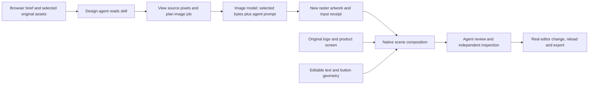

# Reference image direction: local validation

Status: local creative round completed with production-readiness gaps. A working
skill file and passing resource tests are not evidence of universal creative
quality. This document records the sequential validation of the first Design
Agent V1 skill, not a new brand ingestion workflow.

September 13 review: the founder rejected the corrected wide artifact's overall
branding and composition. Removing the invented lighting passed a narrow repair
check; it did not make the creative acceptable. Earlier "usable" labels below
describe an independent draft assessment, not founder approval or a production
quality pass. See `design-agent-v1-harness-audit.md` for the subsequent audit and
proposed evaluation reset.

## Scope and sequence

1. Restore the existing local stack and verify the active brand, original asset
   custody, model configuration, worker availability and browser session.
2. Freeze the current knowledge/tool sources and run a baseline with the actual
   local brand assets. Preserve the brief, attachment IDs, input digests, tool
   events, provider receipts, native scene and rendered output.
3. Diagnose failures at their actual layer: source selection, image transport,
   direction, generated pixels, composition or editor persistence. Repair the
   smallest responsible layer; add a failing regression before a code fix.
4. Run the revised skill sequentially on (a) a close companion background,
   (b) an authentic product screenshot with new surrounding artwork, and (c) a
   new concept in the brand's visual treatment. Retain unsuccessful candidates.
5. Inspect every generated component and the final composition. Verify native
   copy/logo/button separation, an independent source-UI image, and native
   geometry where a true vector is required. Edit, save, reopen and export an
   actual platform artifact; do not substitute a hand-authored demonstration.
6. Capture worked successes and failure repairs in reusable skill guidance.
   Run the applicable regression gate and repeat the relevant live case after
   any behavioral change. Report timing and remaining gaps without claiming
   universal brand fidelity from one brand.

## Acceptance evidence

| Dimension | Required evidence |
|---|---|
| References | Actual inspected pixels and exact model input IDs/digests; library viewing alone does not count |
| New artwork | Real provider output and generated asset custody; distinguish cached results and placeholders |
| Brand fit | Observed subject, treatment, tonal relationships and texture scale compared with the references |
| Product truth | Original product pixels preserved; a generated screen is not authentic product evidence |
| Copy | One supported message, clear hierarchy, optional CTA appropriate to the brief, no invented proof |
| Editability | Native text and independent logo/image/geometry layers, saved and reopened after a real edit |
| Rendering | Full-size and display-size inspection, readable text, intended crop, no broken images or clipping |
| Speed | Request-to-saved-artifact wall time including retries; 3–4 minutes remains a measured target |
| Generality | No brand-specific branches or fixed brand layouts; further brands remain a separate validation gap |

Customer assets, exact prompts, images and raw event logs stay in the ignored
local control-test directory. The separate image-model experiment directory is
read-only and is not copied into this repository. No production changes or
remote publication are part of this validation.

## Results

### How the platform test is run

All creative runs start through the authenticated local project chat. The first
message opens a Design session; the next message supplies the generation brief,
selected existing asset IDs (or an uploaded original), and the instruction to
use `reference-image-direction`. The design runtime discovers and reads the
materialized skill through `/.deepagent/skills/reference-image-direction/SKILL.md`.
The final wide test's actual tool log records both director and author reads.
The materialized bytes match the authored skill. This proves loading and use;
it does not prove that every instruction is followed successfully.
Headline and supporting copy are fixed in these control briefs so the imagery
and composition can be compared. Autonomous copywriting is not validated by
this round. The agent writes the component image prompt and chooses placement.

The existing provider prepends a style-only instruction: generate a new image,
do not copy/crop/edit the reference. That framing was **not changed** here.
Selected reference transport is therefore different from faithful source
reconstruction. Exact logo/UI identity uses source reuse; supported image edits
are a separate operation. New-concept and companion tests must not be described
as pixel-preserving reconstructions.

### Completed comparison

The baseline and first candidate used the same awareness brief, the same source
image bytes and the same configured models. The candidate changes both guidance
and tool capability, so this is a system comparison, not a prompt-only ablation.
The live model configuration was `x-ai/grok-4.6` for the design reasoning and
`openai/gpt-image-2` for artwork. No model upgrade was implied or performed.

| Attempt | Request to saved | Agent runtime | Model calls | Independent result |
|---|---:|---:|---:|---|
| Initial skill baseline | 14m 00s | 13m 57s | 47 | Failed: white copy on pale ground and an opaque app icon; two invalid DSL compiles |
| First revised candidate | 9m 21s | 9m 16s | 26 | Needs repair: exact reference delivered and authentic wordmark used, but copy still weak and logo on a button-like plate |
| Measured contrast repair | 9m 33s | 9m 23s | 35 | Usable awareness composition: dark native copy, authentic wordmark and no white plate; existing artwork reused |
| Authentic product plus new atmosphere | 18m 35s | 18m 24s | 57 | Usable draft with crop debt: authentic UI, new background, native copy/button; some avatars still clipped at the left |
| New concept in wide format | 8m 31s | 8m 19s | 34 | Failed brand review: retained dots and palette but invented luminous points and connecting trails |
| Wide treatment correction | 6m 29s | 6m 13s | 29 | Lighting repair only; overall creative rejected in September 13 founder review. Foreground nodes were unchanged, including the unsatisfactory composition |

These are individual attempts, not median or percentile performance. The repair
adds time to the earlier candidate; it is not a fresh generation in 9m 33s. A
successful repaired artifact cannot be counted as meeting the speed target.

The initial and revised fresh runs both delivered the exact selected source
pixels to the image model. The first revision's provider receipt includes the
selected asset ID, source digest and MIME type. This rules out missing image
transport as the explanation for these two outputs; it does not prove visual
fidelity. The model reviewers accepted both weak initial compositions, which
is why visual inspection and measured contrast were added.

The first revised run reached a preview in 5m 34s, already outside the 3–4 minute
finished-creative target. A browser attachment operation also stalled for about
30 minutes before submission; that tooling delay is excluded from these agent
runtimes and is recorded separately.

### What the repairs established

The awareness repair used the new source-image contrast tool. Independent
conservative regions measured approximately 7.02:1 for the headline and 6.47:1
for support on the preserved background. The resulting dark copy is readable;
the absent reversed wordmark remains a source gap, not a generated substitute.

The product run sent only the original atmosphere image to generation. The
actual inbox screenshot remained a separate original image. The image model
returned a real 1024-square background for the requested square artwork; requested
size was 1536 square. The exported scene is 1080 square. The provider's requested
dimensions are not its actual output dimensions.

The first product review rejected clipped header controls. A later crop fixed
the header but still cuts some avatars. Declared bleed prevents an oversized
child from being a mechanical validation error; it does not certify a good
crop. A general source-rectangle calculation was added to the decision guide
after observing that failure. It was not part of the product run's earlier
materialized context and must not be credited for that run's repair.

Texture fidelity remains weaker than the original reference in the new product
atmosphere. The model receipt proves the selected input, not recovery of the
reference's exact grain, blur or shape structure.

The wide test exposed a more specific error. The test brief requested a new
metaphor for coordinated guest care; the agent invented a luminous constellation.
Its actual prompt supplied glowing orbs and connecting arcs, which were absent
from the selected original. The user rejected that lighting even though the
dotted pattern was closer. Both internal review and an initial independent
assessment over-weighted palette/texture similarity. The result is retained as
a negative case, not counted as a successful branded creative.

The revised skill now separates permission to change a subject from permission
to change its visual treatment. It checks invented motifs, lighting and materials
before generation and during review. A new arrangement of observed forms with
native explanatory copy can be sufficient; a campaign keyword does not require
a literal metaphor. The correction uses the original image again rather than
conditioning on the rejected lighting. Its run is a feedback-driven repair,
not independent evidence that a fresh run will always make the right choice.

The correction returned new model pixels conditioned on the original source
digest. Its 1536×864 raster was cover-fitted into the 1200×628 scene; this is not
native generation at the requested aspect. The subsequent code audit confirmed
that the active adapter snaps 1.91:1 to 16:9 before the provider call; this is
adapter negotiation, not proof that the model ignored its wire request.
Independent inspection confirmed
that the conspicuous glow, sparks and connecting lines were removed. Comparing
saved scenes showed only the background image node changed: headline, support,
wordmark and white plate were unchanged. This fixes the rejected image treatment;
the small supporting line and the overall card composition remain visible
design limitations. The rejected run plus correction took about 15 minutes.

### Editor and export verification

- Awareness support text was changed in the actual browser inspector, saved at
  document version 36, reloaded and observed in the inspector, then restored at
  version 37. Native sizes and authentic logo asset were preserved.
- The product CTA is a native auto-layout shape with its own text node. Its
  label was changed, persisted at version 88, observed after reload, then
  restored at version 89. Fill, padding, radius, type and position are editable.
- Browser PNG export completed successfully. PNG and SVG exports were also
  requested through the canonical document export API with persistence disabled;
  exports did not create new document versions. Actual exported PNGs were viewed.
  The SVG contains independent image layers; a raster inside SVG is not a vector.
- A stale font-library 401 banner disappeared on fresh navigation, which returned
  200 and rendered the brand faces. No frontend cache fix was implemented. The
  hidden mounted designing-status text was not a live editor lock.

A separate live-canvas bug was reproduced during the wide run: its new image
digest returned HTTP 404 while the asset was still being staged. The browser
cached the failure at that unchanged URL even after the document save made the
bytes available. Reloading the page fetched HTTP 200. A mounted-component
regression reproduced the sticky placeholder, then passed after allowing one
retry of settled failures per completed authoritative document load. Ready
images remain cached; ordinary redraws do not retry. The next live run exercised
that exact path: the new digest returned 404 during generation, then 200 after
the save, and the corrected background appeared without a manual reload. The
code was loaded before both requests. This fixes recovery after publication;
it does not make staged bytes publicly available before their existing
persistence boundary.

### Runtime findings

Reducing duplicate direction notes and fixing illegal staging reduced the
first revised fresh run from 47 to 26 model calls, with no invalid DSL compiles.
This small comparison is not a general speed guarantee. The product run needed
57 calls and seven compiles over two rounds; one reasoning call lasted 189
seconds. The 3–4 minute target therefore cannot be solved by image-generation
latency alone. The current director/author runtime remains in place; this work
does not implement a new single-agent runtime.

The next runtime experiment should measure a compact single-owner authoring
loop, with a bounded image dependency and one explicit review/repair pass,
against this recorded baseline. Source selection, original-asset custody,
native scene operations and honest failure reporting must remain intact.

### Code verification and retained gaps

- The reference-selection and image-contrast revision passed the focused
  367-test runtime gate. After the final skill revision, 43 targeted skill,
  materialization, image-selection and contrast tests passed again.
- The canvas publication regression failed before the fix and passed after it.
  All 30 targeted canvas/cache/asset-URL tests passed. The real subsequent run
  also demonstrated 404-to-200 recovery after publication without a page reload.
- Frontend design-system generation, lint and production build passed. Lint
  reports two existing unused-helper warnings in `canvasOperations.ts`, with
  no errors. No engine schema or Rust change was made; the build confirmed the
  existing editor stamp remained current.
- The documented crop transform was checked on 15 rectangle/aspect/anchor
  combinations for source-region containment and preserved image aspect.
  This is mathematical evidence, not semantic crop or rendered-engine proof.

This round does not pass the entire ten-case behavioral matrix. A repeatable
fresh success on multiple brands, autonomous copywriting, precise reference
reconstruction, alpha cutouts, native-vector illustration and a 3–4 minute
finished-artifact runtime remain unproven. The corrected wide treatment is a
specific observed improvement, not a score of 100% or a production rollout.

### Logo identity finding

The active local kit contains an authentic dark wordmark and an opaque app
icon, with no reversed white wordmark. The flattened reference includes a white
wordmark. A fresh lookup returned a pale chevron labeled as a dark-surface
lockup; visual inspection shows that it is only a symbol. The repair correctly
keeps the authentic wordmark rather than substituting that symbol or recoloring
identity pixels. No brand-kit version or ingestion workflow was changed.

This reveals two separate responsibilities: ingestion needs reliable variant
classification, and the design skill must inspect identity pixels and report
missing variants. A provider's `dark_lockup` label is not enough evidence.

### Current scope limits

Source-region contrast is a bounded sample over opaque sRGB pixels. It does not
measure a final rendered composite, actual glyph pixels, overlaid scrims,
transforms, alpha or color-profiled content. The tool reports those limits;
actual copy regions must be mapped to source coordinates and the finished
render inspected. Threshold flags use unrounded ratios.

The scene's default recent-library manifest is capped at 24 assets. The active
kit also supplies older original imagery used in these tests. This change adds
selection among assets already authorized for a run; it does not implement
search over the entire historical library or a new brand-preparation agent.

Cross-brand reliability, repeated successful fresh generations, standalone
cutout alpha and native-vector illustration remain separate evaluation cases.
A single successful repair is not evidence of universal or production readiness.
